# Liu 2025：从稀疏工作量预测到PLL与电源域——CNN/GCN加速器DVFS全流程精读

[从零入门](start.md) · [原图表索引](figures.md) · [双语摘要与导读](abstract.md)

## 核心信息

- 标题：Architecture Design for Reconfigurable and Energy-Efficient Deep Neural Network Accelerators With Dynamic Voltage and Frequency Scaling Techniques
- 标题翻译：采用动态电压与频率调节技术的可重构、能量高效深度神经网络加速器架构设计
- 作者：Siqin Liu
- 机构：Ohio University，Electrical Engineering and Computer Science；导师 Avinash Karanth
- 发表时间：2025年5月
- 发表渠道：Ohio University 博士学位论文
- 论文链接：[OhioLINK原文记录](https://rave.ohiolink.edu/etdc/view?acc_num=ohiou1743094632563429)
- 数据 / 资源：本次分析用户提供的完整135页PDF；引用定位按PDF页码
- 论文类型：硬件架构与学习型DVFS方法，包含多个研究章节

## 原文摘要翻译

过去十年，深度神经网络在计算机视觉、语音识别、自然语言处理、机器人和自动驾驶等领域快速发展。它们在传统与新兴应用中取得的准确率表现，显示了计算能力推动人工智能的潜力。然而，这些性能与硬件层面的高计算和通信成本密切相关，推动了面向高效处理这些开销的新型计算机架构的发展。专门服务于特定应用领域的硬件计算引擎称为深度神经网络加速器。

本论文主要探索利用无线技术，对多层感知机、卷积神经网络、图神经网络及递归神经网络等应用进行硬件加速。首先，提出一种通过无线链路精细组织数据搬移的卷积神经网络加速器，以改善整体能效和吞吐。然后，为扩展到其他深度网络，提出结合数据流探索、稀疏—稠密矩阵乘法优化及动态电压调节的图卷积网络加速器。最后，提出一种基于可重构无线互连的加速器架构，利用强化学习高效适配不同网络变体。

以上忠实转述PDF第3–4页摘要，不加入结果判断。**阅读提醒：摘要最后的强化学习表述，与第120–121页将联合学习互连/DVFS列为未来工作的写法有落差；当前正文不足以认定已经完成一套RL控制器实验。** 摘要后的家人献辞不属于摘要内容。

**English abstract paraphrase**： This dissertation studies energy-efficient neural-network accelerators through communication-aware architecture design. Its main technical threads include wireless data movement for CNNs, workload prediction and voltage/frequency adaptation for sparse computation, and graph-accelerator co-design involving dataflows, column organization, and DVFS. The detailed chapters are useful for reconstructing how workload observations become operating-state requests. Their evidence is primarily architectural simulation and technology-library-based estimation. The final reinforcement-learning direction should be distinguished from an experimentally demonstrated controller in the supplied dissertation.

## 创新点

这本论文的价值在于把“需要算多少”与“硬件应该以什么电压、速度运行”联系起来，同时承认数据搬移也可能比计算更昂贵。各章贡献不同，不能把整本书的收益都算成DVFS收益。

| 章节与PDF位置 | 实际贡献 | 和你的数字DVFS课题的关系 |
|---|---|---|
| 第3章，44–65页 | e-WiNN：无线/有线混合互连、数据流映射、可变精度MAC | 说明通信与计算必须共同计费；该章的主要收益不是DVFS |
| 第4章，67–90页 | 从稀疏计算轨迹预测下一窗口工作量，再选择PE的电压/频率与门控状态；比较细、粗粒度 | 最适合学习“输入—预测—阈值—档位—反馈”的数字控制链 |
| 第5章，92–118页 | GraFNet：GCN数据流、列重排/合并、片上网络与列级DVFS协同 | 最适合学习co-design，以及策略如何落到PLL/电源域接口 |
| 第6章，120–121页 | 更广网络与强化学习互连/DVFS联合优化的展望 | 可作后续研究问题，不能当作已验证算法 |

创新定位需要回到原发表版本：第3章脚注关联2022年工作，第4章明确关联HiPC 2021，背景章介绍的HSCONN对应2024年工作。**2025是学位论文年份，不代表每个机制首次发表于2025。** “把现有预测、门控和互连整合到一个架构”与“发明一种全新学习算法”也要分开评价。

## 一句话总结

它利用神经网络计算中的稀疏性和不均衡性，预测每个执行域下一段时间的有效工作量，再用规则把预测结果映射到电压/频率档位；同时设计缓冲、数据流和互连，让慢下来的硬件仍能正确接收并完成任务。

## 研究问题

### 先建立一幅能看懂的图景

设一个加速器有许多乘加单元。某一小段时间内，有的单元拿到大量非零乘法，有的拿到许多零。若所有单元一直运行在最高电压和最高频率，轻负载单元会浪费能量。若一律降到最低档，忙的单元可能堵住整个计算过程。

论文研究的不是“训练一个网络让识别更准”，而是“在神经网络已经承担识别任务时，用另一个小型预测器帮助配置硬件”。**被控负载网络**是AlexNet、VGG等；**控制算法里的预测网络**是DP。前者消耗主要计算资源，后者产生控制依据，二者输入、输出和评价标准不同。

| 术语层级 | 先用直觉理解 | 本文严格用途 |
|---|---|---|
| 基础：PE、MAC | 一个小计算工位；一次乘后累加 | PE处理乘加；MAC计数可描述有效计算量 |
| 基础：V/f、OPP | 合法的“电压和速度套餐” | 必须先验证该电压足够支持该频率，策略只从合法表选 |
| 基础：稀疏率 | 有多少元素是零 | 非零密度等于1减稀疏率，两者方向相反 |
| 进阶：epoch | 控制器过一小段时间重新决策 | 此处主要指硬件观察/控制窗口，不等于模型训练遍历一次数据 |
| 进阶：OS | 当前结果留在本地累加 | Output Stationary减少部分和搬移，并不自动解决所有跨时钟通信 |
| 进阶：DP、SD、DVFG | 预测员、计数员、执行配置模块 | 分别负责预测、检测稀疏性和生成V/f控制 |
| 实现：CDC、SIMO | 不同速度工位交接；一套转换器供多条轨 | 跨时钟域传输和单电感多输出电源涉及专门实现约束 |

**可证伪的核心假设（读者归纳）：** 稀疏工作量存在可预测性；利用这一先验选择较低档位，节省的计算/漏电能量能够超过预测、切换、缓冲和额外执行时间的代价。若负载突变频繁、预测失败或电源转换太慢，该假设就可能失效。

### 推荐阅读顺序

第一次读先看本笔记第4章方法的“输入/触发/输出”表，再看表4.1和算法2；第二次读缓冲及粗细粒度；第三次看图5.8的PLL/SIMO；最后看实验与复现清单。背景里的Transformer和第3章无线电路并非理解你的数字控制器的前置门槛。

## 数据与任务定义

### 真实研究对象与证据边界

| 工作 | 被控任务/具体程序含义 | 平台与材料 | 此次可确认的验证层级 |
|---|---|---|---|
| e-WiNN | CNN卷积/全连接层；ResNet、AlexNet、VGG等数据流执行 | 数字逻辑14nm库、RF相关45nm模型、周期级架构分析 | 混合模型与综合估计，不是同一节点完整芯片实测 |
| 第4章CNN DVFS | 稀疏CNN映射到16×16 PE阵列；AlexNet、VGG16、ResNet50 | RTL综合与45nm库配置、能耗分析；CIFAR-10相关训练/测试轨迹 | 库表征与架构仿真；当前材料未展示实体PMIC轨波形 |
| 第5章GraFNet | GCN、GIN、GraphSAGE的矩阵计算；图数据集详见本节说明 | 周期模型与45nm综合、存储估计；若干基线按原文软件环境重建 | 加速器模型评估，不能当作一块FPGA实现全部独立电源域 |

不同图的集合不完全相同：图5.15还出现Collab；不能为了让实验表整齐，就把每幅图都写成完全相同六数据集。第4章只给出预测训练的部分说明，精确训练轨迹划分、隐藏维度、随机种子及全部超参数仍不足以按字节重建。第5章软件环境中的Xeon E5-2680 v3和RTX 8000是参照/运行环境信息，不能换写成E902实测。

本次读完135页正文与前后材料、参考编号1–142，并逐项查看42幅图、15张表及2段算法原页；主文嵌入28项关键原图表，其余进入完整索引。参考条目读过不表示142篇外部论文全文均已精读。自动提取器把部分方法并入“conclusion”章节，也曾只扫描前40页资产；本笔记按PDF真实章节和完整人工页图补核，不能以自动章节名称判断缺少方法。

### 评价量先约定清楚

能量是一次任务所消耗的焦耳，平均功率是瓦特，延迟是秒，吞吐是每秒完成任务数，能效可用每焦耳推理次数。功率下降并不保证能量下降，因为执行时间可能变长。本文多处使用归一化量：能量、延迟低于1通常更好，而能效、加速比高于1更好。EDP是能量与延迟的乘积；比较时必须保持任务数量和正确性一致。

与医学样本相关的伦理/生物重复在这里不适用。对应应检查的是输入图/模型、数据集划分、设备或模型配置、重复运行、随机种子、温度、活动率及统计误差。当前图表没有提供足以重建全部置信区间的重复测量记录，不能补造显著性。

## 方法主线

### 机制流程

1. **提取需求：** 输入权重、激活及其执行轨迹；SD统计当前窗口有效工作和稀疏性，输出特征到DP。GCN还要先决定数据流及列组织，使观测对象与实际映射一致。
2. **预测并更新档位请求：** 输入历史/当前特征与离线训练参数；DP预测下一窗口工作量，控制逻辑解码预测结果、按策略阈值查合法档位表，输出目标状态到DVFG或列控制器。
3. **执行配置并交接数据：** 输入目标状态和当前执行状态；频率/电源模块配置执行域，接收缓冲保存未完成工作，输出实际可工作的PE域。物理实现还需要电压稳定、时钟锁定等反馈约束。
4. **核对完成与继续反馈：** 输入完成标志、缓冲积压、能量/时间记录；将实际结果与预测比较，下一窗口重新观察。统计结果回到评估与后续控制；在线重训练不是这套离线预测方案已经证明的步骤。

### 1．先隔开第3章：无线数据流优化不能冒充DVFS

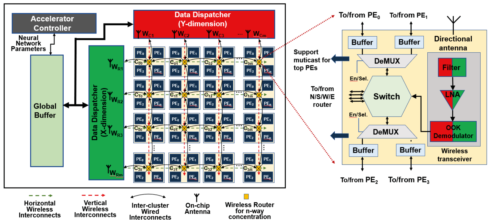
*Figure 3.1，PDF第48页：e-WiNN有线/无线混合互连与路由器。看PE簇、无线全局通道和有线邻接路径，而非寻找电压阈值。*

第3章通过改变数据怎样送到PE、哪些数据复用、采用4/8/16位等精度，减少通信或算术开销。它说明co-design的含义：同一计算任务，不同搬移路径会改变总能量。可是该章并没有证明“只调V/f得到同样节能率”。第60页明确未计运行时重配置控制器的完整面积/能耗，这是评价净收益的缺口。

对你的课题，可迁移的是建立总开销账本和固定数据流基线。是否开发无线NoC不在你已确定的数字DVFS控制器范围内。

### 2．第4章：输入究竟是什么，什么时候调档

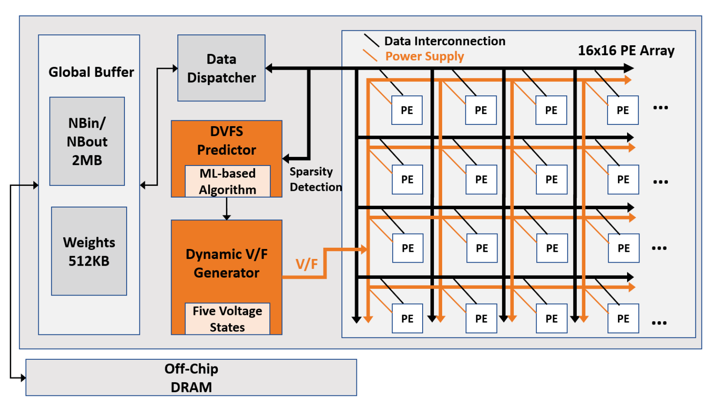
*Figure 4.1，PDF第68页：全局缓冲GB、分发器DD、预测器DP、频压生成DVFG及16×16 PE。先沿数据路径走，再沿控制路径走。*

| 环节 | 原文给出的东西 | 输出给谁 | 初学者最容易混淆的点 |
|---|---|---|---|
| 数据输入 | 神经网络权重与激活，由GB/DD送入PE | 乘加单元及检测单元 | 不是把“图片类别”直接接成电压值 |
| 控制观测 | 稀疏性、非零权重/激活数量、窗口工作量与历史信息 | DP | 各段定义不完全一致，不能伪称一套唯一特征向量 |
| 决策触发 | 观察/控制窗口边界；正文还讨论变化门限减少更新，算法2未完整展开该门限 | 选档逻辑 | 不是只在程序启动前选一次，也不是每个MAC必调一次 |
| 策略输出 | 目标DVFS状态或V/f对；低负载可选门控 | DVFG及电源/时钟模块 | 预测工作量不是实际输出电压，必须经过映射与执行 |
| 正确性反馈 | 剩余工作、缓冲占用与执行完成 | 下一窗口/评估 | 原文未给出可直接套用到任意SoC的完整寄存器协议 |

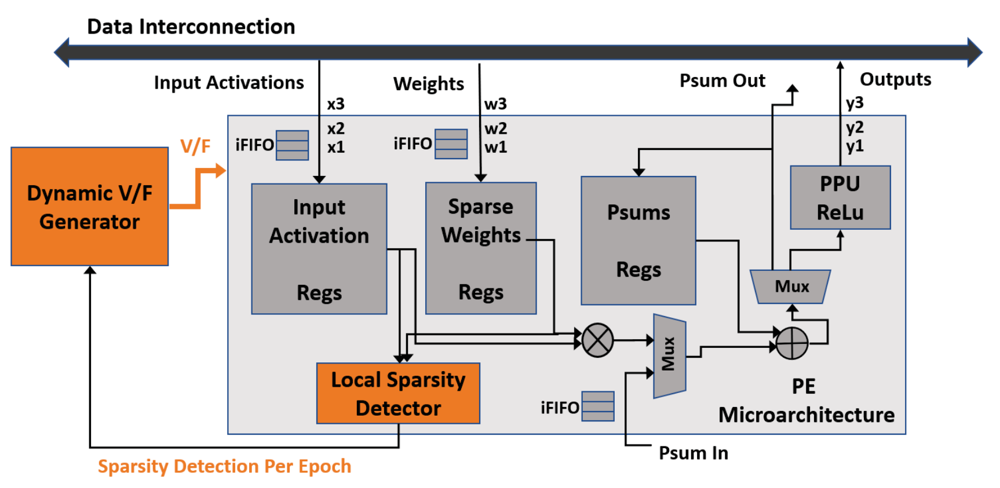
*Figure 4.2，PDF第70页：PE内含稀疏检测、寄存器、乘加/激活和频压控制。控制器与被控计算逻辑是不同职责，可以在同一芯片架构内。*

**为什么零会变成调档依据？** 若乘法任一操作数为零，可以跳过该次实际乘法。在映射、带宽等条件不变时，有效乘法更少通常意味着某段计算可更慢执行。权重的零往往较静态，激活的零随输入变化，所以仅在编译期看权重不能完全知道运行时需求。

原文式4.1写为：

$$
\mathrm{SparseWorkload}=(F^2-S_w)O^2-F(F-S_a).
$$

这里卷积核边长为 $F$，输出空间边长为 $O$，$S_w$ 与 $S_a$ 按附近文字分别联系零权重/零激活数量。该式不能直接当复现真值：若令全部权重为零，即 $S_w=F^2$，而 $S_a=0$，结果成为负数；全密时也出现额外扣项。源页核对后仍存在定义/适用范围问题，不是简单OCR漏字就能确定修正。

**读者复现方案：** 对映射到某PE某窗口的每个合法乘法配对，只有权重与对应激活都非零时才计一次有效MAC；除以该窗口约定的最大可服务MAC数得到负载比例。要保留卷积边界、输入通道、输出通道和padding映射，不能简单把两个张量的非零比例相乘当成精确真值。这个逐配对计数是用于校验的替代定义，不能声称作者就是这样实现式4.1的。

### 3．预测器如何训练，预测的量如何变成档位

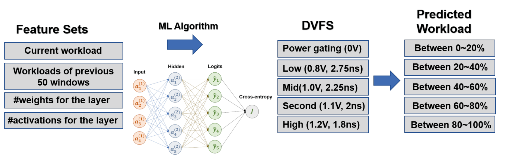
*Figure 4.4，PDF第76页：示意网络有四类输入标记、隐藏节点及五个工作量区间。它是理解分类预测的入口，不是完整可执行网络配置。*

图4.4标出当前工作量、之前50个窗口的信息、层权重数和层激活数，并画出0–20%、20–40%等五个输出区间。正文又用稀疏率与非零数量描述输入；算法1使用的符号为权重、激活和相应计数，部分X/A命名不统一。**因此能确认的是“从已有信息预测动态计算需求”的结构，不能从这几处拼出作者唯一、无歧义的输入维度。** 之前50个窗口是一组历史描述，也不自动等于一个标量输入。

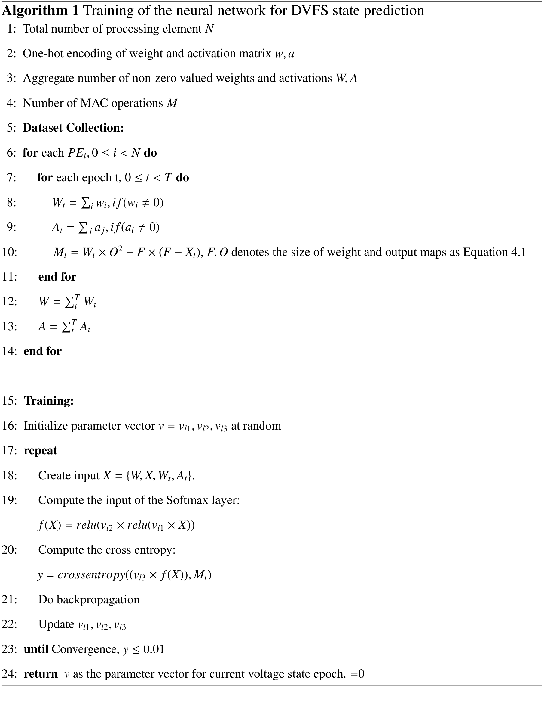
*Algorithm 1，PDF第78页：离线训练流程。请按输入、编码、前向、损失、权重更新顺序读；不要跳过标签定义。*

算法1意图是：先从负载执行中采集窗口特征及目标工作量，编码为训练样本；经过网络计算预测，使用交叉熵优化参数；训练后将参数用于硬件预测。它不是运行时通过真实能量奖励反复试错的Q-learning。图4.10又用Polynomial 4/16标注预测配置，当前材料不足以把这些名称直接解释成图4.4隐藏层宽度。

复现前必须补清三件事。第一，交叉熵需要类别标签，而连续目标工作量如何分箱没有完整统一到算法。第二，决策时只能使用已经观察到的数据；若总激活计数需要未来执行才能获得，就不能作为在线先验。第三，训练集和测试集不能随机拆相邻高度相关窗口而不检查泄漏；应至少按输入样本或完整轨迹留出。

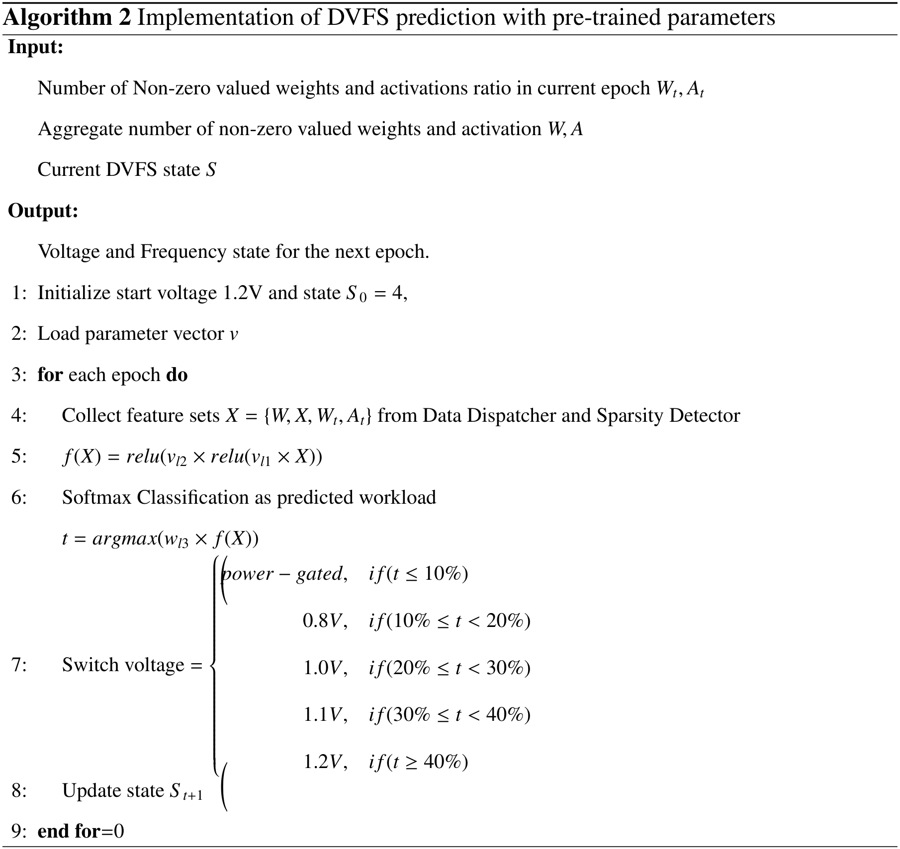
*Algorithm 2，PDF第79页：运行时预测与状态更新。原文argmax结果与百分比比较之间缺少明确解码步骤。*

正文另讨论工作量变化较小时避免频繁更新，但算法2逐epoch直接预测并映射，未把完整变化死区判断展开。伪代码将argmax得到的类别索引直接与百分比比较，初始化状态0起算又与正文模式编号存在约定差异。真正编程时必须区分：类别编号、类别代表的负载范围、负载百分数、档位编号。这四种量不能共用一个整数而不说明转换。

建议实现时先固定一种可审计约定，例如用分类器给出下一窗口负载区间，再按保守区间上界查档；或者直接做负载回归再查档。两者是**读者的复现补全分支**，应分别报告，不能挑有利结果后声称完全复现作者算法。

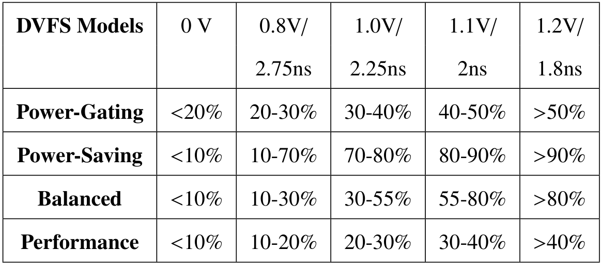
*Table 4.1，PDF第72页：五个状态与四类阈值策略。这些百分数是预测工作量区间，不是分配给各档的PE百分比。*

| 状态 | 电压/时钟周期 | 由周期换算的频率 | 含义 |
|---|---|---|---|
| Off | 0V | 不执行 | 电源门控；残余任务要保留 |
| 低档 | 0.8V / 2.75ns | 约363.6MHz | 有效低负载慢执行 |
| 中低档 | 1.0V / 2.25ns | 约444.4MHz | 更高供给 |
| 中高档 | 1.1V / 2.00ns | 500MHz | 更高供给 |
| 高档 | 1.2V / 1.80ns | 约555.6MHz | 最大供给 |

频率为时钟周期倒数；这些是该工艺/架构假设下的配对，不是E902的合法OPP。表中PG阈值为20/30/40/50%，PS为10/70/80/90%，Balanced为10/30/55/80%，Performance为10/20/30/40%。各段有端点约定不清的地方，复现时要明确小于、等于归哪边。

**算例（读者演示）：** 假设解码后的预测工作量为56%，无历史积压且安全执行器允许切换。PS选0.8V低档；Balanced选1.1V；Performance选1.2V。相同输入可以得到不同输出，因为策略偏好的性能—能量取舍不同。预测器并没有独自“算出唯一最优电压”。若有大量积压或截止期临近，直接照表可能不安全，需要另加约束层，并标明属于你的扩展。

### 4．频率不一样，为什么结果不会错乱

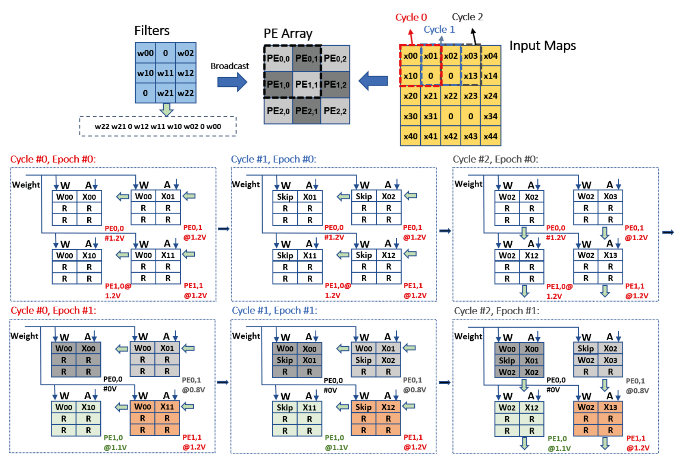
*Figure 4.3，PDF第73页：3×3卷积映射的逐周期、逐epoch示例。第一窗口各PE在1.2V，后续窗口按工作量变为不同电压，慢域输入留在缓冲中；这不是粗细粒度对照图。*

第4章采用OS思路，让一个输出的部分和尽量留在本地PE累加。于是相邻PE并不必在每个相同墙钟时刻产生同一步结果。但DD仍按固定发送节奏送数据，慢PE来不及消化时，输入需要先存入缓冲。**“计算完成的时刻不同”可以允许，“某个输出缺了一个乘积或用了另一个任务的数据”绝不允许。**

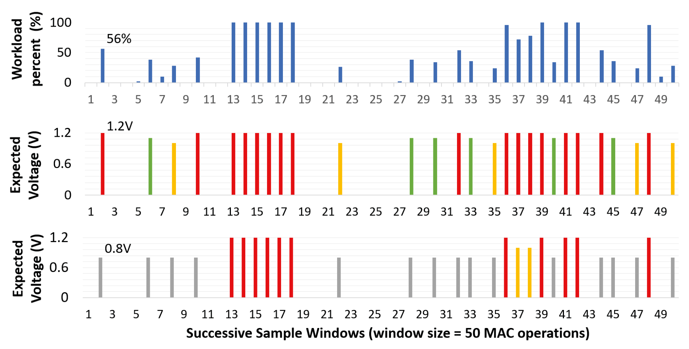
*Figure 4.5，PDF第81页：同一串工作量，分别映射到Performance和Power-Saving期望电压。首个56%例在两策略下对应1.2V和0.8V；横轴标注50 MAC operations窗口，不等于已经测得的50周期切换波形。*

低于门控阈值也可能仍有非零任务。作者的思路是暂存并合并到后续活跃窗口执行，缓冲仍需工作；不是把这些乘法当零删除。由此产生一个重要系统状态：**当前窗口的新工作加上之前积压，才是实际待服务需求。** 若预测器只看到新输入不看积压，会反复低估需求。

原文有缓冲、共享及本地累加的架构依据，却没有展开全部CDC/复位/事务隔离协议。以下是实现时应补上的工程设计，不冒充作者已验证模块：数据包保留层号、tile或输出坐标；跨异步时钟用经过验证的FIFO/握手；满缓冲反压DD，不能覆写；每个输出记录应收贡献数或明确结束标记；域切换前处理在途事务，切后恢复；汇合处等待所有贡献到齐再提交输出。只用“两级触发器”同步整条多位数据总线是不够的。

粗粒度按行共享权重缓冲与控制，能减少控制数量、利用行内复用；代价是同一行所有PE不得不迁就一个共同频率。物理实现时，多个独立电压域还需要电平转换、关断隔离、状态保持和电源分配，这些不因架构图画了多个方框就自动完成。

### 5．控制间隔不是想多短就多短

第70页援引参考20的8.8ns唤醒和6.9ns电压切换，并提出epoch至少200ns。这是引用和模型假设，不能等同于当前板上PMIC的实测。后来实验又讨论50cycles缓冲较优、100cycles能量较优；按最高档1.8ns周期，分别是90ns和180ns，低于200ns。其周期属于哪个时基、与50 MAC窗口如何对应，必须进一步澄清。

你的控制间隔应由真实系统开销决定。一次决策除了计算策略，还包括寄存器/总线访问、PMIC稳定、PLL锁定、事务排空、恢复和可能的测量等待。若这些开销接近窗口长度，控制会大部分时间停在切换中。最小驻留时间、负载变化死区和失败回退能抑制抖动；这些参数要由接口与实测确定，不能复制这里的纳秒数。

### 6．第5章为什么要先改变数据流，再谈DVFS

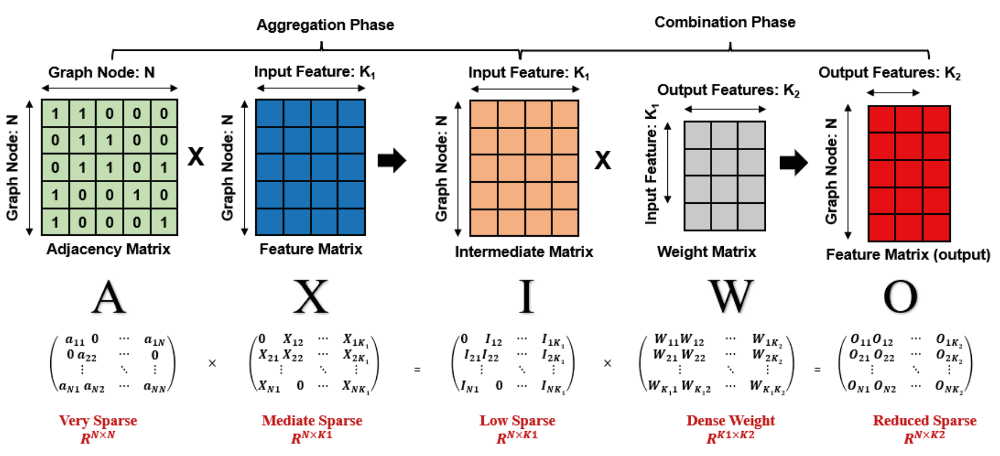
*Figure 2.2，PDF第31页：图卷积可以拆为聚合和组合两次矩阵乘法。矩阵大小和稀疏度决定通信/计算需求。*

设邻接矩阵为 $A$，节点特征为 $X$，权重为 $W$。

三者尺寸依次为 $N\times N$、$N\times K_1$、$K_1\times K_2$。

忽略非线性等操作讨论这一线性部分时，输出为 $AXW$；既可先算 $AX$ 再乘权重，也可先算 $XW$ 再做邻接聚合。两种次序的中间矩阵大小不同，适合的数据搬移与多播方向也不同。不能把整层非线性随意跨过这两个乘法重排。

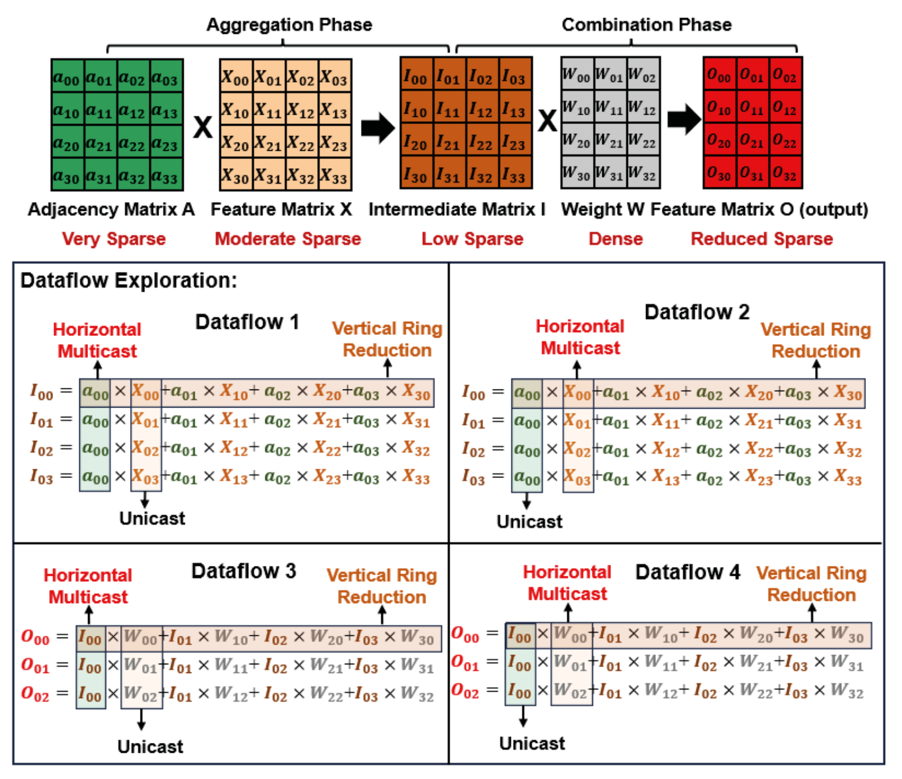
*Figure 5.7，PDF第102页：四种数据流展示广播哪个操作数、单播哪个操作数、沿哪个方向归约。先看乘积的下标，再看箭头。*

D1/D2围绕先聚合的路径，区别在邻接元素与特征元素的分发；D3/D4围绕先组合路径，区别在特征与权重的分发。图的后两个示例着重画组合计算式，不能只凭四象限就推定每个完整阶段的周期时序。论文依据图数据特征选择数据流，相关数据搬移成本列于表5.1。

Cora/Arxiv、Citeseer/Pubmed、NELL、Reddit分别偏好不同配置。

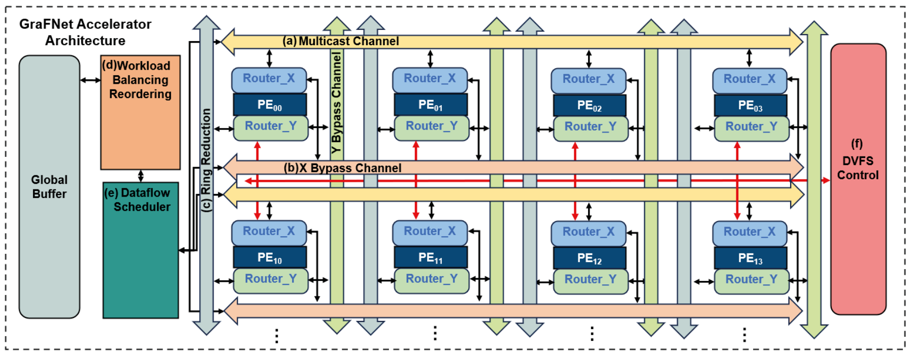
*Figure 5.2，PDF第95页：GraFNet路由结构。X/Y子路径与单播、多播、旁路及归约共同服务局部复用。*

互连让中间结果尽量留在局部，避免每步回全局缓冲。减少搬移可能同时提高速度和降低能量；这与DVFS通过放慢计算换能量不同。因此看到整体“速度提高且能耗降低”，不能反推只降频也会同幅提速。

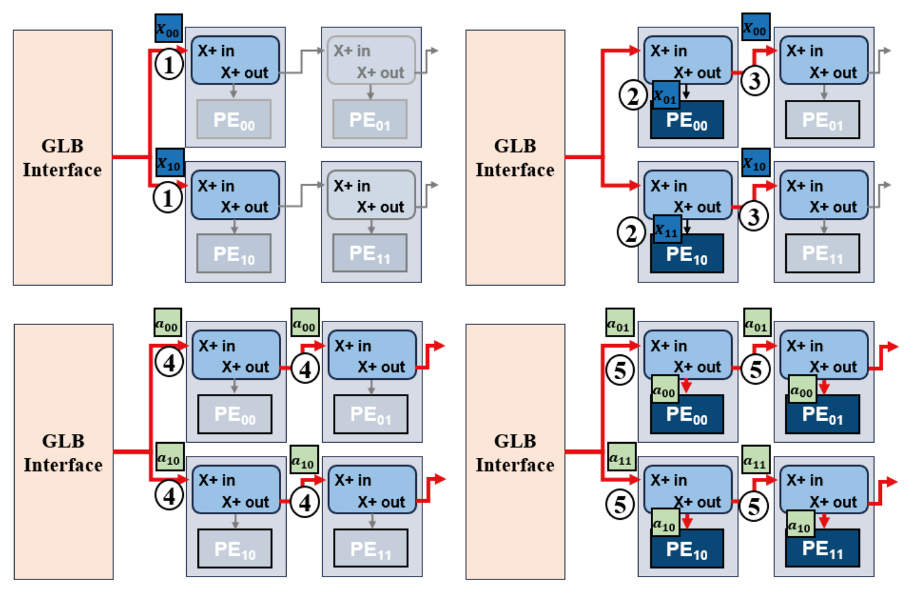
*Figure 5.4，PDF第99页：五个步骤演示片上网络传递。蓝色为输入特征，绿色为邻接项，红箭头给出传递方向；它解释数据复用，不是列合并图。*

先沿编号1–3看特征进入、向右传递和PE接收，再看4–5步邻接项经过时复用已送到的特征。慢PE必须能暂存或反压；图中逐周期路径不直接证明动态异频时的CDC协议。

### 7．列重排/合并究竟改了什么

GCN邻接矩阵有些列很稠、有些很稀。若每列机械分配相同计算资源，轻列闲置、重列拖尾。GraFNet先按密度组织列，再对非零位置不冲突的列进行分组/合并，提高硬件列利用率，随后为不同列域选档。

**教学算例：** 列甲只在行0、3有非零项，列乙只在行1、2有非零项，可在一个打包容器中放置，但每个项仍要携带它来自甲还是乙的归属。若丙也在行3有项，就不能在不加额外槽位/调度的前提下直接覆盖合并。结束时按原列索引还原输出。这里合并的是存储/调度容器，不是把两个图节点在数学意义上合成一个节点。该例是读者解释；原文没有提供足以确定唯一遍历顺序、冲突处理和复杂度的完整伪代码。

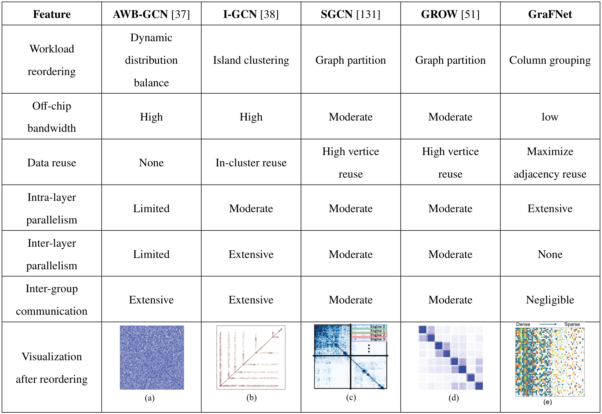
*Table 5.2，PDF第105页：重排、复用、并行和通信的定性对照。GraFNet的跨层并行一栏明确为None，并非每一项都优于其他设计。*

第101页将 $2E/N^2$ 称为Sparsity，但按常见无向图、边计数约定它更接近非零密度；自环、方向和归一化会影响精确计数。控制器若把“稀疏90%”误当“工作量90%”，动作方向会反转。应在自己的trace字段里直接写明zero_fraction与nonzero_fraction，避免只写一个歧义的sparsity。

### 8．列级DVFS用什么策略

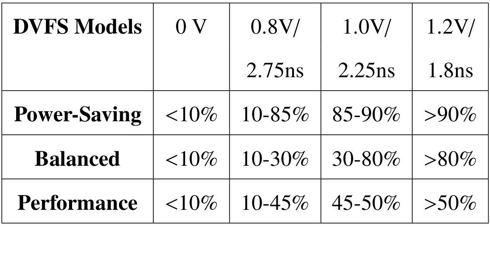
*Table 5.3，PDF第109页：GraFNet为关断加三个有效V/f状态，三种策略。与第4章五状态配置不同。*

| 策略 | Off | 0.8V / 2.75ns | 1.0V / 2.25ns | 1.2V / 1.8ns |
|---|---|---|---|---|
| Power-Saving | <10% | 10–85% | 85–90% | >90% |
| Balanced | <10% | 10–30% | 30–80% | >80% |
| Performance | <10% | 10–45% | 45–50% | >50% |

这些是源表阈值。附近正文出现70/40阈值、称四种策略等说法，与本表不一致，不能混合成一套“作者精确代码”。第4章分类网络和第5章列规则也不该默认是完全相同的学习器配置。

控制对象此时是一列或一组PE的执行域；观测应与重排后的任务分配相匹配。数据变得更集中以后，忙列应服务更多有效工作，而不是因为“重排减少了全局零数”就全阵列降频。若小于10%却仍有非零项，关断仍需延期保存和唤醒条件；截止期和缓冲容量不能从表中推出来。

### 9．PLL和电压端到底做了什么

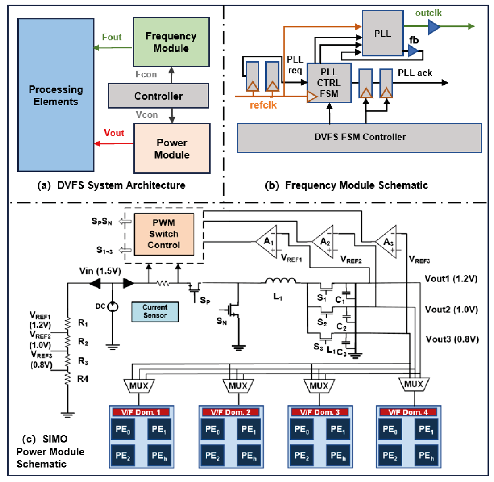
*Figure 5.8，PDF第108页：上左是控制分工，上右是PLL请求/确认FSM，下部是单电感多输出SIMO及每域电源MUX。此图是联系你现有PLL/PMIC模块最重要的一张。*

图5.8子图甲把频率请求送给频率模块、电压请求送给电源模块，再把时钟和供电送到PE。

子图乙明确画出PLL请求/确认、控制FSM及参考/反馈时钟路径；因此说这篇“完全没有握手”不准确。

子图丙假设1.5V输入，通过开关、电感、电容、比较/参考和PWM形成1.2/1.0/0.8V输出，再经Power MUX分配给V/f域。

要区分三个层面：**数字策略决定要哪个状态；数字执行器组织配置与等待；模拟/混合信号电路真正产生电压和时钟。** 若你已有PLL/PMIC，就主要实现前两者的接口适配；不必因此重新设计SIMO功率级。图中有请求确认框图，但确认究竟代表寄存器接受、PLL锁定还是输出已可用，电压稳定门限、负载瞬态和跨轨干扰如何约束，当前正文没有展开为完整波形与接口规范。

**你的实现补全建议：** 对一个供电域，由已验证OPP表请求从低档升高档时，先升压并确认稳定，再安全切频；降档时先降频并确认，再降压。若域关断，还要另处理状态保留、隔离、在途数据和唤醒。用一个常开参考时钟驱动执行FSM；等待超时进入经验证的安全状态并上报错误，不能等到被切掉的目标时钟恢复才继续执行FSM。这是通用执行设计建议，不是本论文已经给出的完整状态图。

多PE异频更需要域间FIFO或握手。频率有相位差且会变化，不能只按“第100拍大家都到齐”硬对齐。结果按事务和输出坐标对齐，由完成条件而非相同时钟边沿决定提交。

**FPGA验证边界：** 可以综合数字控制器、计数器、预测器、合法OPP查表、协议适配与错误回退；可按器件支持使用片上时钟资源验证切频。但FPGA逻辑不能仅靠例化RTL变出SIMO里的电感、模拟电压轨或任意独立PE电源域。真实调压要开发板开放受控电源轨和外部器件接口，且电压范围符合器件要求；否则只做频率验证或用PMIC/PLL行为模型，报告相应边界。

## 关键结果

### 1．第3章结果只证明通信/精度架构的潜力

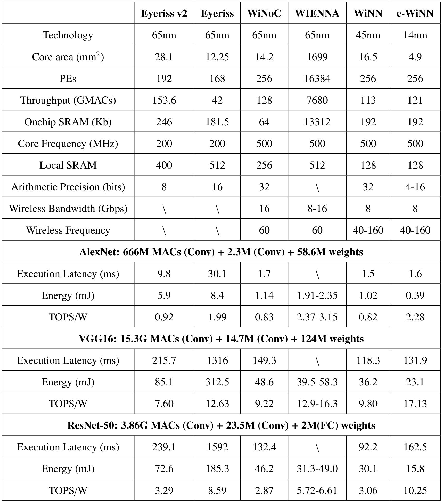
*Table 3.4，PDF第62页：e-WiNN与多种CNN加速器的配置/性能比较。先检查节点、资源和精度，再读能效。*

作者报告相对有线网络的延迟/能量改善，以及相对WiNN的能量/面积取舍；但表中工艺、频率、资源不同，MAC精度也会改变准确率。表3.3中4位与更高精度的识别准确率存在明显差距。不能把低精度少算、无线减少搬移的收益算到DVFS名下，也不能把不同节点的列当作同一颗芯片的受控实验。

### 2．CNN：节能伴随吞吐损失，比较基线要说全

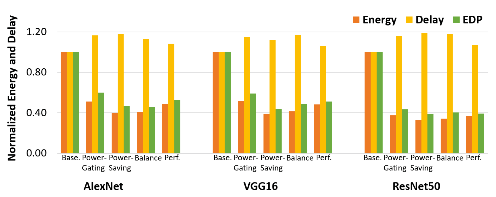
*Figure 4.9，PDF第84页：总能量与延迟，按网络和策略比较。归一化能量/延迟越低越好。*

正文对PS报告总能量降低约60–67%，同时吞吐下降约11–14%。吞吐下降不能直接写成同百分比的延迟增加，它们在固定任务数量下互为倒数。这个基线不包含同样的稀疏优化单元，并保持较高V/f；因此数字混合了跳零、门控与DVFS等因素。要证明DVFS的单独增益，还需固定相同跳零结构、映射和控制器配置，只改变档位策略。

PG策略并非一定总能量最好。频繁进入/退出门控造成切换和等待，可能吃掉漏电收益。图4.8画的是动态/静态能量分项，附近用词又有静态功率，不能把两者当同一个量。HiPC原发表摘要中的59–66%动态能量与69–80%静态功率，是另一表述口径，不能替代这里的总能量/吞吐配对结论。

### 3．控制器开销、预测精度和buffer一起看

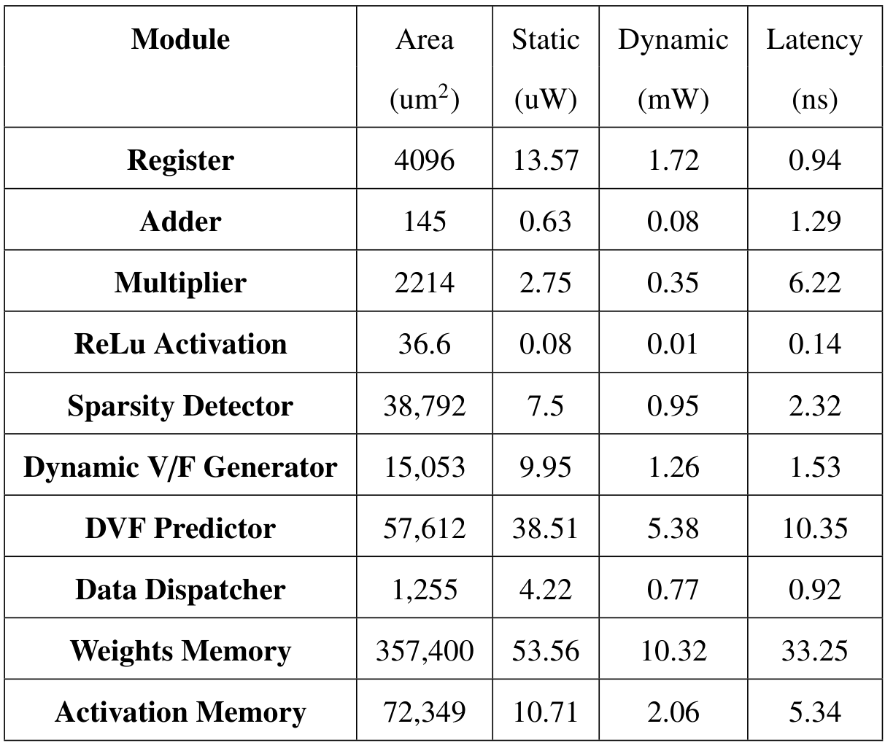
*Table 4.2，PDF第80页：组件面积、静态/动态功耗和延迟。数值应按列读，不能把下一组件功率串列。*

| 组件 | 面积，μm² | 静态功率，μW | 动态功率，mW | 延迟，ns |
|---|---:|---:|---:|---:|
| DP预测器 | 57612 | 38.51 | 5.38 | 10.35 |
| DVFG | 15053 | 9.95 | 1.26 | 1.53 |
| SD | 38792 | 7.5 | 0.95 | 2.32 |

这是源表的库/综合估计，不能不乘实例数/活动时间就称全系统常数开销。表内某些算术单元延迟与最短1.8ns时钟周期还需流水级与时序路径说明，不能从单个组合延迟直接宣判整机一定不能运行，也不能默认已经满足STA。

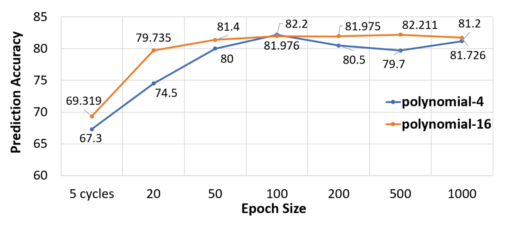
*Figure 4.10，PDF第85页：窗口变长，预测正确率先提高后趋缓。Polynomial 4/16是源图配置名，当前材料不足以等同于隐藏层宽度。*

从图中可读到小窗口正确率较低，约50个周期以后改善变缓。举例，Polynomial 4曲线从5周期约67.3%提高到50周期约80%，100周期约82.2%。这并不意味着“82%正确率已足够安全”：把高负载误分成低档，可能比反向误分造成更严重的积压或违约。需要混淆矩阵、误差方向和最终能量/截止期评价。

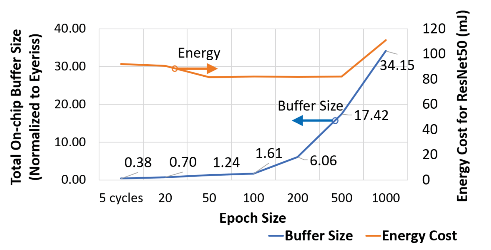
*Figure 4.11，PDF第85页：窗口长度同时影响能量和额外缓冲。双轴分别读取，不能混成一条“越长越好”的结论。*

源图归一化buffer在50周期约1.24，100周期约1.61，200周期约6.06，500周期约17.42，1000周期约34.15。50周期的1.24可理解为相对基线约24%增加。正文称100周期能量较好，但能量曲线部分区间接近，不凭柱高估出未标精确值。更长窗口减少决策频率，却让慢域积攒更多输入，形成面积代价。

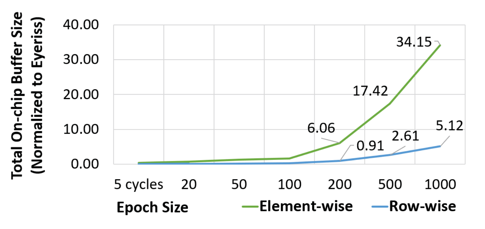
*Figure 4.12，PDF第87页：粗粒度行共享与细粒度独立PE的buffer面积，随窗口增长的差异。*

在200周期点，源图细粒度约6.06、粗粒度约0.91，对应缓冲约6.66倍差异。不能因为一行16PE就断言全部buffer必然缩小16倍：权重可共享而激活、排队与输出状态未必同样共享。

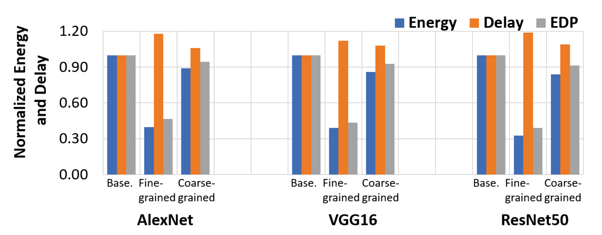
*Figure 4.13，PDF第87页：粗细粒度的能量和延迟代价。粗粒度节省实现复杂度，并不必然最省计算能量。*

作者对AlexNet讨论粗粒度能量约为细粒度的2.25倍，同时延迟相对细粒度降低约18.2%。这体现粗粒度可能过度供给部分PE，执行更快却耗能更多；不能把“控制域少”直接等同“总能量最低”。

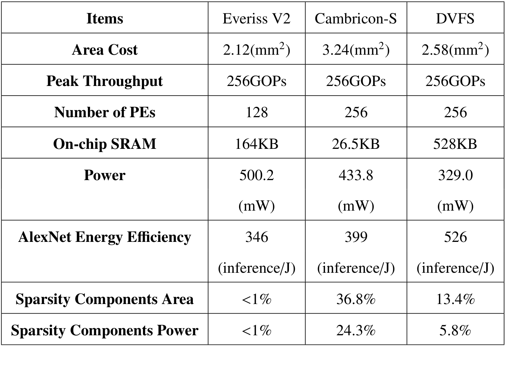
*Table 4.3，PDF第89页：与Eyeriss V2、Cambricon-S对照。相同工艺或峰值吞吐并不等于相同资源。*

表列45nm，面积约2.12/3.24/2.58mm²，PE数量128/256/256，SRAM为164/26.5/528KB，功率500.2/433.8/329mW，AlexNet能效346/399/526 inference/J。必须把这些配置一起引用。528KB远大于另外两项，可能改变数据搬移；表中的峰值256GOP/s对齐声明不能取代完整资源/带宽/精度公平性。

### 4．GCN：先看哪些东西一起改变了

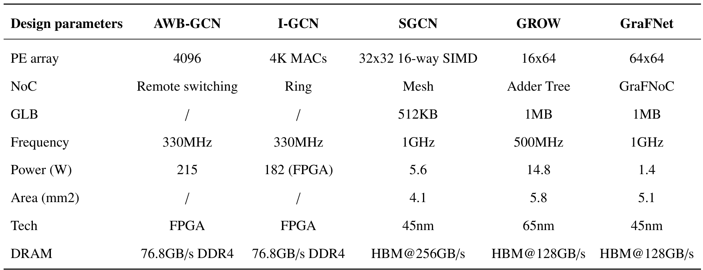
*Table 5.6，PDF第112页：FPGA与45/65nm架构、不同频率和带宽并列。它是配置表，不是统一芯片实测排行榜。*

GraFNet列为64×64 PE、45nm、1GHz、1MB全局缓冲与128GB/s；其他列含FPGA 330MHz、不同ASIC工艺/频率/带宽。这里的1GHz配置又与表5.3最高1.8ns周期之间有时基/配置解释需求。正文重建若干基线可以提高可比性，但不能把源表FPGA百瓦数字直接除以模型1.4W，宣称同任务实测省电若干倍。

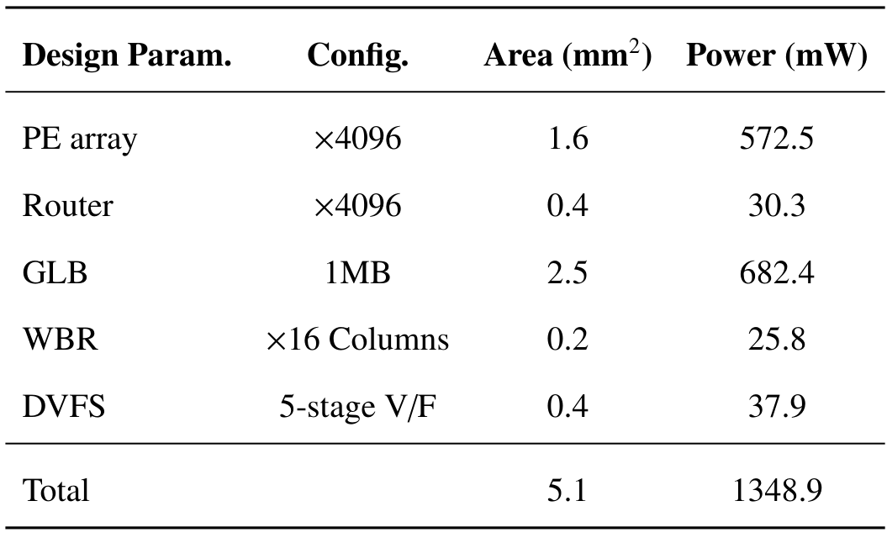
*Table 5.8，PDF第113页：GraFNet组件预算。总和可核算，但域数和活动率仍有疑问。*

源表面积合计5.1mm²，功率合计1348.9mW，作者约写1.4W；其中GLB为682.4mW，PE阵列572.5mW，DVFS为37.9mW约占总计2.8%。这是模型分解，不是电流仪实测。WBR写16 Columns而PE阵列64×64；DVFS写5-stage而表5.3为off加3个有效状态，需明确配置映射。

另一个可核查点：表5.7某路由器功率为0.7mW，若不加限定乘4096得到2867.2mW，远高于表5.8 Router总30.3mW。可能涉及活动率、实例类型或共享，但正文当前信息不足以唯一解释；不能擅自选择一个归一化因子把两表“修好”。

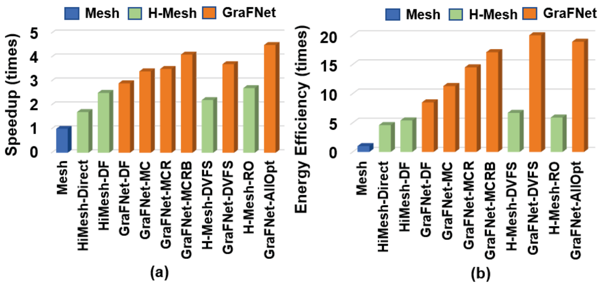
*Figure 5.10，PDF第114页：相对Mesh的多组件消融，左侧加速比，右侧能效；高于1更好。*

从数据流、多播、归约旁路、DVFS到重排，每一步都可能改变结果。作者讨论整体最高约5倍加速、20倍能效；这些属于联合架构。图上部分DVFS配置的能效还高于AllOpt，说明更多优化组合未必对每个目标都最优。图5.12的最高6.9倍加速与图5.13最高4.7倍能效对应不同模型/数据集，不能拼成同一个点的同时收益。

### 5．单看DVFS会发生什么

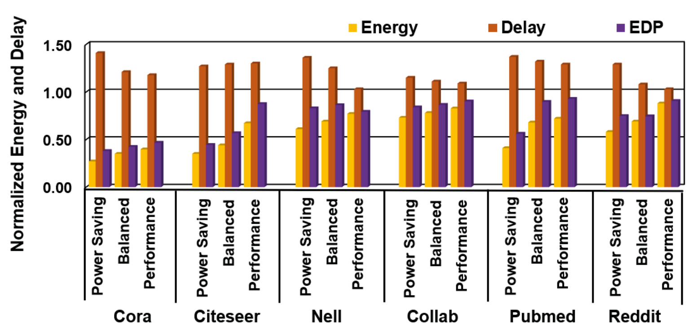
*Figure 5.15，PDF第118页：同图同时展示归一化能量、延迟、EDP。黄色越低节能越多，橙色高于1代表变慢，紫色用于综合判断。*

对Cora的PS，正文报告能量降低72.4%、延迟增加45.7%、EDP降低59.8%。可做不依赖代码的算术一致性核查：

$$
\frac{\mathrm{EDP}_{\mathrm{PS}}}{\mathrm{EDP}_{\mathrm{base}}}
=\frac{E_{\mathrm{PS}}}{E_{\mathrm{base}}}\frac{T_{\mathrm{PS}}}{T_{\mathrm{base}}}
=0.276\times1.457\approx0.402.
$$

其中能量单位焦耳、延迟单位秒，EDP单位焦耳·秒；归一化后无量纲，0.402对应降低约59.8%。这只证明该组三数字内部一致，不证明模型准确或实际平台会得到相同收益。若任务只允许10%延迟增加，45.7%就不可接受，哪怕EDP改善。

**必须保留的图文冲突：** 正文称NELL的能量/EDP可能变坏，并用频繁关断、积压解释；但图5.15中Nell三根紫色EDP条均低于1，PS黄色能量也低于1。图并不支持“这组三策略EDP已经上升”的读法。因此本笔记把该处列为待作者澄清，而不将它当已证实的负结果。频繁门控可能有代价的机制值得测试；第4章PG与窗口buffer成本已有更清楚的证据。

第117页图5.14也要按纵轴Energy Efficiency读，不能跟随图注“energy cost”字样把方向反过来。原图无充分重复试验/误差线，峰值柱图不能用于推断统计显著性。

## 深度分析

### 全图表与算法索引：每项看什么、不能推出什么

以下59项均核对过原页，28项就地内嵌；未内嵌项按PDF页码回查。顺序依真实图表编号，不按自动解析器误分类排序。每行同时给一个阅读问题和一个证据边界。

| 项目/页码 | 阅读问题与直接观察 | 不能据此推出 |
|---|---|---|
| 图1.1 /14 | 准确率与运算量气泡关系，大小还编码参数量 | 运算少一定整机能量低 |
| 图2.1 /29 | 卷积跨通道累加及七重循环，定位MAC配对 | 单张量非零率等于有效MAC比例 |
| 图2.2 /31 | GCN两阶段矩阵尺寸与稀疏度 | 任意非线性都能随乘法重排 |
| 图2.3 /32 | NELL邻接不均衡、簇与稀疏行 | 平均密度足够代表最忙域 |
| 图2.4 /33 | 单头、多头和Transformer模块 | 这是第4章已经实现的大模型负载 |
| 图2.5 /36 | attention稀疏、top-k和行剪枝对照 | 量化/剪枝收益就是DVFS收益 |
| 图3.1 /48 | 混合无线/有线路由与PE簇 | 无线架构已完成独立DVFS执行器 |
| 图3.2 /49 | 3×3核、6×6输入、4×4输出映射 | 后文误引图5.4是另一项新实验 |
| 表3.1 /49 | 多数据流复用/分发维度对照 | 表内定性标记自动保证任何映射最优 |
| 图3.3 /50 | 四数据流、物理映射、时窗和链路排程 | 无线单项提高等于全系统无代价 |
| 图3.4 /55 | 标准Dadda MAC与部分积归约 | 低位宽没有识别质量变化 |
| 图3.5 /56 | 可变精度MAC复用部分积/累加 | 频率随精度自动安全变化 |
| 图3.6 /57 | ResNet9延迟/能量/EDP硬件配置 | 三种指标最佳配置必相同 |
| 图3.7 /58 | ResNet50数据流延迟和逐层mixed | 数据流方案就是选档算法 |
| 图3.8 /59 | 同网络不同数据流能量 | 控制器未计开销也可称净收益 |
| 表3.2 /60 | 14nm、1GHz下MAC综合量 | 已证明整机多电源域时序 |
| 表3.3 /61 | 不同位宽的硬件代价与准确率 | 不同精度能效可忽略质量直接排名 |
| 表3.4 /62 | 多架构资源/节点/性能完整配置 | 全部同工艺受控实测 |
| 图4.1 /68 | GB/DD/DP/DVFG/PE控制连接 | 缓冲图内配置与表4.3自然相同 |
| 图4.2 /70 | PE内稀疏检测、算术、后处理和控制 | 有电压方框即有真实轨测量 |
| 表4.1 /72 | 五状态、四策略工作量阈值 | 阈值是分配PE百分比或统一最优解 |
| 图4.3 /73 | 卷积映射、跳零、跨epoch异频与输入积压 | 图中异频示意即完整CDC正确性证明 |
| 图4.4 /76 | 输入示意、隐藏节点和五类输出 | 已给唯一无歧义模型维度/标签 |
| 算法1 /78 | 编码、训练和交叉熵参数更新 | 连续工作量可不编码直接作类标签 |
| 算法2 /79 | 预测、变化门限和状态更新 | argmax类索引就是百分数 |
| 表4.2 /80 | DP/DVFG/SD等面积、功率、延迟 | 单实例即整个控制系统成本 |
| 图4.5 /81 | 连续窗口工作量与两策略的期望电压 | 期望电压就是已测PMIC波形 |
| 图4.6 /82 | 各网络/策略的五状态工作量分布 | 状态占比本身就是能量比例 |
| 图4.7 /82 | 五个电压状态的能量分解 | 与图4.6工作量比例可直接互换 |
| 图4.8 /83 | 静态/动态能量分项及策略 | 静态能量百分比等于功率百分比 |
| 图4.9 /84 | 总能量和延迟的代价 | 全收益来自DVFS单项 |
| 图4.10 /85 | 窗口长度与正确率趋缓 | 错分后果只用平均正确率即可评价 |
| 图4.11 /85 | 双轴能量/buffer随窗口变化 | 最长窗口总是最佳 |
| 图4.12 /87 | 粗细粒度buffer对照 | 行共享没有激活缓存成本 |
| 图4.13 /87 | 粗细粒度能量/延迟 | 粗粒度总能量必低 |
| 表4.3 /89 | 三架构PE、SRAM、能效配置 | 峰值吞吐一致即资源完全相同 |
| 图5.1 /94 | 多数据集计算与单播/多播/归约/存储通信统计 | 只估MAC能覆盖全部能量与时间 |
| 图5.2 /95 | X/Y路由组织与PE连接 | 路由功能图即CDC完整证明 |
| 图5.3 /97 | 路由器微架构与GCN映射 | 旁路没有流控与拥塞成本 |
| 图5.4 /99 | 五步特征/邻接项分发的周期路径 | 图内示例已证明列重排算法 |
| 图5.5 /100 | Y方向路由和垂直通道进行部分和归约 | 可忽略来自不同任务的部分和标记 |
| 图5.6 /101 | 中间矩阵初始多播与双向分发 | 中间矩阵传递没有缓冲/带宽成本 |
| 图5.7 /102 | 四数据流的多播/单播/归约 | 所有阶段只有一种统一时序 |
| 表5.1 /102 | 数据集特征与不同数据流搬移代价 | 一个图的最优配置适合所有图 |
| 表5.2 /105 | 重排、复用和并行比较 | GraFNet已有跨层并行，源表为None |
| 图5.8 /108 | PLL req/ack/FSM与SIMO电源域 | 纯RTL可在FPGA内部制造模拟电源轨 |
| 表5.3 /109 | 三策略、四状态列DVFS | 可与第4章五状态直接混用 |
| 表5.4 /109 | 各图数据集规模/稀疏信息 | 图5.15必然使用完全同一集合 |
| 表5.5 /110 | GCN/GIN/GraphSAGE层数等模型设置 | 原文误引GAT即GraphSAGE模型来源一致 |
| 表5.6 /112 | FPGA/ASIC工艺与带宽频率 | 跨列功率直接比即同平台节能率 |
| 表5.7 /113 | 路由器面积/功耗/延迟 | 未解释活动率就可乘4096得到总功耗 |
| 图5.9 /113 | GLB/PE/router等面积占比 | 面积比例等于能量比例 |
| 表5.8 /113 | 总组件预算5.1mm²/1348.9mW | 5-stage和16列标记已与全部配置对齐 |
| 图5.10 /114 | 多优化组合的加速/能效消融 | AllOpt对所有目标必最优 |
| 图5.11 /115 | 多数据集NoC信道平均利用率，多播占主导 | 平均利用率足以证明无拥塞/无拖尾 |
| 图5.12 /116 | 多GCN模型/数据集对基线加速 | 最高6.9倍就是DVFS单项 |
| 图5.13 /117 | 多模型/数据集能效对照 | 4.7倍与6.9倍来自同一个点 |
| 图5.14 /117 | 不同数据流的Energy Efficiency纵轴 | 图注写cost就应越低越好 |
| 图5.15 /118 | 能量/延迟/EDP，NELL图文冲突 | 可只照正文将EDP上升当实证 |

### 核心证据矩阵

| 主张 | 最直接证据 | 替代解释/对照需求 | 当前可信边界 |
|---|---|---|---|
| 预测工作量可帮助运行时选档 | 图4.1、4.4、算法1/2、表4.1 | 特征/标签解码尚不完整；应比较规则与oracle | 架构机制明确，精确算法复现中等可信 |
| 细粒度提高供给匹配但增加实现成本 | 图4.3、4.11–4.13 | 固定缓存资源或计面积成本再比 | 同一模型取舍有依据，不能外推物理PMIC规模 |
| DVFS降低能量但可能变慢 | 图4.9、5.15 | 固定稀疏结构、精度、任务数、截止期 | 目标/约束内成立，非无条件最优 |
| GraFNet整体更高效 | 图5.10–5.13、表5.6/5.8 | NoC、重排、带宽、节点同时影响 | 模型证据，不等于统一硅测 |
| PLL/电源能承接控制 | 图5.8 | 仍需锁定/稳定、CDC、模拟瞬态及接口规范 | 架构接口存在，实体完成度不可由图推定 |

### 可以追溯的技术脉络与重复边界

| 引用边 | 证据与年份 | 对本课题的价值 | 外部阅读状态 |
|---|---|---|---|
| 博士第4章 → 参考77 HiPC论文 | 章首脚注；2021；DOI 10.1109/HiPC53243.2021.00037 | 预测工作量/粗细粒度DVFS的前序版本 | 本次补核IEEE身份/摘要与作者PDF入口，不计新增外部全文精读 |
| 博士第2章 → 参考79 HSCONN | 背景章节与参考表；GLSVLSI 2024 | attention稀疏/行剪枝与多阶段DVFS | 同批独立原论文已精读；第4章不是其全套实现 |
| 博士第4章 → 参考20 DozzNoC | 引用8.8ns/6.9ns开销；2020 | 追问转换延迟来源与适用工艺 | 此处只核本书引用，未声称原论文全部复现 |
| 博士参考表 → Jiang 2020 | 参考55的CNN能效/DVFS工作 | 学执行流程，再回看预测策略与域划分 | 同批用户PDF已精读，非新的另一篇 |
| 博士第3章 → 参考76 | 章首脚注；2022 | 无线互连与数据流研究来源 | 避免把合订章节计为2025新独立DVFS贡献 |

这是有明确来源边的路径，不是按关键词相似性猜测谁引用谁。被引量和“最新”需要按查询时间另查，当前不虚构计数。路线可概括为：固定工作量/数据流分析 → 运行时稀疏观测 → 预测下一窗口需求 → 域级OPP选择 → 互连/重排改变需求 → 安全执行和全开销验证。新的控制算法最好落在其中一处明确缺口，而不是把全部链条都叫智能优化。

## 局限

### 作者已讨论的代价

预测准确率与窗口长度相关；细粒度缓冲与控制成本较大；粗粒度不能精确匹配每个PE；频繁门控存在切换开销；节能策略可能牺牲吞吐。这些是本书值得学习的设计权衡，不应在摘要式笔记里略去。

### 读者核查后的关键缺口

**关键：算法定义与安全执行。** 式4.1边界、特征维度、标签/解码、状态编号及阈值端点尚未统一，缺少能一键重建的完整配置；部分输入可能涉及未来信息。图5.8给请求确认，却没有完整的跨电压/时钟域正确性与瞬态测量。关断小负载域必须保证非零工作最终执行，不能以缓冲示意代替无丢失、无死锁与截止期证明。

**重要：实验隔离和量纲。** 无稀疏基线不能隔离DVFS贡献；跨平台/节点/频率/带宽对比需分层。表4.3存储不同，表5.7/5.8功率与配置口径难对齐；epoch最小时间与cycles定义、1GHz配置与V/f表需要澄清。图5.15 NELL的图文结论冲突不能替作者决定。缺少可重建的重复次数/误差记录，均值或最高柱没有统计确定性保证。

**次要但会误导初学者：** 第3章部分图号误引；GraphSAGE处参考122实际对应GAT而参考45才是相应来源；若干“sparsity”实际是density；图5.14图注与纵轴含义不一。应回到计算语义和图轴，避免把排版或术语问题扩展为未经证实的理论结论。

摘要提到强化学习，但第6章相关内容作为未来方向展开。当前精读不能交付“作者已经证明的RL奖励函数、训练曲线和闭环稳定性”，因为这些证据没有随正文完整出现。当前已读材料里也未定位到足以直接运行的官方端到端复现包；这不等于证明所有外部仓库都不存在。

## 我的笔记

### 最小复现应怎样一步步做

**阶段一：先复现决策逻辑，不需要真实可调电源。** 固定一个小CNN卷积层或一个小图的矩阵乘法，建立准确参考输出；逐配对记录每PE/列、每窗口有效MAC、输入到达、执行完成与积压。将zero_fraction和nonzero_fraction分列保存。先固定高档无调节，验证映射与输出正确，再启用原表阈值。

**阶段二：补清预测器的可复现约定。** 从过去可观察窗口构造特征；按完整输入/图划分训练、验证和测试。保留类别定义、归一化、模型结构、随机种子和训练日志。把“原文五类解码”“回归预测后查表”等候选明确列作不同重建版本，不混合。记录负载误差及误判方向，同时评估最终时延/能量。

**阶段三：让仿真器真的受档位影响。** 选档后改变服务速率，并显式模拟切换停顿、关断、常开缓冲、反压与恢复。不能只给trace贴一个低电压标签而让完成时刻保持不变。能量由各状态驻留、计算/访存活动及切换开销累计；模型参数来源与敏感性独立记录。无真实测量时报告“估计能量”。

**阶段四：逐层加功能，做公平消融。** 固定相同精度、稀疏跳零、缓存和数据流，依次比较固定高档、上一窗口反应式规则、预测器选档、已知下一窗口真值的oracle。oracle只给上界，不能当可部署策略。再分别加入门控、列重排或NoC优化，不能一口气全打开后归因给DVFS。

**阶段五：扫边界而不是只找最佳点。** 控制窗口从小到大、预测误差从小到大、切换延迟/能量从理想到目标接口范围；用突发高负载、长低负载、交替负载及最坏积压测试。记录输出一致性、完成时间、违约率、峰值buffer、切换次数、策略耗时及净能量。buffer满或超时必须有明确处理，不允许静默丢任务。

**阶段六：才进入RTL和物理平台。** 为现有PLL/PMIC写接口约束表，包括命令、合法范围、完成语义、锁定/稳定反馈、超时、复位、常开时钟。先用行为模型验证升降序、抖动、命令连续到达、PLL不锁定/PMIC无响应；再视板卡是否暴露安全电源轨决定实测范围。真正能量验证要对任务区间积分，并把控制器和电源损耗纳入可说明的边界。

以上是复现计划与读者补全，**尚未独立运行作者实验或制作芯片**。没有相同标准单元库、存储宏和模拟电源实现时，可以复现机制与趋势，但不能承诺得到相同mW、mm²或节能百分比。

### 和CPU/E902课题怎样接起来

你的核心不必复制4096个PE或训练大CNN。可把“每个PE的非零工作量”换成“一个CPU程序下一块任务的预计周期与时间余量”。CPU候选任务可以是分块压缩、小型信号分类或矩阵核，均需先测资源与可移植性，当前尚未定题。候选输入包括已执行周期、上一块时延、输入块大小、队列长度、可得计数器、截止期与剩余预算；不存在的性能计数器不能凭空假定E902具备。

软件策略输出OPP请求，数字控制器负责合法性、安全切换和反馈。程序并不是靠被修改源代码而直接变快慢，而是同一指令流在不同核心时钟下以不同速率执行；受访存/等待瓶颈时，频率与速度并非线性。电压是支持频率及影响能量的物理条件，在无物理轨模型的软件验证里只能估计其效果。

| 优先级/实验 | 具体做法、资源 | 风险与成功标准 |
|---|---|---|
| P0：软件闭环选档 | 在已有CPU上采任务块trace，建立可服务周期/能量模型；实现固定高档、历史规则、简单回归/分类、oracle四组，按完整输入留出测试；资源为PC与可审计脚本 | 风险是模型泄漏或未计切换。成功：结果完全一致，所有约束满足，计全部控制开销后仍有可重复净收益；仅得到模型结果要如实标注 |
| P1：数字安全执行器 | 用RTL实现OPP请求、升降顺序、等待反馈、超时、busy/actual状态；PLL/PMIC行为模型注入延迟与失败；资源为仿真器和已有IP接口规范 | 风险是FSM用被调目标时钟造成死锁。成功：升频前电压确认、降压前频率确认、失败可回退、无丢命令；不声称此时已实测电压 |
| P2：硬件平台验证 | 核对E902 SoC时钟/电源独立性、合法V/f和板卡权限；先可控频率，再按条件连接PMIC；记录任务标记、V/I轨、实际时钟和全部时间成本 | 风险是共享轨影响外设/存储，或板无调压能力。成功：全任务正确、时序反馈完整且测量边界明确；不满足调压条件时如实只报告频率/协议验证 |

### 你关心的五个问题，读完应能回答

**输入怎么选？** 从决策时可观察、与下一窗口服务需求相关且采集开销低的变量开始。本文用稀疏工作特征；你的CPU可以用任务周期、队列、块大小与截止期。先做相关性、留出测试和消融，再决定是否加入更多计数器。

**怎么控制？** 先预测或估计需求，再在合法OPP集合里按目标/约束选择；原文主要是预测加阈值表，而非每次在线穷举训练或已经实现的RL。安全执行器应能拒绝不合法动作。

**输出是什么？** 算法层输出目标状态/OPP；执行器层输出PLL配置与PMIC命令；物理层才是实际时钟和供电。actual状态与requested状态应分开记录。

**必须有硬件吗？** 算法级先不用。行为/周期模型能研究策略和开销敏感性，RTL能研究协议与正确性；真实稳压时间、板级能量和电源完整性需要相应物理平台，前两级证据不能替代后一级。

**软控软具体做什么？** 用软件实现控制策略，并让另一个软件负载/执行模型按选档后的服务速率、停顿和能量模型运行；也可以在允许接口的真实CPU上由软件调合法频点，但这时已经涉及真实硬件执行，应说明平台。若虚拟E902只改变仿真时钟/周期账本，得到的是时序/能量估计；没有模拟电路就不能声称CPU真的降了电压。

### 下一轮该解决的问题

先索取或确认现有PLL/PMIC的接口与延迟，确定合法OPP和平台电源域；再选一个能在CPU/E902资源内运行的负载，做P0四组实验。若简单历史规则已接近oracle，就没有必要先堆大预测网络；若误判和积压才是主要问题，研究带约束的策略/回退可能比增加模型规模更有价值。保留一张“输入—时间戳—预测—请求档—实际档—完成—能量边界”记录表，后续引用论文和写方法章节都会更清楚。

## 引用

1. Siqin Liu. *Architecture Design for Reconfigurable and Energy-Efficient Deep Neural Network Accelerators With Dynamic Voltage and Frequency Scaling Techniques*. Ohio University博士论文，2025。[OhioLINK机构记录及原文入口](https://rave.ohiolink.edu/etdc/view?acc_num=ohiou1743094632563429)。本笔记直接证据为用户提供的135页PDF；SHA-256：`cdf91dadca415686673c91b9e22910a2390039a612c460d056d6ecba7fae25c3`。
2. Siqin Liu and Avinash Karanth. *Dynamic Voltage and Frequency Scaling to Improve Energy-Efficiency of Hardware Accelerators*. HiPC 2021，DOI [10.1109/HiPC53243.2021.00037](https://doi.org/10.1109/HiPC53243.2021.00037)；[作者PDF入口](https://oucsace.cs.ohio.edu/~avinashk/papers/HiPC2021_Final.pdf)。此次外部补核为身份/摘要，不另计全文精读。
3. 博士论文参考20、55、76、79及章首脚注，支撑切换开销、Jiang、e-WiNN和HSCONN的来源关系；同批对应原论文的笔记从知识库索引进入。

本文原图表用于理解与技术评述，保留原编号；完整PDF不随公开知识库上传。图中近似读数与正文精确报告分开标识；未公开的超参数、接口和测量记录不以猜测填充。
