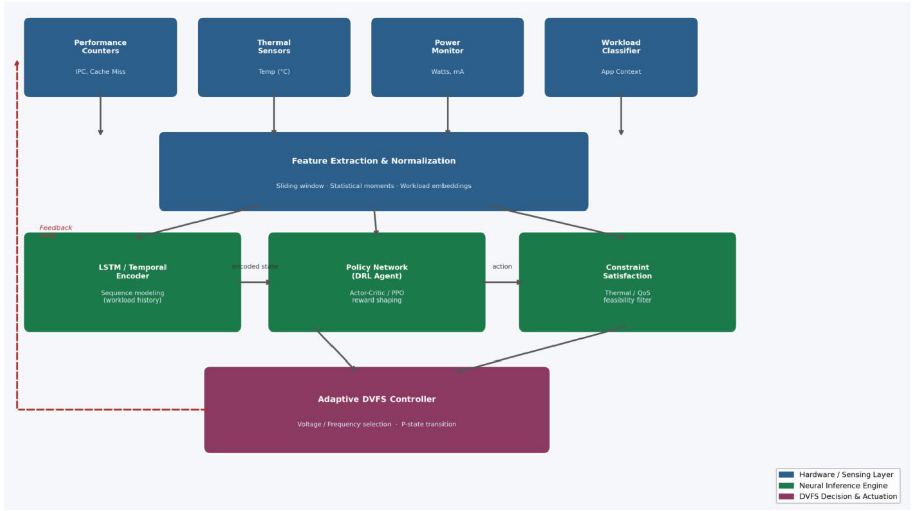
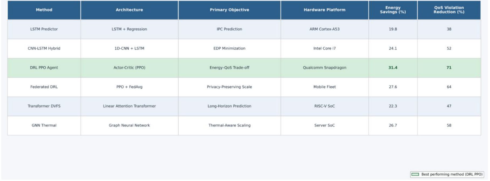
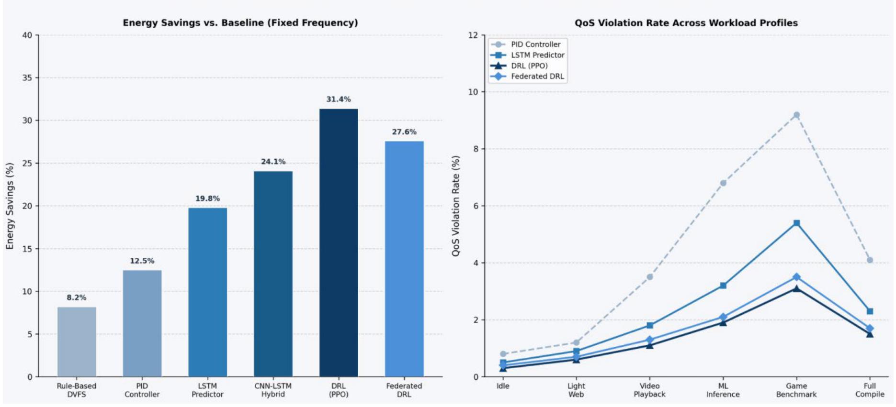

# 神经DVFS综述精读与证据审查：框图怎样理解，哪些结果暂不能采用

[从零入门](start.md) · [原图表索引](figures.md) · [双语摘要与导读](abstract.md)

## 核心信息

- 标题：Neural Methods for Adaptive Voltage and Frequency Scaling in Energy Aware Processors
- 标题翻译：面向能量感知处理器自适应电压频率调节的神经方法
- 作者：Yihan Wang、Suchuan Xing
- 机构：原稿标注University of Pennsylvania、Duke University
- 发表时间：2026年；出版社页面标2026-03-29
- 发表渠道：Journal of Computing and Electronic Information Management，20(3)，127–134
- DOI：10.54097/pkgmn637
- 论文链接：https://jceim.org/index.php/ojs/article/view/181
- 论文类型：神经DVFS方法的概念综述

## 原文摘要翻译

动态电压频率调节是现代处理器在计算性能与能耗之间进行权衡的一种有效运行时机制。传统基于规则和启发式的调节策略，难以适应移动设备、数据中心及边缘部署中越来越异构且不可预测的负载模式。本文综述将神经方法应用于自适应DVFS的研究，包括循环神经网络、卷积神经网络、深度强化学习和联邦学习，梳理从经典预测方法到能够联合优化能效与服务质量约束的策略学习框架的演进。作者分析认为，DRL方法相对固定频率基线可持续取得25–35%的能量降低，同时将QoS违约率保持在4%以下，优于传统策略和监督预测模型。最后讨论多目标优化、设备端持续学习与异构处理器支持等方向。（第1页摘要，忠实保留作者定量主张；其证据能否支持该结论见后文审查）

## 创新点

1. **按预测与策略学习组织神经DVFS概念。** 读者可区分先预测未来工作、再选OPP，以及直接学习状态到动作两条路线。
2. **提供观测到执行的通用框图。** 将计数器、温度、功率、应用信息、特征、模型、约束和反馈放在同一页，可用作设计清单。
3. **讨论部署与持续适应问题。** 涉及推理开销、量化、系统接口、非平稳负载和多域协作，但具体实现与实验支撑仍有明显缺口。

这些是概念组织层面的作用，不是经验证的新芯片或新控制器贡献。**本篇在知识库中归为“框架导读与证据审查”，不进入可靠节能结果排名。** 这种归档针对具体可核查问题，不是依据期刊名称判定真伪。

## 一句话总结

它能帮助列出一个神经DVFS系统可能有哪些模块，但图表来源和引用不足以支持“PPO普遍最优”或直接复现31.4%等节能率；设计应回到原始DVFS实验与目标硬件。

## 研究问题

### 先区分两个“神经网络”角色

**English paraphrase (not the original abstract):** The review outlines supervised workload prediction, reinforcement-learning policies, and a generic sensing-to-actuation loop for neural DVFS. Its conceptual vocabulary can guide questions, but the reported cross-platform comparisons lack sufficient traceability and reproducible settings. Several citation mismatches, including the source next to the six-workload comparison, prevent adopting its numerical claims as validated evidence.

CNN/LLM可以是被控负载，也可以是控制模型。Jiang2020里CNN负责目标检测，是被调速的程序；本文讨论CNN或LSTM从计数器预测负载，是选档工具。题名含CNN和DVFS并不能说明CNN承担哪一种角色。

你的IC主线是数字控制器调用已有PLL/PMIC。神经模型只是策略的一种实现；观测、合法OPP、执行握手和反馈并不会因为有PPO自动具备。阅读本文应把“概念上可以”与“该文实际给了可复现参数”分开。

## 数据与任务定义

### 它究竟用了哪些材料

用户PDF8页，含63条参考文献；文章称自己是review，没有完整数据库检索式、截止日、排除标准和逐行实验提取表。不能把它当作穷尽神经DVFS研究的系统元分析。

表1把A53、Intel i7、Snapdragon、设备群、RISC-V SoC和服务器SoC放在一起；这些不是同一硬件上的六算法对照。图2又展示六类负载的共同曲线，却没有给足设备、频点、程序版本、训练数据、运行次数与原始日志，使其共同实验条件无法恢复。（第3–5页）

出版社页面核实了题名、作者、DOI和出版信息，**只确认文献身份，不表示实验结果已被验证**。机构和邮箱依原稿记录，不由邮箱单独推断作者身份或工作可信度。

### 复现一个DVFS算法最少需要什么

|要素|本篇能提供|缺少后会怎样|
|---|---|---|
|具体程序/输入|若干抽象负载类别|无法重建每个任务的工作量与截止时间|
|平台/执行器|概括性处理器类别|不知道PLL/PMIC真实动作空间和延迟|
|状态|PMU、温度、功率等字段名|无具体事件、窗口、维度与归一化，模型输入无法对齐|
|动作|P-state/频率电压选择|无完整合法OPP和驻留/切换约束|
|训练|LSTM/PPO等方法名与概念|无网络、损失/奖励、超参数、数据划分与种子|
|评价|节能/QoS百分比|缺分母、基线、统计与测量范围，不能公平比较|

## 方法主线

### 机制流程

以下是综述图1表达的概念控制链，不是本文已实现并验证的一套固定系统。

1. **观测与窗口。** 输入计数器、温度、功率和应用上下文，提取窗口统计并归一化，输出状态向量供模型使用。
2. **预测或策略。** 输入窗口序列，用时序模型提取历史表示，或由策略网络更新动作建议，输出候选频率/OPP。
3. **约束与执行。** 输入候选动作，按热和QoS可行条件过滤，更新DVFS执行请求，把目标状态交给系统/硬件执行器。
4. **反馈与适应。** 输入执行后的状态与任务表现，更新后续观测；若使用学习策略，额外定义训练/更新过程。具体更新周期和规则在本文尚不充分。

### 1．图1每个框到底做什么

*原图1，第3页：蓝色观测/特征、绿色神经决策/约束、紫色执行；属于通用架构示意。*

性能计数器框举IPC、cache miss；温度框给温度；功率框给W或mA；工作负载分类框给应用上下文。它们不一定在你的E902上全部可读，也不是单位相同、可以直接拼起来的数。需要先核对硬件支持、采样开销、同步和量纲。

窗口统计可以包括均值、方差等；但窗口多长、几次采样、何时复位、遇到异常读数怎样处理，文章没有固定。图中接LSTM、策略网络和约束过滤，不意味着必须三个都用，更不证明作者训练过这一具体串联网络。

最后的DVFS框应当将策略建议映射到合法状态并执行。原图没有展开PLL锁定、PMIC稳定、先后次序、忙状态和故障回退，因此不能拿它当数字控制器RTL框图的完整规格。

### 2．监督预测和强化学习的区别

|路线|模型实际输出|还缺哪一步|
|---|---|---|
|监督预测|未来工作量、IPC、任务时延等预测|将预测与截止时间、能量模型结合选合法OPP|
|直接策略学习|给定状态下的动作/动作概率|定义奖励、约束、探索数据与安全执行|
|混合结构|时序编码后交策略网络|两部分怎样训练、是否共享数据和稳定性|

预测IPC并不自动知道应选哪个频点：IPC本身受当前频率、访存与任务阶段影响。训练标签、预测时域和状态中是否含当前OPP都应固定。策略网络直接给动作也不自动保证时延，因为真实任务及执行器仍可能偏离训练模型。

PPO是作者重点讨论的一种策略优化方法；“本文称其为事实标准”不等于已建立普遍共识。没有相同平台和约束的对照，不能从方法名称推断它优于查表、阈值或小型预测器。

### 3．多域与联邦学习也不是免费扩展

CPU/GPU/内存域的动作互相影响，可能争用带宽或共享电源；多智能体需要定义各自观测、动作、联合奖励和协调。联邦学习需要规定设备差异、参数聚合、通信和隐私边界。本文讨论了这些方向，但没有给足可运行的具体配置。

不能因为你只有单核CPU就照抄“多智能体”；也不能因为不愿上传日志就认定联邦学习是必要模块。先确定课题实际问题，再选择复杂度。

### 4．约束惩罚为什么不等于硬保证

作为教学示例，一个策略可以用“能量成本+迟到惩罚”训练；只要罚得不够大或模型预测有误，仍可能选择迟到动作。即使训练平均表现很好，也不等于每次动作都可行。

$$
\min_{c\in\mathcal C} \hat E(c,x)\quad\text{s.t.}\quad \hat T(c,x)+T_{\mathrm{switch}}(c)\le D,\quad c\in\mathcal C_{\mathrm{legal}}.
$$

x为状态，c为候选OPP，E_hat是估计能量J，T_hat与切换时间及截止时间D均为秒。这个约束式是本笔记给出的最小设计形式，**不是本文已实现算法**。估计约束仍要给误差裕量，执行器还要保证实际状态合法。

原文称拉格朗日训练可无需后过滤满足硬约束，论据不足；连续状态的DQN也不能无条件继承表格时序差分在特定假设下的收敛结论。这两点是对技术概括的审查，不是否定所有约束学习研究。

### 5．控制周期与物理模型必须回到你的平台

原文给100–500µs推断到执行预算，但引用[55]是Neuro-CIM相关工作，不能由此规定所有CPU/PLL/PMIC同样时序。板外电源管理、片上稳压、PLL重锁与仅分频的开销差异很大。你的预算应由实际IP和总线测定。

功率也不能简单写成只随电压立方变化。常见动态项为：

$$
P_{\mathrm{dyn}}\approx a C V^2 f.
$$

a为活动因子、C为等效电容F、V为电压V、f为Hz，结果为W；静态功耗另计。立方近似需要再假定频率与电压关系，不是无条件的精确律。真实程序还包含访存与系统基底功耗，所以应优先用测量表或经验证模型，而非直接拿立方公式承诺节能。

## 关键结果

### 表1：先看平台，再看31.4%

*原表1，第3页：不同神经方法对应不同硬件，绿色突出PPO；缺少逐行原始实验标识，不能据此算法排名。*

表列能量降低19.8%、24.1%、31.4%、27.6%、22.3%、26.7%，对应不同平台及目标。若一个算法在更慢基线上省很多电，另一个在优化基线上省较少，无法据此判断谁更好。QoS列又是“违约减少比例”，不是绝对违约率。

因此31.4%和71%应记录为**本表声称、来源待追溯**。不能写“PPO一定省31.4%，并保证违约率低于4%”；后者还需要任务数、违约定义与绝对分母。

### 图2：共同曲线必须有共同实验来源

*原图2，第4页：左为相对固定频率的节能柱，右为六负载的QoS违约率线；当前证据不足以等价复现。*

左图画规则8.2%、PID12.5%、LSTM19.8%、混合24.1%、PPO31.4%、联邦27.6%。右图是空闲、轻网页、视频、推理、游戏、编译；图例含四种方法。视觉上PPO线较低，但没有明确共同平台、工作程序、输入、频点、重复和采样分母，不能把曲线当作已经独立验证的公平比较。

更具体的问题是：引出图2六负载比较的段落引用[50]，而第7页[50]列的是Bi与Gelenbe的应急管理综述。原始arXiv记录及摘要也确认它讨论灾害、导航与搜救，不是该CPU DVFS六负载实验。故这条引用不能支撑图2所述数据。**这是一项可核查的出处缺口，不是单凭猜测认定曲线造假。**

## 深度分析

### 全部原图表索引

|项目/用户页|用途与证据边界|
|---|---|
|图1／3，已嵌|输入→特征→模型→约束→执行→反馈概念框图，无具体参数或完整物理控制协议|
|表1／3，已嵌|跨平台方法/指标汇总，缺逐行引用与公平基线，不作排名|
|图2／4，已嵌|能量与QoS对照，缺可恢复实验配置且引用50不匹配，不采用精确结果|

三项裁图全部按原页实际查看。表/图中的重复内部标题裁去，列头、坐标、图例和数值完整保留；没有重画或“纠正”原数值。

### 引用对应审查：几个必须分开的情况

|原文主张/位置|实际参考文献主题|目前可下的结论|
|---|---|---|
|CNN负载预测脉络／第2页[20]|Jiang2020 CNN目标检测与DVFS|该文CNN是被控负载，不能当CNN选档预测器证据|
|六负载PPO比较／第4页[50]|应急管理系统/算法综述|明确不匹配，不能支持该实验|
|联邦DVFS概括／[33]、[54]|虚拟电厂调度；元权重学习|算法思想相近不等于已部署处理器DVFS|
|100–500µs预算／第5页[55]|Neuro-CIM相关芯片|不足以支持全平台统一控制时序|
|cpufreq神经接口概括／[57]|Ashera神经引导约束优化|不是Linux该接口特性的直接来源|
|对抗鲁棒成功率改善60%／[62]|PMU事件驱动DVFS|需回原文核实，当前不采用60%定量主张|

对[62]等只核到本文参考题名和角色的项目，不能声称已全文证明其绝无相关实验。对[20]有本知识库实际精读，对[50]又查了原始记录，判断强度不同。

### 主张证据矩阵

|主张|可用证据|仍缺什么|归档方式|
|---|---|---|---|
|可用神经预测/策略建DVFS|概念分类与框图|具体实现和原始论文|术语/设计问题清单|
|DRL稳定优于所有传统方法|摘要、表1、图2作者主张|共同基线、来源、原始数据和统计|不采用强定量结论|
|存在部署时延和非平稳问题|系统讨论|实际控制器参数、测量、失败结果|实验计划待验证项|
|31.4%/71%可复现|只有图表列值|程序、平台、OPP、日志、代码/协议|来源待澄清，不作课题目标|

## 局限

本篇没有提供足够信息恢复一套确定的LSTM/PPO控制系统。缺具体PMU事件、窗口、网络、奖励、训练/验证/测试划分、OPP、驻留、PLL/PMIC反馈与能量测点。代码未获取核查不等于断言作者没有任何代码，但当前材料不能支撑等价复现。

图表跨平台和数据来源不透明，部分引用主题明确不对应。25–35%节能、<4%违约、60%对抗改善等概括因此不作为本知识库已验证事实。也不能据此反向断言所有神经DVFS或PPO工作都无效。

RAPL分区、更新周期、Linux接口和处理器是否暴露控制状态都依赖具体实现，不能把本文宽泛描述当作E902硬件已有能力。复杂模型越多，越需要单独测控制开销，不应由“神经”“联邦”等词代替工程证据。

## 我的笔记

### 怎样从这篇得到可做的项目

先借图1列候选输入，再删除目标平台读不到或意义不清的字段。固定一个可校验CPU程序，先建合法OPP表和查表/阈值基线，再判断是否值得加轻量预测。应用方向仍未定，不能因本文讨论神经网络就默认必须跑CV/LLM。

|环节|建议最小设置，属于本笔记设计|验证标准|
|---|---|---|
|状态|任务阶段、已完成工作、剩余时间、当前OPP；有条件再加周期/访存计数|记录可用性、单位、采样/同步开销，做特征消融|
|触发|分块/任务边界，必要时固定窗口|窗口可覆盖观测、计算、通信和物理切换|
|算法|查表→轻量时延预测+约束选档|同平台同输入比较，不先承诺PPO最好|
|动作|合法opp_id；不可满足时明确回退|没有任意电压输出，执行器确认状态|
|结果|正确性、时延/违约率、净能量、推理/切换开销|估计和实测分列，测试任务未参与选参|

### 三个实验与最小复现材料

|优先级/实验|所需资源与价值|风险/成功标准|
|---|---|---|
|P0：输入有效性|CPU程序与trace，比较阶段/工作量/计数特征|相关不等于可泛化预测；成功为留出输入上误差和策略收益均可解释|
|P1：监督选档与固定基线|合法OPP响应表、简单预测器、相同截止时间|预测错误和过拟合；成功为正确性不变、违约约束内净能量改善，包含模型成本|
|P2：策略到RTL执行|PLL/PMIC模型、FSM和请求日志|模型快但执行慢；成功为实际握手完成、超时回退和新请求处理正确|

要复现图2，应先向作者或原始来源获得共同设备、频率/电压、程序/输入、数据、训练参数、违约定义、能量测量范围和重复统计。缺这些时，可以实现“受框图启发的新实验”，不能宣称复现了原图31.4%。

本轮已核对全文、63条引用表与三项原图表，并查验关键引用50原始记录；没有逐篇全文验证全部63篇，也没有运行作者代码或独立复现曲线。

## 引用

1. Yihan Wang, Suchuan Xing. Neural Methods for Adaptive Voltage and Frequency Scaling in Energy Aware Processors. JCEIM 20(3), 127–134, 2026. [出版社记录](https://jceim.org/index.php/ojs/article/view/181)、[DOI](https://doi.org/10.54097/pkgmn637)。内容分析基于用户本地8页PDF。
2. 本文[50]的原始记录：[Emergency Management Systems and Algorithms: a Comprehensive Survey](https://arxiv.org/abs/1907.04136)。题名/摘要用于核对引用主题，不将其纳入DVFS技术主线。
3. 本文[20]：[Jiang2020](https://doi.org/10.1088/1674-4926/41/2/022406)。已精读，其CNN是被控负载。
4. 可另追溯的直接DVFS条目包括[17]CPU/GPU可解释学习governor、[40]时序编码DRL频率调度、[62]PMU事件驱动DVFS。此处仅定位原文参考线索，不声称本轮重新精读了它们。
