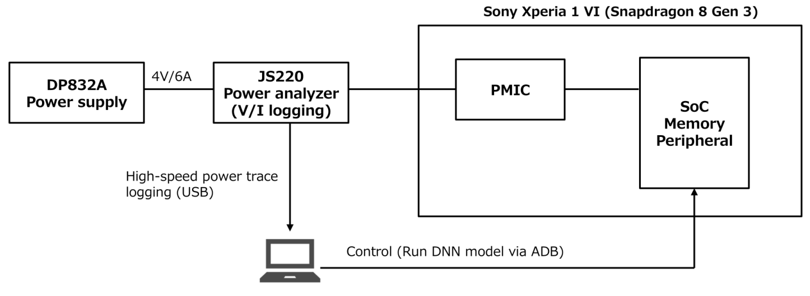
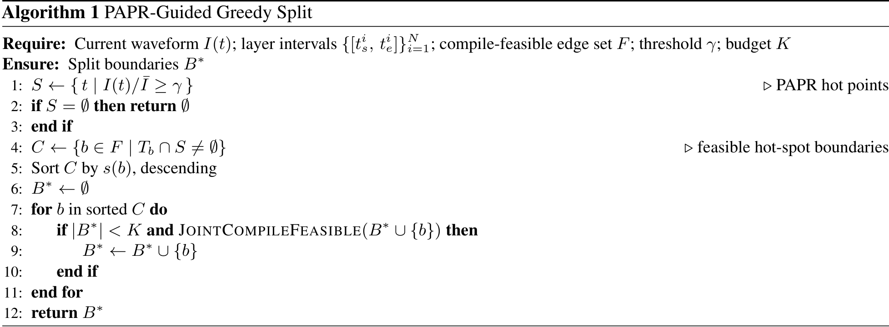
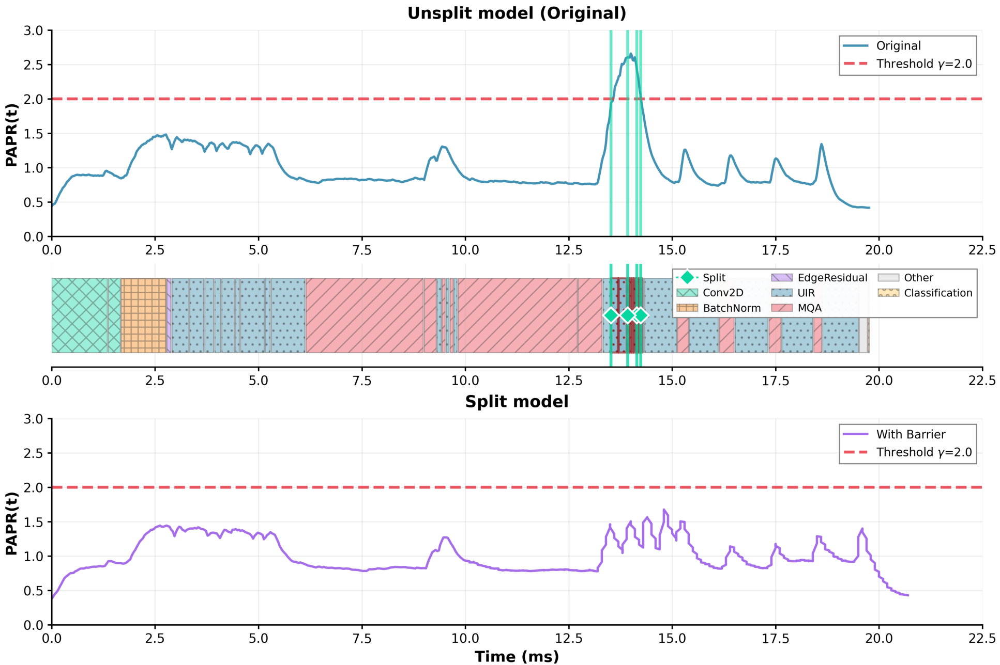
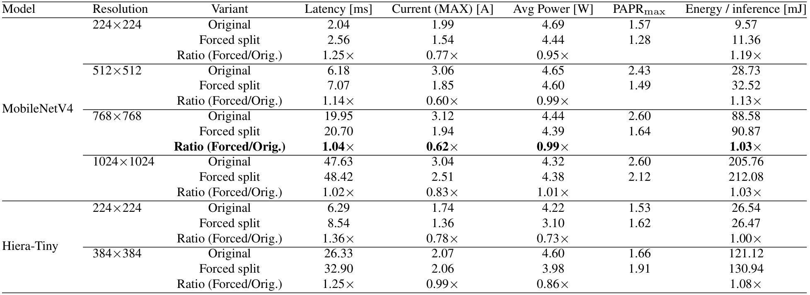
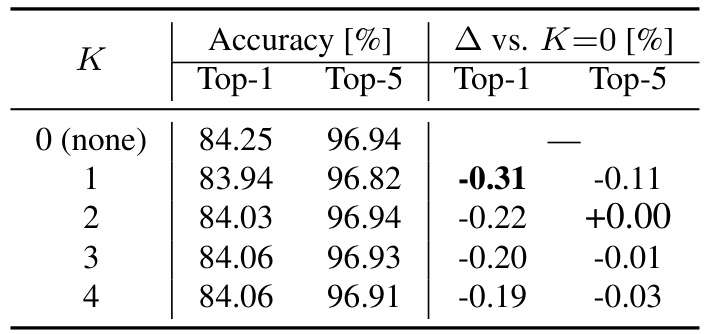
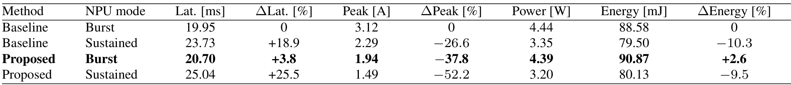
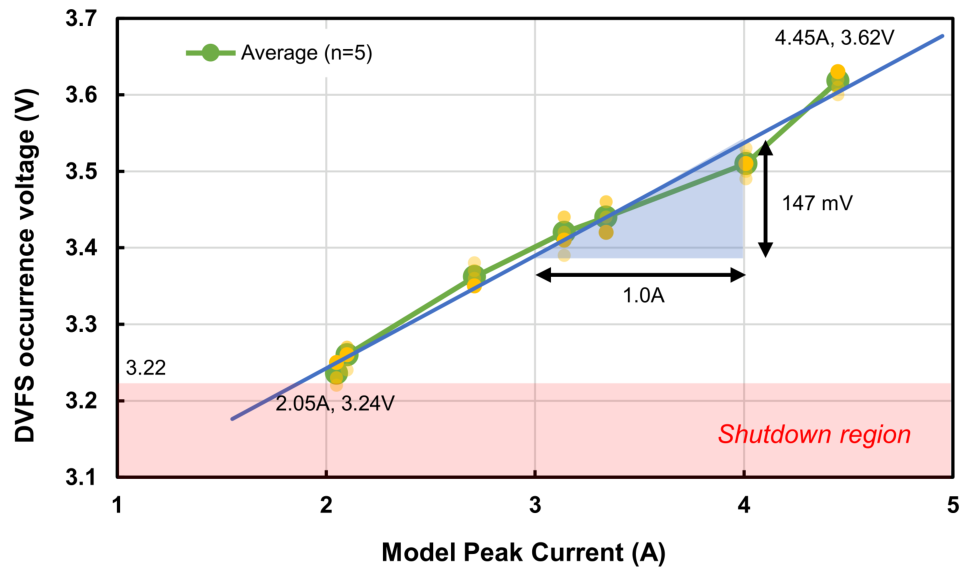
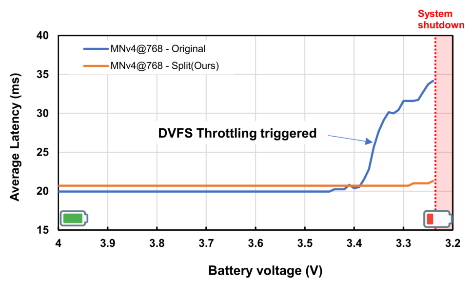

# NPU融合与功率尖峰：怎样通过改变程序执行形状减轻DVFS保护

[从零入门](start.md) · [原图表索引](figures.md) · [双语摘要与导读](abstract.md)

## 核心信息

- 标题：Mitigating Compiler Fusion-Induced Power Bursts in Mobile NPU Inference as the Battery Depletes
- 标题翻译：缓解电池电量下降时移动NPU推理中由编译器融合引起的功率尖峰
- 作者：Ryoga Yuzawa、Masayoshi Tomizuka
- 机构：UC Berkeley、Sony
- 发表时间：2026年，分析用户提供的v1，2026-07-17
- 发表渠道：arXiv预印本，含附录16页
- arXiv：2607.16555v1
- 论文链接：https://arxiv.org/abs/2607.16555v1
- 论文类型：商业NPU测量研究与编译前图改写方法

## 原文摘要翻译

移动设备越来越依赖实时NPU推理来运行相机和感知负载。然而，在低电压条件下，单次推理可能在供电网络中造成瞬态电压跌落，迫使PMIC启动动态电压频率调节，并增加时延。本文在一款商业手机上测量了这一现象。作者表明，移动NPU编译器中激进的算子融合能够形成大型整体式超层，集中执行这些超层会产生很高的峰值电流。尖峰会使DVFS开始介入的电压上移，缩小低电压运行裕量。作者还评估了一种实用的黑盒缓解方法：由测量引导，在编译前改写计算图；部署版本在选定的峰均比热点处插入屏障，阻止供应商NPU编译器进行有害的超层合并。在Snapdragon 8 Gen 3上使用MobileNetV4、768×768输入和ImageNet-1k时，峰值电流从3.12A降至1.94A，时延开销为3.76%；方法在更低电压区间仍保持稳定时延，并使推算得到的DVFS裕量变化约173mV。（第1页摘要）

## 创新点

1. **把编译器融合与供电瞬态联系起来。** 融合通常为了少搬数据、提高速度；本文关注其集中计算是否造成电流尖峰，以及尖峰如何使低压保护更早介入。
2. **用测量引导少量图边界改写。** 先筛选能编译运行的边，再根据电流热点排序，逐个检查屏障组合，避免对全部层粗暴拆分。
3. **与厂商限频配置直接比较。** 把拆分和限频分开及组合实验，展示峰值、时延、能量并非同一目标，也展示低峰均比模型可能不值得改写。

这是一种负载塑形方法，与DVFS保护发生直接联系，但没有重新设计PMIC、PLL，也没有实现新的在线OPP选档算法。其价值在于补上“程序怎样制造供电压力”这一环。

## 一句话总结

先找编译融合后最容易制造电流尖峰的执行区间，再在少量可行边插入不能被优化掉的屏障，使负载不那么集中，从而减少低输入电压下既有保护导致的性能恶化。

## 研究问题

### 先区分三个常被混用的目标

**English paraphrase (not the original abstract):** This measurement study links aggressive operator fusion on a commercial mobile NPU to peak-current bursts and low-voltage protection behavior. An offline, PAPR-guided graph rewrite inserts jointly compilable Q–DQ barriers to reshape execution. Peak-current reduction comes with latency, energy, and quantization tradeoffs; the inferred voltage margin is an exploratory estimate rather than a transferable hardware law.

降低峰值电流，为的是减轻瞬态供电压力；降低每次推理能量，为的是少耗电；提高吞吐，为的是更快完成任务。三者可以冲突。本文最醒目的数字是**峰值下降37.8%**，不是能量下降37.8%。主配置的能量反而增加约2.6%。

图1的假说链是：激进融合→计算与存储流量集中→瞬态电流尖峰→PDN压降→低压保护→时延上升。作者提供测量和拆分前后对照，但商业芯片内部是黑盒，不能把每个中间环节都当作已直接观测。

### 从零需要的术语

|层次|术语|在本文中的准确含义|
|---|---|---|
|A|算子融合、超层|编译器把连续操作合成较大执行单元，减少中间存取和调用；大单元可能集中负载|
|A|PDN|从电源到负载的供电网络，包含路径阻抗和储能/稳压环节；不是理想无损导线|
|A|峰值、平均值、能量|峰值是瞬间最大电流；平均功率是时间平均；能量是功率积分，量纲不同|
|B|PAPR|峰均比；本文用瞬时电流除以整次推理平均电流作代理指标，无量纲|
|B|Q–DQ|量化再反量化，作为阻止进一步融合的屏障；会有数值误差，不是删除权重|
|B|SOC与SoC|SOC常指电池荷电状态百分比；SoC也常指系统芯片。本文须看上下文，不能混成CPU利用率|
|C|保护起始电压|外部供电逐步降低时开始出现保护性节流的输入电压；不是直接读出的NPU核心最低Vdd|
|C|联合编译可行|所有已选屏障一起插入后，图导出、供应商编译、目标执行均成功；单边可行不足以保证组合可行|

阅读顺序建议：先看测量位置图3，再读算法1与波形图5，最后把表1、表4和图6放在一起。这样能同时看到方法、收益与代价。

## 数据与任务定义

### 测量的究竟是哪一条电源

*原图3，第6页：外部电源接电池端，JS220位于PMIC输入侧，主机通过ADB收集模型日志和波形。*

平台为索尼Xperia 1 VI手机、骁龙8 Gen 3芯片及Qualcomm HTP NPU。DP832A作为供电源，JS220测电流与电压。图中测量发生在**PMIC之前的手机输入侧**；后面还有转换器、SoC、存储和外设。因此3.45V、3.28V等不能写成NPU内部核心电压。

作者压低CPU和DRAM频率、抑制后台任务，并用活跃功率减空闲功率估计NPU增量。这样能减少干扰，但不能严格隔离所有受推理影响的非NPU功耗。主机日志与波形同步也需要时间精度保障，文章没有给出可直接用于所有设备的同步误差上限。（第5–6页）

### 模型、配置、质量与重复单位

MobileNetV4-hybrid-large覆盖224、512、768、1024分辨率，Hiera-Tiny覆盖224、384，共六种模型–分辨率配置。表2另用timm预训练MobileNetV4、ImageNet-1k、448×448输入测Q–DQ精度。这与主结果的768输入不同，不能把448质量结果直接当成768设置逐项验证。

|测试|协议|统计边界|
|---|---|---|
|输入电压扫描|约10mV步进；25°C；不同点充分冷却|环境25°C不等于所有内部结温固定|
|图4峰值分箱|每个电流箱5次；插帧间等待尽量对齐平均功率|减少平均负载混杂，未消除模型/内核差异|
|图6详细扫描|MobileNetV4@768，每点100次推理均值|同一设备重复，不是100台芯片|
|随机选边|3个随机种子，表3给均值/范围|种子重复不是芯片批次统计|
|精度|表2按K=0–4测Top-1/Top-5|Q–DQ参数和分辨率仍影响可迁移性|

文中观察到约5%电量的软件保护，以及与输入瞬态跌落相关的硬件保护行为。前者依赖电池状态估计，后者不应被理解为只由一个软件百分比触发。**内部PMIC检测器、请求信号和实际OPP轨迹仍缺少直接展开。**

## 方法主线

### 机制流程

1. **输入与表征。** 输入固定模型、分辨率和编译器配置，采集I(t)及算子执行区间，并逐边试插Q–DQ，提取可编译运行的候选集合F，交给离线选边器。
2. **识别热点。** 输入电流波形和整次推理均值，按PAPR≥γ提取热点时间；将热点与候选边的执行区间对齐，输出与热点重叠的候选集合。
3. **更新屏障集合。** 按局部峰值排序，从空集开始逐个试加，联合导出、编译并执行检查；只接受可行组合且最多K处，输出B*。
4. **部署与评价。** 把B*对应的Q–DQ写入图后交厂商编译器，部署固定产物；测峰值、时延、能量、质量及低压行为。运行时没有再次搜索B*，保护性DVFS仍由既有平台处理。

### 1．为什么电流波形会影响保护

$$
\Delta V(t)\approx R I(t)+L\frac{dI(t)}{dt},\qquad V_{\mathrm{term}}(t)=V_{\mathrm{src}}(t)-\Delta V(t).
$$

R是等效路径电阻（Ω），I是电流（A），L是等效电感（H），dI/dt以A/s计，两项都是伏特。V_src表示源电压，V_term为路径后端电压。电流大使RI压降增加，电流上升快使电感项增加。源电压降低后，同样波形更容易跨过保护阈值。（第3页公式1–2；原图已核对抽取丢失的dt）

这是简化瞬态模型。真实PDN还有电容、稳压动态、封装和非线性保护。论文没有辨识完整R/L参数；图4的147mV/A斜率也不能直接当作某一条核心供电路径电阻。

若负载在很短时间集中做很多乘加和搬运，即使整次推理平均功率并不高，峰值仍可能很大。把一大段融合任务拆开可能降低峰值，却引入中间存取和执行时间，因此不能从峰值下降直接推出总能量下降。

### 2．PAPR先筛“是否值得拆”，再定位“在哪拆”

$$
\mathrm{PAPR}(t)=I(t)/\bar I,\quad S=\{t:\mathrm{PAPR}(t)\ge\gamma\},\quad s(b)=\max_{t\in T_b} I(t).
$$

平均电流I_bar按完整推理区间计算，γ是门限，S是热点时间集合；边b连接生产者i与消费者j，T_b取从生产者开始到消费者结束的区间，s(b)是这一区间峰值电流。PAPR无单位，s(b)以A计。固定近似电压下电流比可作功率峰均比代理，但不同输入电压或波形条件下代理精度需检查。（第4页公式3与选边定义）

**演示算例：** 平均电流1A、某时刻2.6A，则PAPR=2.6，超过γ=2；平均电流2A、峰值3A则PAPR=1.5，虽然绝对峰值更高，门限判断却不同。因此PAPR门控不是绝对电流安全阈值，必须结合具体平台和保护特征。

### 3．先构造F：可插入不等于编译器接受

图的所有边组成E。对每条边单独插入一对Q–DQ，导出改写图，调用供应商编译器，最后在目标NPU执行。只有三步都成功才放入F。这是针对“模型–分辨率–编译配置”的一次离线筛查；换编译器或形状后需要重新确认。

失败边直接排除，不能让算法挑到一个结构看似合理、实际上不能运行的边。F是内部候选池，不是最终部署输出。穷举单边的成本随边数增加；文中未给完整编译耗时统计，因此“部署轻量”不等于“离线搜索没有成本”。

### 4．算法1逐行解释：贪心，但每次检查整个组合

*原算法1，第5页：热点、候选排序、数量预算和联合编译检查共同决定最终B*。*

|原行|操作|为什么需要|
|---|---|---|
|1–3|找PAPR热点；没有热点返回空集|低峰均比模型不必为拆分付出额外成本|
|4|仅保留F中与热点时间有重叠的边|不能编译或与尖峰无关的边不参与本轮|
|5|将局部峰值评分按降序排列|优先处理局部电流最高的边，依据测量而非平均分段|
|6–8|初始化B*；对候选检查数量<K且联合可行|逐边可行不能保证多个屏障共同可行|
|9–12|接受通过检查的边；失败就跳过，最终输出集合|保证输出是真正能编译运行的组合，数量不必恰好等于K|

这个算法没有训练神经网络。γ和K是经验控制参数，主配置用γ=2、K=4。按当前波形排序的贪心不保证全局最优，也没有证明每接受一条边后都会重新采波形并重新排序。复现时应按文中固定评分过程做，不能把自己增加的闭环迭代误记成原算法。

### 5．Q–DQ为什么能拆融合，有没有“剪枝”

Identity或Reshape容易被目标编译器合并，不能可靠形成边界，所以作者使用Quantize–Dequantize屏障，让编译器不能把前后继续合成一个超层。**没有按权重重要性删参数、没有删除PE，也不是结构化剪枝。** 改变的是图中的融合边界及相关数值处理。

量化会将值映射到离散表示再恢复，通常有误差；因此Q–DQ不是任意精度的恒等算子。论文用表2测精度影响，最大Top-1下降0.31个百分点，而非声称绝对无损。屏障还可能引入额外执行或中间数据成本。

*原图5，第8页：原波形、层时间条与拆分标记、改写后的波形；横轴毫秒，纵轴为无量纲PAPR。*

读图先定位上图约14ms的大峰，再看中间时间条的候选屏障菱形，最后看下图该区域变为多个更小峰。虚线γ=2；主配置改写后峰低于门限。上下图按各自推理平均电流归一化，因此应同时看表1的绝对A，不能仅凭归一化峰图计算绝对节能。

图注对部分颜色/区域的文字与图例命名并非完全一致；复现定位应使用层执行日志和附录算子索引，不能按颜色猜边。该图支持执行形状改变，但不是NPU内部核心Vdd的直接跌落波形。

### 6．为什么表1会有“算法本来不建议拆”的结果

作者先关闭部署门限，强制为六个配置选择可行屏障，观察什么时候划算，得到探索集合B_eval；再据结果选择γ≈2作为部署门控。MobileNetV4四种分辨率的探索屏障数均为4，Hiera两种为2。

正式部署算法遇到低于门限的波形应返回空集。低PAPR的Hiera强拆结果用于显示负效益，不代表最终策略要求拆Hiera。附录A1的边号是**改写后图中Q–DQ节点编号**：MobileNet为22/25/28/31，Hiera为1/3，不能直接作为原图节点号写入脚本。（第7–8页及14–16页）

### 7．本文的DVFS输入、输出和触发究竟在哪里

|模块|输入|触发/决策|输出|本文证据边界|
|---|---|---|---|---|
|作者离线改写器|电流波形、层时间、F、γ、K|每个模型/分辨率/编译配置离线处理|屏障集合B*和编译产物|算法1明确；不输出频率/电压|
|电池状态软件保护|文中描述的电量估计|约5%附近统一节流|既有平台限制|不是作者新设计，完整策略内部未展开|
|跌落相关保护|输入电压和瞬态供电压力|观测到低压下时延恶化/近停机|平台既有节流或保护|缺内部触发信号和逐时OPP轨迹，不能凭时延直接恢复全部电路|
|厂商性能档对照|QNN HTP性能预设|用户选择burst/sustained配置|限制可用时钟/电压状态|表4有结果；精确V/f与执行时序未给|

硬件端由现成SoC、NPU、PMIC和保护机制承担；作者没有把新RTL控制器部署进去。对你的课题，该文提示“平均负载之外还有瞬态风险输入”，但还需要独立设计采样、OPP映射、PLL/PMIC握手和快速保护的优先级。

## 关键结果

### 主表逐项核对：峰值下降不等于节能

*原表1，第9页：六种配置的原始/强制拆分/比值；强拆未使用部署门限，所有单位和正负代价应一起读。*

MobileNetV4@768的峰值3.12→1.94A，下降(3.12−1.94)/3.12≈37.8%；时延19.95→20.70ms，增加约3.76%；平均功率4.44→4.39W略降，但能量88.58→90.87mJ增加约2.6%。平均功率乘时间得到能量，轻微降功率仍可能被更长时间抵消。

MobileNetV4@512峰值下降约40%，时延约+14%、能量约+13%；1024输入峰值约−17%、时延约+2%、能量约+3%。低PAPR三种配置强拆时延约增加25–36%；Hiera@384绝对峰值几乎不变，PAPR还从1.66升至1.91。**这正是门控与不拆分选项必须存在的证据。**

### 屏障不是免费：精度与选边对照

*原表2，第9页：448×448设置的K=0–4精度；差值应读作百分点，不能把0.31读成31%。*

Top-1从84.25%到最低83.94%，最差下降0.31个百分点；K=4为84.06%，并非屏障越多误差必然单调越大。该表没有证明所有模型、所有分辨率均保持同样精度。

表3在MobileNetV4@768、同F和K=4预算下比较：PAPR选边1.94A/20.70ms，等间隔2.51A/21.17ms，随机均值2.65A/20.88ms，随机3种子范围也给出。这支持在当前配置中有测量依据的定位优于随意拆分；不证明全局最优或跨平台通用。

### 与限频比较：按目标看四行，别只看最好百分比

*原表4，第10页：原图/改写图与burst/sustained预设的四组合，百分比均相对原图burst基线。*

仅限频：峰值−26.6%，时延+18.9%，能量−10.3%。仅改写：峰值−37.8%，时延+3.8%，能量+2.6%。联合：峰值−52.2%，时延+25.5%，能量−9.5%。若首要目标是省每次推理能量，联合并没有优于仅限频；若重点是峰值上限，联合更有意义，但需接受时延。

这里的厂商预设会影响运行工作点，但不能根据“sustained”名字推定唯一固定电压或频率；实际状态需日志或测量确认。此实验的意义在于展示负载整形与OPP约束互补，而不是证明二者收益可以相加。

### 173mV：派生估计与同模型扫描是两种证据

*原图4，第7页：峰值电流与DVFS开始介入时的输入电压，点为测量、绿线为分箱均值，蓝线为描述性拟合。*

横轴A，纵轴V，橙红区域表示关机占主导。每箱5次，拟合斜率约147mV/A。主配置减少1.18A，因此作者用1.18×147≈173mV估计保护裕量变化。它是从相关拟合导出的结果，没有置信区间或假设检验，还可能受模型/内核差异混杂；不能视为某个芯片的普适“每降1A可降147mV”定律。

*原图6，第10页：同一模型改写前后的输入电压扫描；横轴从左到右逐步降低，时延以ms计。*

原图约3.45V开始明显变慢，改写版本在更低输入电压仍大体保持时延，接近约3.28V区域。此图是同模型对照，比跨模型拟合更直接支持“改写缓解低压性能恶化”。但3.28V附近保持时延与图4/正文约3.22V的关机区域是不同观测描述，不能硬合并成同一个精准硬件阈值。

图的解释仍依赖作者将时延抬升识别为DVFS保护。若要证明具体硬件控制流程，下一步必须同步读取实际频率、保护状态和电源轨，而不能只凭蓝线拐点推断所有PMIC动作。

## 深度分析

### 全部原图表与算法索引

共6图、7表、1算法，主文嵌8项；其余项目保留阅读位置与边界。

|项目/用户PDF页|问题与读法|
|---|---|
|图1／2|融合、跌落与拆分示意；是机制概念图，不是实测电源轨波形|
|图2／4|不同电池状态下输入电压与电量示意，基于引用；不能当作本机完整电池放电实测|
|算法1／5，已嵌|热点、可行候选、排序和联合编译；空集是正常输出|
|图3／6，已嵌|仪表在PMIC输入侧；不能误读为NPU核心供电直接测量|
|图4／7，已嵌|跨配置峰值/保护电压相关拟合；无CI，不是确定传递规律|
|图5／8，已嵌|波形与层时间对齐；PAPR按各自平均值归一化，需配绝对电流表|
|图6／10，已嵌|同模型电压扫描；横轴下降方向和保护区间都要看|
|表1／9，已嵌|强拆探索六配置；低PAPR失败例不能当作部署算法选出的动作|
|表2／9，已嵌|屏障数对精度；448输入与主768性能分开|
|表3／10|同候选池三种选边；随机3种子、同预算和联合可行筛查，非不同预算比较|
|表4／10，已嵌|改写与限频四组合；全部相对原图burst，关注时延和能量副作用|
|表A1／14|强拆探索集合；节点编号是改写后的屏障位置，非原图索引|
|表A2／15|MobileNetV4完整算子列表；标出22/25/28/31屏障，图转换后重建映射|
|表A3／16|Hiera算子与1/3屏障；属于强拆负例，不是所有Hiera都该部署|

### 核心证据链与替代解释

|主张|证据|支持范围|剩余问题|
|---|---|---|---|
|融合会制造集中负载|图5层区间/电流与改写前后|当前商业编译路径存在可观测关联和干预效果|屏障还改变量化及调度，未完全隔离每个机制|
|峰值影响低压保护|图4相关、图6同模型对照|较低尖峰伴随更晚的时延恶化|缺直接内部Vdd/保护/OPP信号，斜率有模型混杂|
|选边有用|同F、K的表3|特定配置优于等间隔与随机|样本和种子有限，未比较所有可行组合|
|方法和限频互补|表4四组合|目标不同可选不同取舍|最小峰值不等于最小能量，也不等于最大续航|

作者明确承认单SoC、两类骨干、编译器与分辨率依赖、回归无CI。本笔记进一步指出：主质量验证448与主性能768不同，输入侧测量不能完整分离NPU轨，黑盒保护没有展开足够的执行信号。这些是外推和复现限制，不表示波形观察本身没有价值。

### 放进DVFS脉络的哪个位置

本篇归档在“**负载瞬态→PDN裕量→快速保护→编译/控制共同设计**”。它与只按平均利用率或预测时延选OPP的策略不同；也不是设计新的模拟稳压器。对数字控制器项目，最有价值的是把正常慢速策略与紧急保护分开，并允许编译/调度先降低风险。

文中引用Razor、主动裕量管理和DVFS应用工作，属于真实参考关系；引用SparseDroop的意义主要是硬件调度/稀疏与跌落管理，未核实其全文前不把它当作直接DVFS控制器论文。纯压缩或模型搜索也不应因此进入核心DVFS发展时间线。

## 局限

### 作者承认的边界

只测一类SoC和两种骨干；融合较少的CPU/GPU路径可能没有相同收益。每个模型、分辨率、编译配置需要重新测PAPR和筛边。γ≈2与K=4来自所测平台经验，没有理论普适性。147mV/A与173mV是探索估计，没有不确定区间和跨设备迁移校准。

### 对IC复现尤其重要的边界

没有可直接复用的新DVFS控制器RTL、PLL/PMIC事务或完整合法OPP表。黑盒厂商性能预设不等于实际电压频率日志，时延突变也不能替代触发信号。同步精度、原始采样与完整工具版本需要继续核查。

精度影响只在表2条件下量化，屏障并非无损；部署目标还要同时约束能量、时延与质量。主配置能量增加2.6%，不能宣称单凭拆分延长了真实电池续航；全文也没有完成完整电池放电寿命对照。

## 我的笔记

### 最小复现路线：先复现逻辑，再验证电气现象

1. 固定模型、输入、精度、编译器/运行时版本和设备。先跑原图，检查输出正确性、时延重复性、仪表量程/带宽/窗口与日志同步；所有失败原样记录。
2. 在额定合规供电下采集波形和层区间，建立原图到编译后执行单元的映射。若拿不到足够精度的层日志，不应宣称已精准定位同一超层。
3. 按每条边做导出→编译→执行筛查，保存F与失败原因；按PAPR算热点和评分，再按算法1联合检查生成B*。保存改写前后图与节点映射。
4. 用相同输入比较峰值、时延、能量和任务质量；重做等间隔/随机同预算对照。低PAPR配置保留空集基线，检查是否不必要拆分。
5. 只有具备合适平台、额定约束和实验条件时才做受控输入电压扫描，保留原生保护。本文的3.xV值不能作为其他板卡操作参数；先用PDN/保护行为模型重现趋势，再决定实物验证条件。
6. 在硬件验证中同步收集actual_f、供电测点、保护事件与时间，区分真正DVFS降档、供电异常和系统调度造成的时延。没有这些信号时，只报告观测到的低压时延变化。

尚待作者材料确认：精确导出/编译命令、Q–DQ量化参数、工具版本、波形采样率与同步误差、各性能预设的实际状态，以及失败候选和全部原始数据。本笔记没有运行作者实验，不能称为独立复现。

### 给CPU/E902课题的三个实验

|优先级/实验|资源与价值|风险/成功标准|
|---|---|---|
|P0：相同平均、不同尖峰轨迹|CPU程序trace+RLC/PMIC行为模型，构造集中突发与分散执行|估计不当可能夸大跌落；成功是平均能量接近时仍能区分峰值与保护率，并报告模型参数|
|P1：正常策略与快保护仲裁|RTL控制器、可控跌落/电源模型、PLL/PMIC握手模型|慢采样可能错过尖峰；成功是保护优先、合法回退、无错误升档和无死锁，不声称FPGA真实降压收益|
|P2：分块程序调度与DVFS联合|候选压缩/数值程序、合法OPP和实测或标注模型能量|分块开销可能抵消收益；成功是在正确性/截止时间/峰值约束下比较四组合净收益|

对你当前项目，先借用P0/P1的思路即可，不需要为此把负载定成CV或重新实现手机NPU编译器。平均利用率可以用于常规选档，跌落/电源告警可进入快速保护；采样周期、保护延迟和执行器延迟必须一起预算。

## 引用

1. Ryoga Yuzawa and Masayoshi Tomizuka. Mitigating Compiler Fusion-Induced Power Bursts in Mobile NPU Inference as the Battery Depletes. arXiv:2607.16555v1, 2026. [论文版本](https://arxiv.org/abs/2607.16555v1)。
2. 方法§3第3–5页；测量§4第5–6页；主结果§5第7–11页；局限§6第11页；附录A第14–16页。公式与插图以上述用户PDF为准。
