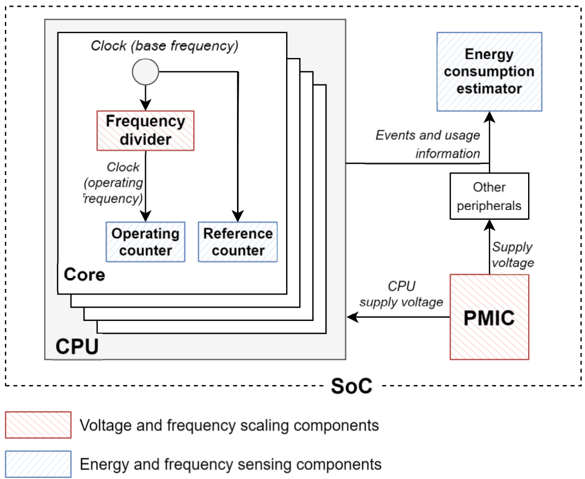
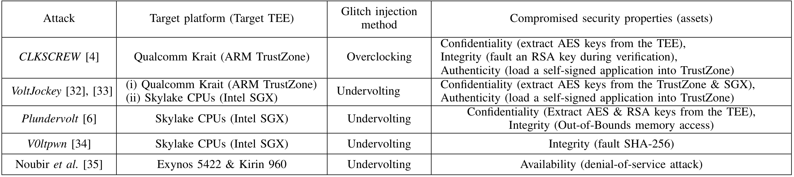
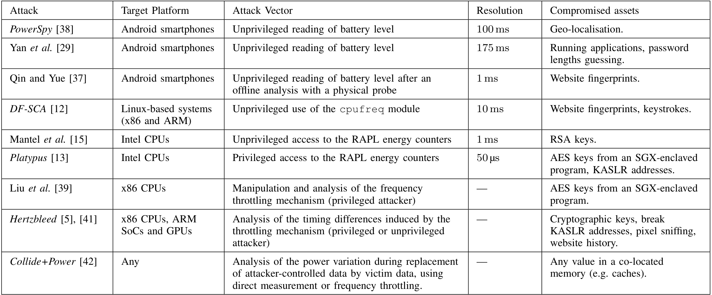
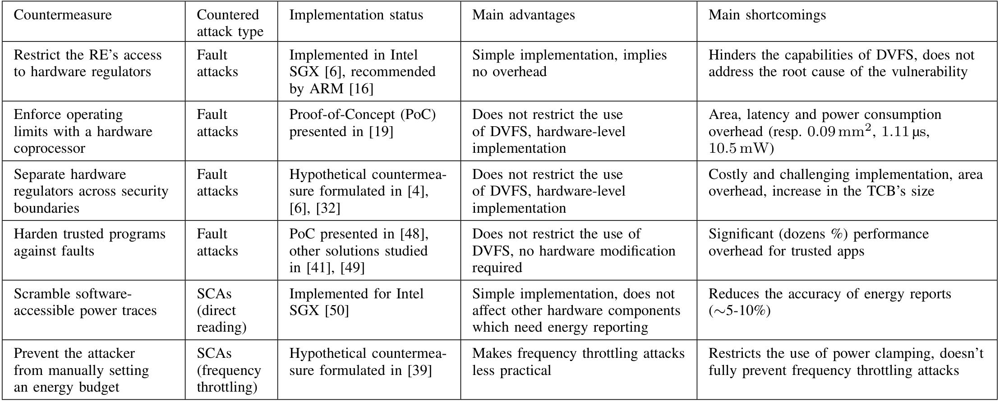

# 电源管理安全综述：数字DVFS控制器除了选档，还应限制什么

[从零入门](start.md) · [原图表索引](figures.md) · [双语摘要与导读](abstract.md)

## 核心信息

- 标题：Do Not Trust Power Management: Challenges and Hints for Securing Future Trusted Execution Environments
- 标题翻译：不要盲目信任电源管理：保护未来可信执行环境的挑战与启示
- 作者：Owen Le Gonidec、Maria Méndez Real、Guillaume Bouffard、Jean-Christophe Prévotet
- 机构：Nantes Université/CNRS/IETR、ANSSI、INSA Rennes等
- 发表时间：用户提供的2024作者稿；对应arXiv v1提交于2024-05-24
- 发表渠道：本笔记分析11页作者稿，非后续35页期刊版本
- arXiv：2405.15537v1
- 论文链接：https://arxiv.org/abs/2405.15537v1
- 论文类型：电源管理、可信执行与软件触发硬件风险的文献综述

## 原文摘要翻译

过去几年，多个研究团队提出了创新的可信执行环境硬件设计，试图保护应用免受可能被攻陷的特权软件（包括内核）影响。自2017年Tang等人引入一种利用能量管理机制的软件触发硬件攻击以来，这类攻击旨在绕过TEE安全保证、暴露密码密钥等敏感信息，并在近年不断增加。然而，现有RISC-V TEE架构尚未将其纳入威胁模型。Arm TrustZone和Intel SGX等专有实现包含应对措施，但这些措施不利于长期使用，也会限制能量管理机制能力。本文提供此类攻击的综合知识综述，并评估文献中的防护措施。分析指出假定威胁模型与实际威胁之间存在明显安全缺口，现代SoC中这些威胁甚至能够破坏TEE的安全保证。作者呼吁下一代RISC-V TEE将其纳入威胁模型，并希望推动进一步研究。（用户第1页摘要，保留作者稿时点与判断，不作为2026所有平台现状）

## 创新点

1. **把共享电源管理当作跨安全边界的资源。** 保护内存和权限并不自动阻止不可信软件改变共享电压、时钟或观测能量活动。
2. **将故障、侧信道与隐蔽通信放入同一框架。** 同一套DVFS和遥测资源可通过不同路径影响完整性或泄漏信息，不能只防一种异常。
3. **比较防护的作用位置与代价。** 关闭接口、可信监管、动态安全边界、资源隔离和软件加固各自覆盖不同风险；本文没有声称一个无代价万能方案。

这属于综述的分类和研究议程贡献，没有提出并流片一个新DVFS控制器；所汇总的面积、延迟、功率与成功率均应归原始研究。

## 一句话总结

正常DVFS可以让软件提出性能需求，但合法性、实际电源时钟执行和敏感遥测权限应经过可信边界；只保护任务内存、只封锁一个寄存器或只检查“没崩溃”，都不能自动解决全部风险。

## 研究问题

### 给初学者的阅读地图

**English paraphrase (not the original abstract):** This survey treats software-accessible power controls, telemetry, and automatic throttling as shared resources that can cross TEE security boundaries. It organizes prior attacks and countermeasures, separates implemented mechanisms from proposals, and motivates trusted OPP enforcement. The 11-page manuscript is a historical snapshot; it neither evaluates a new controller nor proves current vulnerability of every RISC-V implementation.

TEE可理解为同一机器中的受保护运行区域：即使普通操作系统不可信，敏感应用仍希望得到隔离。这里的难点是它与外部程序可能共用CPU、电源、时钟及热/功率预算。外部软件未必能读敏感内存，却可能通过这些共享资源影响或观察执行。

本文最贴近你的课题的问题是：**软件选出了一个OPP后，谁有权决定它可以执行？** 如果PLL/PMIC可被另一条路径绕开，正确的正常策略并不保证整个系统始终处于合法状态。

### 基础与进阶术语

|术语|含义与课题联系|
|---|---|
|TEE、普通环境RE|受保护环境与其余可能不可信的软件环境；用户稿用RE记后者|
|TCB|保证安全所必须信任的软硬件集合；加入监管器会增加其职责与验证成本|
|故障攻击FIA|通过不合适的电压/时钟导致错误；对应合法OPP、时序与保护问题|
|侧信道SCA|不直接读秘密，而从功率、频率或耗时等相关信号推断；对应遥测与策略可观测性|
|隐蔽通信|两个合作程序利用非正式通道传递信息；与无意泄漏的侧信道不同|
|可信代理|不可信软件提出请求，由较可信固件/硬件验证后执行；“谁选档”和“谁批准”可以分离|
|PVT与老化|工艺、电压、温度和时间变化影响真实安全边界，静态表不一定覆盖全部状态|

## 数据与任务定义

### 用户稿范围与关联版本

用户稿为11页、60条参考文献。arXiv v1记录的题名、作者和摘要与当前稿对应；另已检索到2025年TECS关联版本，题名改为关于内部能量攻击的综述，DOI为10.1145/3735556，篇幅35页。**本笔记只精读用户11页稿，不把后续扩展页和分类冒充已在该稿读到。** 期刊入口与版本依据见引用。

用户稿关注攻击程序在CPU运行、威胁TEE的内部路径，并明确将FPGA-to-CPU欠压攻击排除在此范围外。后续版本范围不同，因此不能沿用旧稿的排除条件描述整项研究所有版本。

### 文献如何选、实验究竟是谁做的

作者按机制汇总代表性文献，没有给完整数据库检索式、检索截止日和可重建的全部纳入/排除流水。因此这是知识型综述，不能称为穷尽全领域的系统检索或元分析。

|材料|作用|不是哪一种证据|
|---|---|---|
|表I故障研究|整理平台、控制向量与受影响属性|不是综述作者新跑五个平台|
|表II观测研究|整理权限、通道和采样间隔|采样间隔不是总攻击时间，也不是统一成功率|
|表III防护|整理实现状态、适用风险和开销|不能把不同原论文数值横排成公平排名|
|§IV设计讨论|提出RISC-V/TEE可能采用的治理方法|未验证建议已部署到E902|

默认威胁模型允许攻击者控制不可信操作系统及驱动，但不要求物理接近目标；某些观测路径权限更低。它比“普通应用有一次API调用权限”更强，也不意味着互联网上任意人不经执行入口就能改变你的板卡。

## 方法主线

### 机制流程

这里重建的是综述的分类与证据综合过程，不是新硬件的运行算法。

1. **识别共享资源。** 输入已有电源管理和TEE文献，提取控制、观测与自动节流接口，输出供后续分类使用的共享资源维度。
2. **按安全影响分类。** 输入既有攻击研究，提取平台、权限、观察粒度和资产，按故障、侧信道、隐蔽通信更新分类，输出表I/II及相关论述。
3. **按防护作用点比较。** 输入防护文献，提取禁用、可信许可、安全边界、隔离和程序加固的作用点，更新“已实现/原型/假设”与代价记录，输出表III。
4. **提出设计缺口。** 输入以上分类与现有TEE威胁模型，对齐尚未覆盖的路径，输出未来监管和软硬件共同设计问题；此步是研究建议而非新实验结论。

### 1．控制路径和观测路径要分开画

*原图1，第2页：红色是电压/频率调节部件，蓝色是能量/频率观测部件，PMIC、分频器、计数器与估计器各有不同角色。*

左边时钟经分频进入核心，运行计数与参考计数可用于估计实际频率；右边电源路径给CPU与其他部件供电，事件信息也可进入能量估计。图是典型示意，不是你已有PLL/PMIC的寄存器规范，也没有穷尽所有平台实现。

正常选频器关注“需要多快”；安全许可器关注“这个请求是否允许”；遥测接口关注“能观察到什么”。三者可由不同模块负责。允许普通软件看某些统计，不等于允许它任意调压；拒绝直接读频率，也不保证执行时间不随频率变化。

### 2．三类风险为何需要不同防护

|类别|系统关系|设计上优先检查什么|
|---|---|---|
|故障|不合适状态影响计算路径/稳定性|OPP合法性、过渡态、错误监测和回退|
|侧信道|任务活动影响功率/频率/时间，可被观测|观测权限、粒度、数据依赖和自动节流行为|
|隐蔽通信|合作程序主动利用共享管理资源交流|安全域间资源共享、预算与观测隔离|

这不是三套操作教程，而是对正常DVFS设计的三类验收要求。即使所有任务输出正确，仍可能存在数据相关时间变化；即使禁用直接写电压，自动节流也可能随负载产生可观察变化。

### 3．可信代理：把选档和批准分离

用户稿讨论由RISC-V的M-mode安全监控层访问调节器，其他软件只提OPP请求。代理检查状态是否属于允许集合，再执行。应用或OS仍可给性能/功率需求，并不一定要失去全部DVFS能力。（第7–8页§IV-A1）

但是代理成立有前提：请求必须经过它，备用寄存器和总线路径不能绕过；实际OPP需要确认；表必须考虑温度和器件变化；控制源复位、权限变化和并发请求也要处理。仅在Linux应用里加一个if判断不足以保证更低层不能直接写硬件。

### 4．Blacklist Core：学习器判“能不能用”，不是判“哪档最省能”

用户稿引用[19]，讨论专用协处理器依据离线表征训练轻量模型，判断请求OPP是否安全；运行时出现错误后调整边界，以处理温度与老化变化。综述转引每次判定约1.11µs、250MHz下约10.5mW、面积0.09mm²。（第7–8页、表III）

这条路线与智能选频可组合：正常策略产生候选，安全模型许可或拒绝，执行器完成切换。但安全分类器有两类错误：误拒安全点会损失效率，误放危险点会破坏正确性；后者通常更关键。一次分类准确率很高不等于所有危险边界都不会误放，需要按危险点分布、PVT和最坏条件测试。

综述没有实现这个模型，也未给其完整网络与所有输入规则。作者公开的Blacklist原文已定位，现阶段仅核对身份和主张，不能称本轮完成该文全文复现。

### 5．SUIT：两条OPP曲线和指令敏感性

引用[52]提供另一种co-design方向：在保守OPP曲线之外增加更省能曲线，遇到对故障敏感的指令时切回保守配置；对频繁且敏感的操作，还可通过放宽关键路径等硬件措施提高容忍度。它把软件指令行为与硬件电压裕量联系起来。（第8页）

这不是用户稿作者的新方案，详细策略和开销应回SUIT原文。对你而言，启发是控制输入不只能是利用率，也可以是阶段、指令类别或延迟敏感事件；但不能在没有可靠标识、硬件支持与切换预算时直接照搬。

### 6．其他防护为何有代价

表III将分离安全域稳压器作为假设路线：可减少共享，但硬件面积、控制复杂度与TCB可能增加。不是把两核分别设置两个软件变量，就实际获得了独立供电。

软件冗余、错误检测或陷阱可以增加错误被发现的机会，却消耗运行时间、代码和能量；相关防护在部分引用中的报告并非跨架构证明。遥测扰动或降分辨率会影响能效策略的数据质量，也未必消灭时间观测路径。应按目标分别验收，不把一项成功当作全部安全属性通过。

### 7．与你控制器的输入、触发、输出怎样衔接

|层|输入与触发|决策/输出|需要验证|
|---|---|---|---|
|性能策略|任务需求、阶段、剩余时间、可信统计；任务/窗口触发|候选opp_id|满足时延，含策略开销|
|安全许可|请求、权限、温度/电源状态、合法表；每请求触发|允许/拒绝/回退状态|非法请求不能经其他路径执行|
|数字执行器|已批准状态、实际状态；请求或异常触发|PLL/PMIC事务、完成/失败|顺序、稳定、锁定、超时、复位|
|遥测出口|能量/频率/温度数据及调用者身份|被允许的统计视图|数据可信、足够控制使用，权限和粒度符合系统需求|

这是根据综述为你的课题整理的设计分层，不是原文已经综合验证的寄存器接口。没有TEE需求的最小E902课题也可先做“合法OPP许可+安全执行”，不必为写毕设新实现完整TEE。

## 关键结果

### 表I：平台不同，风险边界却相通

*原表I，第5页：五类既有故障工作、目标平台、控制类型与影响属性。*

从左到右读研究→平台/TEE→影响途径→安全属性。多平台记录说明电源时钟接口可以越过内存层面的隔离产生影响。它不表示每款当前CPU都有同一入口，也不是作者新测的攻击成功率。通用DVFS课题应带走“请求许可、真实执行与正确性”要求，不能把表中的异常工作点当成自己的合法OPP。

### 表II：采样慢也不自动安全，但不能混淆指标

*原表II，第6页：遥测/节流研究；Resolution列是相邻测量最小间隔，不是恢复秘密所需总时间。*

表内有50µs、1ms、10ms及更慢的观测间隔。权限、通道和所推断对象各不相同，有些依赖直接计数器，有些通过时间。不能把分辨率最低的一行当作攻击最强，也不能因你的控制周期为10ms就推定泄漏不存在。

所有条目都是二手汇总，具体复现实验的机器、软件版本、样本量与限制要回原文。表中“Any”等概括尤其不能当作对任意E902硬件已验证。

### 表III：比较防护覆盖与开销，而非选最大百分比

*原表III，第7页：六类防护及实现状态、优点和不足，已有措施、PoC和假设方案不能混称部署完成。*

|防护路线|主要覆盖|对DVFS课题的约束|
|---|---|---|
|限制直接调节|针对特定控制接口故障路径|可能缩小可用工作点空间，仍需可信执行与遥测设计|
|硬件安全边界|阻止不安全OPP|增加每次请求判定与持续硬件开销，需更新边界|
|分离调节器|减少安全域共享|物理域分割、面积和协议成本|
|程序加固|检测/容忍某些错误|任务时间/代码开销，未必覆盖所有故障类型|
|扰动遥测|降低某些直接观测质量|综述转引约5–10%报告变化，影响控制和计量|
|限制预算配置|提高部分节流观测难度|不能保证消灭所有负载相关时间变化|

表III的0.09mm²、1.11µs、10.5mW来自[19]，不是本综述测量。正文另转引某软件防护148.4%时间和50–150%代码开销、约99%特定防护结果，均受其原始实验设置约束，不得作为你控制器的预期常数。

## 深度分析

### 全部原图表索引

一图三表均已内嵌。自动抽取漏掉罗马数字表号，并把图1正文提及当图注，本轮按实际原页修复索引，原PDF与原始正文未改动。

|项/页|阅读重点和边界|
|---|---|
|图1／2|控制与观测红/蓝区分；典型架构示意，不是完整PLL/PMIC手册|
|表I／5|平台、权限与影响；非统一成功率比较|
|表II／6|通道与测量间隔；采样周期不同于总实验耗时|
|表III／7|实现状态与代价；不同文献、平台和防护目标不可直接排名|

### 主张证据矩阵

|综述主张|支撑|合理结论|不能外推|
|---|---|---|---|
|内存隔离不够|多项不同平台既有研究|系统威胁模型需要共享电源管理层|所有当前RISC-V/TEE都有已知漏洞|
|许可器可保留DVFS|可信代理讨论、Blacklist、SUIT引用|可探索批准与执行分离的co-design|该综述已有验证完备的新RTL|
|故障和侧信道需分开|表I/II和§IV不同防护|零错误不等于零泄漏|只关闭遥测就消除全部时间通道|

### 对正常DVFS流程应加的两条原则

**合法端点还不够，要检查中间过程。** 两个OPP各自合法，若升频早于电压建立或控制反馈丢失，转换中仍可能有错误。许可器和执行器需要一同约束，不是只在表里查到opp_id就结束。

**观测既要可信，也要说清测量来源。** 能量报告可能来自模型、传感器或混合路径；某接口读数被扰动后，策略未必能按原精度运行。不能从本综述对某RAPL实现的描述推断所有处理器或你平台的遥测方式。

用于课题的净收益还应计入许可器：省下的负载能量，减去控制计算、许可器持续功耗、通信和切换能量，才是系统净收益。这是设计评价建议，综述没有给统一公式实验数据。

## 局限

### 综述和版本边界

本稿缺完整可重建检索流程，不能证明没有遗漏后续研究。2024稿对厂商措施、RISC-V TEE及“尚未有某防护”的表述是历史判断，不能不核实就写成2026现状。已发现关联期刊扩展，但本笔记未声称读完35页版本。

表I/II/III依赖异构原始实验，没有统一负载、工艺、软件版本或统计分母。多数机制讨论可以转化成需求，数值开销仍需你的目标平台独立验证。

### 初学者不能照抄的粗略物理表述

用户稿说V/f对功率有立方影响，这依赖特定近似，不是普适精确律；常见动态功率关系还受活动率、电容与电压平方及频率共同影响，静态功耗另计。正文一处说执行时间与频率正比，若执行周期数固定，基本关系应是时间约为周期数除频率，实际任务还受访存等限制。不要用这两句简化描述直接建立控制预测器。

学习器允许/拒绝的安全性、可信测量、未文档接口、共享域和异常回退仍有工程缺口。对非法访问的抵抗与对被批准但危险过渡态的防护是不同问题；双方都需要测试。

## 我的笔记

### 怎样“复现一篇综述”

1. 固定阅读版本与参考文献号，建立每项主张→原始研究→平台/接口→指标/限制的证据表。先沿[19]、[52]等直接DVFS控制文献，纯密码学或非电源管理材料只作背景。
2. 逐项区分已实现、硬件原型、软件实验、分析建议与未验证假设。复制表格数值必须保留分母和来源，不能当作新控制器实测。
3. 对你的平台先画权限与总线图，检查性能策略、许可器、PLL/PMIC接口和遥测通道。用合法读写及RTL模型检查是否存在绕过许可器路径，无需运行攻击程序。
4. 用正常任务加故障行为模型验证稳态、切换和超时，记录拒绝请求、恢复状态和结果正确性；安全性能与能耗指标分开统计。
5. 若进一步研究学习许可器，将安全/危险标签的来源、PVT划分和误放率作为主要评价，不以平均准确率代替边界保障。没有真轨数据只能报告模型实验。

### 三个CPU/E902相关实验

|优先级/实验|资源与价值|风险/成功标准|
|---|---|---|
|P0：OPP许可与执行分层|现有合法表、RTL/FSM和请求源；先打通正常接口|隐藏旁路会使许可无效；成功为所有请求必经检查，越界请求被拒，合法任务正确|
|P1：切换及反馈故障模型|PLL/PMIC响应模型、温度/稳定状态输入|只测端点会漏转换错误；成功为顺序正确、反馈丢失/超时回退、无死锁和错误任务被标识|
|P2：安全预测器与能量预算|表征数据、轻量模型、留出PVT/输入条件|误放危险点最关键；成功为报告误放/误拒、判定延迟及持续能耗，不宣称绝对安全|

若课题暂不包含TEE，可以把权限模块简化到明确的软件/硬件边界，仍保留OPP白名单、完成确认和回退。这些与数字DVFS控制器直接相关，也不会要求你重做模拟PLL/PMIC或完整密码系统。

本轮未运行综述涉及的攻击或防护原型，也没有测试用户电脑是否存在漏洞。完成的是全文与图表精读、版本/引用核对和面向课题的验证设计。

## 引用

1. 用户11页作者稿：[arXiv v1](https://arxiv.org/abs/2405.15537v1)。题名、作者及2024-05-24提交记录与原稿对应；本笔记内容以本地PDF为准。
2. 关联期刊版本：[TECS DOI 10.1145/3735556](https://doi.org/10.1145/3735556)。[作者项目页](https://mariamendezreal.github.io/CoPhyTEE.html)记录2025期刊版本；不把该35页版本当作本轮用户稿已精读内容。
3. 原稿[19]：[Blacklist Core作者公开原文](https://0x0atang.github.io/files/islped18_blcore.pdf)，ISLPED2018。此处为直接相关后续精读入口，未完成其全篇独立复现。
4. 原稿[52]：SUIT: Secure Undervolting with Instruction Traps. ASPLOS2024. [DOI](https://doi.org/10.1145/3620665.3640373)、[作者全文](https://www.jonasjuffinger.com/papers/suit.pdf)。引用号按11页稿，其他版本可能不同。
