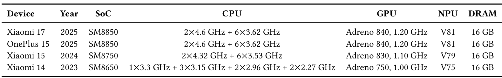
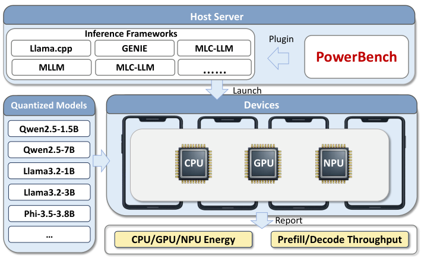
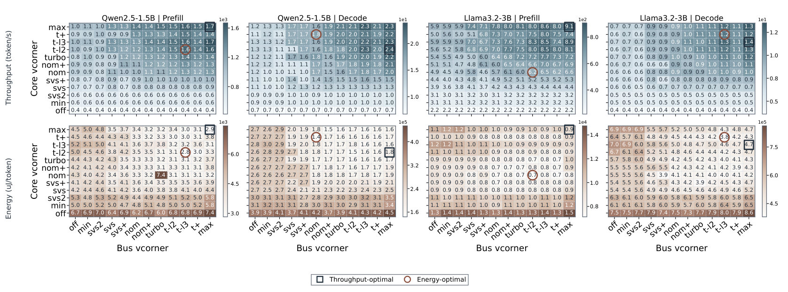
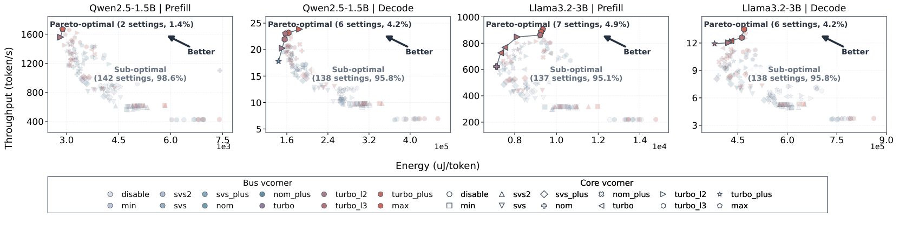
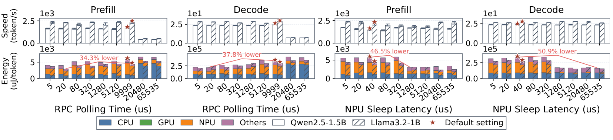
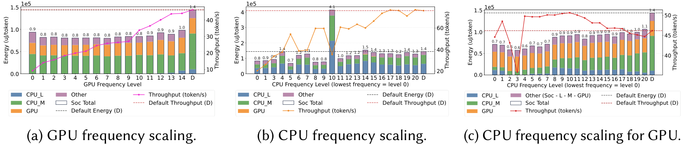
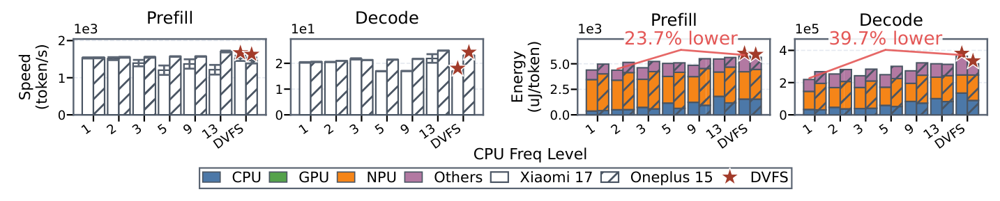
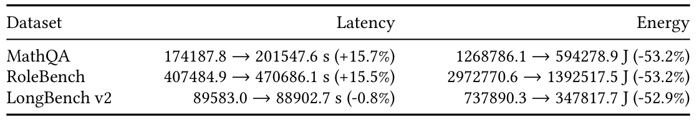

# PowerBench：怎样测清CPU/GPU/NPU的能耗，再为DVFS选择输入和工作点

[从零入门](start.md) · [原图表索引](figures.md) · [双语摘要与导读](abstract.md)

## 核心信息

- 标题：Is Your NPU Ready for LLMs? Dissecting the Hidden Efficiency Bottlenecks in Mobile LLM Inference
- 标题翻译：你的NPU准备好运行LLM了吗？剖析移动端LLM推理中隐藏的能效瓶颈
- 作者：Guanyu Cai、Ruiming Tian、Lang Yang、Zhouhong Ren、Jinliang Yuan、Lingkun Li、Jiliang Wang
- 机构：清华大学、北京交通大学
- 发表时间：2026年，本文分析arXiv v2，版本日期2026-10-16
- 发表渠道：稿件排版为POMACS 10(3)，Article 67，December 2026，25页
- DOI：10.1145/3857370
- arXiv：2607.05475v2
- 论文链接：https://arxiv.org/abs/2607.05475v2
- 论文类型：跨层测量与配置表征研究

## 原文摘要翻译

在移动设备上部署大语言模型能够增强隐私并降低时延，但硬件效率不足严重限制了这一过程。作者提出一项全面的移动端LLM推理跨层测量研究，覆盖五种主流框架（例如llama.cpp和GENIE）以及CPU、GPU、NPU三类硬件后端。为开展分析，作者开发了细粒度剖析工具PowerBench，用于测量LLM吞吐，并提供移动LLM推理的后端能量归因，超越传统设备级测量。作者还通过硬件微基准表征移动CPU、GPU和NPU的存储系统性能与计算能力。研究得到三项主要认识：第一，由框架造成的性能差距在NPU上被显著放大，可达10倍，原因包括卸载策略、不能充分利用硬件的算子以及激活量化策略不同。第二，推理存在明显的阶段差异：NPU擅长计算受限的提示处理，而CPU在访存受限的逐词生成阶段优于其他后端。这源于NPU偏好大型固定形状负载，与生成阶段的小算子及动态特征相冲突。第三，分后端剖析发现了先前研究遗漏的调度优化空间。欠佳的线程配置、不协调的NPU睡眠延迟和CPU轮询间隔会造成不必要的能量消耗。例如，仅调整CPU频率就能使能量消耗最高下降39.7%。利用这些发现，作者估算，一套面向能量的配置能够在三个数据集的NPU后端上将能量消耗最高降低53.2%，表明移动端LLM部署仍有较大的效率提升潜力。（第1页摘要）

## 创新点

1. **将“谁在耗能”纳入同一评测体系。** 在相同推理窗口内测量SoC、CPU、GPU和NPU能量，比仅比较tokens/s或整机电池下降量更容易找到协调问题。它依赖平台已有遥测接口，贡献主要是统一的剖析基础设施和实验组织。
2. **将框架行为与硬件极限联系起来。** 除真实模型外，还测算子、调用、缓存和带宽，使“高峰值算力为什么没有带来高吞吐”得到可检查的机制解释。
3. **用实测配置空间展示调度和DVFS余量。** 作者分别扫描频率、NPU核心/总线工作角及轮询/睡眠配置，展示吞吐与能量的取舍。论文没有提出并部署一套新的强化学习调档器。

这里的LLM是被控程序的工作负载；PowerBench是测量工具。二者均不能直接等同于你要设计的数字DVFS控制器。

## 一句话总结

先固定真实推理任务，测出每个执行阶段在不同合法配置下的时延与能量，再找性能合格的省能工作点；本文提供这套表征证据，而PLL/PMIC的底层执行协议仍由平台承担。

## 研究问题

### 阅读地图：这篇论文最能回答你什么

先读“方法主线”的计量和扫档，再看图14的二维工作点与图15的Pareto前沿，最后看图16和表9。你会知道哪些数据足以支撑一个选档器，也能看到从一张实验表到实际硬件闭环还差哪些模块。

**English paraphrase (not the original abstract):** PowerBench characterizes mobile LLM execution across frameworks and heterogeneous backends using standardized timing, energy attribution, and hardware microbenchmarks. Configuration sweeps reveal phase-dependent bottlenecks and coordination costs. Measured CPU-frequency savings and estimated end-to-end savings are distinct results; the work does not implement a new online DVFS controller or expose a complete PLL/PMIC transition protocol.

直观地说，NPU像一条适合大批量生产的流水线。一次送入大量工作时很高效；如果每次只做一个很小的操作，却需要不断由CPU发命令、等待并同步，生产线的高峰值能力就未必能转成真实任务速度。这只是帮助理解的类比，是否发生要由实际算子和调用测量证明。

论文的研究空白是：只看CPU/GPU/NPU的峰值TOPS、模型总吞吐或整机功率，会掩盖框架实现、数据搬运、CPU辅助和NPU电源状态之间的耦合。因此它同时回答两个层次的问题：哪个后端适合哪一阶段，以及在已选后端上有哪些省能配置。

### 术语按三个层次掌握

|层次|术语|含义与本篇用途|
|---|---|---|
|A：先看懂任务|prefill，提示处理|并行处理输入token、建立上下文缓存，通常有较大的矩阵乘法|
|A|decode，逐词生成|依次生成token，每一步依赖前一步；小矩阵向量运算和访存占比可能更高|
|A|吞吐、能量、功率|tokens/s表示快慢；J或µJ/token表示完成工作耗多少能量；W表示瞬时或平均耗能速率|
|B：理解实验|GEMM/GEMV|矩阵乘矩阵/矩阵乘向量，决定同一硬件是否有足够并行工作|
|B|PMIC zone、累计能量计数|平台按供电区域提供的能量遥测；读两次做差获得测量窗口能量|
|B|vcorner|供应商定义的性能/电压等级；名称本身不是伏特值，也不等于实际测得频率|
|C：形成策略|Pareto前沿|找不到另一个同时更快且不更耗能、或更省能且不更慢的已测配置集合|
|C|OPP|运行工作点，通常包含合法电压频率组合；还可能受温度、共享电源域和固件限制|
|C|RPC轮询、睡眠延迟|CPU/NPU协作与电源状态参数；与DVFS有关联，但不是同一种控制动作|

## 数据与任务定义

### 平台、程序和比较范围


*原表3，第6页：四台设备、SoC、CPU/GPU标称配置、NPU版本和DRAM。*

表的阅读顺序是设备→SoC→执行后端→内存。两台同为SM8850的手机用于观察设备差异，另外两台提供代际比较。**四台手机不是四代独立微架构，也不代表每个型号都有多个芯片样本。** 表中标称GHz不等于每次运行的实际频率轨迹。

|实验要素|原文设置|复现时要保留的原因|
|---|---|---|
|框架|llama.cpp eadc418；MNN 510ac8f；MLC-LLM 8f49ea6；MLLM 10d3d6a；GENIE 2.39.0|不同版本的NPU卸载路径和算子会变化|
|模型|Llama3.2-1B/3B、Qwen2.5-1.5B/7B、Phi3.5-mini 3.8B|模型规模、形状和上下文决定计算/访存压力|
|精度|权重均W4；多数激活FP16/FP32；标为W4A16的NPU配置用16位整数激活|“都是4bit模型”不足以保证公平比较|
|KV缓存|多数FP16；GENIE CPU为FP32；W4A16 NPU配置为8位整数|内存流量、容量和质量可能同时变化|
|宏观任务|控制输入/输出token、运行时间和重复；表4示例为256-token负载|不能让配置A生成更短文本就声称省能|
|微观任务|真实推理形状的层/算子；独立存储和计算微基准|解释瓶颈而不是用峰值TOPS猜测|
|质量|WikiText-2测试集固定10%行样本；窗口128，步长84；每个目标token计分一次|能效收益需同时检查模型质量|

400多配置是模型、设备、框架、后端、阶段构成的评测空间，不等于每种组合都支持，也不表示有400多个独立芯片样本。（第5–8页）

### 控制环境与重复统计

每次实验前将**电池温度**降至28°C以下；文中记录到的最低电池温度为15.8°C。关闭背景服务与通知、飞行模式、屏幕关闭；执行一次预热，至少三次正式测量并报告均值。线程数与亲和性另外扫描，默认亲和掩码为0xe0。（第7–9页及第17页）

电池温度不是CPU/NPU结温。“初始低于28°C”也不是全程结温固定28°C。重复同一手机的推理主要衡量运行波动，不能替代跨设备样本；持续热稳态、设备间变异和统计区间仍要另行验证。生物样本、临床伦理、人工类别标注在此不适用，工程对应物是设备、负载、输入、计数器和重复运行协议。

## 方法主线

### 机制流程

1. **建立可比任务。** 输入模型、框架、后端、token规模及设备条件，更新运行配置并统一计时边界，将确定的推理任务交给设备。
2. **测量一个候选。** 输入合法频率/工作角及任务，通过PowerBench提取窗口前后能量计数并记录阶段时间，把吞吐、每token能量和质量结果写入实验记录。
3. **更新候选集合。** 输入完整扫档记录，按吞吐和能量剔除被支配点，输出当前模型与阶段的Pareto表，供离线分析和后续策略设计。
4. **核对配置收益。** 输入单项配置与组合配置，分别比较默认基线、吞吐最优点和推算数据集总量，将结果及代价交给结论分析；论文到此没有形成完整在线硬件控制闭环。

### 1．主机、测量库、推理框架各做什么


*原图3，第4页：主机组织实验、设备执行框架、PowerBench记录吞吐和分后端能量。*

主机经ADB准备模型、部署二进制、设置配置、启动测试并收回记录。C++推理框架在设备上调用CPU/GPU/NPU。PowerBench以头文件库形式插入不同框架的二进制，在相同任务窗口调用start()/stop()。因此它改变的是可观测性和统一测试方式，不是给NPU重新实现一套计算电路。

图3只是概念总览，图内框架文字存在重复；实际五框架及版本以表2和第3节为准。不能根据示意框数量推断多测了一套框架。

PowerBench建立在Qualcomm QPT驱动之上，从Linux powercap的sysfs接口读取PMIC调节供电区域的累计能量。它发现可用zone并映射到逻辑后端。SoC总能量还包括其他模块，不等于只把CPU/GPU/NPU能量相加。后台线程可以按配置采样功率曲线，曲线用于辅助分析，窗口总能量主要来自计数差。（第7页§3.3）

$$
E_z=C_z(t_1)-C_z(t_0),\qquad e_z=E_z/N,\qquad \bar P_z=E_z/(t_1-t_0).
$$

这里z表示被测zone，C是累计能量，t以秒计，E以J计，N是窗口内有效token数，e以J/token计，平均功率以W计。若计数器单位是µJ，先统一单位。举例：累计计数增加200000µJ，窗口生成10token，则e=20000µJ/token；窗口持续0.5s时平均功率为0.4W。**这是解释公式的算例，不是论文实验值。**

实现时还要检查计数器回绕、更新周期、读数成本、zone重叠、权限和计数器是否覆盖该任务。论文没有提供独立外部仪表对每条zone的全面校准，不能把接口读数直接等同于任何平台的高精度电源轨真值。

### 2．阶段与吞吐边界为什么重要

prefill吞吐按提示长度除以“推理开始到首个输出token”的时间；decode按生成token数除以“首个到末个输出token”的时间。二者的事件边界不完全一样。复现须检查代码对首token、末token和实际计数的约定，尤其防止短生成任务中N与N−1造成偏差。（第7页§3.2）

对于逐词生成，一步要读取权重及KV缓存，还可能执行大量小算子和CPU/NPU往返。文章报告代表性路径每token约533次算子调用，一些计算仅1–3µs而往返耗20–30µs。（第13–14页，图7、表8）这解释了为什么NPU频率升高后，整个程序未必按比例变快：没有随该频率缩短的时间仍然存在。

这与简单的“运行周期固定，时间等于周期数除频率”模型不同。对于有访存和异构同步的程序，更实用的理解是：总时间包含随核心频率改变的计算时间，以及受存储、调度、同步和其他域限制的部分。后者较大时，降核心频率可能损失很少吞吐；低到某一点后又会进入计算瓶颈。

### 3．先用微基准验证瓶颈解释

指针追逐通过逐步增大工作集识别缓存/DRAM访问时延；流式读取测可达带宽；CPU的NEON FMA、GPU的OpenCL乘加及NPU的HVX/HMX测近峰值计算能力。统一将一次FMA/MAC计为两次运算。（第6页、图4）

图4显示NPU的矩阵单元在适合的大运算上很强，但其可达DDR带宽和缓存条件与CPU/GPU不同。NPU HMX的INT8、FP16结果不能直接与CPU另一精度的TOPS比较。图5再用真实形状的矩阵乘法连接微基准和实际推理，避免仅凭峰值数解释全部结果。

图7和表8进一步分离真实计算、调用和同步；图8显示固定大上下文的配置会引入额外工作。因而“阶段类型”“张量形状”“调用密度”和“存储压力”比抽象的“这是一个AI程序”更可能成为有用的控制输入。

### 4．CPU/GPU怎么扫档：请求配置不等于实际频点

在§8.3中，作者使用**21组可用CPU频率组合**，分别涉及policy0的cpu0–5与policy6的cpu6–7；GPU有15个频率等级。部分供应商状态无法固定保持，所以实验只保留可用配置。此处21组不是“每个核心有21个独立电压轨”，更不是任意频率均可设置。

一次扫档的实验单位是“指定程序、输入、阶段、执行配置下的一次窗口”。其他条件固定，切到一个候选，确认实际执行状态，完成预热/测量并记录结果；然后测试下一个候选。默认DVFS单列为基线D。这是离线表征过程，论文没有描述一个每隔若干毫秒在线遍历所有档位的控制器。

对于你的IC控制器，可把软件层动作理解为OPP请求，把PLL/PMIC及驱动理解为执行层。本文没有展开具体PLL寄存器、PMIC总线命令、升降压顺序、无毛刺切频或超时回退，因此不能据此直接综合出完整RTL。

### 5．NPU为什么要扫描“核心×总线”


*原图14，第18页：四组模型/阶段的NPU二维工作角扫描；上排吞吐、下排每token能量；方框为吞吐最优，圆圈为能量最优。*

横轴是总线工作角，纵轴是核心工作角。每轴12档，故每个模型阶段有144组候选。图中用off、t+、t-l2等缩写。**这是供应商状态名称，不是公开的12个伏特值；也不能假设off意味着整个NPU完全断电。** 原文完整名称如下：

```text
disable, min, svs2, svs, svs_plus, nom, nom_plus, turbo, turbo_plus, turbo_l2, turbo_l3, max
```

读图按四步：先固定一个模型阶段的整列；再对齐上、下两张热图的同一格；注意色条倍率与µJ/token单位；最后比较方框和圆圈是否重合。热图中某一行核心更高不保证更省能，因为总线可能成为瓶颈；核心过低也可能拖长任务，让其余域持续耗电。

例如Qwen decode的能量最优角为(core=turbo_plus,bus=nom)，相对吞吐最优角少耗能22.1%，但吞吐降低25.5%。这个点对严格交互速度约束可能不合格，不能只读圆圈就定最终档位。（第19页）

### 6．Pareto筛选怎样把实验表变成候选动作


*原图15，第19页：横轴越左越省能，纵轴越高越快；颜色编码总线角、形状编码核心角，较佳方向为左上。*

设配置a的能量不高于b、吞吐不低于b，且至少一项严格更好，则b被a支配。四面板的前沿分别只有2、6、7、6个点；总计21/576，555/576约96.4%被支配。**这是四次144点扫描的合计比例，不能当作任何NPU全部状态的普适比例。**

有了测量表，最简单的派生策略是：给定当前阶段s及最低吞吐R_min，在合法前沿集合中选择每token能量最小的配置。

$$
c^*(s)=\arg\min_{c\in\mathcal P_s} e_s(c)\quad\text{s.t.}\quad R_s(c)\ge R_{\min}.
$$

c是配置，P_s是阶段s的实测前沿，e_s为J/token，R_s为tokens/s。如果没有点满足约束，要报告不可满足或走明确回退，不应假装存在最优可行解。不同输入长度或温度可能对应不同表；切换开销也需要加入预算。

**上述约束式是根据论文测量结果给你的策略设计归纳，不能写成作者已实现的在线算法。** 本文没有训练标签、训练轮数、奖励函数或在线模型更新。论文中的“选择配置”主要来自扫描分析。

### 7．轮询和睡眠为什么会让同一NPU耗能不同


*原图11，第16页：CPU RPC轮询和NPU睡眠延迟的单项变化；分别显示两个推理阶段的分区能量和吞吐。*

前两个面板调RPC轮询间隔：CPU多快检查一次NPU结果。5–20µs短轮询比默认9999µs，SoC每token能量下降30.9–37.8%，吞吐变化−7.2%到+0.1%。作者把主要NPU能量下降解释为更早识别完成状态，避免NPU不必要地保持活跃；不能只按“轮询更频繁，所以CPU一定更耗电”推断总结果。

后两个面板调NPU进入睡眠前的等待时间。相对40µs默认，延长到1280–65535µs时，总能量下降44.6–50.9%，吞吐变化−0.9%到+16.2%。作者认为较少的睡眠/唤醒切换有帮助；该观察没有单独把所有内部状态转换代价和因果路径完全测出。（第16–17页）

这两组参数改变运行时协作和电源状态管理，**不能把其全部节能率归到DVFS上**。若你的方案联合调频与睡眠，至少保留默认、仅调频、仅睡眠、联合四种消融，才能说明每部分起什么作用。

### 8．从本文到你的控制器：输入、触发、决策、输出

|环节|本文实际做到|可为课题补上的实现，属于本笔记建议|
|---|---|---|
|输入|离线选定模型/阶段、运行配置，记录时间与能量|程序阶段ID、待完成工作、剩余时间、实际频率、温度/功率上限；先验证哪些可观测|
|触发|主机按实验脚本切换候选与启动测试|任务开始、分块边界、阶段切换；需要时加周期采样，避免每条指令调档|
|决策|扫档、画热图/Pareto、识别好配置|先查表，再比较带约束预测器；不要一开始就假定必须用深度强化学习|
|输出|CPU/GPU等级及NPU核心/总线角等配置请求|合法opp_id及必要域组合；执行层再转换为电压与时钟请求|
|执行确认|使用供应商现有平台，底层协议未展开|等待调压完成、PLL锁定、切频完成；记录actual_opp、busy、fault与回退|
|评价|吞吐、每token能量、质量，外加阶段推算|正确性、截止时间违约率、含切换和控制开销的净能量、温度稳定性|

升档先建立足够电压再提高频率，降档先降低频率再降电压，是需要在具体IP约束下实现的通常安全顺序，**不是本文已展示的时序图**。若现有平台频率和电压由固件统一管理，不能绕开固件直接把两者当独立旋钮。

## 关键结果

### CPU、GPU扫档：默认策略并非每个程序的能量最优


*原图13，第18页：GPU后端调GPU、CPU后端调CPU，以及GPU后端调辅助CPU；D为默认DVFS。*

|证据|比较基线|原文报告|应如何理解|
|---|---|---|---|
|图13(a)，GPU13档|默认D|每token能量−38.0%，吞吐−5.4%|省能有速度代价，非同时最优|
|同图13→10档|13档|再省能5.9%，吞吐再降22.6%|过度降档的边际取舍变差；不能与上一行直接相加|
|图13(b)，CPU8–9档附近|默认D|能量约−50%，吞吐约−13%|程序和具体频率组合相关，不适用于所有CPU负载|
|图13(c)，GPU负载的CPU9档|默认D|吞吐+13%，能量−51%|GPU执行也有CPU辅助；改善不只来自GPU本体|

图13(b)还有部分中间档位能量反而更高。正文对CPU频率等级的部分编号与图横轴0–20存在映射歧义；复现应记录各policy的实际Hz，不能把“等级9”直接写成通用的某个MHz。

### NPU核心/总线：最省能点可能不满足速度要求

下表均是**能量最优角相对吞吐最优角**，基线不同于图13的默认DVFS。（图14，第19页正文）

|阶段|能量最优(core,bus)|每token能量变化|吞吐变化|
|---|---|---|---|
|Qwen2.5-1.5B prefill|(turbo_l2,turbo_l3)|−2.0%|−6.5%|
|Qwen2.5-1.5B decode|(turbo_plus,nom)|−22.1%|−25.5%|
|Llama3.2-3B prefill|(nom,turbo_l2)|−23.7%|−31.3%|
|Llama3.2-3B decode|(turbo_plus,turbo_l3)|−19.1%|−11.7%|

若吞吐最多允许下降10%，上表后三个“全局最省能角”都不合格，应回到前沿找别的可行点。这是把论文结论转成控制约束的必要一步。

### NPU推理时调CPU：39.7%是哪项实验


*原图16，第20页：Qwen2.5-1.5B在两台设备上的NPU推理，固定不同CPU档位，与默认DVFS星标比较。*

左两图先看速度，右两图再看能量和分区。CPU降档不意味着NPU本体停下来，但CPU请求、同步和其他开销会改变整条路径。论文报告prefill每token能量最高下降23.7%，decode最高下降39.7%。**这是一项具体CPU频率实验的测量结果**；两台设备的速度变化不同，不能写成“CPU设最低档永远不影响NPU吞吐”。

### 表9：53.2%为什么必须加上“估算”


*原表9，第21页：根据阶段吞吐与每token能量推算的数据集端到端影响，非三个完整数据集全程运行积分实测。*

作者将RPC轮询20µs、睡眠延迟65535µs和CPU最低频率组合，在GENIE NPU路径获得阶段统计：prefill能量−52.9%、吞吐+0.8%；decode能量−53.2%、吞吐−13.6%。再利用数据集输入/输出token长度推算总量。（第20–21页§8.5）

$$
T\approx N_p/R_p+N_d/R_d,\qquad E\approx N_p e_p+N_d e_d.
$$

下标p、d表示prefill和decode，N为token数，R为tokens/s，e为J/token。各样本求和得到数据集估计。该式隐含阶段统计能够代表样本、开销边界一致等条件；不能自动覆盖模型加载、所有输入形状变化、热稳态与状态切换额外成本。

MathQA能量1268786.1→594278.9J，约−53.2%，但时延174187.8→201547.6s，+15.7%；RoleBench时延+15.5%；prefill占比较高的LongBench v2则时延−0.8%、能量−52.9%。因此“省一半能量”不等于所有交互都更快，也不等于仅靠CPU调频省了一半。

### 其他结果如何帮助判断DVFS输入

大矩阵prefill、decode小算子、上下文配置及量化方法均改变瓶颈。图6中更激进激活量化可提高吞吐并降低能量，但PPL也可能变差；表7的质量结果必须一起读。表6比较的GENIE计算占比与MNN墙钟时间占比分母不同，不能直接相减当作某个算子的因果节能。

可信度判断：本文对所测配置具有较强的机制诊断价值；对任意手机、长期热负载或E902的数值外推可信度低。这里的“可信度”是证据适用范围判断，不是本笔记已独立复现。

## 深度分析

### 全部原图表阅读索引

主文内嵌8项；其余条目在这里说明问题和边界。页码是用户PDF页码。解析器把图4a/b/c的正文讨论额外识别为图项，已合并到图4，不重复计数。

|原项/页|它回答的问题、读法与证据边界|
|---|---|
|图1／2|已有工作的跨层覆盖；按框架/后端/指标维度读，属于作者对相关工作的定位，不是性能实验|
|图2／4|CPU/GPU/NPU与共享存储关系；帮助定位带宽和缓存，示意拓扑不提供完整芯片连线参数|
|图3／4，已嵌|实验组织与测量输出；实际框架数量以表2和正文为准|
|图4／10|缓存时延、带宽和计算微基准；先看单位/精度与工作集，再看后端差异，不直接外推真实模型速度|
|图5／11|真实形状矩阵乘法在QNN/llama.cpp上的表现；分离大GEMM与小GEMV，不能只看理论TOPS|
|图6／12|激活量化引起的吞吐/能量变化；同时核对表7质量，不能全部归因DVFS|
|图7／13|decode算子时间分解；用组成和时间尺度找瓶颈，调用次数多不等于计算量最大|
|图8／15|固定上下文配置的额外代价；4096与小配置比较支持冗余开销，不表示所有NPU必须使用相同上下文|
|图9／15|设备与CPU/GPU后端的decode差异；模型和设备要成对比较，代际趋势不代表独立硬件普遍规律|
|图10／16|CPU/GPU/NPU与其他部件能量归因；SoC与子zone不能不核对包含关系就相加|
|图11／16，已嵌|RPC与睡眠调节；读四面板的默认星标和吞吐，两个参数不是DVFS单项|
|图12／17|线程数、核亲和性与能效；软件调度也是变量，频率比较前应固定它们|
|图13／18，已嵌|CPU/GPU频率扫描；D默认基线与等级编号必须分清|
|图14／18，已嵌|NPU二维工作角；同一格对齐上下两图，读取每面板倍率和两个最优标记|
|图15／19，已嵌|Pareto点筛选；越左上越好，前沿只对当前候选和测量条件成立|
|图16／20，已嵌|NPU推理的辅助CPU档位；分设备读速度与能量，不能只抄39.7%|
|表1／3|本文与既有测量覆盖的比较；检查分类轴，不当作全部文献的系统检索结论|
|表2／5|框架版本与支持后端；可运行不代表内核和量化完全一致|
|表3／6，已嵌|平台身份与标称配置；不等于运行时实际OPP|
|表4／8|256-token任务吞吐、能量和PPL总览；先固定模型、框架、精度再跨后端比较|
|表5／9|重复性和温度条件；有助于区分运行波动，不能代替长时热稳态和多芯片统计|
|表6／11|两框架的操作组成；计算百分比与墙钟百分比分母不同|
|表7／12|PPL质量；同一量化名称仍需检查激活和KV差异|
|表8／14|GEMV计算与调用成本；计算周期和端到端延迟要分开|
|表9／21，已嵌|数据集估算总时延/能量；与直接端到端测量分开保存|

### 核心证据矩阵：到底证明了哪一层

|主张|直接证据与对照|能支持|还不能支持|
|---|---|---|---|
|后端归因发现浪费|同一任务窗口的zone能量；图10/11/16|CPU辅助和NPU状态会影响总能量|所有zone都经外部仪表精确校准|
|高峰值NPU不一定适合decode|图4/5/7、表8和真实模型比较|形状、访存、调用在测试路径中有重要作用|所有未来NPU和框架都比CPU差|
|二维选角有必要|图14与144点散点图15|核心/总线组合显著改变能效，存在少量前沿候选|前沿跨温度、输入、设备保持不变|
|CPU频率能改善NPU推理能量|图16的同负载变频实验|具体平台和阶段最高39.7%改善|所有最低CPU频率均最优|
|组合优化有约一半省能潜力|阶段实测+表9长度模型|该估算模型下约52.9–53.2%|已实现一个无损实时在线DVFS控制器|

### 与IC闭环论文怎么归档

将本篇放在“**工作负载表征→策略输入选择→OPP候选筛选**”这一层。ISSCC硬件闭环论文更关注电压裕量、传感器、稳压和时钟响应；PowerBench更适合回答“为何调、何时阶段不同、测什么收益”。两者互补，不应因为本篇出现PMIC字样就把它归成PMIC电路设计。

主线应同时存储两类表：策略表记录状态、目标和候选OPP；执行表记录域约束、电压/频率、PLL锁定、调压延迟和故障处理。本文主要补充第一类表所需的测量依据。

## 局限

### 关键：完整在线执行链尚未展开

论文没有给出可直接移植的完整实际电压/频率表、在线采样周期、PLL配置事务、PMIC稳定反馈与异常回退规范。NPU工作角由厂商运行时抽象，CPU/GPU频率也受系统策略影响。它不能单独作为数字控制器的完整实现说明书。

### 重要：测量、推算和比较的边界

- QPT遥测依赖特定平台/权限；短窗口分辨率、计数器读数开销和跨zone校准需要进一步核对。数据接口可用不代表可以精确归因每个微秒算子。
- 四台设备/三代平台和至少三次重复提供一定覆盖，但没有充分证明所有输入长度、设备批次和持续热状态的普遍结论。频点实验还应记录固件干预、实际OPP和结温。
- W4权重相同不代表激活、KV精度及质量一致。跨框架峰值结果不能直接当作同等质量下的硬件胜负。
- 表9使用阶段平均吞吐和每token能量推算；尚需端到端运行验证长度分布、缓存变化、冷启动、切换与热效应。
- 同时调整轮询、睡眠、CPU档位的组合收益不能无消融地归于DVFS；所有“最高”值也不是同一配置可同时获得。

### 次要但影响复现的缺口

图13部分频率等级与正文编号关系需确认；代码里的token计数边界、完整配置脚本和PowerBench可获取版本还需要查验。不能因为相关推理框架开源，就宣称整套测量和配置数据均已公开。稿头给出2026年12月卷期，本笔记仅分析当前用户提供的v2，不声称未来卷期已实际出版。

## 我的笔记

### 最小复现：有同类设备时

1. **固定环境。** 记录手机/SoC、系统、内核、QNN版本、各框架提交、模型文件哈希和量化格式；确认root、QPT可读性和可控policy。先读默认状态和权限，不盲写别的平台寄存器。
2. **跑通一个负载。** 从一个小模型、一个框架、一个后端开始，固定输入/输出token及停止规则；输出文本/数值校验、阶段时间和默认能量，保证正确性稳定。
3. **核对仪表。** 枚举zone及单位，检查累计计数单调性、更新粒度、回绕与空闲读数，确认测量窗口长度足够；有条件用外部电流仪对总输入能量交叉检查，保留遥测与外部两列。
4. **复现单维扫描。** 先仅扫CPU合法状态，记录请求与实际Hz、温度、时间、token、各zone能量；每候选至少沿用论文一次预热和三次重复。随机化候选顺序是本笔记建议，用于减少温漂/顺序偏差。
5. **复现二维扫描。** 只有平台实际暴露独立核心/总线角时才扫144组合；不可达、被固件覆盖、结果错误或测量不完整的组合标失败，不填补成“0能量”。
6. **建立前沿与约束。** 同模型同阶段筛选Pareto点；按预设最低吞吐选可行点。在未参与表征的新输入长度、温度和持续运行上验证，比较默认、固定最高、固定最低、最优固定、阶段查表策略。
7. **再复核组合收益。** 单独改变轮询/睡眠/频点并做联合消融；最后实际跑一组完整任务，积分能量，检查与表9式推算的偏差。未完成这一步只能报告估算。

建议原始日志字段：run_id、设备/版本、模型哈希、后端、phase、N_prompt、N_generated、requested_opp、actual_f、温度起止、counter起止、时间起止、输出校验、失败原因。原始日志先落盘，再算百分比，避免只有图没有证据。

### 没有手机时：怎样做你的软控软

先在CPU上用分块压缩、定长数值运算、数组遍历等可验证程序建立实验；应用尚未定题，不要求E902运行大LLM。用计算密集/访存密集两种程序验证“同一频率改变对不同瓶颈作用不同”。

如果电脑允许合法CPU频率控制，可以用软件选OPP，由现成OS/固件执行，程序真实运行，能量用平台计数或外部仪表测。这属于软件策略控制真实处理器工作点。若只有离散事件/行为模型，就让程序或trace提供工作量，模型给出各OPP的延迟与能量响应；这时能验证策略逻辑、预算和稳定性，节能数值仍是模型估计。二者都不要求先写RTL，但必须标明实验是哪一种。

### 三个紧贴CPU/E902的后续实验

|实验/优先级|价值和所需资源|风险与成功标准|
|---|---|---|
|P0：单域扫档和查表|CPU程序+可读时间/能量，先学会可重复表征|若能量为模型需明确；成功为同输入正确性一致、前沿可重复、能说明代价|
|P1：阶段和截止时间约束|增加程序阶段标记、留出输入；比较固定档与阶段查表|阶段切换过多可能亏损；成功为满足预设违约率且净能量改善，计入控制和切换成本|
|P2：数字执行器co-design|RTL/FSM+现有PLL/PMIC行为模型，后接实际IP/板级接口|FPGA不一定可调核心供电；成功为合法状态、正确顺序、握手/超时/回退通过，再单独报告真实轨测试|

需要进一步的具体问题：QPT的更新周期和校准误差是多少？角名称与实测V/f如何对应？代码怎样定义decode的token边界？Pareto表在新输入和结温下有多大漂移？把这些问题补齐，比给策略套一个复杂“智能”模型更接近可复现的IC课题。

本笔记已核对论文方法、正文结果与所嵌原图，但未运行作者推理框架、未独立复现其手机能量数据。复现步骤和CPU/E902实验是研究建议，不是完成记录。

## 引用

1. Guanyu Cai et al. Is Your NPU Ready for LLMs? Dissecting the Hidden Efficiency Bottlenecks in Mobile LLM Inference. arXiv:2607.05475v2, 2026. [当前版本](https://arxiv.org/abs/2607.05475v2)。
2. 本文正式标识：[DOI 10.1145/3857370](https://doi.org/10.1145/3857370)。方法§3，第6–8页；配置§8，第16–21页；局限/讨论第21–22页；参考文献第22–25页。
3. 本文参考文献[11]：Dissecting the Impact of Mobile DVFS Governors on LLM Inference Performance and Energy Efficiency. [arXiv:2507.02135](https://arxiv.org/abs/2507.02135)。此处记录的是原文真实引用关系，不能据此声称本笔记已对该文重新全文精读。
