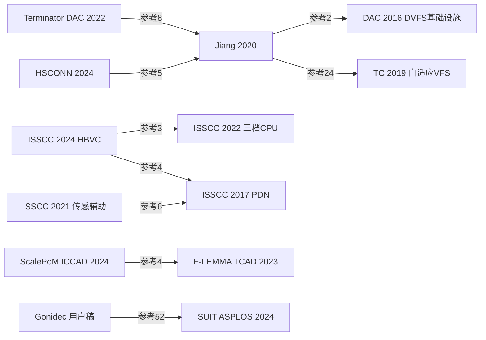
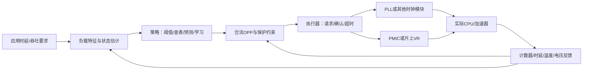

# DVFS技术脉络：从能运行的档位，到能执行的控制系统

更新2026-11-08。综合知识库：new_paper的14份PDF正式笔记已全部完成，并补充有明确来源的直接相关引用链。不宣称独立复现或穷尽所有被引。

**14/14正式图文笔记、104项内嵌原图表/算法。** [Liu博士全书](liu-dissertation/note.md)完成135页/59项图表核对，详解离线预测与运行时选档、粗细粒度、异频缓冲、PLL/SIMO及CPU/E902复现。新完成的[EARA](eara/note.md)按DEAR九步拆解联合控制，并保留功率×时间/能量、模块总和、版本及物理执行缺口；[可穿戴综述](wearable/note.md)用于需求生成与系统边界，非IC控制器核心证据。其参考10给出的arXiv2310.09692实际题名/作者不符，59–66%等预测DVFS数字不可依此追溯，不画作已确认的技术继承边。两篇是深入审查，不意味着原文所有主张通过核实。

新增[能量感知深度学习综述](energy-dl/note.md)完成全文/六图表：其中参考81→PredictiveExit是真实直接DVFS引用边。综述列2022预印本，正式AAAI2023 DOI10.1609/aaai.v37i7.26042身份与摘要已核，原始研究全文仍待另做；不能把NAS、早退、卸载或间歇恢复一概标成DVFS。

## 先把五个概念分开

DVFS改变工作电压与频率；DFS只改变频率；AVS在给定性能要求下利用反馈调整电压及裕量；clock gating停止部分时钟活动；power gating切断部分电源。论文经常联合使用这些技术，效果必须拆分，不能把全部收益都归于DVFS。

控制系统通常分成：任务目标/监测→状态与工作量估计→策略选择→安全执行→PLL/时钟模块及PMIC/VR→实际程序→反馈。策略“算出了档位”不等于硬件“已经安全到达档位”。

## 技术不是单线替代，而是六条并行主线

|主线|解决的问题|当前材料中的代表|对课题的用途|
|---|---|---|---|
|工作点与测量|某个V/f能否正确执行，时间/功率/质量如何变化|Jiang2020、其前序Elongate|先建立可靠基线与实测OPP|
|监测与裕量|给定频率是否能降低保守电压裕量|ISSCC2021 P/V/T/A传感器CPU|选择反馈输入，区分调性能和调安全裕量|
|执行与快速闭环|软件目标如何驱动真实时钟及电源|ISSCC2024 HBVC/FLL/PMIC|软件请求与硬件执行的分工|
|学习与分层控制|如何把复杂策略和快速响应结合|ScalePoM引用F-LEMMA TCAD2023|全局目标、局部策略和快速执行分层|
|应用与供电co-design|计算稀疏、任务映射和供电损耗如何联合优化|HSCONN、ScalePoM ICCAD2024、Liu博士论文|从应用特征寻找可解释控制输入|
|边界与安全|何时会触发欠压保护，接口怎样避免被滥用|NPU融合功率尖峰、Terminator、Gonidec安全研究|安全档位、权限、保护与恢复|

## 从现有PDF确认的引用关系

箭头表示“左边论文在参考文献中引用右边”，不自动表示技术继承或性能提升。

|引用方|被引方|证据位置|关系与范围|
|---|---|---|---|
|Jiang2020|Mantovani等，An FPGA-Based Infrastructure for Fine-Grained DVFS Analysis in High-Performance Embedded Systems，DAC2016|参考文献[2]|板级/仿真基础设施前序；需区分模拟V/f域与实测供电|
|Jiang2020|Nunez-Yanez，Energy Proportional Neural Network Inference with Adaptive Voltage and Frequency Scaling，TC2019/先行2018|参考文献[24]|神经网络FPGA与自适应工作点；正式卷期应写2019|
|Terminator on SkyNet，DAC2022|Jiang2020|PDF第6页参考文献[8]|相同SkyNet/DVFS背景被用于研究工作点安全边界|
|HSCONN，GLSVLSI2024|Jiang2020|PDF第6页参考文献[5]|应用特征驱动控制的相关工作，不能混用平台数据|
|MediaTek ISSCC2024|A 5nm 3.4GHz Tri-Gear ARMv9 CPU Subsystem in a Fully Integrated 5G Flagship Mobile SoC，ISSCC2022|PDF第1页参考文献[3]|直接说明扩展既有控制机制：软件AVS向硬件HBVC推进|
|MediaTek ISSCC2021|A 7nm FinFET 2.5GHz/2.0GHz Dual-gear Octa-Core CPU Subsystem…，ISSCC2020|PDF第1页参考文献[1]|快速电压跌落传感器前序|
|MediaTek ISSCC2021及2024|A 10nm FinFET 2.8GHz Tri-Gear Deca-Core CPU Complex with Optimized Power-Delivery Network…，ISSCC2017|分别参考文献[6]和[4]|供电及监测相关前序；不要把两个后续间画成未经核实的直接引用边|
|ScalePoM，ICCAD2024|F-LEMMA: Fast Learning-Based Energy Management for Multi-/Many-Core Processors，TCAD2023|PDF第9页参考文献[4]|学习型DVFS与快慢控制层次|
|ScalePoM，ICCAD2024|Power Management for Chiplet-Based Multicore Systems Using Deep Reinforcement Learning，ISVLSI2022|PDF第9页参考文献[8]|Chiplet供电与在线策略的直接前序|
|Liu2025博士论文|HSCONN2024、Jiang2020|参考文献[79]、[55]；第2章背景|相关研究与已读原文对应，不能重复计为独立创新|
|Liu2025博士论文第4章|Dynamic Voltage and Frequency Scaling to Improve Energy-Efficiency of Hardware Accelerators，HiPC2021|章首脚注及参考[77]，DOI10.1109/HiPC53243.2021.00037|CNN预测DVFS章节来源，2025合订年份非该方法首次年份|
|Liu2025博士论文第4章|DozzNoC，2020|参考[20]及PDF70页的8.8ns/6.9ns开销引用|开销模型来源，不等于本平台PLL/PMIC实测|
|PowerBench，2026 v2|Dissecting the Impact of Mobile DVFS Governors on LLM Inference Performance and Energy Efficiency，arXiv2507.02135|参考文献[11]|测量/工作点表征与既有手机DVFS策略研究；不意味着本文实现同一个governor|
|Gonidec用户11页稿，2024|Blacklist Core，ISLPED2018|参考文献[19]及第8页|学习模型判定OPP是否可接受，和最省能动作选择是不同问题|
|Gonidec用户11页稿，2024|SUIT，ASPLOS2024|参考文献[52]及第8页|保守/省能双曲线与指令敏感性，直接DVFS/co-design线索|
|JCEIM神经DVFS综述，2026|Jiang2020；可解释CPU/GPU governor TECS2021；时序编码DRL JSA2023|参考文献[20]/[17]/[40]|引用边可核；但CNN负载不能被误读为控制预测模型，引用存在不代表综述所有主张正确|

## 已通过公开原始来源核对的扩展入口

- DAC2016，DOI10.1145/2897937.2897984：[作者公开全文](https://www.sld.cs.columbia.edu/pubs/mantovani_dac16.pdf)。直接DVFS基础设施，尚未本轮全文精读。
- TC2019，DOI10.1109/TC.2018.2879333：[作者机构记录及全文](https://research-information.bris.ac.uk/en/publications/energy-proportional-neural-network-inference-with-adaptive-voltag/)。利用时序检测器探索工作裕量，尚未本轮全文精读。
- F-LEMMA TCAD2023，DOI10.1109/TCAD.2022.3176219：[作者公开稿](https://www.seas.upenn.edu/~leebcc/documents/zou22-flemma.pdf)。全局预算、强化学习层、快速数字控制层；与MLCAD2020 DOI10.1145/3380446.3430630关联，不重复计数，不混淆版本。
- TVLSI2024，DOI10.1109/TVLSI.2024.3415487：[作者机构记录](https://researchportal.hkust.edu.hk/en/publications/deep-reinforcement-learning-based-power-management-for-chiplet-ba/)。离线供电优化与在线DQN协同。与ISVLSI2022关系尚需核对完整版本，当前不画确定扩展边。
- SUIT，ASPLOS2024，DOI10.1145/3620665.3640373：[作者全文](https://www.jonasjuffinger.com/papers/suit.pdf)、[公开实验材料](https://zenodo.org/records/10704359)。Gonidec用户稿参考文献[52]确实引用。利用不同指令对低压敏感度的差异，在高效与保守DVFS曲线间切换；属于CPU软硬件共同设计，已取得全文，尚未本轮正式精读。机构库DOI有截断，采用作者全文完整DOI，不复制截断标识。
- TECS2018，DOI10.1145/3182172：[作者机构记录](https://research-information.bris.ac.uk/en/publications/dynamic-energy-management-of-fpga-accelerators-in-embedded-system/)。EARA参考文献[10]，研究CPU/FPGA任务选择及VFS，不把映射算法应用当电机驱动实施。

TCAD2025《A Deep Investigation on Stealthy DVFS Fault Injection Attacks at DNN Hardware Accelerators》的[IEEE出版社记录](https://ieeexplore.ieee.org/abstract/document/10591998)已核实：DOI10.1109/TCAD.2024.3426364，2024年先行、2025年44(1)39–51。它是DAC2022同主题后续阅读，完整引用/扩展关系仍待全文确认，当前不画确定继承边。暂不把只讲LLM、NoC、剪枝而不控制/分析V/f的工作放入DVFS主图。

从边缘深度学习综述参考文献[81]追到Predictive Exit：综述引用2022预印本，正式为[AAAI2023原文](https://ojs.aaai.org/index.php/AAAI/article/download/26042/25814)。它预测早退位置以便提前规划V/f，是应用工作量先验与DVFS结合的支线。沿同作者课题组资料另定位[SSMDVFS，DATE2025](https://ieeexplore.ieee.org/abstract/document/10992871)，DOI10.23919/DATE64628.2025.10992871，研究监督学习、自校准与微秒级GPU DVFS；身份与直接相关性已核，未完成本轮全文精读，不能声称它必然引用Predictive Exit。

以上箭头只表示已核对的引用方向，不能按箭头直接排性能高低。

## 当前最值得深入的三条研究问题

1. 在任务要求频率不变时，如何利用温度、工艺或延迟反馈，降低过度保守的供电裕量？需清楚区分策略目标、监测器校准和安全界限。
2. 在PLL和PMIC能力固定时，如何把切换延迟、能量及锁定/稳定反馈纳入选档？不能从ASIC快速调压直接推导板外PMIC性能。
3. 如何从程序阶段或可读计数器估计有效工作量，并在硬件执行时间预算内选档？比较查表/阈值与学习策略，报告净收益，保留安全执行状态机。

## 初学者应如何读这张图

技术发展并非“查表→神经网络→强化学习，后者必然更好”。工作点表征、安全反馈、时钟电源执行、应用策略及供电网络始终并行。Jiang2020擅长解释板级执行流程；ISSCC2021解释工艺/温度/老化裕量；ISSCC2024解释硬件快环；ScalePoM把转换器效率、映射与多域DVFS一起考虑。应用变复杂不代表必须使用更大的控制算法。

这个图是综合教学模型，不是某一篇原图。本文图谱中的箭头必须区分：这里的箭头表示信号/反馈，前面的引用表表示“谁引用谁”，不是同一种关系。

选择输入也按层分开：任务层使用截止时间、队列与阶段；程序层使用有效工作量、计数器和计算/访存特征；物理层使用温度、电压/时序监测、故障与稳定状态。前两层帮助决定需求，物理层限制动作是否安全。不能因为某字段容易采集就断言它对性能/能量有因果解释力，需要消融。

触发可以是固定窗口、任务/层边界、请求事件或硬件异常。控制周期必须覆盖策略计算、通信及物理切换开销；快速欠压保护通常不能依赖较慢的任务调度周期。原文没有报告触发机制时，标缺失，不替作者补出一个阈值。

## 已落地的本轮成果

全部14篇已完成四报告：从零入门、完整图文精读、全图表索引、双语摘要与导读；共104项重要原图表/算法内嵌。正文逐篇给控制输入、触发、策略、输出、执行接口、负载与平台、实验基线、复现步骤及CPU/E902迁移边界。正式保存和所有必需审查已完成，没有独立复现声明。

建议初学者按以下次序阅读：

1. [Jiang2020](jiang2020/note.md)：离线表征与运行中按帧切换，先明白执行链。
2. [Liu博士全书](liu-dissertation/note.md)：工作量预测与阈值不是一回事，异频要用缓冲与事务完成条件交接；图5.8有PLL请求确认，但具体安全时序仍需实现。
3. [ISSCC2021](isscc2021/note.md)与[ISSCC2024](isscc2024/note.md)：传感器裕量、软硬件分层与硬件快环。
4. [ScalePoM](scalepom/note.md)：把映射与供电损耗纳入co-design；[HSCONN](hsconn/note.md)理解应用稀疏性到域控制。
5. [PowerBench](powerbench/note.md)、[NPU融合](npu-bursts/note.md)、[Terminator](terminator/note.md)：分别学习测量、公平比较、瞬态和正确性。

正式笔记完成不等于原论文结果都可靠。保留EARA量纲不合、JCEIM错引、可穿戴转引身份问题、Jiang UEE不可重建、HSCONN图文冲突，以及Liu图5.15 NELL正文/图EDP冲突。不能把这些问题抹掉后用最大的节能率规划课题。

## 保留的后续边界

引用/被引链建立了明确出处的候选，未计作本轮14份之外已完成的全文笔记，不保证穷尽全部后续研究。Zotero新增写入此前授权超时，仍为0；本地RIS仅是待导入材料，不能称备份成功。后续若取得授权再同步，当前无需反复触发原生授权。
