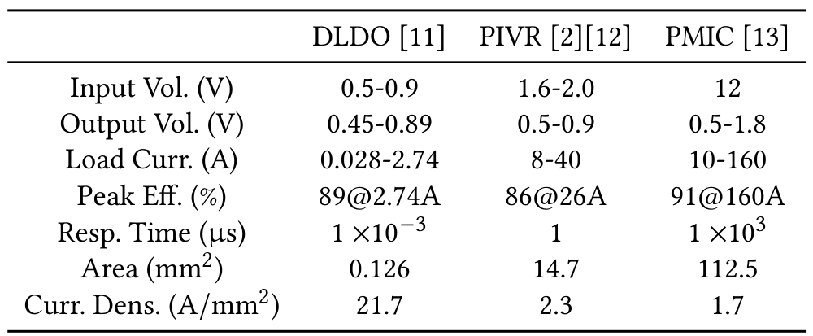
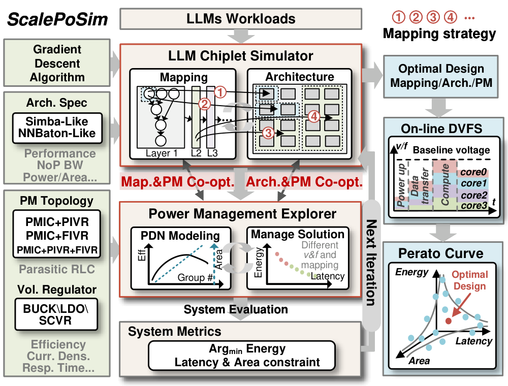
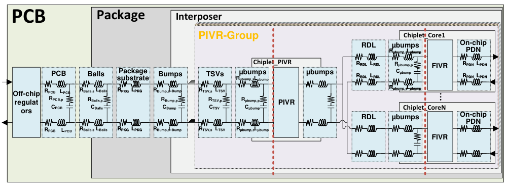
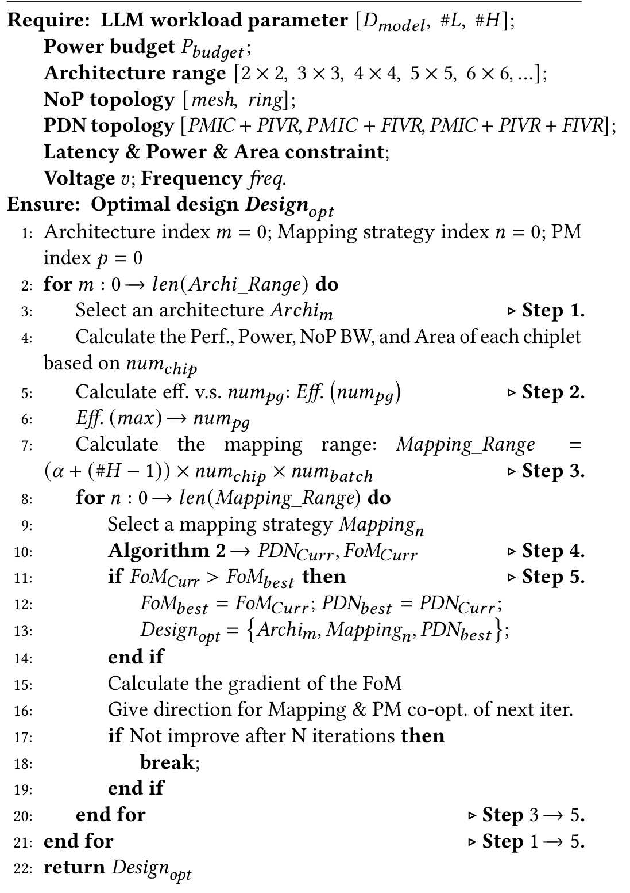
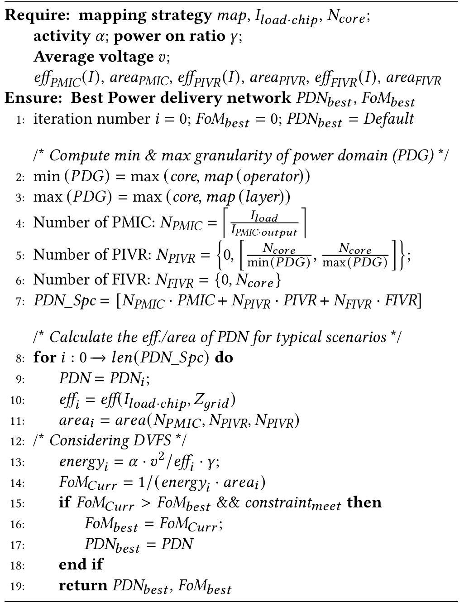
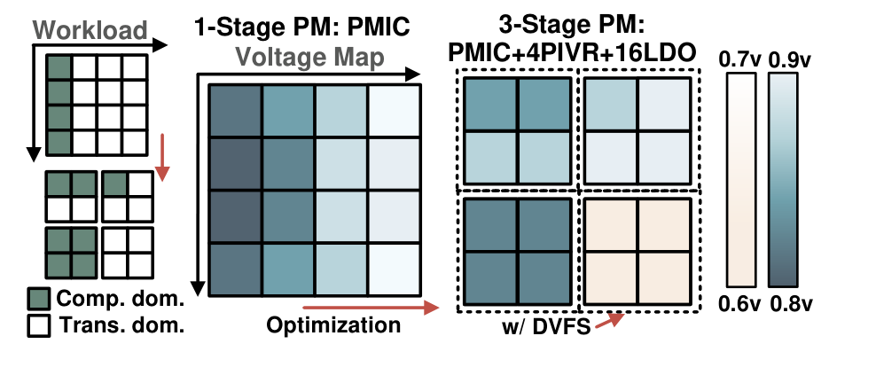
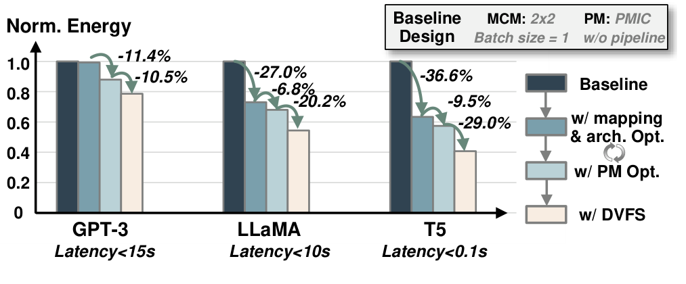
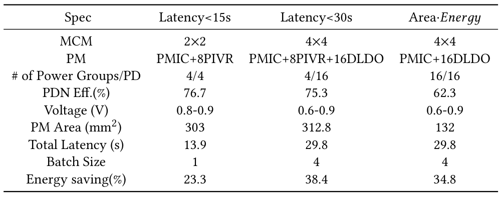

# ScalePoM：把DVFS、供电损耗、LLM映射和Chiplet架构一起优化

[从零入门](start.md) · [原图表索引](figures.md) · [双语摘要与导读](abstract.md)

## 核心信息

- 标题：Hierarchical Power Co-Optimization and Management for LLM Chiplet Designs
- 标题翻译：面向LLM Chiplet设计的分层电源协同优化与管理
- 作者：Yanchi Dong、Xueping Liu、Xiaochen Hao、Yun Liang、Ru Huang、Le Ye、Tianyu Jia
- 机构：北京大学集成电路学院、软件与微电子学院
- 发表时间：2024年
- 发表渠道：IEEE/ACM ICCAD，用户PDF9页
- DOI：10.1145/3676536.3676740
- 论文链接：https://doi.org/10.1145/3676536.3676740
- 论文类型：芯片系统建模、设计空间探索及DVFS共同优化方法

## 原文摘要翻译

对高能效、高性能大语言模型硬件的需求推动了可扩展Chiplet设计的发展，而这类设计需要仔细进行电源优化与管理。本文提出一种面向LLM应用的Chiplet分层供电协同优化与管理方法。为建模LLM工作负载映射与供电，作者首先建立可扩展Chiplet模拟器，展示不同电源策略对效率有显著影响，需要细致全面的优化。随后，作者开发了面向Chiplet电源管理的协同优化框架ScalePoM。根据给定LLM模型与功耗、性能和面积要求，ScalePoM能够自动探索Chiplet架构和工作负载映射，以优化分层供电。作者通过两种采用不同互连拓扑的扩展LLM Chiplet方案评估该方法，在不同稀疏程度的LLM推理中取得平均45%、最高62%的能量节省。（第1页摘要）

## 创新点

1. **把供电端损耗纳入架构与映射决策。** 相同核心计算功耗下，稳压器效率、寄生网络、电流分布和供电分组仍会改变输入端能量。只优化MAC或只给核心降频会遗漏这部分。

2. **构建连接LLM任务与分层PDN的探索框架。** 输入模型规模、功率/时延/面积约束及器件特征，联动Chiplet数量、映射、批量和PMIC/PIVR/FIVR组合，输出候选设计和Pareto集合。

3. **利用阶段与负载差异做运行时DVFS。** 分层供电隔离不同组，再降低低负载/非瓶颈组的电压频率。论文说明其应用机会，但没有给足完整在线控制器实现规范。

LLM是被控工作负载，不是训练一个LLM来选频。本文也不是用强化学习替代所有搜索。

## 一句话总结

先共同决定任务放在哪里、电从哪里来，再根据各域是否处在瓶颈上调整电压频率，评价完成任务的总能量而非只看核心功率。

## 研究问题

### 核心省下的电，为什么不等于输入端省下的电

电源从板级PMIC经过封装/中介层和片上稳压器到达计算核心。每级转换都有效率，线路也有损耗。稳压器效率还随负载电流变化：工作量很低时未必高效，更多分组也可能只增加面积。

LLM的QKV生成、注意力、前馈层的计算与传输比例不同。任务怎样分给Chiplet、一次处理多少批次，会改变哪些组忙、哪些组闲以及电流大小。映射因此会影响供电效率，供电域划分也会限制可用DVFS动作。作者研究这些耦合，而不是只寻找一个全局最低频点。

## 数据与任务定义

### 实际用了什么平台

这是**分析模型、RTL库特征与SPICE相结合的研究**，不是制造三套LLM Chiplet系统后测得的结果。模拟器借鉴Simba的mesh与NN-Baton的ring拓扑，构建扩展架构；用Cadence Virtuoso表征低压电压频率关系，主要基于TSMC16nm。PMIC/PIVR参数来自商品数据手册或文献，RLC网络用于SPICE分析。

主要评价模型为GPT-3 175B、LLaMA65B、T5 11B；前两者是decoder-only，T5含编码器。早期映射说明用GPT-3 13B举例，不能把它和最终175B实验混成同一个模型。这里具体被控程序是作者的LLM映射/性能模拟负载，没有证据说明在对应实物上完整运行了生成文本程序。

表2把原Simba架构扩展为3倍/12倍量级，性能和功耗在一定条件下线性缩放，NoP带宽按规模平方根缩放。这些是假设与模型设定，不是新制造芯片的规格实测。图8给出的0.41–1.2V、161–2001MHz是探索范围，不是任何CPU/PLL都可以合法使用的通用OPP表。

### 稳压器能力决定控制时间尺度

*表1，PDF第2页：作者选取的DLDO、PIVR、PMIC器件/文献参数。注意响应时间单位为µs。*

按表中单位换算，三者响应时间分别是1ns、1µs、1ms。它们是这次建模所用选择，不是“所有LDO都1ns”或“所有板上PMIC都1ms”的定律。不同级还具有不同输入输出范围、最大电流、效率与面积。

算法想每微秒换一次电压时，板外器件不一定跟得上。你调用现有PLL/PMIC时，应先测/查最坏响应、稳定反馈、供电域和可用档位；不要直接沿用本文的最快器件参数。

## 方法主线

### 先看完整框架，再分开离线与在线

*图5，PDF第5页：LLM模拟器与电源探索器联合评价，离线搜索产生架构/映射/电源方案，在线DVFS利用相应域的运行差异。*

左边是架构规格、供电拓扑和稳压器特征，中间是任务映射与供电模型，下面计算能量/时延/面积，右边输出设计与运行管理。图中的在线DVFS只是整个框架的一部分。离线选择“用几个Chiplet、几个电源组、什么稳压器”不会在每个控制周期重新制造一套硬件。

### 第一部分：把任务变成各域负载

对LLM算子/层选择映射粒度和批量，估计每个Chiplet的计算量、数据转移量、运行时间及电流。大Chiplet可将一层放在一颗上，减少跨片通信；小Chiplet可把一层划分给一组，在组内协作。增加batch可以提高权重复用和硬件利用率，但会影响时延及电源负载。

图2的GPT-3 13B例子用token数n和向量维度d估计计算：Q/K/V投影主要随nd²变化，注意力部分随n²d变化。token数量变化时，这两类负载增长方式不同，因此仅用“模型参数量”一个输入不足以决定阶段工作点。该模型是算子工作量估算，不是已实现的在线特征采样器。

### 第二部分：计算供电效率、损耗与瞬态

*图3，PDF第4页：PCB、封装、中介层与芯片内的供电路径，以及PMIC/PIVR/FIVR层级和寄生RLC。*

先沿供电路径从左往右读，再看红色边界的分组。分组数量变化会改变负载电流、路径长度和哪些扰动共享。输出相同核心功率，并不意味着这条路径损耗相同。

原式(1)定义：

$$
\eta_{\rm sys}=\frac{P_{\rm load}}{P_{\rm load}+P_{\rm loss,PMIC}+P_{\rm loss,PIVR}+P_{\rm loss,FIVR}}.
$$

功率单位W，效率无量纲。原式(2)对某级损耗写为：

$$
P_{{\rm loss},i}=P_{{\rm load},i}\left(\frac{1}{\eta_i}-1\right)+Z_{{\rm grid},i}I_{{\rm out},i}^{2}.
$$

前项是转换损耗，后项表示供电网络影响。稳态热耗散通常使用电阻R计算I²R，不能把任意频率下的复阻抗直接当电阻；本文用Zgrid并结合RLC/SPICE建模，复现时应说明所取等效量及瞬态评价方法。

原式(4)用电荷/电容关系估计瞬态压降：

$$
V_{\rm droop}=\frac{Q}{C}\approx\frac{\bar I_r t_{\rm resp}}{C}.
$$

电流单位为安培，响应时间单位为秒，电容单位为法拉，计算得到电压伏特。这是响应窗口内电荷失衡的近似；真实网络还受IR、ESR/ESL及电流变化率影响，不能用这一个式子替代全部供电瞬态仿真。它解释了为什么响应较慢的供电路径需要额外裕量。

### 第三部分：算法1怎样协调搜索

*算法1，PDF第5页：整体架构、映射与供电管理搜索。图中梯度方向指导后续迭代，不是神经网络反向传播。*

输入是LLM维度/层/头信息，功率预算，架构与NoP拓扑候选，PDN候选，以及时延/功率/面积约束。输出是保存的最佳设计；正文同时讨论Pareto设计集合。

按执行次序拆解：先固定一个候选架构，估计各Chiplet性能、功耗、NoP带宽与面积；扫描供电分组与效率关系做初选；再探索层/算子划分与batch；针对该映射调用算法2评价供电选择；约束满足且FoM更好就保存；根据FoM变化给下轮映射/电源优化方向；连续N次不改善则结束相应循环。

它有显式循环，但正文说不探索全部映射空间，采用梯度方向加速。论文没有完整给出离散设计变量的梯度求法、步长、N及边界处理，所以不能声称“保证全局最优”，也不能把这些循环说成在线RL训练。

### 第四部分：算法2怎样选择供电方案

*算法2，PDF第6页：给定映射和电流后，构建供电域/稳压器候选，比较效率、面积和简化能量指标。*

这里的输入更具体：映射、每芯片负载电流、核数、活动率α、上电比例γ、平均电压v，以及各稳压器效率–电流曲线和面积。先依据核、算子和层的映射确定供电域粒度范围，再根据电流能力和域数量生成PMIC/PIVR/FIVR组合。逐候选计算效率、面积、DVFS相关能量指标，满足约束才参与FoM比较，最后返回最佳PDN。

伪代码第13行写：

$$
E_{\rm proxy}=\alpha v^2\gamma/\eta,\qquad FoM=1/(E_{\rm proxy}A).
$$

这里缺少电容、活动次数/时间等绝对能量项，应理解为特定假设下的简化指标，不能直接把数值当焦耳。最后系统报告的能量还依赖任务执行、器件及通信模型。α在不同上下文还用于映射划分参数，复现代码应采用不同变量名。

第11行面积函数重复写了PIVR数量，疑似应有FIVR项；原图已保留。应查代码/作者说明，或把自行修正明确记入复现差异，不机械复制。第19行return的缩进和循环语义也需要在实现中明确。

### 第五部分：在线DVFS到底依据什么调整

*图10，PDF第8页：T5运行时某时刻的负载与电压分布，比较单级供电及优化后分组和DVFS。*

图例先区分计算主导和传输主导Chiplet，再看单级共享供电怎样受到不均衡影响，最后看PIVR分组与各组电压。作者用SPICE模型分析压降，并让组内负载相对均衡，组间由PIVR隔离。

运行时策略的明确依据是：不同batch的token数、算子/层负载及流水线瓶颈不同，给任务较少的Chiplet降V/f，让最慢段维持足够性能。降低非瓶颈域频率后，只要它还没有变成新的最慢段，整体吞吐可保持。

教学例：两个流水阶段原来分别需10ms和6ms，理想稳态节拍由10ms段决定；第二段可尝试减速到不超过10ms。这个例子不是论文测量，还忽略了缓存、通信和切换开销，用来理解“非瓶颈降频”。实际动作必须把这些成本加回来。

**在线触发周期、全部状态特征、阈值、控制律、OPP与PLL/PMIC请求确认流程，在第5.3节仍有具体实现空白。** 因而能确定策略思想与模型输入，不能据此认定已经交付可直接综合的数字DVFS控制器。

### 机制流程

1. **离线建立负载与电源模型。** 输入模型/架构/器件参数，输出各映射下计算、通信、电流、效率和开销估计。
2. **联合探索与筛选。** 算法1调用算法2，比较映射/批量/PDN，按时延、功率、面积约束更新最佳候选设计，送到下一轮搜索并最终形成性能能量取舍。
3. **运行时分域管理。** 利用已选硬件与映射，识别负载轻重/瓶颈，降低非关键域V/f；执行时机与安全协议在本文中未完整展开。
4. **评价收益。** 用完成工作所需能量、时延和面积比较，另外使用SPICE检查供电压降；不能只验证搜索器输出一个档位。

## 关键结果

### 图9：先看基线，再看每一步

*图9，PDF第7页：相对2×2、仅PMIC、batch=1、无流水线基线，逐步加入架构映射、电源优化和DVFS。*

横向三组模型有不同延迟约束：GPT-3<15s，LLaMA<10s，T5<0.1s。颜色按基线、映射/架构、电源管理、DVFS顺序读取。作者正文给累计能量下降21.3%、45.7%、59.3%，是组合结果；其中一些变化同时调整架构或batch，不是同一平台仅替换控制算法。

图中相邻步骤百分比不能相加。举例LLaMA的27.0%、6.8%、20.2%若按连续下降计算，剩余约0.73×0.932×0.798=0.543，与累计下降45.7%相符。GPT-3仅按图上11.4%与10.5%标注相乘约下降20.7%，与正文21.3%不完全一致；当前不能确定是舍入还是其他条件，保留原图和正文值，不创造精确新测量。

### 表3：不同目标不能直接以百分比排名

*表3，PDF第8页：32token GPT-3在不同约束/目标下得到的设计，包含架构、供电、时延、batch和能量。*

| 对照项目 | 时延<15s | 时延<30s | 面积×能量目标 |
|---|---|---|---|
| Chiplet矩阵 | 2×2 | 4×4 | 4×4 |
| 电压范围 | 0.8–0.9V | 0.6–0.9V | 0.6–0.9V |
| 实际估计时延 | 13.9s | 29.8s | 29.8s |
| batch | 1 | 4 | 4 |
| 表列能量节省 | 23.3% | 38.4% | 34.8% |
| 电源管理面积 | 303mm² | 312.8mm² | 132mm² |

放宽时延允许更细粒度供电和更低压，batch也改变。移除PIVR的方案虽PDN效率低至62.3%，却可能因面积少而在能量面积目标中更好；不能以效率最高直接决定整体设计。PM器件数量与Power Groups/PD行是不同计数，需要完整实现映射解释，不能把8个PIVR简单说成8个独立任务组。

### 稀疏度实验换了基线

图11在30/50/70/90%稀疏下比较，以图9已经优化的设计为基线。90%稀疏时GPT-3与T5报告49.6%/62.1%进一步改善，不能把它当相对最初基线的同一个百分比，也不能与图9收益相加。

摘要最高62%、第2页引言最高84.6%、表4某NN-Baton/T5项66.0%涉及不同或未完全解释的条件，当前材料不足以把它们归成唯一峰值。本笔记按图表与对应基线引用，不擅自挑最大数字作为DVFS单项效果。

## 深度分析

### 全部图表与算法索引

| 项目/页码 | 要回答的问题及阅读重点 |
|---|---|
| 图1，第1页 | LLM层怎样映射到Chiplet、PMIC/PIVR/FIVR在哪些层级；总体背景，不是控制器详细电路。 |
| 表1，第2页 | 器件效率、电流、响应与面积有什么限制；已嵌入，注意µs单位。 |
| 图2，第3页 | 一层一片与一层一组的映射、流水与空闲时段如何形成；例子用13B。 |
| 表2，第3页 | 原架构与3倍/12倍模型如何缩放；不是实际芯片测试表。 |
| 图3，第4页 | 从PCB到核心的RLC与稳压器层级；已嵌入。 |
| 图4，第4页 | 分组效率/面积、负载电流高效区、平衡程度与DVFS及能量取舍，多个子图是不同对照。 |
| 图5，第5页 | 联合探索框架；已嵌入。离线设计输出与在线控制分开。 |
| 算法1，第5页 | 架构/映射/供电联合搜索及停止；已嵌入，梯度细节不足。 |
| 算法2，第6页 | 供电候选遍历与FoM；已嵌入，能量proxy与变量笔误需处理。 |
| 图6，第6页 | 同功率预算的2×2、2×6、4×4，更多组可能换来效率或面积取舍。 |
| 图7，第7页 | 映射/batch改变计算传输占比与稳压器负载高效区；不只看平均电流。 |
| 图8，第7页 | 具体LLM规模、token/算子差异及搜索范围；范围不是完整安全OPP规范。 |
| 图9，第7页 | 三种模型分步骤与组合节能；已嵌入。 |
| 表3，第8页 | GPT-3不同目标约束的具体设计；已嵌入。 |
| 表4，第8页 | 两类互连架构的LLaMA/T5结果，时延、吞吐和batch一起读。 |
| 图10，第8页 | 负载分组、供电隔离和运行时电压图；已嵌入，属于模型/SPICE证据。 |
| 图11，第8页 | 稀疏度下额外优化，基线为已优化设计；纵轴是能量J。 |

### 硬件端实际做了什么

论文建模已有稳压器与供电网络，选择数量、层级和域划分；不是从晶体管开始设计所有PMIC，也没有展示一块完整LLM实物芯片。其硬件贡献体现在架构/PDN协同设计方法及低压表征，而在线固件/RTL接口的公开程度有限。

你若已有PLL和PMIC，应把它们当固定能力边界。可先借鉴“把输入端损耗与任务阶段纳入策略”，不必让毕设范围扩展为Chiplet封装、稳压器电路和LLM硬件全部重做。

## 局限

模型扩展依赖面积/性能/功率等缩放假设，NoP和真实存储系统也可能改变瓶颈。器件效率曲线来源与插值精度、动态负载下适用范围决定结果可靠性；平均效率不能证明瞬态一定满足电压下限。

搜索算法的梯度定义、步长、停止N及离散约束处理未充分展开。第2算法的简化能量指标、面积变量笔误、return语义，以及图表累计收益差异，都增加逐行复现的歧义。公开源代码/完整参数当前未在所给材料定位到，不能据此宣称确定不存在。

在线DVFS的采样、预测、动作、切换能量、PLL锁定和电压完成协议不足，无法从论文直接实现等价数字控制器。结果来自模型/库表征/SPICE，缺少制造后端到端实测和统计重复信息。本次未执行作者模拟器，也没有独立复现节能数字。

## 我的笔记

### 从这篇学到的三个层次

第一层是给定工作点时核心如何耗能；第二层是电源把多少输入能量送到核心；第三层是任务映射如何同时改变前两者。只在第一层优化，可能错过整机最佳点。相反，层次多也增加实现成本，应以自己的硬件范围裁剪。

**English paraphrase, not the original abstract:** ScalePoM links LLM workload mapping with chiplet architecture and hierarchical power delivery. It searches design choices using performance and power-delivery models, then exploits unequal runtime loads through DVFS. Its reported benefits combine several optimizations and depend on the modeled architectures, constraints, regulator data and baselines.

### 最小可执行复现路线

以下是实验建议，不是本次已运行的结果。

| 实验与优先级 | 设置与输入 | 评价、成功条件与风险 |
|---|---|---|
| 1，优先：固定单域OPP | 选CPU上固定输入的计算/访存任务；给每个合法OPP测或假设明确标注的时延、核心功耗与PMIC效率曲线 | 分别以核心能量和输入端能量选档，比较选择是否不同；先固定硬件，只变评价模型。效率未实测时不得声称真实节能。 |
| 2，优先：两个阶段/域 | 建计算主导与访存/传输主导阶段，固定通信和FIFO容量，比较统一档位与非瓶颈降频 | 同样完成工作且不违反时限，报告吞吐、积压和净能量；如果低档使原非瓶颈成为瓶颈，策略应停止继续降档。 |
| 3，后续：现有PLL/PMIC执行 | 使用行为模型接数字状态机，加入命令延迟、稳定/锁定确认、最低驻留和超时；平台支持后再物理测量 | 检查安全电压频率关系、连续请求、错误反馈、任务正确性；计算控制与切换后的净收益。没有独立电压域时不能验证逐域DVFS。 |

最小数据表应含：程序/输入ID、阶段、请求/实际OPP、电压频率、时延、核心/输入能量、温度、切换次数和失败原因。训练轻量预测器时，先有阈值/查表基线并按输入划分训练测试，避免同一运行轨迹随机拆窗造成泄漏。

## 引用

1. Dong等，本文，ICCAD2024，[DOI](https://doi.org/10.1145/3676536.3676740)。证据以用户9页PDF为准。
2. F-LEMMA: Fast Learning-Based Energy Management for Multi-/Many-Core Processors，TCAD2023，本文参考文献[4]，[作者稿](https://www.seas.upenn.edu/~leebcc/documents/zou22-flemma.pdf)。是实际引用关系，本笔记不代替其全文分析。
3. Power Management for Chiplet-Based Multicore Systems Using Deep Reinforcement Learning，ISVLSI2022，本文参考文献[8]。它是相关前序，不表示ScalePoM也采用同一种RL。
