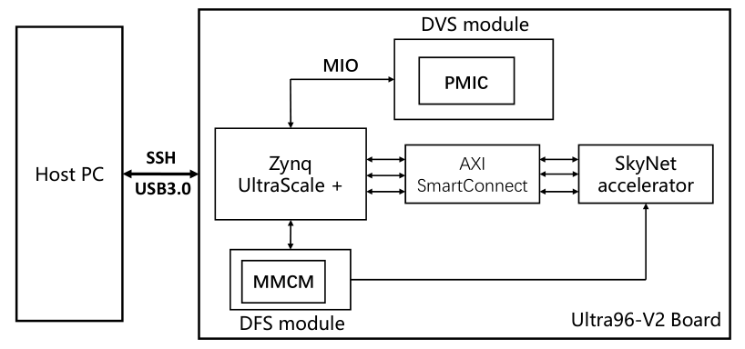
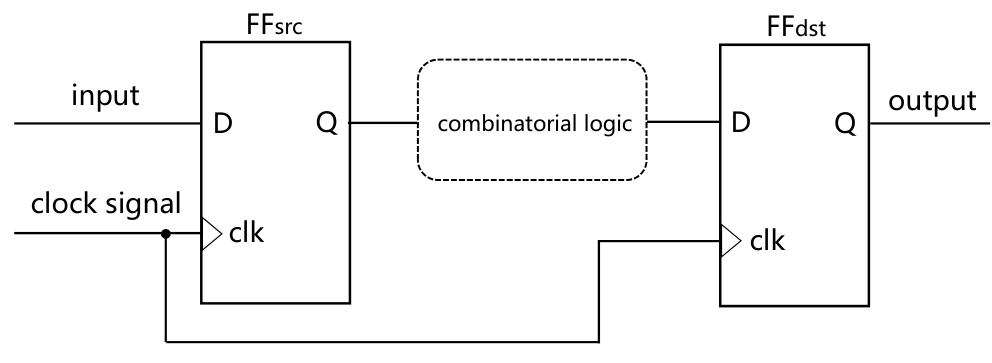
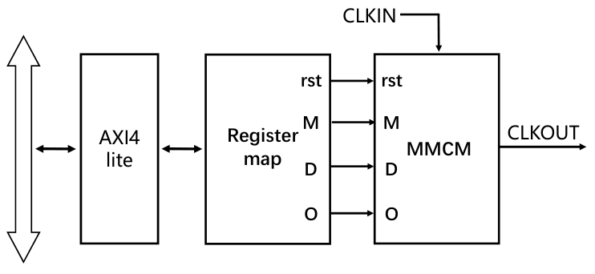
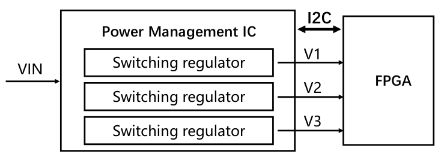
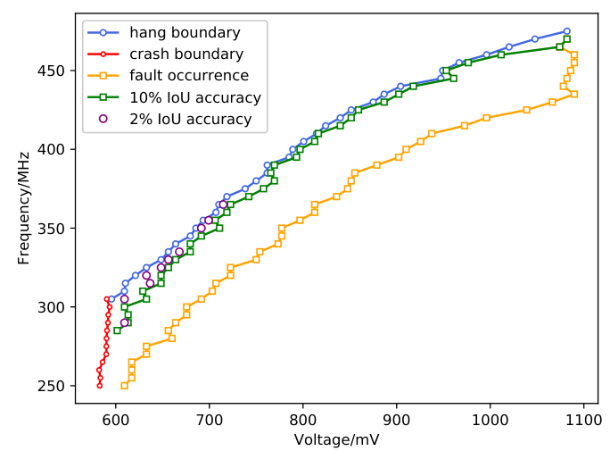
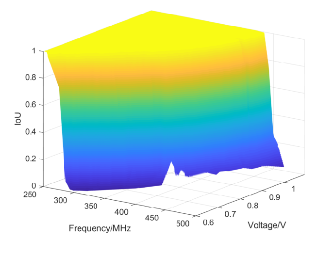

# Terminator on SkyNet：真实FPGA的DVFS执行链，以及“没死机仍可能算错”

[从零入门](start.md) · [原图表索引](figures.md) · [双语摘要与导读](abstract.md)

## 核心信息

- 标题：Terminator on SkyNet: A Practical DVFS Attack on DNN Hardware IP for UAV Object Detection
- 标题翻译：SkyNet上的终结者：面向无人机目标检测DNN硬件IP的实用DVFS攻击
- 作者：Junge Xu、Bohan Xuan、Anlin Liu、Mo Sun、Fan Zhang、Zeke Wang、Kui Ren
- 机构：浙江大学及阿里巴巴–浙江大学前沿技术联合研究机构等
- 发表时间：2022年
- 发表渠道：59th ACM/IEEE DAC，685–690页；用户PDF6页
- DOI：10.1145/3489517.3530516
- 论文链接：https://doi.org/10.1145/3489517.3530516
- 论文类型：DVFS硬件执行框架与可靠性/安全评估

## 原文摘要翻译

随着各种应用计算量增加，动态电压频率调节逐渐被部署到FPGA上，但其可靠性与安全性尚未得到充分评估。本文提出一种针对SkyNet加速器IP的实用DVFS故障攻击，能够破坏检测准确性。在不知道加速器内部结构的情况下，该方法在十个脆弱工作点对上可造成超过98%的检测准确性损失。作者还探索了持续1ms的局部扰动以及随后增加扰动强度的情况，分别可造成超过50%和74%的平均准确性损失。（第1页摘要）

## 创新点

1. **展示现有可编程DVFS接口可能突破功能正确性边界。** 系统仍继续运行并产生结果，不代表结果正确；错误不必表现为挂起或崩溃。
2. **给出真实板卡的软件控制路径。** PS软件、AXI寄存器、MMCM时钟资源、I²C/PMBus和板级PMIC组成可运行框架，对“调频在哪里、调压在哪里”有直观参考价值。
3. **把稳态边界与短时扰动分开评估。** 观察不同工作点、执行阶段和持续时间对输出的影响，提示正常控制器必须验证工作点及切换过程，而非只看稳态平均功耗。

该文研究故障与安全，**不是提出新节能算法**。本笔记按合法OPP、执行器和防御验证的思路阅读，不将破坏检测的指标当成能效收益。

## 一句话总结

PS软件确实可以控制FPGA的时钟资源和板上稳压器，但不能把所有“还能跑”的电压频率组合交给正常控制策略，必须同时保证输出正确性和切换安全。

## 研究问题

### 阅读地图：它怎样回答你的疑问

**English paraphrase (not the original abstract):** The paper builds a software-controlled voltage and frequency framework on an Ultra96-V2 FPGA platform and evaluates reliability boundaries of the SkyNet accelerator. MMCM configuration controls the PL clock, while a board PMIC supplies voltage through a separate control path. Results show that silent output corruption can occur without a hang or crash. The useful lesson for a normal DVFS controller is to restrict legal OPPs and validate both steady states and transitions; the paper is not an energy-saving governor.

按图4看平台整体，图2看调频，图3看调压，再读图5的不同边界。最后看图7及局部实验的指标定义。你会看到DVFS并不是一个悬在CPU外面的“神奇算法”：软件提出状态请求，数字接口配置执行器，实际硬件时钟/电源改变，程序速度与正确性随之受影响。

文中的被控计算对象是PL中的SkyNet加速器，不是PS里的ARM处理器本身。PS承担控制职责。对于你的E902，若E902处于被调电压/时钟域，则需要明确谁在稳定域执行控制代码、谁负责配置PLL/PMIC；不能直接照搬“PS管PL”就假设CPU能在任意停钟或低压状态自救。

### 三个成功层次不能混为一谈

|现象|能说明什么|不能说明什么|
|---|---|---|
|配置寄存器读回正确|软件事务写到了某处|电压已稳定、PLL已锁定、负载已切到新状态|
|程序done或未触发watchdog|没有明显卡住|算术结果或检测输出正确|
|与正常配置输出一致|这组输入下未发现硬件扰动差异|模型语义完全正确，或所有输入/PVT都安全|

静默数据错误SDC指没有通过明显崩溃显露出来的错误结果。合法DVFS设计需要把正确性放进约束，不应只最小化功率或让程序不超时。

## 数据与任务定义

### 真板卡、硬核PS与可编程逻辑PL

*原图4，第4页：Ultra96-V2中的PS、MIO/PMIC、MMCM、AXI与SkyNet，以及主机连接。*

平台是Ultra96-V2，器件为Zynq UltraScale+ XCZU3EG-SBVA484，包含PS和PL。SkyNet用HLS C++实现并在SDSoC 2019.1综合；DFS由MMCM提供时钟，DVS通过PMIC调节供电。主机用于组织实验、传输和收集结果，不是直接给组合逻辑产生每一个时钟。（第4页§4.1）

|角色|实际位置|作用|
|---|---|---|
|主机|板外PC|实验调度与结果收集|
|控制软件|PS的ARM/Linux|经驱动和总线配置电压/频率|
|时钟执行器|PL相关MMCM及配置逻辑|产生SkyNet工作时钟|
|电压执行器|板级Infineon IRPS5401 PMIC|转换和调节供电；通过PMBus/I²C访问|
|被控负载|PL中的SkyNet加速器|执行无人机图像目标检测|

SkyNet共40层，其中12个卷积层；论文背景报告正常模型约0.716 IoU、25.05FPS。这个正常任务指标与后面“偏离正常输出的IoU”不是同一评价语义，不能混用。（第2页§2.2）

### 样本、程序与基线

全局实验使用DAC-SDC2019的1000幅带标注图像。局部试验选取其中四幅不同内容图像，SkyNet一次并行处理四图。全局数据量与局部图像数量应分别记录；不能说每项局部结果都有1000幅独立测试图支撑。

主要基线是供应商规定工作点下的同程序输出，作者称为normal truth。对偏离输出的量化，后续IoU主要相对这个正常预测框，而不是直接相对人工标注。精度受损是硬件一致性方面的证据，不应自动转换成标准目标检测mAP或同等比例的真实任务准确率损失。

文中没有提供足够的跨板卡样本、完整温度/工艺/老化覆盖或所有图中的重复次数及置信区间。本文结果是实际FPGA实验，但不是量产PVT签核。

## 方法主线

### 机制流程

1. **明确正常参照。** 输入同一图像与正常配置，提取SkyNet输出作为一致性参照，并记录是否完成，将基线交给工作点评价。
2. **通过两条执行链配置状态。** 输入实验指定的电压/频率请求，更新AXI/MMCM配置和I²C/PMBus的PMIC设置，使PL负载实际处于相应运行状态；目标并非学习一个省能OPP。
3. **区分系统与结果状态。** 输入执行日志和预测框，提取挂起、崩溃和相对正常输出的偏差，分别记录不同边界，不将“还能运行”当作正确。
4. **审查时窗与约束。** 比较稳态和短时状态变化的结果，输出安全性分析与控制器验证需求；本文没有形成正常运行的自适应选档闭环。

### 1．电压和频率为什么会使结果变错

*原图1，第3页：源触发器、组合逻辑和目的触发器共享时钟，数据须在下一个采样边沿前稳定。*

源触发器发出的数据经过组合逻辑，必须赶在目的触发器采样之前稳定。忽略时钟偏差等附加裕量时，基本建立时间约束可写为：

$$
T_{\mathrm{clk}}\ge t_{\mathrm{cq}}+t_{\mathrm{comb}}+t_{\mathrm{setup}}.
$$

T_clk为周期，t_cq为源触发器时钟到输出延迟，t_comb为组合路径延迟，t_setup为目的触发器建立时间；单位均为秒，实际通常用ns。原文式1用T_FF、T_propagation和T_setup对应这些项。更完整的时序分析还要考虑时钟偏差、不确定度等，本文简式没有覆盖全部约束。

提高频率使左侧变小；降低电压通常使右侧的路径延迟变大。若两者不协调，目的触发器可能采到未稳定值。程序继续产生输出也可能带着错误。因此“频率降低一定省电”之外，还必须问“这个频率允许的电压是多少、是否有足够裕量”。

### 2．调频链：PS→AXI4-Lite→寄存器→MMCM→负载时钟

*原图2，第4页：MMCM配置模块；M、D、O、复位与输入时钟共同决定输出时钟。*

PS的软件请求通过AXI4-Lite写入寄存器映射，配置逻辑将参数及复位送到MMCM。MMCM使用片上专用时钟资源产生目标时钟，而不是用普通RTL逻辑随意拼一个模拟PLL。（第3页§3.3）

$$
f_{\mathrm{out}}=f_{\mathrm{in}}\frac{M}{D\,O}.
$$

M是倍频相关参数，D和O是分频相关参数，无量纲，输入输出频率单位相同。**原PDF公式2明确有分子M，提取文本曾丢失，已按原页核对。** 可实现频率还受具体器件VCO、输入范围和分频限制，不能仅凭比例式就认定任意M/D/O均合法。

原文框架声称支持20–500MHz、5MHz步进，调频约3µs。这是该实现的报告，不是所有FPGA的固定切频时间，也不代表3µs里包含了完整电压切换。图2只有配置与复位示意，没有完整展示锁定、无毛刺切换、暂停负载和完成握手。

对正常控制器，必须在具体IP说明下规定锁定等待、时钟切换及失败处理；软件写完寄存器只能代表请求发出。多时钟域之间还要单独验证CDC，本文并未提出各PE异频对齐架构。

### 3．调压链：PS→Linux驱动→I²C/PMBus→板级稳压器→电源轨

*原图3，第4页：PMIC经多个开关稳压器给FPGA供电，I²C负责配置与状态通信。*

Ultra96-V2使用IRPS5401。PMBus在I²C兼容物理链路上定义电源管理访问；PS可以经MIO和Linux驱动控制PMIC、监测其状态。真正改变电压的是板级开关稳压器，不是把“PMIC模块”作为普通数字IP综合进PL。（第3–4页）

论文报告DVS框架范围550–1100mV、10mV步进、约2ms。它表示当前实验框架的能力，**不是推荐给你的通用安全电压范围**。具体哪条轨、共享哪些逻辑、可调区间、最大电流和允许斜率，必须看你实际板卡与IP。

图中V1/V2/V3是多路供电示意，不证明每个PE都有一条独立可调轨。若E902、存储和互连共享电源域，调压会一起影响它们；如果板上电压不可软件调节，就只能先验证调频和逻辑接口，不能宣称已经真实DVFS。

### 4．它用什么策略调节：实验设定，不是智能governor

|环节|原文做法|与正常控制器的区别|
|---|---|---|
|输入|实验指定OPP或状态变化时窗|没有给出利用率/剩余工作量到OPP的学习策略|
|触发|实验启动或预设执行时窗|不是根据预测能量与截止时间自适应决策|
|决策|边界表征与指定状态比较|目标是安全评估，非最小能量优化|
|输出|MMCM配置请求和PMIC电压请求|确有硬件执行链，但正常合法性需额外约束|
|反馈|完成/挂起/崩溃、预测框偏差|未建立正常运行下的闭环选频与调压控制律|

因而它回答了“软件怎样能影响真实电压/频率”，没有回答“给定一个新任务怎样自动选最优档”。你可以借鉴执行接口和实验记录方式，再用其他论文或自己的方法补策略层。

### 5．三类边界怎样测、怎样解释

作者对电压频率组合做表征，先记录是否挂起/崩溃，再检查还能输出的区域是否偏离正常结果。论文的框架全范围与实际用于图5的较小扫描范围不同；不能拿全范围当作验证全部正确的OPP集合。

评价框偏差时用：

$$
\mathrm{IoU}(B,B_0)=\frac{|B\cap B_0|}{|B\cup B_0|}.
$$

B是当前状态输出的预测框，B0是正常配置预测框，面积单位相消，所以IoU无量纲。B=B0时为1；相互不重叠时为0。这里B0不是自动等于人工ground truth；两种比较应另存字段，以免将硬件错误和模型原本的识别错误混在一起。（第4页公式3）

对于普通CPU任务，类似的正确性对照可以是无损压缩解压后的字节一致、整数运算参考结果或程序校验值。不能用“运行时延看起来正常”替代校验。

### 6．局部试验说明切换过程也要检查

全程固定异常配置与短时改变状态的影响不同，作者分别评估。局部试验的层位置是用GPU上FLOPs估算执行时间推断，作者承认配置变化会扰动实际时长。因此横轴时间点并不等于精确命中某个RTL流水级，不能据此声称周期级定位。

更重要的是，论文调压约2ms，而部分软件时窗为1ms。软件命令窗口、总线通信、稳压斜率和真实电压波形不能视为同一个矩形脉冲。复现解释需要实际电压/时钟波形；正文没有足够信息保证所称1ms全部处于目标稳态。

对正常DVFS，启示是把“发请求→执行中→稳定→恢复/下一状态”整个过程都纳入验证。这个启示不要求在真实板上重做破坏性扰动；可先在电源和时钟故障模型中验证请求边界与回退逻辑。

## 关键结果

### 图5：能继续跑的区域里仍有错误

*原图5，第4页：电压mV与频率MHz平面上的挂起、崩溃、错误开始及严重输出偏差边界。*

横轴是电压、纵轴是频率。蓝/红表示挂起或崩溃相关边界，橙色表示输出开始偏离，绿色/紫色进一步标记严重偏差。核心观察是这些线并不重合：**未挂起/未崩溃的状态仍可能产生静默错误。**

对合法OPP表，不能把“系统没有死”的线作为最低电压边界。应以正确性、时序约束和足够PVT裕量共同定义合法区，再考虑功耗/时延优化。这张图的具体曲线属于当前SkyNet与板卡，不能抄给E902。

### 图7：质量表面不是能效曲面

*原图7，第5页：IoU随电压和频率变化的三维结果，IoU主要相对正常预测定义。*

平坦接近1的区域说明在当前输入比较中输出接近正常参照；陡降区域说明输出受到显著扰动。论文在一组脆弱OPP上报告超过98%的“准确性损失”，其具体论证主要来自相对正常框的平均IoU降至很低。它不是节能98%，也不能直接写成标准mAP下降98个百分点。

图6再用少量图片显示预测框变化：青色为人工标注，蓝色为正常预测，红色为异常输出的重复结果。它帮助理解语义，但只是四个例子，不能代替全数据的统计。

### 局部结果与非单调现象

正文报告部分局部设置可达100%故障发生率和71.33%平均IoU损失；更长持续时间的某项结果为95.56%与56.53%，没有简单单调变坏。增加扰动次数的结果另报告74.44%损失和95.45%故障率。（第5–6页）

这些数字说明“持续更久就必然更坏”的简单直觉不成立。可能涉及时窗覆盖、重叠执行和实际状态动态，但原文没有充分分离各原因。图9左轴标注概率百分比，而部分刻度为0.2–2.0，和正文百分比的关系不够清楚；精确读值不能只从图轴猜测。

与稳态1000图相比，局部四图、时间点和重复属于不同统计层次。没有独立运行日志与分母定义，就不能把不同图的最高百分比拼成统一概率模型。

## 深度分析

### 九张原图阅读索引

论文没有数据表或独立算法框，原图1–9全部已定位。主文嵌6张，其余按下面回查。

|项目/用户PDF页|读什么、不能推出什么|
|---|---|
|图1／3，已嵌|同步路径与采样；是逻辑示意，不含所有setup/hold/时钟偏差分析|
|图2／4，已嵌|AXI配置MMCM；M/D/O和复位路径不等于完整锁定及无毛刺协议|
|图3／4，已嵌|外部稳压器与控制链；多路电源示意不代表每PE可独立调压|
|图4／4，已嵌|主机/PS/PL边界；被控的是加速器，PS运行控制软件|
|图5／4，已嵌|挂死/崩溃/SDC边界不同；不是节能最优曲线或通用合法OPP表|
|图6／5|四个目标检测例子；区分人工框、正常预测框、异常框，不能由少量图外推全任务精度|
|图7／5，已嵌|电压频率与相对正常输出的IoU；三维陡变体现正确性约束|
|图8／5|时间、估计层号、故障率和故障后IoU；层号是估算，三条线含义不能混淆|
|图9／6|三种持续时窗结果；左右轴与概率标注需原始数据核对，不能当作精确单调规律|

### 三条核心主张的证据强度

|主张|直接证据|判断与边界|
|---|---|---|
|软件可驱动真实电压/时钟|真实板卡、图2–4和§3.3/4.1|硬件执行链存在；内部转换波形和完整控制状态机仍缺|
|不死机也会算错|图5/7和正常输出对照|对当前被测系统证据直接；不等于任意CPU相同边界|
|短时变化影响结果|局部实验图8/9|提示过渡态风险；精确层位置、真实持续时间与统计分母仍不够清楚|

### 对“PLL/PMIC能放FPGA吗”的具体启发

这篇使用的是FPGA专用MMCM时钟硬宏与板上PMIC。数字控制器、寄存器、总线主机、OPP表和FSM可以放PL；真实模拟稳压电路不能靠把普通数字RTL下载到FPGA就产生。若已有的是ASIC PLL/PMIC模块，还要区分可综合控制逻辑、模拟宏、行为模型与外部器件，不能全部叫“例化后就能用”。

选择平台应检查：目标电源轨是否暴露可编程接口、是否与其他模块共享、可用范围与电流、时钟是否可运行时重配置、控制通道是否在稳定域、状态反馈是否可读，以及有没有足够测量点。本文证明某块板可做，不证明你手头所有板卡可做。

### 与Jiang2020的真实联系

参考文献[8]明确引用Jiang2020《利用动态电压频率调节优化CNN目标检测的能效》，英文题名和DOI见末尾引用。这是实际引用边：先有相似应用场景的能效表征，本篇进一步研究可编程工作点带来的故障风险。共同平台思路不意味着所有电路、参数、代码或结果完全相同，也不能据此认定后续TCAD论文必然是本篇扩展。

## 局限

论文没有以正常能效优化为目标的策略、奖励函数或预测模型，没有给出可直接复用的合法OPP控制器。不能把异常参数搜索当作你的正常控制算法。

正常输出一致性不是人工语义正确率；过于依赖IoU也不一定覆盖所有硬件错误。精确OPP合法性受RTL、器件速度等级、温度、供电、布局布线影响，单块板的“还能跑”结果不能替代时序签核与PVT验证。

MMCM的锁定等待、负载静止、CDC、无毛刺切频、调压反馈与故障回退没有完整展开。约2ms和3µs属于报告的执行能力，不能自动作为你的总切换时延。部分图轴、局部窗口和层估算不够清晰，未给完整原始数据时应保留解释边界。

## 我的笔记

### 最小复现：复用正常执行链和正确性验证，不复用异常操作脚本

1. 先确认实际板卡原理图、电源轨、额定OPP及MMCM/PMIC接口；以供应商规定的合法状态为起点。记录芯片、板卡、工具、RTL/软件版本及比特流哈希。
2. 在合法固定OPP下跑可校验程序，建立同输入参考输出、时间、完成状态和能量记录。CPU程序可用压缩回环或确定整数运算，不要求先移植SkyNet。
3. 实现控制层的OPP请求与执行状态，记录requested_opp、actual_opp、busy、clock_ready、voltage_ready、fault。具体反馈名称是设计建议，不是原文已公开接口。
4. 先在RTL/行为模型中验证升档先建立电压裕量再升频、降档先降频再降压，并按已有IP约束处理锁定、等待、暂停与恢复。加入请求冲突、超时、反馈丢失和复位场景。
5. 只在经确认的合法范围做硬件稳态与切换对照，持续校验结果。越界请求在控制器入口拒绝；错误/超时回退到已确认状态，记录原因，避免把“没有死机”当作验收。
6. 分开报告逻辑仿真、FPGA功能、实际电压/频率波形和能量测量。若只能仿真PMIC响应，就写执行协议模型通过，不写芯片已实现真实调压节能。

本笔记未在Ultra96或E902平台执行实验，也未独立复现本文故障率。上面是防御性控制器复现路线；实际接口仍需你已有IP和板卡材料。

### 三个课题实验及验收

|优先级/实验|资源与价值|风险和成功标准|
|---|---|---|
|P0：合法OPP和正确性|可校验CPU负载、时间/输出日志，建立稳态基线|参考程序也可能错；成功为同输入一致、失败分类完整，模型能量单独标记|
|P1：数字执行器验证|RTL/FSM、PLL/PMIC行为模型、testbench|只看请求不看执行容易假通过；成功为顺序、握手、并发请求、超时/复位均符合约束|
|P2：平台实物验证|可编程板级供电、运行时切频、测量点与仪表|共享电源/时钟域影响其他模块；成功为合法切换下输出正确、实测延迟和能量与日志对应|

初期无需一上来完成全部软控硬。先在软控软阶段明确状态、目标和合法OPP，再将同一请求接口接数字执行器。算法级收益证明与硬件执行可靠性证明是两份证据，最后共同构成co-design方案。

具体待补材料：板上IRPS5401被控轨及共享域，MMCM lock/reset协议，PMIC真实调压波形，控制软件对完成状态的判断，以及温度和输入覆盖。这些会直接决定你的平台能否采用相同分工。

## 引用

1. Junge Xu et al. Terminator on SkyNet: A Practical DVFS Attack on DNN Hardware IP for UAV Object Detection. DAC 2022, pp.685–690. [DOI](https://doi.org/10.1145/3489517.3530516)。
2. 原文§3.2–3.3第3页为时序与执行框架；§4第4–6页为平台、边界、输出和时窗实验。本文页码是用户PDF1–6，而非会议页码685–690。
3. Weixiong Jiang et al. Optimizing energy efficiency of CNN-based object detection with dynamic voltage and frequency scaling. Journal of Semiconductors 41, 022406, 2020. [DOI](https://doi.org/10.1088/1674-4926/41/2/022406)。原文参考文献[8]，属于已确认引用关系。
