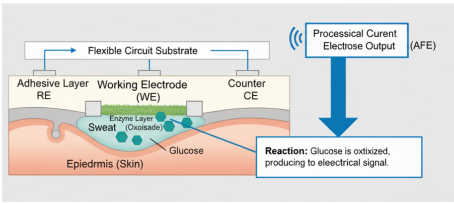

# 可穿戴SoC：需求、DVFS、卸载与证据审查｜原图表索引

索引来自已核对原文的正式笔记。核心原图在主文相应方法/结果处内嵌，下面保留全部项目的阅读顺序与证据边界。

### 全部四幅图索引与阅读问题

|图|PDF页|要回答的问题|可以观察|不能推出|
|---|---|---|---|---|
|图1|2|系统有哪些协同对象？|数据、电源和通信模块的概念联系|PLL/PMIC寄存器、真实总线或安全切换时序|
|图2|4|传感器如何生成电信号？|目标物与通道变化的示意|CPU调压、电路定量传递函数|
|图3|5|任务可以由哪些处理架构完成？|CPU、加速器与脉冲网络三类组织|跨架构性能排名、具体E902接口|
|图4|7|汗液传感应用的输入来自哪里？|电极、皮肤、反应与前端关系|医学可靠性、可制造电路或DVFS闭环|

*原文图4，PDF第7页：可穿戴电化学葡萄糖传感器截面概念图。*

读图先找工作、参比和对电极，再看反应区域与前端输出箭头。图中存在原始拼写异常，保留其原样以便回查；它不是能直接按标注制造和验证的电路。对本课题，它只说明“CPU接收的是一串需要处理的数据”；不必因此把葡萄糖监测定为毕设应用。本文讨论的生理相关性、校准和漂移提醒我们，应用输出质量要独立评价。

[返回完整图文精读](note.md) · [专题索引](../index.md)
