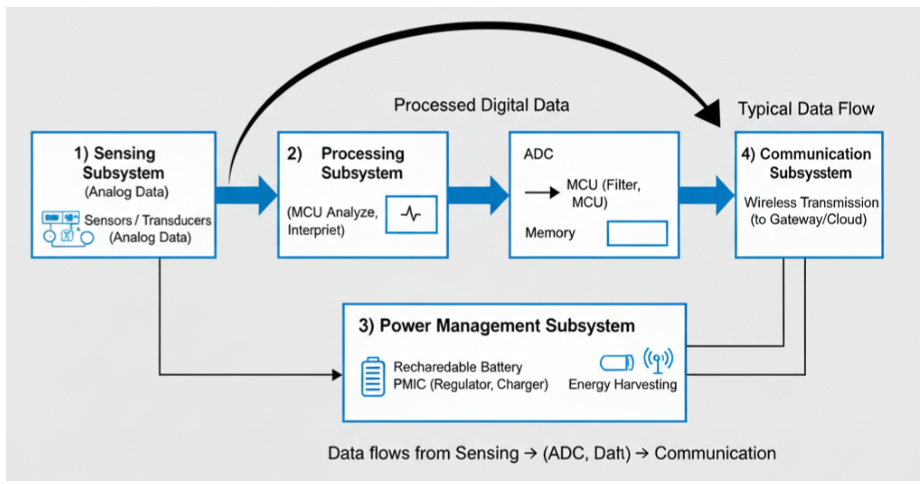
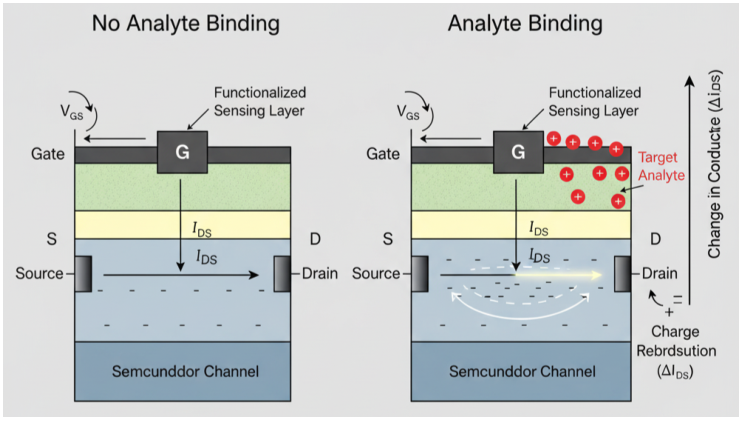
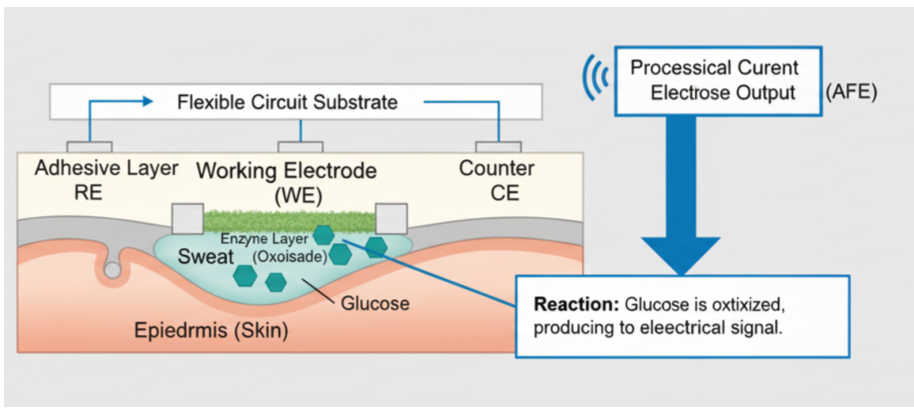

# 可穿戴SoC协同设计：如何把应用需求接到DVFS，哪些证据还不够

[从零入门](start.md) · [原图表索引](figures.md) · [双语摘要与导读](abstract.md)

## 核心信息

- 标题：Circuit-Level Architectures for Next-Generation Wearable Health Monitoring Systems
- 标题翻译：面向下一代可穿戴健康监测系统的电路级架构
- 作者：Qiaori Zheng
- 机构：浙江大学电气工程学院
- 发表时间：2025
- 发表渠道：ICPHDS 2025，8页
- DOI：10.1145/3789537.3789573
- 论文链接：https://doi.org/10.1145/3789537.3789573
- 论文类型：跨子系统技术综述

## 原文摘要翻译

集成电路层面的创新，是可穿戴设备发展为个性化医疗工具的基础。经典可穿戴片上系统架构提供了基本模型，但其局限正在成为进一步发展的重要瓶颈。本综述从两个关键角度，整体分析下一代可穿戴系统，而非逐模块介绍已有技术。首先，它考察可能重塑核心子系统的新趋势，包括RISC-V处理器的开放灵活性、支持片上人工智能的神经形态计算，以及超宽带和5G等先进通信协议。其次，它分析系统级协同设计范式：上下文自适应采样、人工智能驱动的动态电压频率调节，以及智能计算卸载，是实现临床应用所需超低功耗运行和实时智能的重要优化机制。最后，文章通过无袖带血压监测、无创葡萄糖传感和设备端心律失常检测等案例，评价技术成熟度，讨论从实验室成果转化为临床可靠工具所面对的验证、监管与系统障碍。文章将电路技术、系统优化和临床转化问题联系起来，为自主运行、经医疗验证的可穿戴电子设备提供路线图。

以上忠实转述原摘要；摘要中的发展判断属于作者观点，不能当作本文已实现芯片的结论。

**English abstract paraphrase**：This review connects wearable sensing, computation, power management, and communication through system-level co-design. It discusses emerging processing and connectivity options, adaptive sampling, predictive DVFS, and offloading, then considers the validation challenges of clinical applications. It presents a conceptual roadmap rather than a new experimentally evaluated DVFS controller.

## 创新点

1. **综述组织方式**：把采样、处理、电源与通信的相互影响放在同一条数据链上，而不是只罗列低功耗器件。价值在于帮助选择控制器的上游需求输入；这不等于首次提出跨层协同。
2. **把任务质量放进系统约束**：减少采样和降低处理能力都可能影响检测能力或响应时间，不能只优化处理器瓦数。
3. **补充应用转化视角**：即使单个电路有效，系统仍要面对校准、不同人群泛化与数据互联问题。它是场景背景，不是本文新做的人体试验。

全文没有一个可按其参数重建的新DVFS策略、训练过程或PLL/PMIC执行器。ICPHDS也不能与ISSCC或IEEE VLSI会议混同；本文适合放在应用背景层，不进入数字DVFS核心实现证据的首选集合。

## 一句话总结

它说明“任务需求为什么会变、DVFS为什么要与其他模块协同”，但没有回答“给定输入时，本控制器具体选哪一档、怎样安全切到这一档”。

## 研究问题

### 先建立一个不混淆的系统模型

可穿戴设备可能周期性获得一段传感数据，执行滤波、特征提取或识别，再把结果发给手机。处理器只是其中一环。某段数据变少，CPU所需工作可能减少；把任务交给手机，本地计算减少但无线发送增加；降低CPU电压能省处理能量，却不一定降低整个设备的能量。

作者反对各模块单独优化，提出联合考虑。这里的 **co-design** 可以包括算法和硬件的共同选择，但文章主要停留在系统协同原则，没有给出接口级软硬件共同设计实现。全文的核心问题可归纳为：在任务质量与实时性约束下，怎样统筹采样、计算、供电和通信，使系统能量下降？这是阅读归纳，不是作者写出的优化问题。

### 与你的课题怎样接上

对“数字DVFS控制器＋已有PLL/PMIC”，最有价值的启发是：控制器上游不必只用CPU利用率，还可以拿到队列、待处理样本数、任务截止时间和任务类型；下游仍需一个真实执行OPP切换的模块。文章没有选定E902，也没有要求你开发医疗器械。可以先用离线录制信号做周期性CPU程序，完全不涉及对病人的医疗决策。

## 数据与任务定义

材料是用户提供的8页PDF，正文和39条参考条目已读，4幅原图均核对并内嵌。本文没有结果表、独立公开的数据集划分或一套统一设备实验。所有能耗百分比均是转引或叙述，不能当作作者在同一平台测得的横向排名。外部参考只对下文明确列出的身份问题作核查，不宣称39篇参考全文均读。

|层次|本文讨论对象|对你的实验意味着什么|
|---|---|---|
|感知需求|生理信号、运动事件、采样率|决定到达CPU的数据量，不等于CPU频率|
|计算任务|MCU处理、神经网络、事件处理|须落为具体可运行程序及输入文件|
|算力配置|处理器类型、DVFS、专用加速器|架构选择与运行时选档属于不同决策|
|电源执行|PMIC、充电、稳压、采能|需确定哪一条电源轨可编程，不能只有模块名称|
|任务质量|识别、检测、时延、信号可靠性|节能比较必须固定或明确改变质量约束|

任务从“信号变化”到“执行周期”并非一一对应。同样长度的输入可能走不同程序分支；采样率相同也可能因模型或压缩率不同而工作量不同。选输入时应先实测相关性。

## 方法主线

### 机制流程

这四步重建的是综述的逻辑，不是假称本文提供了可运行算法。

1. **输入是传感数据和状态**。采样策略判断信号是否平稳或发生事件，更新采样率；输出的数据流进入处理队列。原文提到状态机与加性增大、乘性减小，但没有给其参数和事件判据。
2. **输入是更新后的计算需求**。处理—电源协同根据需求选择性能水平；预测方法意在提前估计下一段需求，AVFS意在根据物理反馈调整裕量。输出应进入OPP执行器，但本文未展开其实现。
3. **输入是剩余任务、数据量和链路条件**。卸载策略比较本地处理和传输代价，输出执行位置与通信任务。原文没有实现一个和选档联合求解的优化器。
4. **输入是总能量、响应时间和任务质量**。这些指标应反馈到系统策略，评价是否真正受益；本文只是提出协同需求，没有给完整闭环调试和稳定性实验。

### 图1：系统边界比“CPU省电”更大

*原文图1，PDF第2页：经典可穿戴SoC的数据流概念图。*

从左向右读传感、处理、数据转换/存储和通信，下方是电池、稳压和采能。蓝色箭头代表概念数据路径，黑色线联系系统模块。可以直接观察到通信、电源和处理并非孤立；不能从箭头读出总线协议、采样同步、寄存器地址或时钟域。

图中ADC被画在处理框之后，处理框内又已有MCU，排列不能直接当真实模拟采集链的电路顺序。实际数字处理前通常要有适当的模拟前端与转换。本图也没有画回CPU的电压完成反馈、PLL锁定和策略监控，所以它不是DVFS闭环框图。

### 第一层：采样控制改变的是需求

原文§2.1.1认为信号平稳时可少采样，事件发生时恢复高采样。这能同时减少传感器、前端、CPU和无线的工作。要区分两个操作：采样控制改变“有多少数据要算”，DVFS改变“用什么电压频率算这些数据”。若A方案少算了数据，B方案全量计算，两者的节能差不能全部归给DVFS。

下列教学模型有助于把这层联系写清，**不是本文给出的实测公式**：

$$N\approx r_s T_w,\qquad C_{\mathrm{job}}\approx c_s N+C_0.$$

|符号|含义与单位|何时需要重测|
|---|---|---|
|$r_s$|采样率，样本/秒|采样策略改变时|
|$T_w$|处理窗口长度，秒|窗口或重叠率改变时|
|$N$|窗口样本数|边界和取整会产生偏差|
|$c_s$|平均每样本处理周期|程序、缓存与输入分布变化时|
|$C_0$|每任务固定周期开销|调度、初始化或算法变化时|

例如，假设200样本/秒、窗口1秒、每样本1000周期且忽略固定开销，约需20万周期。降到100样本/秒可能变成10万周期，但是否保留事件信息必须另验。这里的数值仅为算例，不能写成本论文平台参数。

### 第二层：DVFS、AVFS和预测控制是三个维度

原文§2.1.2给出动态功耗对电压平方的关系。更完整的教学表达为：

$$P_{\mathrm{dyn}}\approx \alpha C_{\mathrm{eff}}V^2 f,\qquad E=\int P(t)\,dt.$$

其中活动因子为 $\alpha$。有效开关电容写作 $C_{\mathrm{eff}}$，核心供电电压写作 $V$，时钟频率写作 $f$。电压降低有助于减少每次开关的能量，但频率下降会延长执行时间；漏电、稳压效率、等待和切换开销也要算。不能从“功率低”直接推出“每任务能量低”。

|维度|回答的问题|典型输入|本文公开程度|
|---|---|---|---|
|DVFS选档|当前要多少算力？|队列、利用率、剩余工作、截止期|只讲概念，没有选档规则|
|预测策略|下一窗口需要多少算力？|过去的需求、应用上下文|没有特征向量、标签、模型、训练划分或预测跨度|
|AVFS裕量适应|当前电压能否安全支持这个频率？|时序/工艺/温度相关监测|没有传感器电路、反馈律和响应时延|

原文把传统DVFS概括为“反应式、开环”，过于笼统。一个使用合法静态OPP表、同时根据运行时队列反馈选档的控制器，在工作量层面也能是闭环。相反，预测需求并不自动消除物理安全裕量。**需求预测与物理安全反馈可以同时存在**，并非DVFS升级成AVFS后才允许反馈。

你真正需要的执行链可写为“需求特征→目标OPP编号→合法性检查→电源/时钟切换→完成或故障反馈”。这是针对课题的工程补全，原文没有实现。PLL改变时钟，PMIC改变对应电源轨；控制器输出通常是请求编号、配置字和握手，不是软件直接生成一根模拟电压。

### 第三层：计算卸载改变执行位置

原文§2.1.3的标题重复写成“AI驱动DVFS”，正文其实讨论卸载。其输入包括任务复杂度、数据量、电池与链路状况，输出是本地执行或远端执行。应先比较本地能量与发送、接收及等待的总成本，再讨论是否卸载。链路不佳时，少做本地计算也可能更耗电、更慢。

要做协同实验，可固定任务输出质量，分别比较“只调CPU”“只改采样”“只做卸载”“联合策略”，从而分辨各部分贡献。本文没有给这四组消融，更没有给可直接抄用的联合状态机。

### 图2与图3：不要把不同“电压”和“处理器开放性”混在一起

*原文图2，PDF第4页：目标物结合前后，FET传感器通道发生变化的示意。*

先看左右是否有目标物，再看功能化感知层、源漏和通道。$V_{GS}$是传感器栅源电压，$I_{DS}$是漏源电流；它们不是CPU核心供电电压与CPU工作电流。图中的电导变化标记又使用电流符号，存在表达不严谨处。图只帮助理解信号来源，不提供CPU调压接口或精确传感器模型。

*原文图3，PDF第5页：通用MCU、RISC-V加加速器和脉冲式处理三种概念架构。*

三栏分别强调通用执行、任务分工和事件驱动。中间的RISC-V CPU把一部分工作交给加速器，箭头表示概念交互，并未说明共享存储、DMA、握手、CDC或多电压域。右侧事件驱动网络也不意味着真实芯片在无事件时总功率绝对为零。

原文把RISC-V开放性与ARM“固定设计”对比，需收窄理解：开放ISA不代表每个RISC-V核的RTL都开放，也不代表所有IP、工具和制造没有成本。E902能否修改、可用什么外设，取决于你实际获得的IP和授权资料，不能从这幅图直接推出。

## 关键结果

### 原文数字有哪些可以引用、哪些应暂缓

|位置|原文报告/转引|证据性质|当前可支持的结论与限制|
|---|---|---|---|
|第2页§2.1.1|节能85%，分类准确率损失5%|综述叙述，附近引7、8|没有明确设备、基线和实验定义，不能作为采样算法的可复现结果；5%也未明确百分点或相对损失|
|第3页§2.1.2|动态能量降低59–66%，静态功率降低69–80%|归给参考10|引文身份出现不匹配，不能当预测DVFS实证；动态能量和静态功率也非同一指标|
|第3页卸载段|系统功率最多降低20%|二手叙述|没有统一任务、链路和成本设置，不等于CPU调压收益|
|第4页RISC-V例子|传输51nJ、推理0.9μJ、时延0.012秒|转引参考4|即使原始研究成立，也属于特定协处理器任务，不证明本综述做了DVFS实验|
|第5页采能段|采能常为微瓦、活跃SoC常为毫瓦|量级性背景|提示供需差距，不能用这两个量级计算本课题续航|
|第6–7页医疗例子|相关系数、误差与部署困难|临床背景转引|不是本文的受试者实验，也不转换成处理器准确率或DVFS违约率|

这些不是可直接做“最佳节能率排行”的同类结果。本文没有相同负载、相同平台下的固定频率、规则、PID或学习策略对照，也没有重复次数、温度条件和误差条。

### 引用10为什么特别重要

第8页把参考10写为Roy等2023年的《Neuromorphic Computing: From Materials and Devices to Systems and Algorithms》，并给出arXiv:2310.09692。实际[arXiv原始记录](https://arxiv.org/abs/2310.09692)的题名是《Spike-based Neuromorphic Computing for Next-Generation Computer Vision》，作者为Hasan等；元数据与原文不一致。

本次只核该外部页面的身份和摘要，没有冒称读了其全文。能够确定的是：**不能依靠这一条目追溯本文所述预测DVFS的59–66%和69–80%结果**。不能由此推断所有预测控制无效，也不能在尚未查明时猜测作者真正想引哪篇文章。知识库把这条边标为“引文身份不匹配”，不当作已确认的DVFS技术传承。

## 深度分析

### 全部四幅图索引与阅读问题

|图|PDF页|要回答的问题|可以观察|不能推出|
|---|---|---|---|---|
|图1|2|系统有哪些协同对象？|数据、电源和通信模块的概念联系|PLL/PMIC寄存器、真实总线或安全切换时序|
|图2|4|传感器如何生成电信号？|目标物与通道变化的示意|CPU调压、电路定量传递函数|
|图3|5|任务可以由哪些处理架构完成？|CPU、加速器与脉冲网络三类组织|跨架构性能排名、具体E902接口|
|图4|7|汗液传感应用的输入来自哪里？|电极、皮肤、反应与前端关系|医学可靠性、可制造电路或DVFS闭环|

*原文图4，PDF第7页：可穿戴电化学葡萄糖传感器截面概念图。*

读图先找工作、参比和对电极，再看反应区域与前端输出箭头。图中存在原始拼写异常，保留其原样以便回查；它不是能直接按标注制造和验证的电路。对本课题，它只说明“CPU接收的是一串需要处理的数据”；不必因此把葡萄糖监测定为毕设应用。本文讨论的生理相关性、校准和漂移提醒我们，应用输出质量要独立评价。

### 主张—证据—外推边界

|主张|直接证据|可信度与外推|
|---|---|---|
|系统优化需跨模块考虑|§2的需求链及四模块图|作为结构性思路合理；本文没有证明最优联合策略|
|预测DVFS可在可穿戴平台取得所列大幅收益|只有叙述和参考10|当前不可核实，不能作为项目数值目标|
|新处理架构能降低能量|多种不同技术的文献举例|需要回原始平台和任务，不能归因于DVFS|
|已有文章可直接指导数字执行器|全文未展开执行器|不支持；必须补OPP、安全切换与状态反馈设计|

### 如何把概念变成你能写的控制器

可以把系统分成三层：**需求策略**估计下一窗口工作量；**OPP策略**从合法档位表里选满足截止时间的候选；**执行器**按已有PLL/PMIC要求完成切换。以下约束是教学设计，不是本文公开算法：

$$\frac{\widehat C_k}{f_i}+t_{\mathrm{sw}}(i_{k-1},i)+t_{\mathrm{ctrl}}\le D_k.$$

$\widehat C_k$是预测周期数，$f_i$是候选频率，$D_k$是剩余截止时间；切换和控制时间也必须占预算。若没有可行低档，使用保守可行档；若最高档仍不可行，应记录过载，不能隐藏超时。

软件先输出`opp_id`，RTL执行器按IP约束解析成时钟和电源配置。通常加速需先保证电压足够，再升频；降压需先把频率降到安全水平。具体是否需要时钟旁路、暂停、锁定等待、隔离或其他步骤，要查现有IP和板卡电源要求。本文没有给这些状态，也不能从其PMIC段替你确定电压轨可调。

软件模型阶段可把OPP作为时间/能量模型动作，验证策略；那时电压是模型变量。FPGA阶段可验证寄存器、握手和故障回退，但如果电源轨固定，只能证明逻辑执行正确。真实调压能耗必须在支持该电源域动态供电的平台测量。

## 局限

1. **关键：结果追溯不足**。预测DVFS大幅收益的参考条目身份有冲突，其他百分比缺实验设置；不适合支撑控制器性能承诺。
2. **关键：没有可重建的控制算法**。特征、预测标签、控制周期、OPP集合、收益函数、训练与测试划分均不完整；不能用“AI驱动”补造这些内容。
3. **重要：跨层收益没有消融**。改变采样、卸载和处理器架构都会改变任务，缺固定质量和统一边界下的对照。
4. **重要：未展开IC执行约束**。PMIC、RISC-V和神经形态只是技术类别，没有PLL锁定、稳压稳定、过渡态、PVT与失效处理实验。
5. **次要但需注意：概念措辞过宽**。开环DVFS、免费开放处理器和近零静态消耗等表述不能当普适事实。第3节的小标题和部分图注也有表达问题。

前四项是对全文的阅读分析，不是作者自行承认的完整局限清单。作者主要强调采能供需缺口、真实环境的质量与临床验证障碍。

## 我的笔记

### 最小复现应该怎样命名

本论文没有一套足够完整的算法可做逐项一致复现。可做的是“受其协同思路启发的独立实验”，不能写“复现本文59–66%”。先固定程序、输入文件和采样率，在软件时间模型中检查策略，再逐级接硬件。所有以下实验尚未执行。

|实验与优先级|步骤与资源|记录指标和成功标准|风险与失败处理|
|---|---|---|---|
|周期性CPU程序，P0|选滤波或特征统计程序；固定输入，逐OPP表征周期/耗时；以窗口队列和截止期选档；比较固定高档、规则、理想预知下界|相同输出校验、同截止期；记录违约率、每任务能量和切换开销；净收益需包含控制成本|PC功耗不可直接外推E902；无仪表时只报模型结果，预测失准回高档|
|需求输入消融，P1|固定采样，比较仅利用率、队列/周期历史和预测需求；按连续时间段或输入来源划分训练测试|报告预测误差如何变为超时；在同违约预算下比较净能量，而非只报回归误差|相邻重叠窗口可能泄漏；错误升频与错误降频分开统计|
|OPP执行器，P0|RTL接已有PLL/PMIC的行为模型；注入延迟、锁定失败和超时；板卡支持时再接真实接口|只允许合法OPP；升频前电压条件满足、降压前时钟条件满足；每次请求都有完成或明确失败|FPGA固定供电不能当真实DVS；故障时回保守档，日志记录失败状态|

### 再做联合控制时怎样保持公平

先让固定采样下的控制器可靠，再加入采样动作。每一组都使用同一段原始信号，单独评价降采样后的任务质量，报告漏事件风险、处理延迟、通信成本和总能量。不能只看CPU能量下降，也不能用平均准确率掩盖关键事件遗漏。这里是一般工程评价方案，不涉及临床效果承诺。

读完应保留三个知识点：需求生成与算力配置属于不同层；预测不替代电气安全反馈；总系统收益必须按统一边界测。仍待解决的问题是：具体程序的工作量是否可预测、你的PLL/PMIC实际提供何种完成信号、真实板卡能测哪一条轨。下一篇优先接Jiang2020的执行流程，再接ISSCC的监测反馈与ScalePoM的策略机制，比继续收集模糊“AI省电”数字更有用。

## 引用

1. Qiaori Zheng. *Circuit-Level Architectures for Next-Generation Wearable Health Monitoring Systems*. ICPHDS 2025. [DOI](https://doi.org/10.1145/3789537.3789573)。主证据为用户PDF8页，页码均按PDF顺序。
2. 本文参考10给出的编号：[arXiv:2310.09692原始记录](https://arxiv.org/abs/2310.09692)。本次核题名、作者、摘要和版本信息；不声称其全文精读，且不支持把原文未定位的节能率转嫁给它。
3. 批内对照：Jiang2020、ISSCC2024、ScalePoM正式笔记。它们用于明确执行链和评价方法的差别，不表示本文实际引用或继承了这三项工作。
