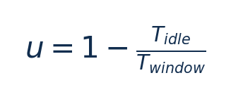

[论文页面](https://www.kernel.org/doc/ols/2006/) · [本笔记所用 PDF](https://www.kernel.org/doc/ols/2006/ols2006v2-pages-223-238.pdf) · [标识符](https://www.kernel.org/doc/ols/2006/)

整理日期：2026-11-05。**读者原创中文解读；原图归论文作者／出版方。未运行作者实验，不是独立复现。**

## 先把四个角色放对位置

被控负载是要完成的程序和输入，比如压缩一块日志；CPU是执行程序的硬件；控制器根据观测选运行档位；驱动／寄存器把档位落实。程序代码可以完全一样，CPU时钟变慢时每条指令对应的墙钟时间通常变长，访存或I/O等待则未必按同样比例变化。

软件控制并不意味着没有真实硬件。软件中的学习策略可控制真实CPU；也可先控制一个执行时间与能量模型。后者能验证闭环逻辑，但模型输出的J不能当真实电测。E902的RTL能在仿真中改变时钟并反馈计数；电压导致的物理功耗还需相应模型、功耗分析或板级实验。

## 这篇到底解决哪一件事

用CPU忙闲比触发升频，并由内核与驱动协调共享频域，是后续智能算法必须面对的基线

为什么相同CPU利用率未必对应相同的工作需求？本篇的可检验主张是：用CPU忙闲比触发升频，并由内核与驱动协调共享频域，是后续智能算法必须面对的基线。验证链是可观测状态→控制规则或学习模型→执行器→任务正确性/服务质量与能耗对照。

**把方法想成一条流水线：** 采样窗口CPU忙闲时间、up/down阈值、频率转换延迟、共享依赖CPU集合 → 内核定时采样忙闲比：原版超过上阈值升MAX，低于下阈值逐步降；后续直接选可保持约80%忙碌的最低频率，共享域取最高核需求 → CPUFreq驱动目标频率请求；驱动/硬件匹配电压，不是governor直接写任意电压 → 执行与反馈。

| 先回答的问题 | 本文答案 |
| --- | --- |
| 具体控制算法 | 内核定时采样忙闲比：原版超过上阈值升MAX，低于下阈值逐步降；后续直接选可保持约80%忙碌的最低频率，共享域取最高核需求 |
| 被控负载类型 | 多处理器SSL Web服务，客户连接数由负载机递增 |
| 具体被控程序 | 标准SSL Web server/client测试；当前材料未明确到可唯一复建的服务软件版本，不擅自补成Apache/Nginx |
| 使用平台与测量 | 4-socket Xeon MP，双核/HT共16逻辑CPU，8GB；Linux2.6时期cpufreq；12V CPU供电支路电流，CR5410S霍尔传感器＋PMD-1208LS USB采集 |
| 输入/状态 | 采样窗口CPU忙闲时间、up/down阈值、频率转换延迟、共享依赖CPU集合 |
| 输出/动作 | CPUFreq驱动目标频率请求；驱动/硬件匹配电压，不是governor直接写任意电压 |
| 周期与运行位置 | 采样受HZ和P-state切换延迟影响；文中示例110000µs/up_threshold80，参数是历史示例非当前Linux建议 |

## 十个先修关键词

| 级别 | 术语／关键词 | 直觉、严格含义与易混点 |
| --- | --- | --- |
| A | DVFS / DFS | DVFS同时涉及动态电压与频率；只有时钟变化称DFS。电压能否改变取决于实际供电域。 |
| A | Workload | 真正执行应用计算的程序与输入；本文里的控制器是另一个角色。 |
| A | Controller | 根据观测选择动作的软件／硬件，可运行在同一CPU或独立控制核。 |
| A | OPP | Operating Performance Point，经过允许范围验证的电压—频率组合。 |
| A | Power / Energy | 功率W表示此刻消耗快慢；能量J是对时间积分。低功率不必然低能量。 |
| B | Deadline | 作业必须完成的时刻；平均时延、P95与最大时延各有不同用途。 |
| A | 被控程序 | 标准SSL Web server/client测试；当前材料未明确到可唯一复建的服务软件版本，不擅自补成Apache/Nginx |
| A | 控制策略 | 内核定时采样忙闲比：原版超过上阈值升MAX，低于下阈值逐步降；后续直接选可保持约80%忙碌的最低频率，共享域取最高核需求 |
| B | 控制周期 | 采样受HZ和P-state切换延迟影响；文中示例110000µs/up_threshold80，参数是历史示例非当前Linux建议 |
| B | 证据边界 | 实测、硬件仿真、功耗模型是不同证据，见平台与结果表。 |

## 用一个小算例建立直觉

10ms窗口空闲2ms得到80%；两个不同期限任务都可能有80%。

时间均s或cycles但需同基准，u为0–1；它不是剩余工作量。

**要防止的误读：** 历史参数与内核接口已演化；本笔记不把2006实现说成当前系统行为。

## 论文真正验证了什么

| 指标 | 原文报告 | 条件／分母／边界 | 证据位置 |
| --- | --- | --- | --- |
| Performance与Powersave功率差 | 约10% | 16逻辑CPU服务器SSL负载；CPU12V支路，不是任意整机能量节省 | §6.3，PDF p10–12 |
| 动态策略性能 | 相对静态低频退化更小 | 原文描述dynamic性能损失barely visible；不从曲线虚构统一精确节能率 | Fig4–5，p12 |
| 测量变化 | 约1W run-to-run | 作者因此展示原始曲线未额外平均；不是置信区间 | §6.2，p10 |

这些结果来自作者实验。算法reward、模型误差、控制器时延、被控应用速度与应用节能是不同指标，要看具体行的单位和证据。

## 它与你的毕设怎么接起来

E902可实现一个忙闲比阈值控制器作最低复杂度对照，再验证进度/余量特征是否真正改善；无Linux时用裸机计时与安全寄存器接口替代CPUFreq。

最先可以尝试：**P0：忙闲阈值基线**。理由是建立智能控制参照；最低资源是CPU忙闲计时/固定周期/合法档；通过标准是任务正确性与全路径延迟可测。

## 五分钟自测

1. 这篇输出的是下一频率、功率估计，还是通信／控制时序？
2. 是真实负载硬件实验，还是模型／RTL／HIL？哪些部分是真的？
3. 最重要百分比的分母和比较对象是什么？
4. 如果换成单核E902，哪一个输入或硬件旋钮会消失？
5. 算上采样、推理、切频和空闲时间后，节能是否还成立？

答案线索在本页角色表和结果表；进一步读“图文技术精读”的关键原图、公式与三项课题实验，再到“图表索引”回查原PDF。不是先记住论文所有缩写。
