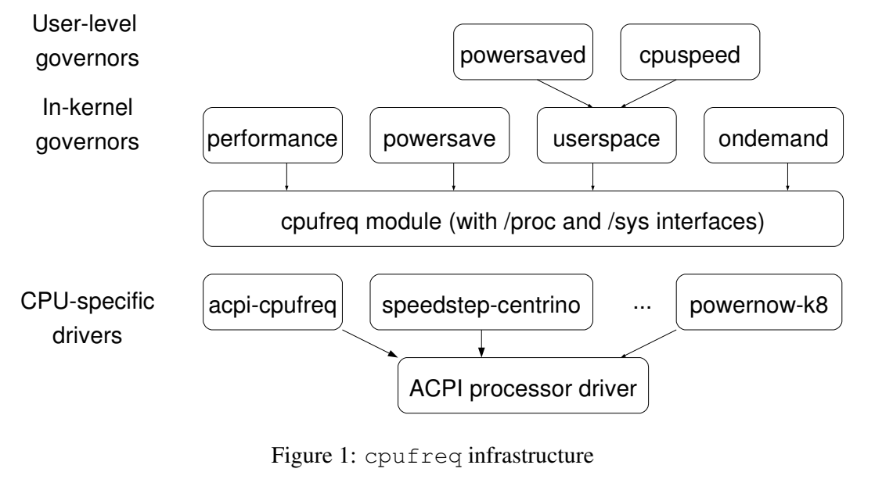
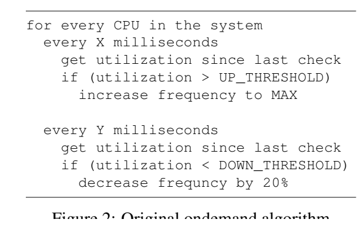
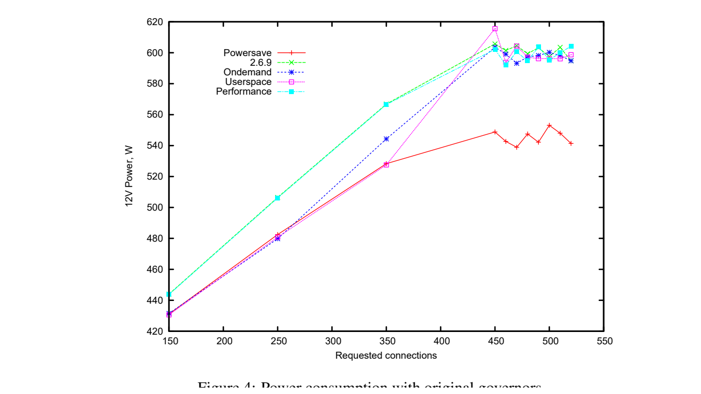

[论文页面](https://www.kernel.org/doc/ols/2006/) · [本笔记所用 PDF](https://www.kernel.org/doc/ols/2006/ols2006v2-pages-223-238.pdf) · [标识符](https://www.kernel.org/doc/ols/2006/)

整理日期：2026-11-05。**读者原创中文解读；原图归论文作者／出版方。未运行作者实验，不是独立复现。**

**覆盖范围：** 本版本正文中识别到的9项图、表或算法；保留原编号。关键项已裁图并在技术精读相应段落出现，未内嵌的项可点PDF页链接查看，不上传整篇PDF。

**统计总边界：** 改变连接数的曲线是负载扫描，不是每个点多次独立重复统计。作者声明约1W跨运行变化并直接展示数据；未提供现代策略意义上的全输入违约率或能量置信区间。比较原始/实验变体须保持同一节内硬件与采样设置；不同图的曲线不能混成一个“节能率”。

## Fig1：CPUFreq软件层次

[原文 Fig1，PDF p4](https://www.kernel.org/doc/ols/2006/ols2006v2-pages-223-238.pdf#page=4)

[打开大图](images/original-fig1.png)

1. **本项回答的问题：** CPUFreq软件层次，用于支撑这条方法或实验链中的具体环节。
2. **组成、坐标和对照：** 先读图题、图例、坐标/表头与单位，再在同一负载和同一基线内比较。governor定政策、driver接硬件，各有职责。 结构／流程类没有统一数值坐标；箭头表示数据或控制关系，不表示统计因果。 颜色按原图图例辨认，不能把同色跨图视为同一组。
3. **阅读顺序与统计单位：** 先看设定、单位和图例，再看趋势与作者正文。重复次数及采样独立性参见本篇技术精读统计节；没有为该图定位到的误差线定义／独立重复数，不另行猜测。
4. **直接观察：** governor定政策、driver接硬件，各有职责。
5. **作者解释的范围：** 原文以该图／表作为上述观察的结构说明或实验支撑，需连同对应页正文读取；本索引不额外替作者推导因果机制。
6. **独立判断（AI分析）：** 本项只支撑原文所列平台和配置；不证明E902可直接复用这些数值。
7. **证据链位置：** 方法／系统实现说明。它支持本文具体条件下的实现或结果，不单独完成跨平台验证。
8. **结论与强度：** 可复述“governor定政策、driver接硬件，各有职责。”；对图内描述的核查可信度高，对未做独立实验的泛化判断为中或无法判断。不能得出的结论是“本项只支撑原文所列平台和配置；不证明E902可直接复用这些数值。”所排除的外推。

## Fig2：原始Ondemand算法

[原文 Fig2，PDF p6](https://www.kernel.org/doc/ols/2006/ols2006v2-pages-223-238.pdf#page=6)

[打开大图](images/original-fig2.png)

1. **本项回答的问题：** 原始Ondemand算法，用于支撑这条方法或实验链中的具体环节。
2. **组成、坐标和对照：** 先读图题、图例、坐标/表头与单位，再在同一负载和同一基线内比较。分开升/降采样路径，低负载降20%。 结构／流程类没有统一数值坐标；箭头表示数据或控制关系，不表示统计因果。 颜色按原图图例辨认，不能把同色跨图视为同一组。
3. **阅读顺序与统计单位：** 先看设定、单位和图例，再看趋势与作者正文。重复次数及采样独立性参见本篇技术精读统计节；没有为该图定位到的误差线定义／独立重复数，不另行猜测。
4. **直接观察：** 分开升/降采样路径，低负载降20%。
5. **作者解释的范围：** 原文以该图／表作为上述观察的结构说明或实验支撑，需连同对应页正文读取；本索引不额外替作者推导因果机制。
6. **独立判断（AI分析）：** 本项只支撑原文所列平台和配置；不证明E902可直接复用这些数值。
7. **证据链位置：** 方法／系统实现说明。它支持本文具体条件下的实现或结果，不单独完成跨平台验证。
8. **结论与强度：** 可复述“分开升/降采样路径，低负载降20%。”；对图内描述的核查可信度高，对未做独立实验的泛化判断为中或无法判断。不能得出的结论是“本项只支撑原文所列平台和配置；不证明E902可直接复用这些数值。”所排除的外推。

## Fig3：实验连接

[原文 Fig3，PDF p10](https://www.kernel.org/doc/ols/2006/ols2006v2-pages-223-238.pdf#page=10)

1. **本项回答的问题：** 实验连接，用于支撑这条方法或实验链中的具体环节。
2. **组成、坐标和对照：** 先读图题、图例、坐标/表头与单位，再在同一负载和同一基线内比较。测CPU12V支路且有外部负载机。 结构／流程类没有统一数值坐标；箭头表示数据或控制关系，不表示统计因果。 颜色按原图图例辨认，不能把同色跨图视为同一组。
3. **阅读顺序与统计单位：** 先看设定、单位和图例，再看趋势与作者正文。重复次数及采样独立性参见本篇技术精读统计节；没有为该图定位到的误差线定义／独立重复数，不另行猜测。
4. **直接观察：** 测CPU12V支路且有外部负载机。
5. **作者解释的范围：** 原文以该图／表作为上述观察的结构说明或实验支撑，需连同对应页正文读取；本索引不额外替作者推导因果机制。
6. **独立判断（AI分析）：** 本项只支撑原文所列平台和配置；不证明E902可直接复用这些数值。
7. **证据链位置：** 方法／系统实现说明。它支持本文具体条件下的实现或结果，不单独完成跨平台验证。
8. **结论与强度：** 可复述“测CPU12V支路且有外部负载机。”；对图内描述的核查可信度高，对未做独立实验的泛化判断为中或无法判断。不能得出的结论是“本项只支撑原文所列平台和配置；不证明E902可直接复用这些数值。”所排除的外推。

## Fig4：原版策略功率

[原文 Fig4，PDF p12](https://www.kernel.org/doc/ols/2006/ols2006v2-pages-223-238.pdf#page=12)

[打开大图](images/original-fig4.png)

1. **本项回答的问题：** 原版策略功率，用于支撑这条方法或实验链中的具体环节。
2. **组成、坐标和对照：** 先读图题、图例、坐标/表头与单位，再在同一负载和同一基线内比较。横轴请求连接数、纵轴功率；不能忽略服务成功率。 按原图／表标示的单位与归一化基准阅读；不将不同子图或不同分母的柱高直接相除。 颜色按原图图例辨认，不能把同色跨图视为同一组。
3. **阅读顺序与统计单位：** 先看设定、单位和图例，再看趋势与作者正文。重复次数及采样独立性参见本篇技术精读统计节；没有为该图定位到的误差线定义／独立重复数，不另行猜测。
4. **直接观察：** 横轴请求连接数、纵轴功率；不能忽略服务成功率。
5. **作者解释的范围：** 原文以该图／表作为上述观察的结构说明或实验支撑，需连同对应页正文读取；本索引不额外替作者推导因果机制。
6. **独立判断（AI分析）：** 本项只支撑原文所列平台和配置；不证明E902可直接复用这些数值。
7. **证据链位置：** 性能验证／定量或示例证据，需结合实验条件。它支持本文具体条件下的实现或结果，不单独完成跨平台验证。
8. **结论与强度：** 可复述“横轴请求连接数、纵轴功率；不能忽略服务成功率。”；对图内描述的核查可信度高，对未做独立实验的泛化判断为中或无法判断。不能得出的结论是“本项只支撑原文所列平台和配置；不证明E902可直接复用这些数值。”所排除的外推。

## Fig5：原版服务性能

[原文 Fig5，PDF p12](https://www.kernel.org/doc/ols/2006/ols2006v2-pages-223-238.pdf#page=12)

1. **本项回答的问题：** 原版服务性能，用于支撑这条方法或实验链中的具体环节。
2. **组成、坐标和对照：** 先读图题、图例、坐标/表头与单位，再在同一负载和同一基线内比较。配合图4看可满足连接数。 按原图／表标示的单位与归一化基准阅读；不将不同子图或不同分母的柱高直接相除。 颜色按原图图例辨认，不能把同色跨图视为同一组。
3. **阅读顺序与统计单位：** 先看设定、单位和图例，再看趋势与作者正文。重复次数及采样独立性参见本篇技术精读统计节；没有为该图定位到的误差线定义／独立重复数，不另行猜测。
4. **直接观察：** 配合图4看可满足连接数。
5. **作者解释的范围：** 原文以该图／表作为上述观察的结构说明或实验支撑，需连同对应页正文读取；本索引不额外替作者推导因果机制。
6. **独立判断（AI分析）：** 本项只支撑原文所列平台和配置；不证明E902可直接复用这些数值。
7. **证据链位置：** 性能验证／定量或示例证据，需结合实验条件。它支持本文具体条件下的实现或结果，不单独完成跨平台验证。
8. **结论与强度：** 可复述“配合图4看可满足连接数。”；对图内描述的核查可信度高，对未做独立实验的泛化判断为中或无法判断。不能得出的结论是“本项只支撑原文所列平台和配置；不证明E902可直接复用这些数值。”所排除的外推。

## Fig6：实验策略功率

[原文 Fig6，PDF p13](https://www.kernel.org/doc/ols/2006/ols2006v2-pages-223-238.pdf#page=13)

1. **本项回答的问题：** 实验策略功率，用于支撑这条方法或实验链中的具体环节。
2. **组成、坐标和对照：** 先读图题、图例、坐标/表头与单位，再在同一负载和同一基线内比较。版本变化属于算法改进实验。 按原图／表标示的单位与归一化基准阅读；不将不同子图或不同分母的柱高直接相除。 颜色按原图图例辨认，不能把同色跨图视为同一组。
3. **阅读顺序与统计单位：** 先看设定、单位和图例，再看趋势与作者正文。重复次数及采样独立性参见本篇技术精读统计节；没有为该图定位到的误差线定义／独立重复数，不另行猜测。
4. **直接观察：** 版本变化属于算法改进实验。
5. **作者解释的范围：** 原文以该图／表作为上述观察的结构说明或实验支撑，需连同对应页正文读取；本索引不额外替作者推导因果机制。
6. **独立判断（AI分析）：** 本项只支撑原文所列平台和配置；不证明E902可直接复用这些数值。
7. **证据链位置：** 性能验证／定量或示例证据，需结合实验条件。它支持本文具体条件下的实现或结果，不单独完成跨平台验证。
8. **结论与强度：** 可复述“版本变化属于算法改进实验。”；对图内描述的核查可信度高，对未做独立实验的泛化判断为中或无法判断。不能得出的结论是“本项只支撑原文所列平台和配置；不证明E902可直接复用这些数值。”所排除的外推。

## Fig7：实验策略性能

[原文 Fig7，PDF p13](https://www.kernel.org/doc/ols/2006/ols2006v2-pages-223-238.pdf#page=13)

1. **本项回答的问题：** 实验策略性能，用于支撑这条方法或实验链中的具体环节。
2. **组成、坐标和对照：** 先读图题、图例、坐标/表头与单位，再在同一负载和同一基线内比较。和同页功率配对，不与其他硬件混比。 按原图／表标示的单位与归一化基准阅读；不将不同子图或不同分母的柱高直接相除。 颜色按原图图例辨认，不能把同色跨图视为同一组。
3. **阅读顺序与统计单位：** 先看设定、单位和图例，再看趋势与作者正文。重复次数及采样独立性参见本篇技术精读统计节；没有为该图定位到的误差线定义／独立重复数，不另行猜测。
4. **直接观察：** 和同页功率配对，不与其他硬件混比。
5. **作者解释的范围：** 原文以该图／表作为上述观察的结构说明或实验支撑，需连同对应页正文读取；本索引不额外替作者推导因果机制。
6. **独立判断（AI分析）：** 本项只支撑原文所列平台和配置；不证明E902可直接复用这些数值。
7. **证据链位置：** 性能验证／定量或示例证据，需结合实验条件。它支持本文具体条件下的实现或结果，不单独完成跨平台验证。
8. **结论与强度：** 可复述“和同页功率配对，不与其他硬件混比。”；对图内描述的核查可信度高，对未做独立实验的泛化判断为中或无法判断。不能得出的结论是“本项只支撑原文所列平台和配置；不证明E902可直接复用这些数值。”所排除的外推。

## Fig8：后续变体功率

[原文 Fig8，PDF p14](https://www.kernel.org/doc/ols/2006/ols2006v2-pages-223-238.pdf#page=14)

1. **本项回答的问题：** 后续变体功率，用于支撑这条方法或实验链中的具体环节。
2. **组成、坐标和对照：** 先读图题、图例、坐标/表头与单位，再在同一负载和同一基线内比较。不同idle计量影响动作与功耗。 按原图／表标示的单位与归一化基准阅读；不将不同子图或不同分母的柱高直接相除。 颜色按原图图例辨认，不能把同色跨图视为同一组。
3. **阅读顺序与统计单位：** 先看设定、单位和图例，再看趋势与作者正文。重复次数及采样独立性参见本篇技术精读统计节；没有为该图定位到的误差线定义／独立重复数，不另行猜测。
4. **直接观察：** 不同idle计量影响动作与功耗。
5. **作者解释的范围：** 原文以该图／表作为上述观察的结构说明或实验支撑，需连同对应页正文读取；本索引不额外替作者推导因果机制。
6. **独立判断（AI分析）：** 本项只支撑原文所列平台和配置；不证明E902可直接复用这些数值。
7. **证据链位置：** 性能验证／定量或示例证据，需结合实验条件。它支持本文具体条件下的实现或结果，不单独完成跨平台验证。
8. **结论与强度：** 可复述“不同idle计量影响动作与功耗。”；对图内描述的核查可信度高，对未做独立实验的泛化判断为中或无法判断。不能得出的结论是“本项只支撑原文所列平台和配置；不证明E902可直接复用这些数值。”所排除的外推。

## Fig9：后续变体性能

[原文 Fig9，PDF p14](https://www.kernel.org/doc/ols/2006/ols2006v2-pages-223-238.pdf#page=14)

1. **本项回答的问题：** 后续变体性能，用于支撑这条方法或实验链中的具体环节。
2. **组成、坐标和对照：** 先读图题、图例、坐标/表头与单位，再在同一负载和同一基线内比较。反应快慢与能量收益共同决定可用性。 按原图／表标示的单位与归一化基准阅读；不将不同子图或不同分母的柱高直接相除。 颜色按原图图例辨认，不能把同色跨图视为同一组。
3. **阅读顺序与统计单位：** 先看设定、单位和图例，再看趋势与作者正文。重复次数及采样独立性参见本篇技术精读统计节；没有为该图定位到的误差线定义／独立重复数，不另行猜测。
4. **直接观察：** 反应快慢与能量收益共同决定可用性。
5. **作者解释的范围：** 原文以该图／表作为上述观察的结构说明或实验支撑，需连同对应页正文读取；本索引不额外替作者推导因果机制。
6. **独立判断（AI分析）：** 本项只支撑原文所列平台和配置；不证明E902可直接复用这些数值。
7. **证据链位置：** 性能验证／定量或示例证据，需结合实验条件。它支持本文具体条件下的实现或结果，不单独完成跨平台验证。
8. **结论与强度：** 可复述“反应快慢与能量收益共同决定可用性。”；对图内描述的核查可信度高，对未做独立实验的泛化判断为中或无法判断。不能得出的结论是“本项只支撑原文所列平台和配置；不证明E902可直接复用这些数值。”所排除的外推。
