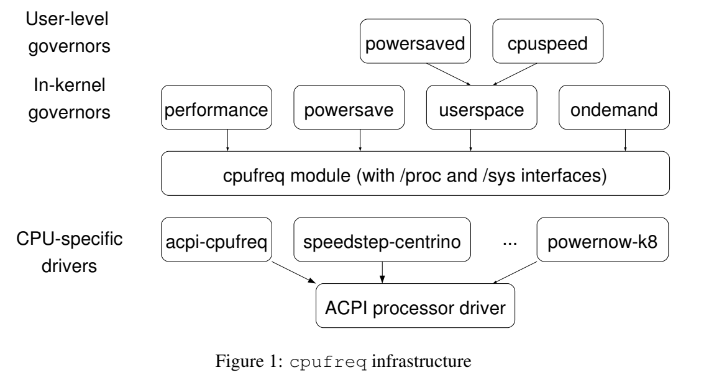
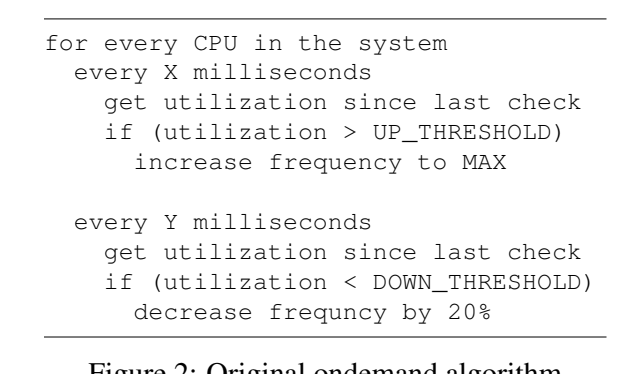
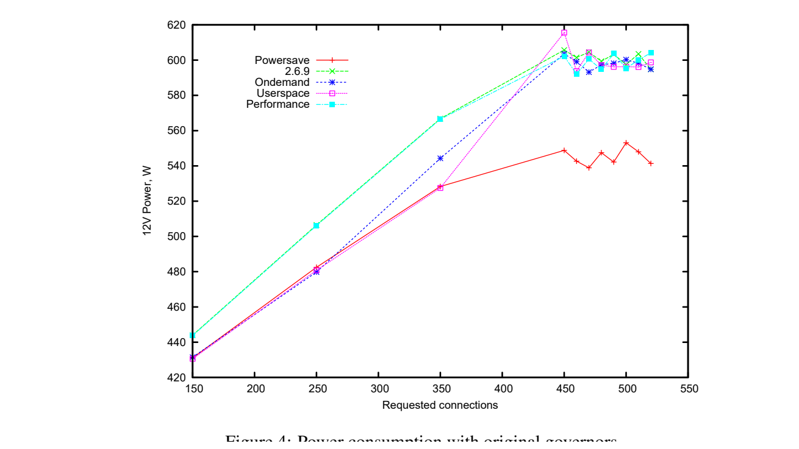

[论文页面](https://www.kernel.org/doc/ols/2006/) · [本笔记所用 PDF](https://www.kernel.org/doc/ols/2006/ols2006v2-pages-223-238.pdf) · [标识符](https://www.kernel.org/doc/ols/2006/)

整理日期：2026-11-05。**读者原创中文解读；原图归论文作者／出版方。未运行作者实验，不是独立复现。**

**一句话：** 用CPU忙闲比触发升频，并由内核与驱动协调共享频域，是后续智能算法必须面对的基线

阅读地图：先看问题与输入输出，再顺着架构图、公式和结果图阅读；最后检查统计边界与E902迁移。完整编号索引另见“图表索引”。下文“读者分析”是推断或建议，不是原文结果。

## 阶段0：材料与版本审计

| 材料 | 当前可用程度 | 影响 |
| --- | --- | --- |
| 摘要、正文、方法、原图注 | 已获取本地完整PDF、文本与逐页渲染 | 可核查结构、实验及关键数字；可见页面优先于异常文本层 |
| 分析版本 | kernel.org公开PDF18页；文件名页码与正文印刷页存在差异，本文一律按PDF页定位；历史设计，不代表当前内核默认。 | 引用页码以“PDF第几页”标识 |
| 代码／原始数据 | 当前材料中尚未定位齐完整控制器源码、实验脚本和原始重复数据；这不表示这些材料不存在。 | 公开链接不等于已构建或已拿到原始轨迹 |
| 附件、独立原始重复与勘误 | 当前未完成全渠道附件／勘误穷尽检索 | 不能断言没有附件、没有勘误或没有其他版本 |
| 本次工作范围 | 材料阅读、图表裁取、证据整理、教学公式 | 所有新实验均是建议，尚未执行 |

## 阶段1：身份卡与整体概述

| 项目 | 内容 |
| --- | --- |
| 英文题名 | The Ondemand Governor: Past, Present, and Future |
| 中文导读题名 | 用CPU忙闲比触发升频，并由内核与驱动协调共享频域，是后续智能算法必须面对的基线 |
| 作者 | Venkatesh Pallipadi, Alexey Starikovskiy |
| 发表／版本 | Ottawa Linux Symposium2006，Volume2；kernel.org公开PDF18页；文件名页码与正文印刷页存在差异，本文一律按PDF页定位；历史设计，不代表当前内核默认。 |
| 类型与领域 | 原始方法／工程系统研究；DVFS、CPU能效、运行时控制 |
| 单位、通讯、资助与利益关系 | 作者姓名以本版本首页为准；通讯方式、单位及资助可回查首页与末页声明。当前尚未完成资助/利益关系/勘误的跨版本穷尽审计。 |
| 核心对象与接口 | 采样受HZ和P-state切换延迟影响；文中示例110000µs/up_threshold80，参数是历史示例非当前Linux建议 |
| 代码与数据 | 当前材料中尚未定位齐完整控制器源码、实验脚本和原始重复数据；这不表示这些材料不存在。 |
| 与本课题关系 | E902可实现一个忙闲比阈值控制器作最低复杂度对照，再验证进度/余量特征是否真正改善；无Linux时用裸机计时与安全寄存器接口替代CPUFreq。 |

**约200字中文概述（改写）：** 本文研究多处理器SSL Web服务，客户连接数由负载机递增的运行时能效。具体程序包括标准SSL Web server/client测试；当前材料未明确到可唯一复建的服务软件版本，不擅自补成Apache/Nginx。作者在4-socket Xeon MP，双核/HT共16逻辑CPU，8GB；Linux2.6时期cpufreq；12V CPU供电支路电流，CR5410S霍尔传感器＋PMD-1208LS USB采集上采用内核定时采样忙闲比：原版超过上阈值升MAX，低于下阈值逐步降；后续直接选可保持约80%忙碌的最低频率，共享域取最高核需求。输入为采样窗口CPU忙闲时间、up/down阈值、频率转换延迟、共享依赖CPU集合，输出为CPUFreq驱动目标频率请求；驱动/硬件匹配电压，不是governor直接写任意电压。主要结果应与下方基线、性能约束和测量范围一起阅读，不能只摘最高百分比。把轻量忙闲调频放入内核，利用快速P-state切换与多CPU依赖协调；这是一篇理解基线与软件执行路径的原始工程文献，不因年份旧而省略。

**三句话定位：** 问题是为什么相同CPU利用率未必对应相同的工作需求？本篇的可检验主张是：用CPU忙闲比触发升频，并由内核与驱动协调共享频域，是后续智能算法必须面对的基线。验证链是可观测状态→控制规则或学习模型→执行器→任务正确性/服务质量与能耗对照。 方法主线为采样窗口CPU忙闲时间、up/down阈值、频率转换延迟、共享依赖CPU集合 → 内核定时采样忙闲比：原版超过上阈值升MAX，低于下阈值逐步降；后续直接选可保持约80%忙碌的最低频率，共享域取最高核需求 → CPUFreq驱动目标频率请求；驱动/硬件匹配电压，不是governor直接写任意电压 → 执行与反馈。 主要证据见下方结果表，结论须与测量和版本范围一起使用。

## 阶段2：问题、假设与创新位置

为什么相同CPU利用率未必对应相同的工作需求？本篇的可检验主张是：用CPU忙闲比触发升频，并由内核与驱动协调共享频域，是后续智能算法必须面对的基线。验证链是可观测状态→控制规则或学习模型→执行器→任务正确性/服务质量与能耗对照。

**创新判断（读者分析）：** 把轻量忙闲调频放入内核，利用快速P-state切换与多CPU依赖协调；这是一篇理解基线与软件执行路径的原始工程文献，不因年份旧而省略。 不依据作者自称“首次”断定整个领域绝无前例。

## 阶段3：必要术语与数学

| 级别 | 术语／关键词 | 直觉、严格含义与易混点 |
| --- | --- | --- |
| A | DVFS / DFS | DVFS同时涉及动态电压与频率；只有时钟变化称DFS。电压能否改变取决于实际供电域。 |
| A | Workload | 真正执行应用计算的程序与输入；本文里的控制器是另一个角色。 |
| A | Controller | 根据观测选择动作的软件／硬件，可运行在同一CPU或独立控制核。 |
| A | OPP | Operating Performance Point，经过允许范围验证的电压—频率组合。 |
| A | Power / Energy | 功率W表示此刻消耗快慢；能量J是对时间积分。低功率不必然低能量。 |
| B | Deadline | 作业必须完成的时刻；平均时延、P95与最大时延各有不同用途。 |
| A | 被控程序 | 标准SSL Web server/client测试；当前材料未明确到可唯一复建的服务软件版本，不擅自补成Apache/Nginx |
| A | 控制策略 | 内核定时采样忙闲比：原版超过上阈值升MAX，低于下阈值逐步降；后续直接选可保持约80%忙碌的最低频率，共享域取最高核需求 |
| B | 控制周期 | 采样受HZ和P-state切换延迟影响；文中示例110000µs/up_threshold80，参数是历史示例非当前Linux建议 |
| B | 证据边界 | 实测、硬件仿真、功耗模型是不同证据，见平台与结果表。 |

### 公式1：窗口利用率

**符号与前提：** 时间均s或cycles但需同基准，u为0–1；它不是剩余工作量。

**代入与检查：** 10ms窗口空闲2ms得到80%；两个不同期限任务都可能有80%。

**来源：** §3/Fig2，p6
### 公式2：比例选频的教学表达

**符号与前提：** 这是文中保持目标忙碌率思想的简化教学表达，非某现代内核逐行实现；最终映射合法频档。

**代入与检查：** 当前1GHz、u=0.4、目标0.8，可建议0.5GHz；低于最低档须截断。

**来源：** §4.1，p7

## 阶段4–6：架构、关键图与方法拆解

**输入—处理—输出：** 采样窗口CPU忙闲时间、up/down阈值、频率转换延迟、共享依赖CPU集合 → 内核定时采样忙闲比：原版超过上阈值升MAX，低于下阈值逐步降；后续直接选可保持约80%忙碌的最低频率，共享域取最高核需求 → CPUFreq驱动目标频率请求；驱动/硬件匹配电压，不是governor直接写任意电压 → 执行与反馈。

| 系统角色 | 具体设置 |
| --- | --- |
| 具体控制算法 | 内核定时采样忙闲比：原版超过上阈值升MAX，低于下阈值逐步降；后续直接选可保持约80%忙碌的最低频率，共享域取最高核需求 |
| 被控负载类型 | 多处理器SSL Web服务，客户连接数由负载机递增 |
| 具体被控程序 | 标准SSL Web server/client测试；当前材料未明确到可唯一复建的服务软件版本，不擅自补成Apache/Nginx |
| 使用平台与测量 | 4-socket Xeon MP，双核/HT共16逻辑CPU，8GB；Linux2.6时期cpufreq；12V CPU供电支路电流，CR5410S霍尔传感器＋PMD-1208LS USB采集 |
| 输入/状态 | 采样窗口CPU忙闲时间、up/down阈值、频率转换延迟、共享依赖CPU集合 |
| 输出/动作 | CPUFreq驱动目标频率请求；驱动/硬件匹配电压，不是governor直接写任意电压 |
| 周期与运行位置 | 采样受HZ和P-state切换延迟影响；文中示例110000µs/up_threshold80，参数是历史示例非当前Linux建议 |

§3–6（PDF p6–14）：原版双路径以不同时间间隔检查升/降条件，升频直接到最高，降频逐档约20%。2.6.9至2.6.16演进改成估算保持约80%利用率所需频率，一跳下降。共享频域需在OS/BIOS/硬件间协调，最高需求可能覆盖其他核请求。文章还研究统一升降路径、idle微计量和调度器合作；这些实验变体不能与原始算法混为一个固定版本。

被控对象是执行SSL服务的真实CPU；服务器软件任务本身不被改写。利用率告诉CPU忙了多久，不告诉某请求还有多少工作/期限，因此适合作为低成本基线。§7.3指出实时线程可能先于governor运行，导致频率提升不及时，说明低成本并不等于deadline保证。

### Fig1：CPUFreq软件层次

[打开大图](images/original-fig1.png) · [原文 Fig1，PDF p4](https://www.kernel.org/doc/ols/2006/ols2006v2-pages-223-238.pdf#page=4)

**怎样看：** 先读图题、图例、坐标/表头与单位，再在同一负载和同一基线内比较。governor定政策、driver接硬件，各有职责。

**直接观察／原文报告：** governor定政策、driver接硬件，各有职责。

**读者判断：** 本项只支撑原文所列平台和配置；不证明E902可直接复用这些数值。

### Fig2：原始Ondemand算法

[打开大图](images/original-fig2.png) · [原文 Fig2，PDF p6](https://www.kernel.org/doc/ols/2006/ols2006v2-pages-223-238.pdf#page=6)

**怎样看：** 先读图题、图例、坐标/表头与单位，再在同一负载和同一基线内比较。分开升/降采样路径，低负载降20%。

**直接观察／原文报告：** 分开升/降采样路径，低负载降20%。

**读者判断：** 本项只支撑原文所列平台和配置；不证明E902可直接复用这些数值。

| 阅读问题 | 先看材料 | 如何接到下一步 |
| --- | --- | --- |
| 为什么要改现有方案 | 问题背景与动机图 | 确定目标、约束和原有不足 |
| 系统观察什么、控制什么 | 输入输出表＋关键架构图 | 确认数据、模型和执行器真实角色 |
| 方法如何得到动作或估计 | 方法段、公式、算法／模型表 | 明确离线训练与在线流程 |
| 收益是否真实且公平 | 结果图表、统计与测量边界 | 核查基线／目标／分母／开销 |
| 能否用于自己的CPU | 局限、复现计划、三项实验 | 把论文假设变成待验证的工程条件 |

## 阶段7–8：实验、统计及证据链

本节数字均是**原文明确报告或原文数值的标注算例**；没有按图柱高度臆造额外精确值。

| 指标 | 原文报告 | 条件／分母／边界 | 证据位置 |
| --- | --- | --- | --- |
| Performance与Powersave功率差 | 约10% | 16逻辑CPU服务器SSL负载；CPU12V支路，不是任意整机能量节省 | §6.3，PDF p10–12 |
| 动态策略性能 | 相对静态低频退化更小 | 原文描述dynamic性能损失barely visible；不从曲线虚构统一精确节能率 | Fig4–5，p12 |
| 测量变化 | 约1W run-to-run | 作者因此展示原始曲线未额外平均；不是置信区间 | §6.2，p10 |

### Fig4：原版策略功率

[打开大图](images/original-fig4.png) · [原文 Fig4，PDF p12](https://www.kernel.org/doc/ols/2006/ols2006v2-pages-223-238.pdf#page=12)

**怎样看：** 先读图题、图例、坐标/表头与单位，再在同一负载和同一基线内比较。横轴请求连接数、纵轴功率；不能忽略服务成功率。

**直接观察／原文报告：** 横轴请求连接数、纵轴功率；不能忽略服务成功率。

**读者判断：** 本项只支撑原文所列平台和配置；不证明E902可直接复用这些数值。

**统计与公平性审查（读者分析）：** 改变连接数的曲线是负载扫描，不是每个点多次独立重复统计。作者声明约1W跨运行变化并直接展示数据；未提供现代策略意义上的全输入违约率或能量置信区间。比较原始/实验变体须保持同一节内硬件与采样设置；不同图的曲线不能混成一个“节能率”。

工程实验中，设备、程序、输入文件、重复运行、时间窗口是不同统计层级，不能互相替代。本任务不涉及生物样本，细胞／动物／试剂等检查不适用。未注明的P值或置信区间不补造；“差了几个百分点”不自动等于统计显著。

| 主张层级 | 直接证据 | 对照与统计 | 可得结论／替代解释 | 可信度 |
| --- | --- | --- | --- | --- |
| 原文明确报告 | Performance与Powersave功率差：约10% | §6.3，PDF p10–12 | 16逻辑CPU服务器SSL负载；CPU12V支路，不是任意整机能量节省；仅在该实验范围内成立 | 图表／文本可核对：高；独立复现：尚无 |
| 作者解释 | 所提架构／模型解释了性能或估计改善 | 关键原图与方法见上文；统计边界见下节 | 效果可能同时来自动作空间、平台特性与采样设置，因果归因需消融 | 中 |
| AI分析／迁移假设 | 用于E902的压缩候选负载 | 本篇未直接验证该芯片与任务组合 | 需三项后续实验；不能复制论文收益数字 | 待验证，当前无法判断 |

## 阶段9–10：贡献与局限分开判断

把轻量忙闲调频放入内核，利用快速P-state切换与多CPU依赖协调；这是一篇理解基线与软件执行路径的原始工程文献，不因年份旧而省略。

| 来源 | 严重程度 | 局限及其影响 |
| --- | --- | --- |
| 读者分析 | 关键 | 瞬时利用率不包含任务进度/期限，压缩计算密集时可能总在最高档。 |
| 读者分析 | 关键 | 内核调度、采样与切换延迟形成完整路径，不能只看计算公式。 |
| 读者分析 | 关键 | 历史参数与内核接口已演化；本笔记不把2006实现说成当前系统行为。 |

## 阶段11：最小复现路线与缺口

先重建原文固定安全档、输入文件和测量边界，再实现上述算法。逐档确认正确输出和执行时间，记录控制、监测、调频与空闲成本；冻结模型后用整文件留出的输入测试。原文未定位齐的参数须列入复现日志，不用猜测值伪装完整复现。E902可实现一个忙闲比阈值控制器作最低复杂度对照，再验证进度/余量特征是否真正改善；无Linux时用裸机计时与安全寄存器接口替代CPUFreq。

**代码／数据现状：** 当前材料中尚未定位齐完整控制器源码、实验脚本和原始重复数据；这不表示这些材料不存在。

**质量控制顺序：** 先验证程序输出和时间基准，再验证采样／模型，最后比较策略。保存输入文件哈希、平台配置、OPP、随机种子、温度与每次运行原始记录。失败时先回固定安全频点定位错误，再继续优化。复现可行性判断为“可开始部分方法复建，完整数值复现条件未齐”；这与“已完成复现”不同。

## 阶段12：用于你的CPU／E902课题

E902可实现一个忙闲比阈值控制器作最低复杂度对照，再验证进度/余量特征是否真正改善；无Linux时用裸机计时与安全寄存器接口替代CPUFreq。

| 建议实验／优先级 | 价值 | 最低资源 | 主要风险 | 成功判据（设计目标，非已得结果） |
| --- | --- | --- | --- | --- |
| P0：忙闲阈值基线 | 建立智能控制参照 | CPU忙闲计时/固定周期/合法档 | 空闲统计受中断影响 | 任务正确性与全路径延迟可测 |
| P1：饱和利用率反例 | 检验信息不足 | 不同熵/块长压缩输入 | 都100%忙时策略退化 | 对比期限余量状态与能量 |
| P1：采样周期扫描 | 量化反应和开销 | 多控制周期、切换计数 | 太快轮询耗能太慢违约 | 找净能量/尾时延折中并报告边界 |

上述优先级是读者建议：P0先做，P1建立在基线可运行后，P2只在资源允许且前序实验证明有必要时开展。压缩应用仍是候选，尚未替你最终定题或证明已在E902运行。论文公开可读不自动授权任意复制数据；代码、图片和数据须分别核对许可。

## 阶段13：读完后应掌握与继续核查

**五个知识点：** 用CPU忙闲比触发升频，并由内核与驱动协调共享频域，是后续智能算法必须面对的基线 你还应能解释输入输出表中的角色、两条公式的单位、首个结果指标的分母，以及局限表里的关键条件。

**五个未决问题：** 独立新输入是否成立？最差时延是否可接受？测量参考是否足够？控制与切换是否抵消收益？E902实际具有哪些接口和可观测量？这些是研究问题，不是对作者遗漏的无证据指控。

**立即做：** 按公式算例手算一次，选一张结果图复述“硬件—负载—基线—指标—边界”。**后续核查：** 补齐代码版本、训练数据和仪表设置。**可复用：** 上文明确标注的模型与接口思路。**谨慎采用：** 所有跨平台百分比。**暂不采用：** 尚未证实存在的电压控制和完整硬实时承诺。
