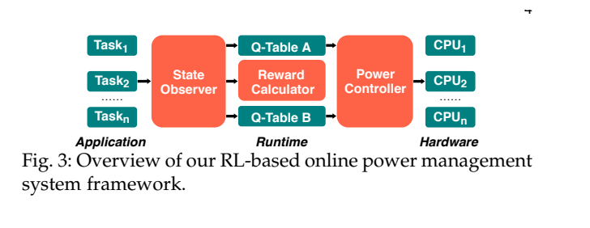
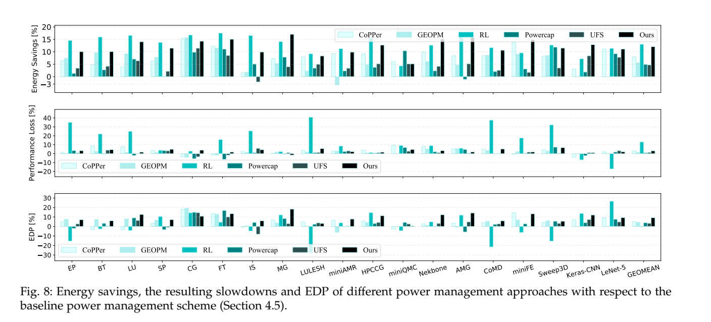
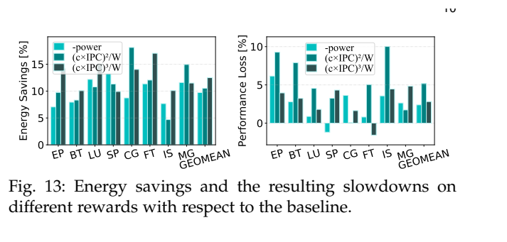
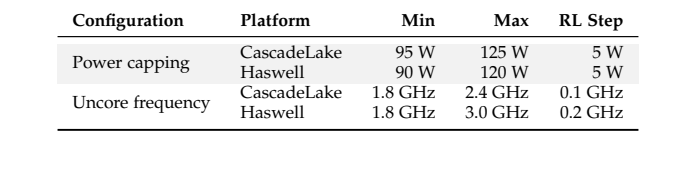

[论文页面](https://doi.org/10.1109/TPDS.2021.3092270) · [本笔记所用 PDF](https://issl-uk.com/publications/tpds21-2.pdf) · [DOI](https://doi.org/10.1109/TPDS.2021.3092270)

整理日期：2026-11-05。**读者原创中文解读；原图归论文作者／出版方。未运行作者实验，不是独立复现。**

**覆盖范围：** 本版本正文中识别到的18项图、表或算法；保留原编号。关键项已裁图并在技术精读相应段落出现，未内嵌的项可点PDF页链接查看，不上传整篇PDF。

**统计总边界：** 论文明确重复到每个程序／输入的95%置信界小于5%，比只报单次更完整。训练与未见程序分开，但在线测试期间继续学习，故结果并非完全冻结模型的零样本泛化。功率测量依赖RAPL寄存器，性能计数与能量采样存在开销；3秒窗口可错过毫秒级阶段。Fig8中的EDP改善比例越高越好，与原始EDP越低越好不是矛盾。

## Fig1：核心与uncore组成

[原文 Fig1，PDF p3](https://issl-uk.com/publications/tpds21-2.pdf#page=3)

1. **本项回答的问题：** 核心与uncore组成，用于支撑这条方法或实验链中的具体环节。
2. **组成、坐标和对照：** 看共享部分与各核连接。 结构／流程类没有统一数值坐标；箭头表示数据或控制关系，不表示统计因果。 颜色按原图图例辨认，不能把同色跨图视为同一组。
3. **阅读顺序与统计单位：** 先看设定、单位和图例，再看趋势与作者正文。重复次数及采样独立性参见本篇技术精读统计节；没有为该图定位到的误差线定义／独立重复数，不另行猜测。
4. **直接观察：** 两个旋钮作用范围不同。
5. **作者解释的范围：** 原文以该图／表作为上述观察的结构说明或实验支撑，需连同对应页正文读取；本索引不额外替作者推导因果机制。
6. **独立判断（AI分析）：** Intel结构不等于E902 SoC结构。
7. **证据链位置：** 方法／系统实现说明。它支持本文具体条件下的实现或结果，不单独完成跨平台验证。
8. **结论与强度：** 可复述“两个旋钮作用范围不同。”；对图内描述的核查可信度高，对未做独立实验的泛化判断为中或无法判断。不能得出的结论是“Intel结构不等于E902 SoC结构。”所排除的外推。

## Fig2：动机程序对比

[原文 Fig2，PDF p3](https://issl-uk.com/publications/tpds21-2.pdf#page=3)

1. **本项回答的问题：** 动机程序对比，用于支撑这条方法或实验链中的具体环节。
2. **组成、坐标和对照：** 分别看AMG和miniQMC的功率／时间。 按原图／表标示的单位与归一化基准阅读；不将不同子图或不同分母的柱高直接相除。 颜色按原图图例辨认，不能把同色跨图视为同一组。
3. **阅读顺序与统计单位：** 先看设定、单位和图例，再看趋势与作者正文。重复次数及采样独立性参见本篇技术精读统计节；没有为该图定位到的误差线定义／独立重复数，不另行猜测。
4. **直接观察：** 最优旋钮组合因负载变化。
5. **作者解释的范围：** 原文以该图／表作为上述观察的结构说明或实验支撑，需连同对应页正文读取；本索引不额外替作者推导因果机制。
6. **独立判断（AI分析）：** 静态示例不是完整策略平均。
7. **证据链位置：** 性能验证／定量或示例证据，需结合实验条件。它支持本文具体条件下的实现或结果，不单独完成跨平台验证。
8. **结论与强度：** 可复述“最优旋钮组合因负载变化。”；对图内描述的核查可信度高，对未做独立实验的泛化判断为中或无法判断。不能得出的结论是“静态示例不是完整策略平均。”所排除的外推。

## Fig3：在线学习架构

[原文 Fig3，PDF p4](https://issl-uk.com/publications/tpds21-2.pdf#page=4)

[打开大图](images/original-fig3.png)

1. **本项回答的问题：** 在线学习架构，用于支撑这条方法或实验链中的具体环节。
2. **组成、坐标和对照：** 观测→奖励→Q表→硬件。 结构／流程类没有统一数值坐标；箭头表示数据或控制关系，不表示统计因果。 颜色按原图图例辨认，不能把同色跨图视为同一组。
3. **阅读顺序与统计单位：** 先看设定、单位和图例，再看趋势与作者正文。重复次数及采样独立性参见本篇技术精读统计节；没有为该图定位到的误差线定义／独立重复数，不另行猜测。
4. **直接观察：** CPU功率帽与uncore共同输出。
5. **作者解释的范围：** 原文以该图／表作为上述观察的结构说明或实验支撑，需连同对应页正文读取；本索引不额外替作者推导因果机制。
6. **独立判断（AI分析）：** 不是直接写电压寄存器。
7. **证据链位置：** 方法／系统实现说明。它支持本文具体条件下的实现或结果，不单独完成跨平台验证。
8. **结论与强度：** 可复述“CPU功率帽与uncore共同输出。”；对图内描述的核查可信度高，对未做独立实验的泛化判断为中或无法判断。不能得出的结论是“不是直接写电压寄存器。”所排除的外推。

## Fig4：两表更新示例

[原文 Fig4，PDF p5](https://issl-uk.com/publications/tpds21-2.pdf#page=5)

1. **本项回答的问题：** 两表更新示例，用于支撑这条方法或实验链中的具体环节。
2. **组成、坐标和对照：** 追踪一张表选动作、另一张表估计。 按原图／表标示的单位与归一化基准阅读；不将不同子图或不同分母的柱高直接相除。 颜色按原图图例辨认，不能把同色跨图视为同一组。
3. **阅读顺序与统计单位：** 先看设定、单位和图例，再看趋势与作者正文。重复次数及采样独立性参见本篇技术精读统计节；没有为该图定位到的误差线定义／独立重复数，不另行猜测。
4. **直接观察：** 更新机制与普通Q不同。
5. **作者解释的范围：** 原文以该图／表作为上述观察的结构说明或实验支撑，需连同对应页正文读取；本索引不额外替作者推导因果机制。
6. **独立判断（AI分析）：** 不证明所有噪声均被消除。
7. **证据链位置：** 性能验证／定量或示例证据，需结合实验条件。它支持本文具体条件下的实现或结果，不单独完成跨平台验证。
8. **结论与强度：** 可复述“更新机制与普通Q不同。”；对图内描述的核查可信度高，对未做独立实验的泛化判断为中或无法判断。不能得出的结论是“不证明所有噪声均被消除。”所排除的外推。

## Fig5：miniAMR阶段

[原文 Fig5，PDF p5](https://issl-uk.com/publications/tpds21-2.pdf#page=5)

1. **本项回答的问题：** miniAMR阶段，用于支撑这条方法或实验链中的具体环节。
2. **组成、坐标和对照：** 横轴秒，上下分别看核心与内存指标。 按原图／表标示的单位与归一化基准阅读；不将不同子图或不同分母的柱高直接相除。 颜色按原图图例辨认，不能把同色跨图视为同一组。
3. **阅读顺序与统计单位：** 先看设定、单位和图例，再看趋势与作者正文。重复次数及采样独立性参见本篇技术精读统计节；没有为该图定位到的误差线定义／独立重复数，不另行猜测。
4. **直接观察：** 程序执行存在明显阶段。
5. **作者解释的范围：** 原文以该图／表作为上述观察的结构说明或实验支撑，需连同对应页正文读取；本索引不额外替作者推导因果机制。
6. **独立判断（AI分析）：** 阶段相关性不等于cache miss导致能耗的因果量。
7. **证据链位置：** 性能验证／定量或示例证据，需结合实验条件。它支持本文具体条件下的实现或结果，不单独完成跨平台验证。
8. **结论与强度：** 可复述“程序执行存在明显阶段。”；对图内描述的核查可信度高，对未做独立实验的泛化判断为中或无法判断。不能得出的结论是“阶段相关性不等于cache miss导致能耗的因果量。”所排除的外推。

## Fig6：整体能量与性能

[原文 Fig6，PDF p7](https://issl-uk.com/publications/tpds21-2.pdf#page=7)

1. **本项回答的问题：** 整体能量与性能，用于支撑这条方法或实验链中的具体环节。
2. **组成、坐标和对照：** 上下图同一应用配对读。 按原图／表标示的单位与归一化基准阅读；不将不同子图或不同分母的柱高直接相除。 颜色按原图图例辨认，不能把同色跨图视为同一组。
3. **阅读顺序与统计单位：** 先看设定、单位和图例，再看趋势与作者正文。重复次数及采样独立性参见本篇技术精读统计节；没有为该图定位到的误差线定义／独立重复数，不另行猜测。
4. **直接观察：** 平均收益以小幅性能损失为代价。
5. **作者解释的范围：** 原文以该图／表作为上述观察的结构说明或实验支撑，需连同对应页正文读取；本索引不额外替作者推导因果机制。
6. **独立判断（AI分析）：** 平均小于3%不代表每个任务小于3%。
7. **证据链位置：** 性能验证／定量或示例证据，需结合实验条件。它支持本文具体条件下的实现或结果，不单独完成跨平台验证。
8. **结论与强度：** 可复述“平均收益以小幅性能损失为代价。”；对图内描述的核查可信度高，对未做独立实验的泛化判断为中或无法判断。不能得出的结论是“平均小于3%不代表每个任务小于3%。”所排除的外推。

## Fig7：AMG与miniQMC功率轨迹

[原文 Fig7，PDF p7](https://issl-uk.com/publications/tpds21-2.pdf#page=7)

1. **本项回答的问题：** AMG与miniQMC功率轨迹，用于支撑这条方法或实验链中的具体环节。
2. **组成、坐标和对照：** 沿时间看默认与在线策略。 按原图／表标示的单位与归一化基准阅读；不将不同子图或不同分母的柱高直接相除。 颜色按原图图例辨认，不能把同色跨图视为同一组。
3. **阅读顺序与统计单位：** 先看设定、单位和图例，再看趋势与作者正文。重复次数及采样独立性参见本篇技术精读统计节；没有为该图定位到的误差线定义／独立重复数，不另行猜测。
4. **直接观察：** 策略随阶段更新。
5. **作者解释的范围：** 原文以该图／表作为上述观察的结构说明或实验支撑，需连同对应页正文读取；本索引不额外替作者推导因果机制。
6. **独立判断（AI分析）：** 曲线长度不同，面积才决定能量。
7. **证据链位置：** 性能验证／定量或示例证据，需结合实验条件。它支持本文具体条件下的实现或结果，不单独完成跨平台验证。
8. **结论与强度：** 可复述“策略随阶段更新。”；对图内描述的核查可信度高，对未做独立实验的泛化判断为中或无法判断。不能得出的结论是“曲线长度不同，面积才决定能量。”所排除的外推。

## Fig8：竞争基线和单旋钮消融

[原文 Fig8，PDF p8](https://issl-uk.com/publications/tpds21-2.pdf#page=8)

[打开大图](images/original-fig8.png)

1. **本项回答的问题：** 竞争基线和单旋钮消融，用于支撑这条方法或实验链中的具体环节。
2. **组成、坐标和对照：** 依次看能量、性能损失、EDP改善。 按原图／表标示的单位与归一化基准阅读；不将不同子图或不同分母的柱高直接相除。 颜色按原图图例辨认，不能把同色跨图视为同一组。
3. **阅读顺序与统计单位：** 先看设定、单位和图例，再看趋势与作者正文。重复次数及采样独立性参见本篇技术精读统计节；没有为该图定位到的误差线定义／独立重复数，不另行猜测。
4. **直接观察：** 联合管理更好地平衡指标。
5. **作者解释的范围：** 原文以该图／表作为上述观察的结构说明或实验支撑，需连同对应页正文读取；本索引不额外替作者推导因果机制。
6. **独立判断（AI分析）：** 不同目标不能只按能量冠军排序。
7. **证据链位置：** 性能验证／定量或示例证据，需结合实验条件。它支持本文具体条件下的实现或结果，不单独完成跨平台验证。
8. **结论与强度：** 可复述“联合管理更好地平衡指标。”；对图内描述的核查可信度高，对未做独立实验的泛化判断为中或无法判断。不能得出的结论是“不同目标不能只按能量冠军排序。”所排除的外推。

## Fig9：同程序多进程

[原文 Fig9，PDF p9](https://issl-uk.com/publications/tpds21-2.pdf#page=9)

1. **本项回答的问题：** 同程序多进程，用于支撑这条方法或实验链中的具体环节。
2. **组成、坐标和对照：** 按并发进程数比较。 按原图／表标示的单位与归一化基准阅读；不将不同子图或不同分母的柱高直接相除。 颜色按原图图例辨认，不能把同色跨图视为同一组。
3. **阅读顺序与统计单位：** 先看设定、单位和图例，再看趋势与作者正文。重复次数及采样独立性参见本篇技术精读统计节；没有为该图定位到的误差线定义／独立重复数，不另行猜测。
4. **直接观察：** 争用影响收益。
5. **作者解释的范围：** 原文以该图／表作为上述观察的结构说明或实验支撑，需连同对应页正文读取；本索引不额外替作者推导因果机制。
6. **独立判断（AI分析）：** 不等于多节点扩展。
7. **证据链位置：** 性能验证／定量或示例证据，需结合实验条件。它支持本文具体条件下的实现或结果，不单独完成跨平台验证。
8. **结论与强度：** 可复述“争用影响收益。”；对图内描述的核查可信度高，对未做独立实验的泛化判断为中或无法判断。不能得出的结论是“不等于多节点扩展。”所排除的外推。

## Fig10：混合应用

[原文 Fig10，PDF p9](https://issl-uk.com/publications/tpds21-2.pdf#page=9)

1. **本项回答的问题：** 混合应用，用于支撑这条方法或实验链中的具体环节。
2. **组成、坐标和对照：** 同一组合内比较策略。 按原图／表标示的单位与归一化基准阅读；不将不同子图或不同分母的柱高直接相除。 颜色按原图图例辨认，不能把同色跨图视为同一组。
3. **阅读顺序与统计单位：** 先看设定、单位和图例，再看趋势与作者正文。重复次数及采样独立性参见本篇技术精读统计节；没有为该图定位到的误差线定义／独立重复数，不另行猜测。
4. **直接观察：** 不同应用混跑也可在线适应。
5. **作者解释的范围：** 原文以该图／表作为上述观察的结构说明或实验支撑，需连同对应页正文读取；本索引不额外替作者推导因果机制。
6. **独立判断（AI分析）：** 组合有限，非任意负载保证。
7. **证据链位置：** 性能验证／定量或示例证据，需结合实验条件。它支持本文具体条件下的实现或结果，不单独完成跨平台验证。
8. **结论与强度：** 可复述“不同应用混跑也可在线适应。”；对图内描述的核查可信度高，对未做独立实验的泛化判断为中或无法判断。不能得出的结论是“组合有限，非任意负载保证。”所排除的外推。

## Fig11：CascadeLake多节点

[原文 Fig11，PDF p10](https://issl-uk.com/publications/tpds21-2.pdf#page=10)

1. **本项回答的问题：** CascadeLake多节点，用于支撑这条方法或实验链中的具体环节。
2. **组成、坐标和对照：** 看节点数对平均能量／慢化。 按原图／表标示的单位与归一化基准阅读；不将不同子图或不同分母的柱高直接相除。 颜色按原图图例辨认，不能把同色跨图视为同一组。
3. **阅读顺序与统计单位：** 先看设定、单位和图例，再看趋势与作者正文。重复次数及采样独立性参见本篇技术精读统计节；没有为该图定位到的误差线定义／独立重复数，不另行猜测。
4. **直接观察：** 收益没有随节点数立刻消失。
5. **作者解释的范围：** 原文以该图／表作为上述观察的结构说明或实验支撑，需连同对应页正文读取；本索引不额外替作者推导因果机制。
6. **独立判断（AI分析）：** 非无限规模证明。
7. **证据链位置：** 性能验证／定量或示例证据，需结合实验条件。它支持本文具体条件下的实现或结果，不单独完成跨平台验证。
8. **结论与强度：** 可复述“收益没有随节点数立刻消失。”；对图内描述的核查可信度高，对未做独立实验的泛化判断为中或无法判断。不能得出的结论是“非无限规模证明。”所排除的外推。

## Fig12：Haswell多节点

[原文 Fig12，PDF p10](https://issl-uk.com/publications/tpds21-2.pdf#page=10)

1. **本项回答的问题：** Haswell多节点，用于支撑这条方法或实验链中的具体环节。
2. **组成、坐标和对照：** 和Fig11在各自基线上读。 按原图／表标示的单位与归一化基准阅读；不将不同子图或不同分母的柱高直接相除。 颜色按原图图例辨认，不能把同色跨图视为同一组。
3. **阅读顺序与统计单位：** 先看设定、单位和图例，再看趋势与作者正文。重复次数及采样独立性参见本篇技术精读统计节；没有为该图定位到的误差线定义／独立重复数，不另行猜测。
4. **直接观察：** 另一架构有相似趋势。
5. **作者解释的范围：** 原文以该图／表作为上述观察的结构说明或实验支撑，需连同对应页正文读取；本索引不额外替作者推导因果机制。
6. **独立判断（AI分析）：** 跨架构百分比仍需重新测量。
7. **证据链位置：** 性能验证／定量或示例证据，需结合实验条件。它支持本文具体条件下的实现或结果，不单独完成跨平台验证。
8. **结论与强度：** 可复述“另一架构有相似趋势。”；对图内描述的核查可信度高，对未做独立实验的泛化判断为中或无法判断。不能得出的结论是“跨架构百分比仍需重新测量。”所排除的外推。

## Fig13：奖励消融

[原文 Fig13，PDF p10](https://issl-uk.com/publications/tpds21-2.pdf#page=10)

[打开大图](images/original-fig13.png)

1. **本项回答的问题：** 奖励消融，用于支撑这条方法或实验链中的具体环节。
2. **组成、坐标和对照：** 比较负功率、平方项、立方项。 按原图／表标示的单位与归一化基准阅读；不将不同子图或不同分母的柱高直接相除。 颜色按原图图例辨认，不能把同色跨图视为同一组。
3. **阅读顺序与统计单位：** 先看设定、单位和图例，再看趋势与作者正文。重复次数及采样独立性参见本篇技术精读统计节；没有为该图定位到的误差线定义／独立重复数，不另行猜测。
4. **直接观察：** 立方奖励在该设置取得较好权衡。
5. **作者解释的范围：** 原文以该图／表作为上述观察的结构说明或实验支撑，需连同对应页正文读取；本索引不额外替作者推导因果机制。
6. **独立判断（AI分析）：** 不是普遍最优reward定理。
7. **证据链位置：** 性能验证／定量或示例证据，需结合实验条件。它支持本文具体条件下的实现或结果，不单独完成跨平台验证。
8. **结论与强度：** 可复述“立方奖励在该设置取得较好权衡。”；对图内描述的核查可信度高，对未做独立实验的泛化判断为中或无法判断。不能得出的结论是“不是普遍最优reward定理。”所排除的外推。

## Fig14：采样附加成本

[原文 Fig14，PDF p10](https://issl-uk.com/publications/tpds21-2.pdf#page=10)

1. **本项回答的问题：** 采样附加成本，用于支撑这条方法或实验链中的具体环节。
2. **组成、坐标和对照：** 负值表示波动／加速，零为无采样参考。 按原图／表标示的单位与归一化基准阅读；不将不同子图或不同分母的柱高直接相除。 颜色按原图图例辨认，不能把同色跨图视为同一组。
3. **阅读顺序与统计单位：** 先看设定、单位和图例，再看趋势与作者正文。重复次数及采样独立性参见本篇技术精读统计节；没有为该图定位到的误差线定义／独立重复数，不另行猜测。
4. **直接观察：** 监控成本需要计入。
5. **作者解释的范围：** 原文以该图／表作为上述观察的结构说明或实验支撑，需连同对应页正文读取；本索引不额外替作者推导因果机制。
6. **独立判断（AI分析）：** 小负值不能推断采样创造能量。
7. **证据链位置：** 性能验证／定量或示例证据，需结合实验条件。它支持本文具体条件下的实现或结果，不单独完成跨平台验证。
8. **结论与强度：** 可复述“监控成本需要计入。”；对图内描述的核查可信度高，对未做独立实验的泛化判断为中或无法判断。不能得出的结论是“小负值不能推断采样创造能量。”所排除的外推。

## Fig15：窗口扫描

[原文 Fig15，PDF p11](https://issl-uk.com/publications/tpds21-2.pdf#page=11)

1. **本项回答的问题：** 窗口扫描，用于支撑这条方法或实验链中的具体环节。
2. **组成、坐标和对照：** 横轴3ms到5s，纵轴开销。 按原图／表标示的单位与归一化基准阅读；不将不同子图或不同分母的柱高直接相除。 颜色按原图图例辨认，不能把同色跨图视为同一组。
3. **阅读顺序与统计单位：** 先看设定、单位和图例，再看趋势与作者正文。重复次数及采样独立性参见本篇技术精读统计节；没有为该图定位到的误差线定义／独立重复数，不另行猜测。
4. **直接观察：** 作者选3s作为该负载折中。
5. **作者解释的范围：** 原文以该图／表作为上述观察的结构说明或实验支撑，需连同对应页正文读取；本索引不额外替作者推导因果机制。
6. **独立判断（AI分析）：** 压缩小块可能需要完全不同周期。
7. **证据链位置：** 性能验证／定量或示例证据，需结合实验条件。它支持本文具体条件下的实现或结果，不单独完成跨平台验证。
8. **结论与强度：** 可复述“作者选3s作为该负载折中。”；对图内描述的核查可信度高，对未做独立实验的泛化判断为中或无法判断。不能得出的结论是“压缩小块可能需要完全不同周期。”所排除的外推。

## Table1：硬件动作范围

[原文 Table1，PDF p6](https://issl-uk.com/publications/tpds21-2.pdf#page=6)

[打开大图](images/original-table1.png)

1. **本项回答的问题：** 硬件动作范围，用于支撑这条方法或实验链中的具体环节。
2. **组成、坐标和对照：** 比较两平台范围和步长。 按原图／表标示的单位与归一化基准阅读；不将不同子图或不同分母的柱高直接相除。 颜色按原图图例辨认，不能把同色跨图视为同一组。
3. **阅读顺序与统计单位：** 先看设定、单位和图例，再看趋势与作者正文。重复次数及采样独立性参见本篇技术精读统计节；没有为该图定位到的误差线定义／独立重复数，不另行猜测。
4. **直接观察：** 搜索空间受人为收窄。
5. **作者解释的范围：** 原文以该图／表作为上述观察的结构说明或实验支撑，需连同对应页正文读取；本索引不额外替作者推导因果机制。
6. **独立判断（AI分析）：** 不能写成探索全部硬件频点。
7. **证据链位置：** 性能验证／定量或示例证据，需结合实验条件。它支持本文具体条件下的实现或结果，不单独完成跨平台验证。
8. **结论与强度：** 可复述“搜索空间受人为收窄。”；对图内描述的核查可信度高，对未做独立实验的泛化判断为中或无法判断。不能得出的结论是“不能写成探索全部硬件频点。”所排除的外推。

## Table2：训练与测试程序集

[原文 Table2，PDF p6](https://issl-uk.com/publications/tpds21-2.pdf#page=6)

1. **本项回答的问题：** 训练与测试程序集，用于支撑这条方法或实验链中的具体环节。
2. **组成、坐标和对照：** 区分8个训练与11个测试。 按原图／表标示的单位与归一化基准阅读；不将不同子图或不同分母的柱高直接相除。 颜色按原图图例辨认，不能把同色跨图视为同一组。
3. **阅读顺序与统计单位：** 先看设定、单位和图例，再看趋势与作者正文。重复次数及采样独立性参见本篇技术精读统计节；没有为该图定位到的误差线定义／独立重复数，不另行猜测。
4. **直接观察：** 有跨程序验证。
5. **作者解释的范围：** 原文以该图／表作为上述观察的结构说明或实验支撑，需连同对应页正文读取；本索引不额外替作者推导因果机制。
6. **独立判断（AI分析）：** 测试仍在线学习，应单独说明。
7. **证据链位置：** 性能验证／定量或示例证据，需结合实验条件。它支持本文具体条件下的实现或结果，不单独完成跨平台验证。
8. **结论与强度：** 可复述“有跨程序验证。”；对图内描述的核查可信度高，对未做独立实验的泛化判断为中或无法判断。不能得出的结论是“测试仍在线学习，应单独说明。”所排除的外推。

## Table3：混合组合列表

[原文 Table3，PDF p9](https://issl-uk.com/publications/tpds21-2.pdf#page=9)

1. **本项回答的问题：** 混合组合列表，用于支撑这条方法或实验链中的具体环节。
2. **组成、坐标和对照：** 对照Fig10组合名。 按原图／表标示的单位与归一化基准阅读；不将不同子图或不同分母的柱高直接相除。 颜色按原图图例辨认，不能把同色跨图视为同一组。
3. **阅读顺序与统计单位：** 先看设定、单位和图例，再看趋势与作者正文。重复次数及采样独立性参见本篇技术精读统计节；没有为该图定位到的误差线定义／独立重复数，不另行猜测。
4. **直接观察：** 明确并发实验输入。
5. **作者解释的范围：** 原文以该图／表作为上述观察的结构说明或实验支撑，需连同对应页正文读取；本索引不额外替作者推导因果机制。
6. **独立判断（AI分析）：** 不能把组合名当独立算法。
7. **证据链位置：** 性能验证／定量或示例证据，需结合实验条件。它支持本文具体条件下的实现或结果，不单独完成跨平台验证。
8. **结论与强度：** 可复述“明确并发实验输入。”；对图内描述的核查可信度高，对未做独立实验的泛化判断为中或无法判断。不能得出的结论是“不能把组合名当独立算法。”所排除的外推。
