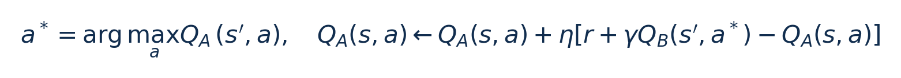
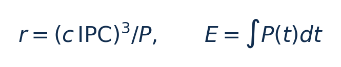
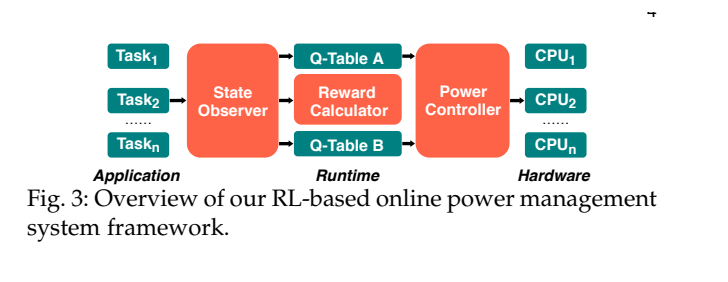
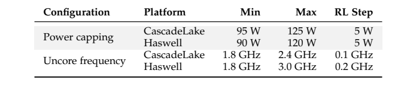
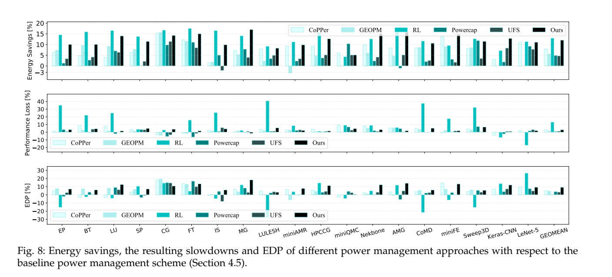
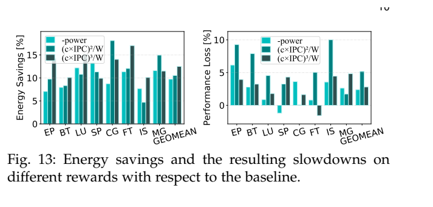

[论文页面](https://doi.org/10.1109/TPDS.2021.3092270) · [本笔记所用 PDF](https://issl-uk.com/publications/tpds21-2.pdf) · [DOI](https://doi.org/10.1109/TPDS.2021.3092270)

整理日期：2026-11-05。**读者原创中文解读；原图归论文作者／出版方。未运行作者实验，不是独立复现。**

**一句话：** 先辨认程序处于计算阶段还是访存阶段，再联合调整处理器功率上限和非核心部分频率。

阅读地图：先看问题与输入输出，再顺着架构图、公式和结果图阅读；最后检查统计边界与E902迁移。完整编号索引另见“图表索引”。下文“读者分析”是推断或建议，不是原文结果。

## 阶段0：材料与版本审计

| 材料 | 当前可用程度 | 影响 |
| --- | --- | --- |
| 摘要、正文、方法、原图注 | 已获取本地完整PDF、文本与逐页渲染 | 可核查结构、实验及关键数字；可见页面优先于异常文本层 |
| 分析版本 | 作者公开的接受稿，14页，页眉DOI标2021接受／在线；卷期年份为2022。作者网站的异常3030日期不采用。 | 引用页码以“PDF第几页”标识 |
| 代码／原始数据 | 接受稿包含Algorithm1和平台参数；当前材料中尚未定位到完整配套源码及原始运行数据。 | 公开链接不等于已构建或已拿到原始轨迹 |
| 附件、独立原始重复与勘误 | 当前未完成全渠道附件／勘误穷尽检索 | 不能断言没有附件、没有勘误或没有其他版本 |
| 本次工作范围 | 材料阅读、图表裁取、证据整理、教学公式 | 所有新实验均是建议，尚未执行 |

## 阶段1：身份卡与整体概述

| 项目 | 内容 |
| --- | --- |
| 英文题名 | Online Power Management for Multi-cores: A Reinforcement Learning Based Approach |
| 中文导读题名 | 同时控制CPU功率帽与uncore：轻量表格强化学习 |
| 作者 | Yiming Wang, Weizhe Zhang, Meng Hao, Zheng Wang |
| 发表／版本 | IEEE TPDS 33(4),751–764 (2022)；作者公开的接受稿，14页，页眉DOI标2021接受／在线；卷期年份为2022。作者网站的异常3030日期不采用。 |
| 类型与领域 | 原始方法／工程系统研究；DVFS、CPU能效、运行时控制 |
| 单位、通讯、资助与利益关系 | 前三位作者来自哈尔滨工业大学网络空间安全学院，Zheng Wang来自University of Leeds。资助列国家自然科学基金及英国相关研究项目（接受稿p12）；本笔记未逐个核实项目编号，不能以此推断经费与结论关系。 |
| 核心对象与接口 | 默认3秒采样；Ubuntu16.04/Linux4.15.0；CascadeLake与Haswell。 |
| 代码与数据 | 接受稿包含Algorithm1和平台参数；当前材料中尚未定位到完整配套源码及原始运行数据。 |
| 与本课题关系 | 这篇支持你先试小Q表而不是直接上深网络。单核E902可将动作简化为3–5档频率，状态用近期每字节周期、剩余字节和剩余时间；如果只具备一个可控时钟域，就不要虚构uncore旋钮。功率帽是厂商硬件功能，不能仅靠一张Q表实现。 |

**约200字中文概述（改写）：** 本文把运行时IPC与末级缓存未命中率离散成状态，用Double Q-learning学习CPU功率帽和uncore频率的联合设置。不同节点独立采样和决策，可随程序阶段在线调整。作者用两种Intel集群、训练与未见应用、并发和混合负载检验收益，报告未见应用平均约12%芯片能量降低、平均性能损失小于3%。关键经验是动作应符合硬件实际可控接口，奖励必须同时考虑功率和进度；该HPC方案没有提供严格实时期限保证。

**三句话定位：** 问题是只降低核心功率可能拖慢计算任务，只降低uncore可能伤害访存任务。待验证的假设是：结合阶段识别和两个硬件旋钮，比单旋钮或固定策略更好地平衡能量与性能。 方法主线为perf读取IPC/MPO → 离散状态和阶段变化 → 两张Q表评估联合动作 → msr-safe设置RAPL功率帽与uncore频率 → 记录能量及进度 → 更新其中一张Q表 → 下个窗口。 主要证据见下方结果表，结论须与测量和版本范围一起使用。

## 阶段2：问题、假设与创新位置

只降低核心功率可能拖慢计算任务，只降低uncore可能伤害访存任务。待验证的假设是：结合阶段识别和两个硬件旋钮，比单旋钮或固定策略更好地平衡能量与性能。

**创新判断（读者分析）：** 将Double Q学习扩展到芯片功率帽＋uncore联合管理，并通过IPC/MPO识别阶段。不是直接向CPU指定每个电压值；功率帽约束下的核心频率由硬件／固件进一步调节。 不依据作者自称“首次”断定整个领域绝无前例。

## 阶段3：必要术语与数学

| 级别 | 术语／关键词 | 直觉、严格含义与易混点 |
| --- | --- | --- |
| A | DVFS / DFS | DVFS同时涉及动态电压与频率；只有时钟变化称DFS。电压能否改变取决于实际供电域。 |
| A | Workload | 真正执行应用计算的程序与输入；本文里的控制器是另一个角色。 |
| A | Controller | 根据观测选择动作的软件／硬件，可运行在同一CPU或独立控制核。 |
| A | OPP | Operating Performance Point，经过允许范围验证的电压—频率组合。 |
| A | Power / Energy | 功率W表示此刻消耗快慢；能量J是对时间积分。低功率不必然低能量。 |
| B | Deadline | 作业必须完成的时刻；平均时延、P95与最大时延各有不同用途。 |
| A | 功率帽 | 允许处理器平均功率不超过某设置，硬件再调频以满足它。 |
| B | Uncore | CPU核外的共享逻辑，如部分缓存／互连等，组成随平台而变。 |
| B | IPC/MPO | 执行效率与访存压力的计数比值，不是直接功耗传感器。 |
| C | Double Q | 把动作选择与价值估计分开，减少单表最大化偏差。 |

### 公式1：Double Q更新（Algorithm1的整理）

**符号与前提：** Q_A/Q_B为两张无量纲价值表；η是学习率，γ是折扣；s为离散IPC/MPO状态。随机选择更新哪张表，另一路对称处理。

**代入与检查：** 教学例：旧Q=2、η=0.1、r=1、γ=0.9，另一表对下一动作估值3，目标为3.7，更新后为2.17。两张表减少特定估计偏差，不保证必然收敛到硬件全局最优。

**来源：** Algorithm1、Fig4，PDF p5。
### 公式2：选定奖励与真实能量的区别

**符号与前提：** P为功率W，c为论文给定缩放常数（c≥10）；IPC为指令/周期。r是训练评分，E才是J。该奖励并非严格的截止期约束。

**代入与检查：** c=10时，IPC=0.5、P=100W，r=1.25；另一档IPC=0.6、P=120W，r=1.8。评分提高不意味着任务总能量已被证明下降，还需实测完成时间。

**来源：** §3.5，PDF p6。

## 阶段4–6：架构、关键图与方法拆解

**输入—处理—输出：** perf读取IPC/MPO → 离散状态和阶段变化 → 两张Q表评估联合动作 → msr-safe设置RAPL功率帽与uncore频率 → 记录能量及进度 → 更新其中一张Q表 → 下个窗口。

| 系统角色 | 具体设置 |
| --- | --- |
| 状态 | IPC=指令/周期；MPO=末级cache miss/指令，经过离散化。 |
| 动作 | 功率帽W和uncore频率GHz的组合；不是压缩等级，也不是神经网络参数。 |
| 奖励 | 最终选择(c·IPC)^3/W，兼顾进度与功率的代理目标。 |
| 周期／平台 | 默认3秒采样；Ubuntu16.04/Linux4.15.0；CascadeLake与Haswell。 |

§3（PDF p4–6）：状态观测器检测IPC/MPO显著变化；更新器采用两张Q表，使用一张表选动作、另一张表估值，以减少单表最大值的高估倾向。ε-greedy保留随机探索，在线探索不能自动保证时限。

§3.5比较负功率、平方IPC/功率、立方IPC/功率。只奖励低功率会诱导过慢运行；立方项更重视性能。但IPC不是每秒完成指令，频率变化时二者有区别，因此“等价逆ED²P”的解释只能在近似条件下使用。

§4：4个CascadeLake节点，每节点2×20核，总160核；另16个12核Haswell节点，总192核。8项NAS程序训练，11项未见程序测试。主实验动作范围较硬件全范围收窄，如CascadeLake功率帽95–125W步长5W、uncore1.8–2.4GHz步长0.1GHz；受限动作集合会影响收益和安全性。

### Fig3：在线学习架构

[打开大图](images/original-fig3.png) · [原文 Fig3，PDF p4](https://issl-uk.com/publications/tpds21-2.pdf#page=4)

**怎样看：** 观测→奖励→Q表→硬件。

**直接观察／原文报告：** CPU功率帽与uncore共同输出。

**读者判断：** 不是直接写电压寄存器。

### Table1：硬件动作范围

[打开大图](images/original-table1.png) · [原文 Table1，PDF p6](https://issl-uk.com/publications/tpds21-2.pdf#page=6)

**怎样看：** 比较两平台范围和步长。

**直接观察／原文报告：** 搜索空间受人为收窄。

**读者判断：** 不能写成探索全部硬件频点。

| 阅读问题 | 先看材料 | 如何接到下一步 |
| --- | --- | --- |
| 为什么要改现有方案 | 问题背景与动机图 | 确定目标、约束和原有不足 |
| 系统观察什么、控制什么 | 输入输出表＋关键架构图 | 确认数据、模型和执行器真实角色 |
| 方法如何得到动作或估计 | 方法段、公式、算法／模型表 | 明确离线训练与在线流程 |
| 收益是否真实且公平 | 结果图表、统计与测量边界 | 核查基线／目标／分母／开销 |
| 能否用于自己的CPU | 局限、复现计划、三项实验 | 把论文假设变成待验证的工程条件 |

## 阶段7–8：实验、统计及证据链

本节数字均是**原文明确报告或原文数值的标注算例**；没有按图柱高度臆造额外精确值。

| 指标 | 原文报告 | 条件／分母／边界 | 证据位置 |
| --- | --- | --- | --- |
| 未见应用平均 | 约12%芯片能量降低、平均慢于3%以内 | 11项未见应用；相对TDP功率帽＋Ondemand＋默认uncore | §5.1，Fig6，p7–8 |
| 训练程序再测试 | 12.5%能量降低 | 不等同于跨程序泛化成绩 | §5.1，p8 |
| 跨节点扩展 | CascadeLake约10%–12%，Haswell约8%–11% | 不同节点数的平均收益，非单核E902 | §5.5，Fig11/12，p10 |
| 统计方法 | 95%置信界小于5%后报告均值（原文表述） | 重复运行而非新增芯片样本 | §4.4，p7 |

### Fig8：竞争基线和单旋钮消融

[打开大图](images/original-fig8.png) · [原文 Fig8，PDF p8](https://issl-uk.com/publications/tpds21-2.pdf#page=8)

**怎样看：** 依次看能量、性能损失、EDP改善。

**直接观察／原文报告：** 联合管理更好地平衡指标。

**读者判断：** 不同目标不能只按能量冠军排序。

### Fig13：奖励消融

[打开大图](images/original-fig13.png) · [原文 Fig13，PDF p10](https://issl-uk.com/publications/tpds21-2.pdf#page=10)

**怎样看：** 比较负功率、平方项、立方项。

**直接观察／原文报告：** 立方奖励在该设置取得较好权衡。

**读者判断：** 不是普遍最优reward定理。

**统计与公平性审查（读者分析）：** 论文明确重复到每个程序／输入的95%置信界小于5%，比只报单次更完整。训练与未见程序分开，但在线测试期间继续学习，故结果并非完全冻结模型的零样本泛化。功率测量依赖RAPL寄存器，性能计数与能量采样存在开销；3秒窗口可错过毫秒级阶段。Fig8中的EDP改善比例越高越好，与原始EDP越低越好不是矛盾。

工程实验中，设备、程序、输入文件、重复运行、时间窗口是不同统计层级，不能互相替代。本任务不涉及生物样本，细胞／动物／试剂等检查不适用。未注明的P值或置信区间不补造；“差了几个百分点”不自动等于统计显著。

| 主张层级 | 直接证据 | 对照与统计 | 可得结论／替代解释 | 可信度 |
| --- | --- | --- | --- | --- |
| 原文明确报告 | 未见应用平均：约12%芯片能量降低、平均慢于3%以内 | §5.1，Fig6，p7–8 | 11项未见应用；相对TDP功率帽＋Ondemand＋默认uncore；仅在该实验范围内成立 | 图表／文本可核对：高；独立复现：尚无 |
| 作者解释 | 所提架构／模型解释了性能或估计改善 | 关键原图与方法见上文；统计边界见下节 | 效果可能同时来自动作空间、平台特性与采样设置，因果归因需消融 | 中 |
| AI分析／迁移假设 | 用于E902的压缩候选负载 | 本篇未直接验证该芯片与任务组合 | 需三项后续实验；不能复制论文收益数字 | 待验证，当前无法判断 |

## 阶段9–10：贡献与局限分开判断

将Double Q学习扩展到芯片功率帽＋uncore联合管理，并通过IPC/MPO识别阶段。不是直接向CPU指定每个电压值；功率帽约束下的核心频率由硬件／固件进一步调节。

| 来源 | 严重程度 | 局限及其影响 |
| --- | --- | --- |
| 作者讨论 | 重要 | 未来优化跨节点全局协调；当前各节点独立。 |
| 读者分析 | 关键 | 没有E902上相同的RAPL/uncore接口，联合动作不能照搬。 |
| 读者分析 | 重要 | IPC代理进度、3秒窗口及受限动作范围决定奖励和响应特性；不能当实时安全控制。 |

## 阶段11：最小复现路线与缺口

按Table1动作范围、Table2训练／测试集合复建；先无控制采集IPC、MPO、RAPL，再实现Double Q与三种奖励。保证所有基线有相同动作权限与功率边界，分别报告训练成本、在线适应和冻结测试。精确学习率／状态划分及完整代码当前未全部定位，不应声称已经复现12%。

**代码／数据现状：** 接受稿包含Algorithm1和平台参数；当前材料中尚未定位到完整配套源码及原始运行数据。

**质量控制顺序：** 先验证程序输出和时间基准，再验证采样／模型，最后比较策略。保存输入文件哈希、平台配置、OPP、随机种子、温度与每次运行原始记录。失败时先回固定安全频点定位错误，再继续优化。复现可行性判断为“可开始部分方法复建，完整数值复现条件未齐”；这与“已完成复现”不同。

## 阶段12：用于你的CPU／E902课题

这篇支持你先试小Q表而不是直接上深网络。单核E902可将动作简化为3–5档频率，状态用近期每字节周期、剩余字节和剩余时间；如果只具备一个可控时钟域，就不要虚构uncore旋钮。功率帽是厂商硬件功能，不能仅靠一张Q表实现。

| 建议实验／优先级 | 价值 | 最低资源 | 主要风险 | 成功判据（设计目标，非已得结果） |
| --- | --- | --- | --- | --- |
| P0：小Q表替代深网络 | 降低部署门槛 | 3–5档频率、离散进度状态、离线轨迹 | 离散太粗损失信息 | 与固定阈值同条件比较净能量及违约 |
| P1：奖励消融 | 避免只追低功率 | 负功率／能量加期限惩罚／进度功率比 | 代理reward与真实目标不一致 | 完整周期J下降且期限不恶化；报告reward与能量相关性 |
| P1：窗口长度扫描 | 匹配压缩阶段时标 | 定时器、1/5/20/100ms等可行窗口 | 过细采样开销过大 | 给出采样＋推理＋执行成本与响应延迟的帕累托曲线 |

上述优先级是读者建议：P0先做，P1建立在基线可运行后，P2只在资源允许且前序实验证明有必要时开展。压缩应用仍是候选，尚未替你最终定题或证明已在E902运行。论文公开可读不自动授权任意复制数据；代码、图片和数据须分别核对许可。

## 阶段13：读完后应掌握与继续核查

**五个知识点：** 先辨认程序处于计算阶段还是访存阶段，再联合调整处理器功率上限和非核心部分频率。 你还应能解释输入输出表中的角色、两条公式的单位、首个结果指标的分母，以及局限表里的关键条件。

**五个未决问题：** 独立新输入是否成立？最差时延是否可接受？测量参考是否足够？控制与切换是否抵消收益？E902实际具有哪些接口和可观测量？这些是研究问题，不是对作者遗漏的无证据指控。

**立即做：** 按公式算例手算一次，选一张结果图复述“硬件—负载—基线—指标—边界”。**后续核查：** 补齐代码版本、训练数据和仪表设置。**可复用：** 上文明确标注的模型与接口思路。**谨慎采用：** 所有跨平台百分比。**暂不采用：** 尚未证实存在的电压控制和完整硬实时承诺。
