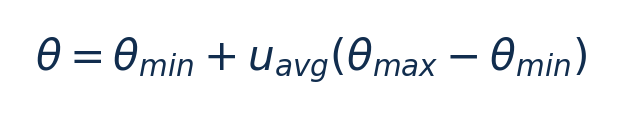

[论文页面](https://doi.org/10.37936/ecti-cit.2025192.258820) · [本笔记所用 PDF](https://ph01.tci-thaijo.org/index.php/ecticit/article/download/258820/174292) · [标识符](https://doi.org/10.37936/ecti-cit.2025192.258820)

整理日期：2026-11-05。**读者原创中文解读；原图归论文作者／出版方。未运行作者实验，不是独立复现。**

## 先把四个角色放对位置

被控负载是要完成的程序和输入，比如压缩一块日志；CPU是执行程序的硬件；控制器根据观测选运行档位；驱动／寄存器把档位落实。程序代码可以完全一样，CPU时钟变慢时每条指令对应的墙钟时间通常变长，访存或I/O等待则未必按同样比例变化。

软件控制并不意味着没有真实硬件。软件中的学习策略可控制真实CPU；也可先控制一个执行时间与能量模型。后者能验证闭环逻辑，但模型输出的J不能当真实电测。E902的RTL能在仿真中改变时钟并反馈计数；电压导致的物理功耗还需相应模型、功耗分析或板级实验。

## 这篇到底解决哪一件事

用随平均CPU利用率变化的阈值替代固定阈值，逐核升到最高档或下降一档

为什么相同CPU利用率未必对应相同的工作需求？本篇的可检验主张是：用随平均CPU利用率变化的阈值替代固定阈值，逐核升到最高档或下降一档。验证链是可观测状态→控制规则或学习模型→执行器→任务正确性/服务质量与能耗对照。

**把方法想成一条流水线：** 各核当前频率和利用率、平均利用率、45%/85%经验阈值界 → 阈值T=45%+U_avg·(85%−45%)；逐核利用率超过T则升最高频，否则降一档；100ms轮询，非神经网络 → 各核频率请求：最高档或下降一个支持频档；没有直接输出电压 → 执行与反馈。

| 先回答的问题 | 本文答案 |
| --- | --- |
| 具体控制算法 | 阈值T=45%+U_avg·(85%−45%)；逐核利用率超过T则升最高频，否则降一档；100ms轮询，非神经网络 |
| 被控负载类型 | 虚拟机中并行通信负载，2/3/4核参与与不同不平衡程度 |
| 具体被控程序 | Charm++ Stream-All-to-All，TRAM（Topological Routing and Aggregation of Messages）；Type1/2/3三种并行配置 |
| 使用平台与测量 | 物理Xeon E5630四核2.53GHz，CentOS7/KVM；4vCPU虚拟机；psutil/perf-kvm，APC UPS/apcupsd读取能耗；实际供电域独立性未由请求接口自动证明 |
| 输入/状态 | 各核当前频率和利用率、平均利用率、45%/85%经验阈值界 |
| 输出/动作 | 各核频率请求：最高档或下降一个支持频档；没有直接输出电压 |
| 周期与运行位置 | 100ms轮询；作者将监测器称Optimizer，控制物理层而负载在VM |

## 十个先修关键词

| 级别 | 术语／关键词 | 直觉、严格含义与易混点 |
| --- | --- | --- |
| A | DVFS / DFS | DVFS同时涉及动态电压与频率；只有时钟变化称DFS。电压能否改变取决于实际供电域。 |
| A | Workload | 真正执行应用计算的程序与输入；本文里的控制器是另一个角色。 |
| A | Controller | 根据观测选择动作的软件／硬件，可运行在同一CPU或独立控制核。 |
| A | OPP | Operating Performance Point，经过允许范围验证的电压—频率组合。 |
| A | Power / Energy | 功率W表示此刻消耗快慢；能量J是对时间积分。低功率不必然低能量。 |
| B | Deadline | 作业必须完成的时刻；平均时延、P95与最大时延各有不同用途。 |
| A | 被控程序 | Charm++ Stream-All-to-All，TRAM（Topological Routing and Aggregation of Messages）；Type1/2/3三种并行配置 |
| A | 控制策略 | 阈值T=45%+U_avg·(85%−45%)；逐核利用率超过T则升最高频，否则降一档；100ms轮询，非神经网络 |
| B | 控制周期 | 100ms轮询；作者将监测器称Optimizer，控制物理层而负载在VM |
| B | 证据边界 | 实测、硬件仿真、功耗模型是不同证据，见平台与结果表。 |

## 用一个小算例建立直觉

u=0.5时θ=0.65；不能把50直接当0.5代入。

利用率u以0–1表示，θ的单位需一致；本文界为0.45/0.85。

**要防止的误读：** UPS与VM指令的测量范围不同，跨平台不能复制节能率。

## 论文真正验证了什么

| 指标 | 原文报告 | 条件／分母／边界 | 证据位置 |
| --- | --- | --- | --- |
| Type1能量/指令 | ATP79.06，Ondemand84.29，Performance75.74 J/Ginstr | ATP好于Ondemand，但差于Performance | Fig9/§6.2，p8–9 |
| Type2能量/指令 | ATP57.88，Ondemand61.64，Performance57.48 J/Ginstr | 同一负载内比较，不能说ATP全面第一 | §6.2，p9 |
| Type3能量/指令 | ATP44.81，Performance44.92 J/Ginstr | 很小差距无置信区间，不自动显著 | §6.2，p9 |
| 温度 | 平均约低2.5°C | 相对Performance；摄氏百分比非热能收益 | §6.3，p10 |

这些结果来自作者实验。算法reward、模型误差、控制器时延、被控应用速度与应用节能是不同指标，要看具体行的单位和证据。

## 它与你的毕设怎么接起来

很适合作为E902简单基线：在固定任务到达与CPU利用率可观测条件下用少量比较和查表控制频率；压缩任务可能持续100%利用率，必须检验是否退化为一直最高档。

最先可以尝试：**P0：自适应阈值基线**。理由是获得低成本控制参照；最低资源是忙闲计数与合法频率表；通过标准是报告阈值轨迹/频率与违约。

## 五分钟自测

1. 这篇输出的是下一频率、功率估计，还是通信／控制时序？
2. 是真实负载硬件实验，还是模型／RTL／HIL？哪些部分是真的？
3. 最重要百分比的分母和比较对象是什么？
4. 如果换成单核E902，哪一个输入或硬件旋钮会消失？
5. 算上采样、推理、切频和空闲时间后，节能是否还成立？

答案线索在本页角色表和结果表；进一步读“图文技术精读”的关键原图、公式与三项课题实验，再到“图表索引”回查原PDF。不是先记住论文所有缩写。
