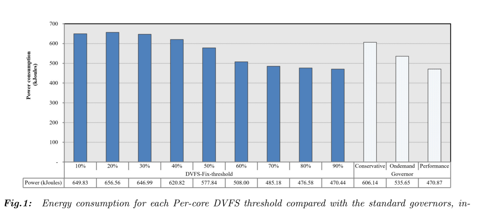
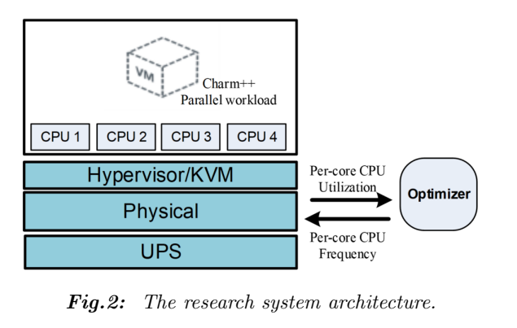
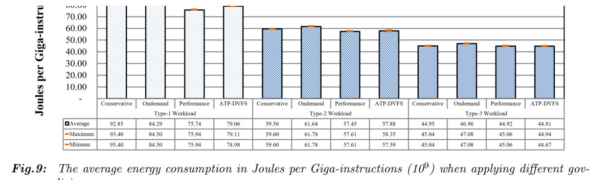

[论文页面](https://doi.org/10.37936/ecti-cit.2025192.258820) · [本笔记所用 PDF](https://ph01.tci-thaijo.org/index.php/ecticit/article/download/258820/174292) · [标识符](https://doi.org/10.37936/ecti-cit.2025192.258820)

整理日期：2026-11-05。**读者原创中文解读；原图归论文作者／出版方。未运行作者实验，不是独立复现。**

**覆盖范围：** 本版本正文中识别到的14项图、表或算法；保留原编号。关键项已裁图并在技术精读相应段落出现，未内嵌的项可点PDF页链接查看，不上传整篇PDF。

**统计总边界：** 论文用UPS/apcupsd能耗与perf-kvm指令数；UPS测量分辨率与采样积分细节、独立运行次数/误差线定义未定位齐。图9单项非常接近时不作显著优势判断。Type1相对Performance更耗J/Ginstr，必须与温度/服务质量一起做取舍，不能只引用摘要。

## Fig1：静态阈值能耗扫描

[原文 Fig1，PDF p4](https://ph01.tci-thaijo.org/index.php/ecticit/article/download/258820/174292#page=4)

[打开大图](images/original-fig1.png)

1. **本项回答的问题：** 静态阈值能耗扫描，用于支撑这条方法或实验链中的具体环节。
2. **组成、坐标和对照：** 先读图题、图例、坐标/表头与单位，再在同一负载和同一基线内比较。45%–85%来源于此平台经验，不是通用阈值。 按原图／表标示的单位与归一化基准阅读；不将不同子图或不同分母的柱高直接相除。 颜色按原图图例辨认，不能把同色跨图视为同一组。
3. **阅读顺序与统计单位：** 先看设定、单位和图例，再看趋势与作者正文。重复次数及采样独立性参见本篇技术精读统计节；没有为该图定位到的误差线定义／独立重复数，不另行猜测。
4. **直接观察：** 45%–85%来源于此平台经验，不是通用阈值。
5. **作者解释的范围：** 原文以该图／表作为上述观察的结构说明或实验支撑，需连同对应页正文读取；本索引不额外替作者推导因果机制。
6. **独立判断（AI分析）：** 本项只支撑原文所列平台和配置；不证明E902可直接复用这些数值。
7. **证据链位置：** 性能验证／定量或示例证据，需结合实验条件。它支持本文具体条件下的实现或结果，不单独完成跨平台验证。
8. **结论与强度：** 可复述“45%–85%来源于此平台经验，不是通用阈值。”；对图内描述的核查可信度高，对未做独立实验的泛化判断为中或无法判断。不能得出的结论是“本项只支撑原文所列平台和配置；不证明E902可直接复用这些数值。”所排除的外推。

## Fig2：宿主机与VM架构

[原文 Fig2，PDF p5](https://ph01.tci-thaijo.org/index.php/ecticit/article/download/258820/174292#page=5)

[打开大图](images/original-fig2.png)

1. **本项回答的问题：** 宿主机与VM架构，用于支撑这条方法或实验链中的具体环节。
2. **组成、坐标和对照：** 先读图题、图例、坐标/表头与单位，再在同一负载和同一基线内比较。Optimizer操作物理CPU，程序在KVM虚拟机。 结构／流程类没有统一数值坐标；箭头表示数据或控制关系，不表示统计因果。 颜色按原图图例辨认，不能把同色跨图视为同一组。
3. **阅读顺序与统计单位：** 先看设定、单位和图例，再看趋势与作者正文。重复次数及采样独立性参见本篇技术精读统计节；没有为该图定位到的误差线定义／独立重复数，不另行猜测。
4. **直接观察：** Optimizer操作物理CPU，程序在KVM虚拟机。
5. **作者解释的范围：** 原文以该图／表作为上述观察的结构说明或实验支撑，需连同对应页正文读取；本索引不额外替作者推导因果机制。
6. **独立判断（AI分析）：** 本项只支撑原文所列平台和配置；不证明E902可直接复用这些数值。
7. **证据链位置：** 方法／系统实现说明。它支持本文具体条件下的实现或结果，不单独完成跨平台验证。
8. **结论与强度：** 可复述“Optimizer操作物理CPU，程序在KVM虚拟机。”；对图内描述的核查可信度高，对未做独立实验的泛化判断为中或无法判断。不能得出的结论是“本项只支撑原文所列平台和配置；不证明E902可直接复用这些数值。”所排除的外推。

## Fig3：采样间隔开销

[原文 Fig3，PDF p6](https://ph01.tci-thaijo.org/index.php/ecticit/article/download/258820/174292#page=6)

1. **本项回答的问题：** 采样间隔开销，用于支撑这条方法或实验链中的具体环节。
2. **组成、坐标和对照：** 先读图题、图例、坐标/表头与单位，再在同一负载和同一基线内比较。5ms轮询使CPU开销更大，作者选100ms。 按原图／表标示的单位与归一化基准阅读；不将不同子图或不同分母的柱高直接相除。 颜色按原图图例辨认，不能把同色跨图视为同一组。
3. **阅读顺序与统计单位：** 先看设定、单位和图例，再看趋势与作者正文。重复次数及采样独立性参见本篇技术精读统计节；没有为该图定位到的误差线定义／独立重复数，不另行猜测。
4. **直接观察：** 5ms轮询使CPU开销更大，作者选100ms。
5. **作者解释的范围：** 原文以该图／表作为上述观察的结构说明或实验支撑，需连同对应页正文读取；本索引不额外替作者推导因果机制。
6. **独立判断（AI分析）：** 本项只支撑原文所列平台和配置；不证明E902可直接复用这些数值。
7. **证据链位置：** 性能验证／定量或示例证据，需结合实验条件。它支持本文具体条件下的实现或结果，不单独完成跨平台验证。
8. **结论与强度：** 可复述“5ms轮询使CPU开销更大，作者选100ms。”；对图内描述的核查可信度高，对未做独立实验的泛化判断为中或无法判断。不能得出的结论是“本项只支撑原文所列平台和配置；不证明E902可直接复用这些数值。”所排除的外推。

## Fig4：三类并行工作负载

[原文 Fig4，PDF p6](https://ph01.tci-thaijo.org/index.php/ecticit/article/download/258820/174292#page=6)

1. **本项回答的问题：** 三类并行工作负载，用于支撑这条方法或实验链中的具体环节。
2. **组成、坐标和对照：** 先读图题、图例、坐标/表头与单位，再在同一负载和同一基线内比较。参与核数、均衡程度和并行行为不同。 按原图／表标示的单位与归一化基准阅读；不将不同子图或不同分母的柱高直接相除。 颜色按原图图例辨认，不能把同色跨图视为同一组。
3. **阅读顺序与统计单位：** 先看设定、单位和图例，再看趋势与作者正文。重复次数及采样独立性参见本篇技术精读统计节；没有为该图定位到的误差线定义／独立重复数，不另行猜测。
4. **直接观察：** 参与核数、均衡程度和并行行为不同。
5. **作者解释的范围：** 原文以该图／表作为上述观察的结构说明或实验支撑，需连同对应页正文读取；本索引不额外替作者推导因果机制。
6. **独立判断（AI分析）：** 本项只支撑原文所列平台和配置；不证明E902可直接复用这些数值。
7. **证据链位置：** 性能验证／定量或示例证据，需结合实验条件。它支持本文具体条件下的实现或结果，不单独完成跨平台验证。
8. **结论与强度：** 可复述“参与核数、均衡程度和并行行为不同。”；对图内描述的核查可信度高，对未做独立实验的泛化判断为中或无法判断。不能得出的结论是“本项只支撑原文所列平台和配置；不证明E902可直接复用这些数值。”所排除的外推。

## Fig5：Type1利用率轨迹

[原文 Fig5，PDF p7](https://ph01.tci-thaijo.org/index.php/ecticit/article/download/258820/174292#page=7)

1. **本项回答的问题：** Type1利用率轨迹，用于支撑这条方法或实验链中的具体环节。
2. **组成、坐标和对照：** 先读图题、图例、坐标/表头与单位，再在同一负载和同一基线内比较。2执行核轮换，平均利用率较低。 按原图／表标示的单位与归一化基准阅读；不将不同子图或不同分母的柱高直接相除。 颜色按原图图例辨认，不能把同色跨图视为同一组。
3. **阅读顺序与统计单位：** 先看设定、单位和图例，再看趋势与作者正文。重复次数及采样独立性参见本篇技术精读统计节；没有为该图定位到的误差线定义／独立重复数，不另行猜测。
4. **直接观察：** 2执行核轮换，平均利用率较低。
5. **作者解释的范围：** 原文以该图／表作为上述观察的结构说明或实验支撑，需连同对应页正文读取；本索引不额外替作者推导因果机制。
6. **独立判断（AI分析）：** 本项只支撑原文所列平台和配置；不证明E902可直接复用这些数值。
7. **证据链位置：** 性能验证／定量或示例证据，需结合实验条件。它支持本文具体条件下的实现或结果，不单独完成跨平台验证。
8. **结论与强度：** 可复述“2执行核轮换，平均利用率较低。”；对图内描述的核查可信度高，对未做独立实验的泛化判断为中或无法判断。不能得出的结论是“本项只支撑原文所列平台和配置；不证明E902可直接复用这些数值。”所排除的外推。

## Fig6：Type2利用率轨迹

[原文 Fig6，PDF p7](https://ph01.tci-thaijo.org/index.php/ecticit/article/download/258820/174292#page=7)

1. **本项回答的问题：** Type2利用率轨迹，用于支撑这条方法或实验链中的具体环节。
2. **组成、坐标和对照：** 先读图题、图例、坐标/表头与单位，再在同一负载和同一基线内比较。3核负载不均衡。 按原图／表标示的单位与归一化基准阅读；不将不同子图或不同分母的柱高直接相除。 颜色按原图图例辨认，不能把同色跨图视为同一组。
3. **阅读顺序与统计单位：** 先看设定、单位和图例，再看趋势与作者正文。重复次数及采样独立性参见本篇技术精读统计节；没有为该图定位到的误差线定义／独立重复数，不另行猜测。
4. **直接观察：** 3核负载不均衡。
5. **作者解释的范围：** 原文以该图／表作为上述观察的结构说明或实验支撑，需连同对应页正文读取；本索引不额外替作者推导因果机制。
6. **独立判断（AI分析）：** 本项只支撑原文所列平台和配置；不证明E902可直接复用这些数值。
7. **证据链位置：** 性能验证／定量或示例证据，需结合实验条件。它支持本文具体条件下的实现或结果，不单独完成跨平台验证。
8. **结论与强度：** 可复述“3核负载不均衡。”；对图内描述的核查可信度高，对未做独立实验的泛化判断为中或无法判断。不能得出的结论是“本项只支撑原文所列平台和配置；不证明E902可直接复用这些数值。”所排除的外推。

## Fig7：Type3利用率轨迹

[原文 Fig7，PDF p7](https://ph01.tci-thaijo.org/index.php/ecticit/article/download/258820/174292#page=7)

1. **本项回答的问题：** Type3利用率轨迹，用于支撑这条方法或实验链中的具体环节。
2. **组成、坐标和对照：** 先读图题、图例、坐标/表头与单位，再在同一负载和同一基线内比较。4核相对均衡，不能与Type1混作同输入。 按原图／表标示的单位与归一化基准阅读；不将不同子图或不同分母的柱高直接相除。 颜色按原图图例辨认，不能把同色跨图视为同一组。
3. **阅读顺序与统计单位：** 先看设定、单位和图例，再看趋势与作者正文。重复次数及采样独立性参见本篇技术精读统计节；没有为该图定位到的误差线定义／独立重复数，不另行猜测。
4. **直接观察：** 4核相对均衡，不能与Type1混作同输入。
5. **作者解释的范围：** 原文以该图／表作为上述观察的结构说明或实验支撑，需连同对应页正文读取；本索引不额外替作者推导因果机制。
6. **独立判断（AI分析）：** 本项只支撑原文所列平台和配置；不证明E902可直接复用这些数值。
7. **证据链位置：** 性能验证／定量或示例证据，需结合实验条件。它支持本文具体条件下的实现或结果，不单独完成跨平台验证。
8. **结论与强度：** 可复述“4核相对均衡，不能与Type1混作同输入。”；对图内描述的核查可信度高，对未做独立实验的泛化判断为中或无法判断。不能得出的结论是“本项只支撑原文所列平台和配置；不证明E902可直接复用这些数值。”所排除的外推。

## Fig8：温度对照

[原文 Fig8，PDF p8](https://ph01.tci-thaijo.org/index.php/ecticit/article/download/258820/174292#page=8)

1. **本项回答的问题：** 温度对照，用于支撑这条方法或实验链中的具体环节。
2. **组成、坐标和对照：** 先读图题、图例、坐标/表头与单位，再在同一负载和同一基线内比较。温度降低不能直接换算能量节省。 按原图／表标示的单位与归一化基准阅读；不将不同子图或不同分母的柱高直接相除。 颜色按原图图例辨认，不能把同色跨图视为同一组。
3. **阅读顺序与统计单位：** 先看设定、单位和图例，再看趋势与作者正文。重复次数及采样独立性参见本篇技术精读统计节；没有为该图定位到的误差线定义／独立重复数，不另行猜测。
4. **直接观察：** 温度降低不能直接换算能量节省。
5. **作者解释的范围：** 原文以该图／表作为上述观察的结构说明或实验支撑，需连同对应页正文读取；本索引不额外替作者推导因果机制。
6. **独立判断（AI分析）：** 本项只支撑原文所列平台和配置；不证明E902可直接复用这些数值。
7. **证据链位置：** 性能验证／定量或示例证据，需结合实验条件。它支持本文具体条件下的实现或结果，不单独完成跨平台验证。
8. **结论与强度：** 可复述“温度降低不能直接换算能量节省。”；对图内描述的核查可信度高，对未做独立实验的泛化判断为中或无法判断。不能得出的结论是“本项只支撑原文所列平台和配置；不证明E902可直接复用这些数值。”所排除的外推。

## Fig9：每十亿指令能量

[原文 Fig9，PDF p8](https://ph01.tci-thaijo.org/index.php/ecticit/article/download/258820/174292#page=8)

[打开大图](images/original-fig9.png)

1. **本项回答的问题：** 每十亿指令能量，用于支撑这条方法或实验链中的具体环节。
2. **组成、坐标和对照：** 先读图题、图例、坐标/表头与单位，再在同一负载和同一基线内比较。ATP并非所有类型都胜过Performance。 按原图／表标示的单位与归一化基准阅读；不将不同子图或不同分母的柱高直接相除。 颜色按原图图例辨认，不能把同色跨图视为同一组。
3. **阅读顺序与统计单位：** 先看设定、单位和图例，再看趋势与作者正文。重复次数及采样独立性参见本篇技术精读统计节；没有为该图定位到的误差线定义／独立重复数，不另行猜测。
4. **直接观察：** ATP并非所有类型都胜过Performance。
5. **作者解释的范围：** 原文以该图／表作为上述观察的结构说明或实验支撑，需连同对应页正文读取；本索引不额外替作者推导因果机制。
6. **独立判断（AI分析）：** 本项只支撑原文所列平台和配置；不证明E902可直接复用这些数值。
7. **证据链位置：** 性能验证／定量或示例证据，需结合实验条件。它支持本文具体条件下的实现或结果，不单独完成跨平台验证。
8. **结论与强度：** 可复述“ATP并非所有类型都胜过Performance。”；对图内描述的核查可信度高，对未做独立实验的泛化判断为中或无法判断。不能得出的结论是“本项只支撑原文所列平台和配置；不证明E902可直接复用这些数值。”所排除的外推。

## Fig10：分支访问速率

[原文 Fig10，PDF p8](https://ph01.tci-thaijo.org/index.php/ecticit/article/download/258820/174292#page=8)

1. **本项回答的问题：** 分支访问速率，用于支撑这条方法或实验链中的具体环节。
2. **组成、坐标和对照：** 先读图题、图例、坐标/表头与单位，再在同一负载和同一基线内比较。分支/秒是性能代理，不能替代deadline成功率。 按原图／表标示的单位与归一化基准阅读；不将不同子图或不同分母的柱高直接相除。 颜色按原图图例辨认，不能把同色跨图视为同一组。
3. **阅读顺序与统计单位：** 先看设定、单位和图例，再看趋势与作者正文。重复次数及采样独立性参见本篇技术精读统计节；没有为该图定位到的误差线定义／独立重复数，不另行猜测。
4. **直接观察：** 分支/秒是性能代理，不能替代deadline成功率。
5. **作者解释的范围：** 原文以该图／表作为上述观察的结构说明或实验支撑，需连同对应页正文读取；本索引不额外替作者推导因果机制。
6. **独立判断（AI分析）：** 本项只支撑原文所列平台和配置；不证明E902可直接复用这些数值。
7. **证据链位置：** 性能验证／定量或示例证据，需结合实验条件。它支持本文具体条件下的实现或结果，不单独完成跨平台验证。
8. **结论与强度：** 可复述“分支/秒是性能代理，不能替代deadline成功率。”；对图内描述的核查可信度高，对未做独立实验的泛化判断为中或无法判断。不能得出的结论是“本项只支撑原文所列平台和配置；不证明E902可直接复用这些数值。”所排除的外推。

## Table1：相关工作

[原文 Table1，PDF p3](https://ph01.tci-thaijo.org/index.php/ecticit/article/download/258820/174292#page=3)

1. **本项回答的问题：** 相关工作，用于支撑这条方法或实验链中的具体环节。
2. **组成、坐标和对照：** 先读图题、图例、坐标/表头与单位，再在同一负载和同一基线内比较。这是研究定位表而非实验结果。 按原图／表标示的单位与归一化基准阅读；不将不同子图或不同分母的柱高直接相除。 颜色按原图图例辨认，不能把同色跨图视为同一组。
3. **阅读顺序与统计单位：** 先看设定、单位和图例，再看趋势与作者正文。重复次数及采样独立性参见本篇技术精读统计节；没有为该图定位到的误差线定义／独立重复数，不另行猜测。
4. **直接观察：** 这是研究定位表而非实验结果。
5. **作者解释的范围：** 原文以该图／表作为上述观察的结构说明或实验支撑，需连同对应页正文读取；本索引不额外替作者推导因果机制。
6. **独立判断（AI分析）：** 本项只支撑原文所列平台和配置；不证明E902可直接复用这些数值。
7. **证据链位置：** 性能验证／定量或示例证据，需结合实验条件。它支持本文具体条件下的实现或结果，不单独完成跨平台验证。
8. **结论与强度：** 可复述“这是研究定位表而非实验结果。”；对图内描述的核查可信度高，对未做独立实验的泛化判断为中或无法判断。不能得出的结论是“本项只支撑原文所列平台和配置；不证明E902可直接复用这些数值。”所排除的外推。

## Algorithm1：原始Ondemand示意

[原文 Algorithm1，PDF p3](https://ph01.tci-thaijo.org/index.php/ecticit/article/download/258820/174292#page=3)

1. **本项回答的问题：** 原始Ondemand示意，用于支撑这条方法或实验链中的具体环节。
2. **组成、坐标和对照：** 先读图题、图例、坐标/表头与单位，再在同一负载和同一基线内比较。用于阈值策略参照，历史实现差异要分开。 按原图／表标示的单位与归一化基准阅读；不将不同子图或不同分母的柱高直接相除。 颜色按原图图例辨认，不能把同色跨图视为同一组。
3. **阅读顺序与统计单位：** 先看设定、单位和图例，再看趋势与作者正文。重复次数及采样独立性参见本篇技术精读统计节；没有为该图定位到的误差线定义／独立重复数，不另行猜测。
4. **直接观察：** 用于阈值策略参照，历史实现差异要分开。
5. **作者解释的范围：** 原文以该图／表作为上述观察的结构说明或实验支撑，需连同对应页正文读取；本索引不额外替作者推导因果机制。
6. **独立判断（AI分析）：** 本项只支撑原文所列平台和配置；不证明E902可直接复用这些数值。
7. **证据链位置：** 性能验证／定量或示例证据，需结合实验条件。它支持本文具体条件下的实现或结果，不单独完成跨平台验证。
8. **结论与强度：** 可复述“用于阈值策略参照，历史实现差异要分开。”；对图内描述的核查可信度高，对未做独立实验的泛化判断为中或无法判断。不能得出的结论是“本项只支撑原文所列平台和配置；不证明E902可直接复用这些数值。”所排除的外推。

## Algorithm2：静态逐核策略

[原文 Algorithm2，PDF p4](https://ph01.tci-thaijo.org/index.php/ecticit/article/download/258820/174292#page=4)

1. **本项回答的问题：** 静态逐核策略，用于支撑这条方法或实验链中的具体环节。
2. **组成、坐标和对照：** 先读图题、图例、坐标/表头与单位，再在同一负载和同一基线内比较。高负载升到最大，低负载降一档。 按原图／表标示的单位与归一化基准阅读；不将不同子图或不同分母的柱高直接相除。 颜色按原图图例辨认，不能把同色跨图视为同一组。
3. **阅读顺序与统计单位：** 先看设定、单位和图例，再看趋势与作者正文。重复次数及采样独立性参见本篇技术精读统计节；没有为该图定位到的误差线定义／独立重复数，不另行猜测。
4. **直接观察：** 高负载升到最大，低负载降一档。
5. **作者解释的范围：** 原文以该图／表作为上述观察的结构说明或实验支撑，需连同对应页正文读取；本索引不额外替作者推导因果机制。
6. **独立判断（AI分析）：** 本项只支撑原文所列平台和配置；不证明E902可直接复用这些数值。
7. **证据链位置：** 性能验证／定量或示例证据，需结合实验条件。它支持本文具体条件下的实现或结果，不单独完成跨平台验证。
8. **结论与强度：** 可复述“高负载升到最大，低负载降一档。”；对图内描述的核查可信度高，对未做独立实验的泛化判断为中或无法判断。不能得出的结论是“本项只支撑原文所列平台和配置；不证明E902可直接复用这些数值。”所排除的外推。

## Algorithm3：自适应逐核策略

[原文 Algorithm3，PDF p5](https://ph01.tci-thaijo.org/index.php/ecticit/article/download/258820/174292#page=5)

1. **本项回答的问题：** 自适应逐核策略，用于支撑这条方法或实验链中的具体环节。
2. **组成、坐标和对照：** 先读图题、图例、坐标/表头与单位，再在同一负载和同一基线内比较。多了平均利用率和阈值计算，复杂度较低。 按原图／表标示的单位与归一化基准阅读；不将不同子图或不同分母的柱高直接相除。 颜色按原图图例辨认，不能把同色跨图视为同一组。
3. **阅读顺序与统计单位：** 先看设定、单位和图例，再看趋势与作者正文。重复次数及采样独立性参见本篇技术精读统计节；没有为该图定位到的误差线定义／独立重复数，不另行猜测。
4. **直接观察：** 多了平均利用率和阈值计算，复杂度较低。
5. **作者解释的范围：** 原文以该图／表作为上述观察的结构说明或实验支撑，需连同对应页正文读取；本索引不额外替作者推导因果机制。
6. **独立判断（AI分析）：** 本项只支撑原文所列平台和配置；不证明E902可直接复用这些数值。
7. **证据链位置：** 性能验证／定量或示例证据，需结合实验条件。它支持本文具体条件下的实现或结果，不单独完成跨平台验证。
8. **结论与强度：** 可复述“多了平均利用率和阈值计算，复杂度较低。”；对图内描述的核查可信度高，对未做独立实验的泛化判断为中或无法判断。不能得出的结论是“本项只支撑原文所列平台和配置；不证明E902可直接复用这些数值。”所排除的外推。
