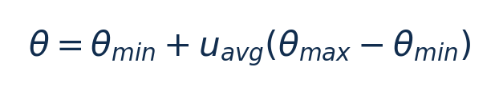
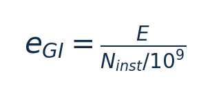
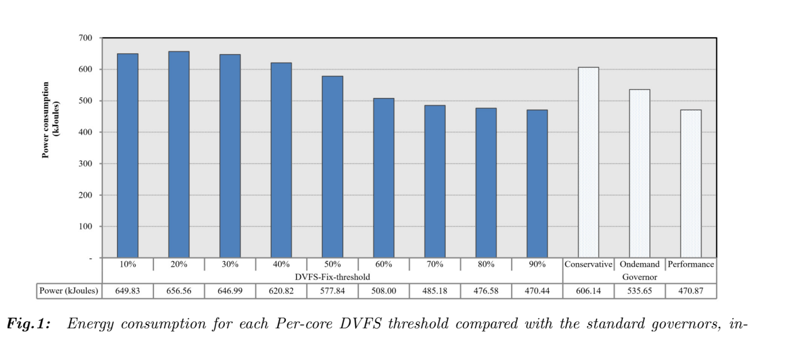
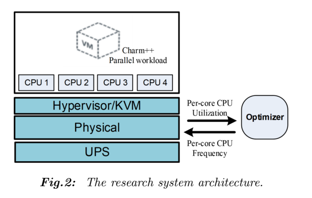
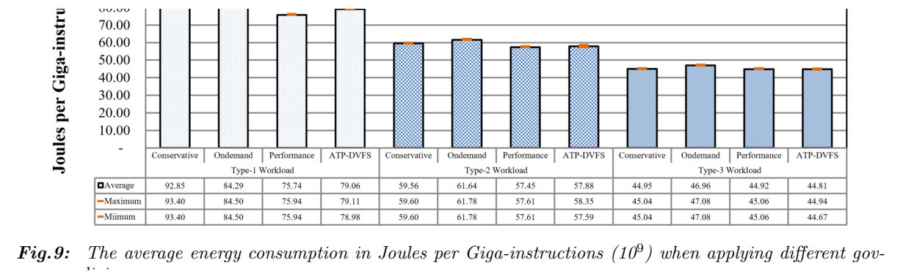

[论文页面](https://doi.org/10.37936/ecti-cit.2025192.258820) · [本笔记所用 PDF](https://ph01.tci-thaijo.org/index.php/ecticit/article/download/258820/174292) · [标识符](https://doi.org/10.37936/ecti-cit.2025192.258820)

整理日期：2026-11-05。**读者原创中文解读；原图归论文作者／出版方。未运行作者实验，不是独立复现。**

**一句话：** 用随平均CPU利用率变化的阈值替代固定阈值，逐核升到最高档或下降一档

阅读地图：先看问题与输入输出，再顺着架构图、公式和结果图阅读；最后检查统计边界与E902迁移。完整编号索引另见“图表索引”。下文“读者分析”是推断或建议，不是原文结果。

## 阶段0：材料与版本审计

| 材料 | 当前可用程度 | 影响 |
| --- | --- | --- |
| 摘要、正文、方法、原图注 | 已获取本地完整PDF、文本与逐页渲染 | 可核查结构、实验及关键数字；可见页面优先于异常文本层 |
| 分析版本 | 出版社正式版12页。 | 引用页码以“PDF第几页”标识 |
| 代码／原始数据 | 当前材料中尚未定位齐完整控制器源码、实验脚本和原始重复数据；这不表示这些材料不存在。 | 公开链接不等于已构建或已拿到原始轨迹 |
| 附件、独立原始重复与勘误 | 当前未完成全渠道附件／勘误穷尽检索 | 不能断言没有附件、没有勘误或没有其他版本 |
| 本次工作范围 | 材料阅读、图表裁取、证据整理、教学公式 | 所有新实验均是建议，尚未执行 |

## 阶段1：身份卡与整体概述

| 项目 | 内容 |
| --- | --- |
| 英文题名 | Energy-Efficient Per-Core DVFS for Virtual Machine Management in Cloud Data Centers |
| 中文导读题名 | 用随平均CPU利用率变化的阈值替代固定阈值，逐核升到最高档或下降一档 |
| 作者 | Kritwara Rattanaopas, Pichaya Tandayya |
| 发表／版本 | ECTI-CIT 19(2),282–293 (2025)；出版社正式版12页。 |
| 类型与领域 | 原始方法／工程系统研究；DVFS、CPU能效、运行时控制 |
| 单位、通讯、资助与利益关系 | 作者姓名以本版本首页为准；通讯方式、单位及资助可回查首页与末页声明。当前尚未完成资助/利益关系/勘误的跨版本穷尽审计。 |
| 核心对象与接口 | 100ms轮询；作者将监测器称Optimizer，控制物理层而负载在VM |
| 代码与数据 | 当前材料中尚未定位齐完整控制器源码、实验脚本和原始重复数据；这不表示这些材料不存在。 |
| 与本课题关系 | 很适合作为E902简单基线：在固定任务到达与CPU利用率可观测条件下用少量比较和查表控制频率；压缩任务可能持续100%利用率，必须检验是否退化为一直最高档。 |

**约200字中文概述（改写）：** 本文研究虚拟机中并行通信负载，2/3/4核参与与不同不平衡程度的运行时能效。具体程序包括Charm++ Stream-All-to-All，TRAM（Topological Routing and Aggregation of Messages）；Type1/2/3三种并行配置。作者在物理Xeon E5630四核2.53GHz，CentOS7/KVM；4vCPU虚拟机；psutil/perf-kvm，APC UPS/apcupsd读取能耗；实际供电域独立性未由请求接口自动证明上采用阈值T=45%+U_avg·(85%−45%)；逐核利用率超过T则升最高频，否则降一档；100ms轮询，非神经网络。输入为各核当前频率和利用率、平均利用率、45%/85%经验阈值界，输出为各核频率请求：最高档或下降一个支持频档；没有直接输出电压。主要结果应与下方基线、性能约束和测量范围一起阅读，不能只摘最高百分比。基于静态阈值扫描得到自适应范围，在较低实现复杂度下改善一部分并行负载的阈值控制。贡献是政策和测评，不是复杂智能算法。

**三句话定位：** 问题是为什么相同CPU利用率未必对应相同的工作需求？本篇的可检验主张是：用随平均CPU利用率变化的阈值替代固定阈值，逐核升到最高档或下降一档。验证链是可观测状态→控制规则或学习模型→执行器→任务正确性/服务质量与能耗对照。 方法主线为各核当前频率和利用率、平均利用率、45%/85%经验阈值界 → 阈值T=45%+U_avg·(85%−45%)；逐核利用率超过T则升最高频，否则降一档；100ms轮询，非神经网络 → 各核频率请求：最高档或下降一个支持频档；没有直接输出电压 → 执行与反馈。 主要证据见下方结果表，结论须与测量和版本范围一起使用。

## 阶段2：问题、假设与创新位置

为什么相同CPU利用率未必对应相同的工作需求？本篇的可检验主张是：用随平均CPU利用率变化的阈值替代固定阈值，逐核升到最高档或下降一档。验证链是可观测状态→控制规则或学习模型→执行器→任务正确性/服务质量与能耗对照。

**创新判断（读者分析）：** 基于静态阈值扫描得到自适应范围，在较低实现复杂度下改善一部分并行负载的阈值控制。贡献是政策和测评，不是复杂智能算法。 不依据作者自称“首次”断定整个领域绝无前例。

## 阶段3：必要术语与数学

| 级别 | 术语／关键词 | 直觉、严格含义与易混点 |
| --- | --- | --- |
| A | DVFS / DFS | DVFS同时涉及动态电压与频率；只有时钟变化称DFS。电压能否改变取决于实际供电域。 |
| A | Workload | 真正执行应用计算的程序与输入；本文里的控制器是另一个角色。 |
| A | Controller | 根据观测选择动作的软件／硬件，可运行在同一CPU或独立控制核。 |
| A | OPP | Operating Performance Point，经过允许范围验证的电压—频率组合。 |
| A | Power / Energy | 功率W表示此刻消耗快慢；能量J是对时间积分。低功率不必然低能量。 |
| B | Deadline | 作业必须完成的时刻；平均时延、P95与最大时延各有不同用途。 |
| A | 被控程序 | Charm++ Stream-All-to-All，TRAM（Topological Routing and Aggregation of Messages）；Type1/2/3三种并行配置 |
| A | 控制策略 | 阈值T=45%+U_avg·(85%−45%)；逐核利用率超过T则升最高频，否则降一档；100ms轮询，非神经网络 |
| B | 控制周期 | 100ms轮询；作者将监测器称Optimizer，控制物理层而负载在VM |
| B | 证据边界 | 实测、硬件仿真、功耗模型是不同证据，见平台与结果表。 |

### 公式1：自适应阈值

**符号与前提：** 利用率u以0–1表示，θ的单位需一致；本文界为0.45/0.85。

**代入与检查：** u=0.5时θ=0.65；不能把50直接当0.5代入。

**来源：** Eq2–3，p5
### 公式2：单位指令能量

**符号与前提：** E单位J，指令数无量纲，结果J/Ginstr；不是整任务J或W。

**代入与检查：** Type1 ATP79.06比84.29低约6.2%，这是读者算例；仍高于Performance75.74。

**来源：** Fig9/§6.2，p8–9

## 阶段4–6：架构、关键图与方法拆解

**输入—处理—输出：** 各核当前频率和利用率、平均利用率、45%/85%经验阈值界 → 阈值T=45%+U_avg·(85%−45%)；逐核利用率超过T则升最高频，否则降一档；100ms轮询，非神经网络 → 各核频率请求：最高档或下降一个支持频档；没有直接输出电压 → 执行与反馈。

| 系统角色 | 具体设置 |
| --- | --- |
| 具体控制算法 | 阈值T=45%+U_avg·(85%−45%)；逐核利用率超过T则升最高频，否则降一档；100ms轮询，非神经网络 |
| 被控负载类型 | 虚拟机中并行通信负载，2/3/4核参与与不同不平衡程度 |
| 具体被控程序 | Charm++ Stream-All-to-All，TRAM（Topological Routing and Aggregation of Messages）；Type1/2/3三种并行配置 |
| 使用平台与测量 | 物理Xeon E5630四核2.53GHz，CentOS7/KVM；4vCPU虚拟机；psutil/perf-kvm，APC UPS/apcupsd读取能耗；实际供电域独立性未由请求接口自动证明 |
| 输入/状态 | 各核当前频率和利用率、平均利用率、45%/85%经验阈值界 |
| 输出/动作 | 各核频率请求：最高档或下降一个支持频档；没有直接输出电压 |
| 周期与运行位置 | 100ms轮询；作者将监测器称Optimizer，控制物理层而负载在VM |

§4–6（p4–10）：先扫描10%–90%静态阈值，以UPS结果选45%–85%范围，再通过线性插值自适应阈值。该阈值是利用率平均值的函数，逐核比较当前负载。与原始Ondemand式阈值政策相比，改动小，易实现。

作者列出含0.6GHz在内的8档和2.54GHz最大值；移植前应读取实际驱动支持表，不能照抄到别的Xeon或E902。功耗来自UPS，指标却按VM指令数归一，宿主机背景与其他设备可能进入分子。测得较低温度不是低功率的直接替代；分支/秒也不是完成整个任务的墙钟时间。

复现审计：Eq3把n解释为核数，而Algorithm3写逐核average utilization(core)。平均范围（跨核或单核时间平均）表述不完全一致，须核对代码；本笔记不替作者猜定实现。

### Fig1：静态阈值能耗扫描

[打开大图](images/original-fig1.png) · [原文 Fig1，PDF p4](https://ph01.tci-thaijo.org/index.php/ecticit/article/download/258820/174292#page=4)

**怎样看：** 先读图题、图例、坐标/表头与单位，再在同一负载和同一基线内比较。45%–85%来源于此平台经验，不是通用阈值。

**直接观察／原文报告：** 45%–85%来源于此平台经验，不是通用阈值。

**读者判断：** 本项只支撑原文所列平台和配置；不证明E902可直接复用这些数值。

### Fig2：宿主机与VM架构

[打开大图](images/original-fig2.png) · [原文 Fig2，PDF p5](https://ph01.tci-thaijo.org/index.php/ecticit/article/download/258820/174292#page=5)

**怎样看：** 先读图题、图例、坐标/表头与单位，再在同一负载和同一基线内比较。Optimizer操作物理CPU，程序在KVM虚拟机。

**直接观察／原文报告：** Optimizer操作物理CPU，程序在KVM虚拟机。

**读者判断：** 本项只支撑原文所列平台和配置；不证明E902可直接复用这些数值。

| 阅读问题 | 先看材料 | 如何接到下一步 |
| --- | --- | --- |
| 为什么要改现有方案 | 问题背景与动机图 | 确定目标、约束和原有不足 |
| 系统观察什么、控制什么 | 输入输出表＋关键架构图 | 确认数据、模型和执行器真实角色 |
| 方法如何得到动作或估计 | 方法段、公式、算法／模型表 | 明确离线训练与在线流程 |
| 收益是否真实且公平 | 结果图表、统计与测量边界 | 核查基线／目标／分母／开销 |
| 能否用于自己的CPU | 局限、复现计划、三项实验 | 把论文假设变成待验证的工程条件 |

## 阶段7–8：实验、统计及证据链

本节数字均是**原文明确报告或原文数值的标注算例**；没有按图柱高度臆造额外精确值。

| 指标 | 原文报告 | 条件／分母／边界 | 证据位置 |
| --- | --- | --- | --- |
| Type1能量/指令 | ATP79.06，Ondemand84.29，Performance75.74 J/Ginstr | ATP好于Ondemand，但差于Performance | Fig9/§6.2，p8–9 |
| Type2能量/指令 | ATP57.88，Ondemand61.64，Performance57.48 J/Ginstr | 同一负载内比较，不能说ATP全面第一 | §6.2，p9 |
| Type3能量/指令 | ATP44.81，Performance44.92 J/Ginstr | 很小差距无置信区间，不自动显著 | §6.2，p9 |
| 温度 | 平均约低2.5°C | 相对Performance；摄氏百分比非热能收益 | §6.3，p10 |

### Fig9：每十亿指令能量

[打开大图](images/original-fig9.png) · [原文 Fig9，PDF p8](https://ph01.tci-thaijo.org/index.php/ecticit/article/download/258820/174292#page=8)

**怎样看：** 先读图题、图例、坐标/表头与单位，再在同一负载和同一基线内比较。ATP并非所有类型都胜过Performance。

**直接观察／原文报告：** ATP并非所有类型都胜过Performance。

**读者判断：** 本项只支撑原文所列平台和配置；不证明E902可直接复用这些数值。

**统计与公平性审查（读者分析）：** 论文用UPS/apcupsd能耗与perf-kvm指令数；UPS测量分辨率与采样积分细节、独立运行次数/误差线定义未定位齐。图9单项非常接近时不作显著优势判断。Type1相对Performance更耗J/Ginstr，必须与温度/服务质量一起做取舍，不能只引用摘要。

工程实验中，设备、程序、输入文件、重复运行、时间窗口是不同统计层级，不能互相替代。本任务不涉及生物样本，细胞／动物／试剂等检查不适用。未注明的P值或置信区间不补造；“差了几个百分点”不自动等于统计显著。

| 主张层级 | 直接证据 | 对照与统计 | 可得结论／替代解释 | 可信度 |
| --- | --- | --- | --- | --- |
| 原文明确报告 | Type1能量/指令：ATP79.06，Ondemand84.29，Performance75.74 J/Ginstr | Fig9/§6.2，p8–9 | ATP好于Ondemand，但差于Performance；仅在该实验范围内成立 | 图表／文本可核对：高；独立复现：尚无 |
| 作者解释 | 所提架构／模型解释了性能或估计改善 | 关键原图与方法见上文；统计边界见下节 | 效果可能同时来自动作空间、平台特性与采样设置，因果归因需消融 | 中 |
| AI分析／迁移假设 | 用于E902的压缩候选负载 | 本篇未直接验证该芯片与任务组合 | 需三项后续实验；不能复制论文收益数字 | 待验证，当前无法判断 |

## 阶段9–10：贡献与局限分开判断

基于静态阈值扫描得到自适应范围，在较低实现复杂度下改善一部分并行负载的阈值控制。贡献是政策和测评，不是复杂智能算法。

| 来源 | 严重程度 | 局限及其影响 |
| --- | --- | --- |
| 读者分析 | 关键 | 平均利用率可能掩盖单核关键任务期限，阈值没有硬实时保证。 |
| 读者分析 | 关键 | 每核写请求不代表物理电压可逐核独立控制。 |
| 读者分析 | 关键 | UPS与VM指令的测量范围不同，跨平台不能复制节能率。 |

## 阶段11：最小复现路线与缺口

先重建原文固定安全档、输入文件和测量边界，再实现上述算法。逐档确认正确输出和执行时间，记录控制、监测、调频与空闲成本；冻结模型后用整文件留出的输入测试。原文未定位齐的参数须列入复现日志，不用猜测值伪装完整复现。很适合作为E902简单基线：在固定任务到达与CPU利用率可观测条件下用少量比较和查表控制频率；压缩任务可能持续100%利用率，必须检验是否退化为一直最高档。

**代码／数据现状：** 当前材料中尚未定位齐完整控制器源码、实验脚本和原始重复数据；这不表示这些材料不存在。

**质量控制顺序：** 先验证程序输出和时间基准，再验证采样／模型，最后比较策略。保存输入文件哈希、平台配置、OPP、随机种子、温度与每次运行原始记录。失败时先回固定安全频点定位错误，再继续优化。复现可行性判断为“可开始部分方法复建，完整数值复现条件未齐”；这与“已完成复现”不同。

## 阶段12：用于你的CPU／E902课题

很适合作为E902简单基线：在固定任务到达与CPU利用率可观测条件下用少量比较和查表控制频率；压缩任务可能持续100%利用率，必须检验是否退化为一直最高档。

| 建议实验／优先级 | 价值 | 最低资源 | 主要风险 | 成功判据（设计目标，非已得结果） |
| --- | --- | --- | --- | --- |
| P0：自适应阈值基线 | 获得低成本控制参照 | 忙闲计数与合法频率表 | 计算密集块长期饱和 | 报告阈值轨迹/频率与违约 |
| P1：进度特征增量 | 检验仅利用率的盲区 | 剩余字节、期限、历史周期 | 新增特征读取有成本 | 同忙碌率不同输入下更好决策 |
| P1：测量范围对齐 | 避免虚拟机指标误导 | 外部电测/CPU轨与字节数 | 背景噪声影响短块 | 固定全系统边界记录J/块 |

上述优先级是读者建议：P0先做，P1建立在基线可运行后，P2只在资源允许且前序实验证明有必要时开展。压缩应用仍是候选，尚未替你最终定题或证明已在E902运行。论文公开可读不自动授权任意复制数据；代码、图片和数据须分别核对许可。

## 阶段13：读完后应掌握与继续核查

**五个知识点：** 用随平均CPU利用率变化的阈值替代固定阈值，逐核升到最高档或下降一档 你还应能解释输入输出表中的角色、两条公式的单位、首个结果指标的分母，以及局限表里的关键条件。

**五个未决问题：** 独立新输入是否成立？最差时延是否可接受？测量参考是否足够？控制与切换是否抵消收益？E902实际具有哪些接口和可观测量？这些是研究问题，不是对作者遗漏的无证据指控。

**立即做：** 按公式算例手算一次，选一张结果图复述“硬件—负载—基线—指标—边界”。**后续核查：** 补齐代码版本、训练数据和仪表设置。**可复用：** 上文明确标注的模型与接口思路。**谨慎采用：** 所有跨平台百分比。**暂不采用：** 尚未证实存在的电压控制和完整硬实时承诺。
