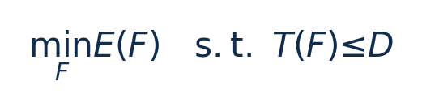
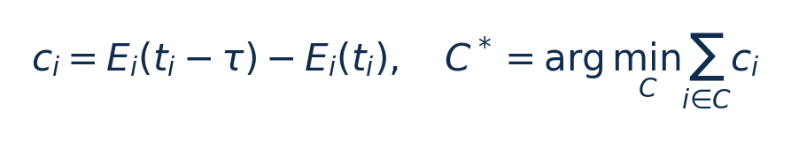
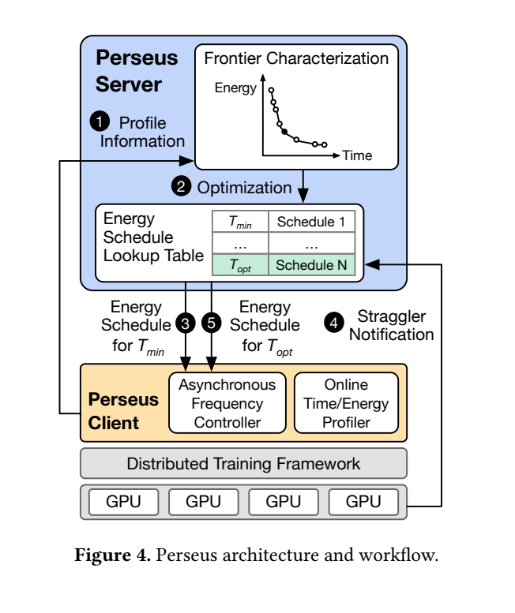
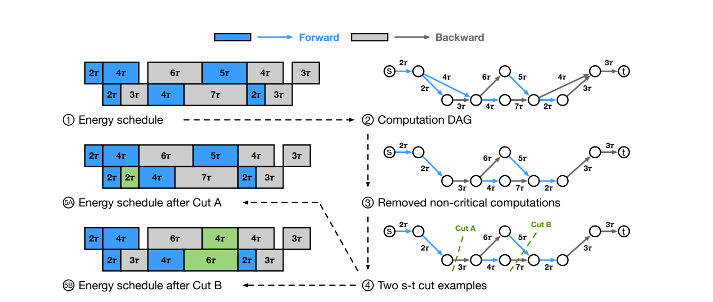
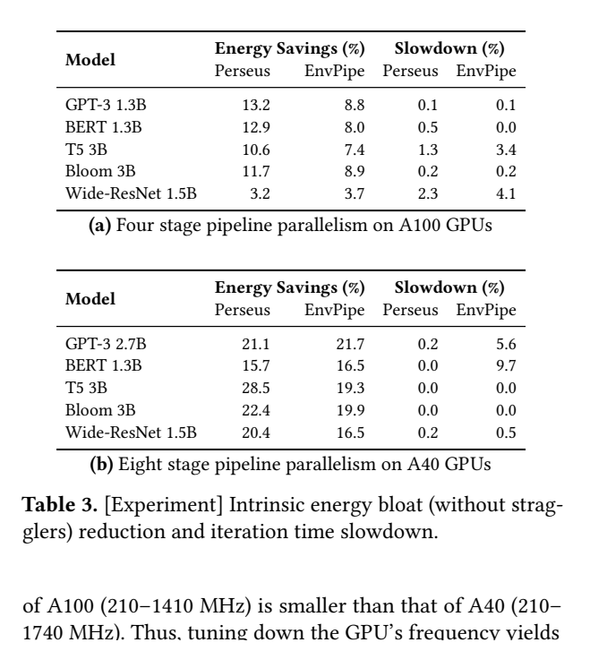

[论文页面](https://arxiv.org/abs/2312.06902v3) · [本笔记所用 PDF](https://arxiv.org/pdf/2312.06902v3) · [标识符](https://doi.org/10.48550/arXiv.2312.06902)

整理日期：2026-11-06。**读者原创中文解读；原图归论文作者／出版方。未运行作者实验，不是独立复现。**

**一句话：** 将训练计算DAG的关键路径转成最小割问题，给不同前向/反向计算安排GPU频率以回收流水线等待能量

阅读地图：先看问题与输入输出，再顺着架构图、公式和结果图阅读；最后检查统计边界与E902迁移。完整编号索引另见“图表索引”。下文“读者分析”是推断或建议，不是原文结果。

## 阶段0：材料与版本审计

| 材料 | 当前可用程度 | 影响 |
| --- | --- | --- |
| 摘要、正文、方法、原图注 | 已获取本地完整PDF、文本与逐页渲染 | 可核查结构、实验及关键数字；可见页面优先于异常文本层 |
| 分析版本 | arXiv2312.06902v3，2024-09-23，24页；不能把大规模emulation写成同规模硬件实验。 | 引用页码以“PDF第几页”标识 |
| 代码／原始数据 | 实现接口与DeepSpeed/Megatron集成见§5和附录G；本次未构建源码或独立跑训练。 | 公开链接不等于已构建或已拿到原始轨迹 |
| 附件、独立原始重复与勘误 | 当前未完成全渠道附件／勘误穷尽检索 | 不能断言没有附件、没有勘误或没有其他版本 |
| 本次工作范围 | 材料阅读、图表裁取、证据整理、教学公式 | 所有新实验均是建议，尚未执行 |

## 阶段1：身份卡与整体概述

| 项目 | 内容 |
| --- | --- |
| 英文题名 | Reducing Energy Bloat in Large Model Training |
| 中文导读题名 | 将训练计算DAG的关键路径转成最小割问题，给不同前向/反向计算安排GPU频率以回收流水线等待能量 |
| 作者 | Jae-Won Chung, Yile Gu, Insu Jang, Luoxi Meng, Nikhil Bansal, Mosharaf Chowdhury |
| 发表／版本 | SOSP 2024相关论文；本笔记分析arXiv v3；arXiv2312.06902v3，2024-09-23，24页；不能把大规模emulation写成同规模硬件实验。 |
| 类型与领域 | 原始方法／工程系统研究；DVFS、GPU/CPU能效、CV/LLM应用运行时控制 |
| 单位、通讯、资助与利益关系 | 作者姓名以本版本首页为准；通讯方式、单位及资助可回查首页与末页声明。当前尚未完成资助/利益关系/勘误的跨版本穷尽审计。 |
| 核心对象与接口 | 启动时逐频率约5迭代剖析；服务端算前沿，客户端在forward/backward边界异步set_speed；不是逐token反馈 |
| 代码与数据 | 实现接口与DeepSpeed/Megatron集成见§5和附录G；本次未构建源码或独立跑训练。 |
| 与本课题关系 | 若选择GPU训练，可以研究小型pipeline的阶段频率调度；E902可迁移“找真正关键路径、给非关键段用余量、离散动作保守取整”，在压缩/预处理/通信流水线重新测E–T。 |

**约200字中文概述（改写）：** 本文研究GPU流水线并行与数据并行训练，含stage不均衡和straggler的运行时能效。具体程序包括GPT3、Bloom、BERT、T5、Wide-ResNet；真实平台约1.3B–6.7B配置，大规模emulation扩到176B。作者在真实A40-48GB集群与4×A100-80GB节点；NVML锁SM时钟、异步进程执行；大规模GPU数为基于剖析的emulation上采用离线/启动剖析E–T曲线→指数连续松弛→关键DAG的s-t最小割/最大流迭代追踪Pareto前沿→离散频率向上取可行档；慢流水线约束下选调度。输入为前向/反向计算DAG、各计算频率–时间–能量曲线、阻塞功率、目标iteration time/straggler迭代时间，输出为每个前向/反向计算的GPU频率schedule；不改变网络质量目标与global batch。主要结果应与下方基线、性能约束和测量范围一起阅读，不能只摘最高百分比。把全局DAG时间约束与GPU E–T曲线连接，通过关键图最小割高效生成前沿；控制智能来自结构优化，不是RL。

**三句话定位：** 问题是为什么局部利用率不能完整反映整个应用的性能与能耗？本篇的研究问题或可检验主张是：将训练计算DAG的关键路径转成最小割问题，给不同前向/反向计算安排GPU频率以回收流水线等待能量。验证链是可观测状态→控制规则或学习模型→执行器→任务正确性/服务质量与能耗对照。 方法主线为前向/反向计算DAG、各计算频率–时间–能量曲线、阻塞功率、目标iteration time/straggler迭代时间 → 离线/启动剖析E–T曲线→指数连续松弛→关键DAG的s-t最小割/最大流迭代追踪Pareto前沿→离散频率向上取可行档；慢流水线约束下选调度 → 每个前向/反向计算的GPU频率schedule；不改变网络质量目标与global batch → 执行与反馈。 主要证据见下方结果表，结论须与测量和版本范围一起使用。

## 阶段2：问题、假设与创新位置

为什么局部利用率不能完整反映整个应用的性能与能耗？本篇的研究问题或可检验主张是：将训练计算DAG的关键路径转成最小割问题，给不同前向/反向计算安排GPU频率以回收流水线等待能量。验证链是可观测状态→控制规则或学习模型→执行器→任务正确性/服务质量与能耗对照。

**创新判断（读者分析）：** 把全局DAG时间约束与GPU E–T曲线连接，通过关键图最小割高效生成前沿；控制智能来自结构优化，不是RL。 不依据作者自称“首次”断定整个领域绝无前例。

## 阶段3：必要术语与数学

| 级别 | 术语／关键词 | 直觉、严格含义与易混点 |
| --- | --- | --- |
| A | DVFS / DFS | DVFS同时涉及动态电压与频率；只有时钟变化称DFS。电压能否改变取决于实际供电域。 |
| A | Workload | 真正执行应用计算的程序与输入；本文里的控制器是另一个角色。 |
| A | Controller | 根据观测选择动作的软件／硬件，可运行在同一CPU或独立控制核。 |
| A | OPP | Operating Performance Point，经过允许范围验证的电压—频率组合。 |
| A | Power / Energy | 功率W表示此刻消耗快慢；能量J是对时间积分。低功率不必然低能量。 |
| B | Deadline | 作业必须完成的时刻；平均时延、P95与最大时延各有不同用途。 |
| A | 被控程序 | GPT3、Bloom、BERT、T5、Wide-ResNet；真实平台约1.3B–6.7B配置，大规模emulation扩到176B |
| A | 控制策略 | 离线/启动剖析E–T曲线→指数连续松弛→关键DAG的s-t最小割/最大流迭代追踪Pareto前沿→离散频率向上取可行档；慢流水线约束下选调度 |
| B | 控制周期 | 启动时逐频率约5迭代剖析；服务端算前沿，客户端在forward/backward边界异步set_speed；不是逐token反馈 |
| B | 证据边界 | 实测、硬件仿真、功耗模型是不同证据，见平台与结果表。 |

### 公式1：受时间约束的能量最小化

**符号与前提：** F为所有计算的频率向量；E为GPU J/迭代，T与D为s。不是每个算子各自满足同一个D。

**代入与检查：** 教学例两条路径10ms和8ms，第二条可慢2ms；第一条若慢则总迭代变慢。

**来源：** Eq5，p6
### 公式2：关键割的边际成本（教学整理）

**符号与前提：** τ与t为s，ci为加速τ增加的J；C是关键DAG合法s-t割。

**代入与检查：** 两条并行关键路径需要各切一条边；只加速一个最快节点可能完全不提速。

**来源：** §4.3/Fig6，p7

## 阶段4–6：架构、关键图与方法拆解

**输入—处理—输出：** 前向/反向计算DAG、各计算频率–时间–能量曲线、阻塞功率、目标iteration time/straggler迭代时间 → 离线/启动剖析E–T曲线→指数连续松弛→关键DAG的s-t最小割/最大流迭代追踪Pareto前沿→离散频率向上取可行档；慢流水线约束下选调度 → 每个前向/反向计算的GPU频率schedule；不改变网络质量目标与global batch → 执行与反馈。

| 系统角色 | 具体设置 |
| --- | --- |
| 具体控制算法 | 离线/启动剖析E–T曲线→指数连续松弛→关键DAG的s-t最小割/最大流迭代追踪Pareto前沿→离散频率向上取可行档；慢流水线约束下选调度 |
| 被控负载类型 | GPU流水线并行与数据并行训练，含stage不均衡和straggler |
| 具体被控程序 | GPT3、Bloom、BERT、T5、Wide-ResNet；真实平台约1.3B–6.7B配置，大规模emulation扩到176B |
| 使用平台与测量 | 真实A40-48GB集群与4×A100-80GB节点；NVML锁SM时钟、异步进程执行；大规模GPU数为基于剖析的emulation |
| 输入/状态 | 前向/反向计算DAG、各计算频率–时间–能量曲线、阻塞功率、目标iteration time/straggler迭代时间 |
| 输出/动作 | 每个前向/反向计算的GPU频率schedule；不改变网络质量目标与global batch |
| 周期与运行位置 | 启动时逐频率约5迭代剖析；服务端算前沿，客户端在forward/backward边界异步set_speed；不是逐token反馈 |

§2–5，p2–9：intrinsic bloat来自stage不均衡与流水线气泡；extrinsic bloat来自非慢者等待straggler。原离散Pipeline Energy Minimization为NP-hard；用每计算E(t)=a·exp(bt)+c连续拟合松弛。从每计算最低能量schedule出发，每步缩短τ（例1ms），只保留关键路径计算，将加速计算的能量边际成本作图容量，s-t最小割同时缩短所有关键路径。只加速一条并行关键路径不够。连续解映射回“能比计划t更快的最慢合法档”，避免向下舍入破坏迭代时限。

NVML异步频率控制在另一进程，不阻塞主训练；仍需计算短于切换时间的可实现性。默认global batch和分割相同，基线EnvPipe、最大频率以及Zeus衍生前沿。Table3–4明示Experiment；Table5–6/Fig7–8明示Emulation。

### Fig4：服务端/客户端架构

[打开大图](images/original-fig4.png) · [原文 Fig4，PDF p5](https://arxiv.org/pdf/2312.06902v3#page=5)

**怎样看：** 先读图题、图例、坐标/表头与单位，再在同一负载和同一基线内比较。剖析、图优化和异步控制角色不同。

**直接观察／原文报告：** 剖析、图优化和异步控制角色不同。

**读者判断：** 只支持此图所列的模型、设备、输入与测量口径；剖析、图优化和异步控制角色不同。 不能由单图推出E902或其他GPU的同幅收益。

| 阅读问题 | 先看材料 | 如何接到下一步 |
| --- | --- | --- |
| 为什么要改现有方案 | 问题背景与动机图 | 确定目标、约束和原有不足 |
| 系统观察什么、控制什么 | 输入输出表＋关键架构图 | 确认数据、模型和执行器真实角色 |
| 方法如何得到动作或估计 | 方法段、公式、算法／模型表 | 明确离线训练与在线流程 |
| 收益是否真实且公平 | 结果图表、统计与测量边界 | 核查基线／目标／分母／开销 |
| 能否用于自己的CPU | 局限、复现计划、三项实验 | 把论文假设变成待验证的工程条件 |

## 阶段7–8：实验、统计及证据链

本节数字均是**原文明确报告或原文数值的标注算例**；没有按图柱高度臆造额外精确值。

| 指标 | 原文报告 | 条件／分母／边界 | 证据位置 |
| --- | --- | --- | --- |
| 真实GPU intrinsic能量降低 | 最高28.5% | 8stage A40/T5-3B，对最大频率；同项slowdown0.0%；各模型不全相同 | Table3，p10 |
| A100 GPT3-1.3B例 | 能量−13.2%，时间＋0.1% | 4stage；EnvPipe−8.8%，＋0.1% | Table3a，p10 |
| 大规模结果 | 最高约30% | 是emulation，不是几千张实体卡全部实测 | §6.3/Fig7–8，p11 |

### Fig6：关键图与最小割

[打开大图](images/original-fig6.png) · [原文 Fig6，PDF p7](https://arxiv.org/pdf/2312.06902v3#page=7)

**怎样看：** 先读图题、图例、坐标/表头与单位，再在同一负载和同一基线内比较。需同时缩短所有关键路径。

**直接观察／原文报告：** 需同时缩短所有关键路径。

**读者判断：** 只支持此图所列的模型、设备、输入与测量口径；需同时缩短所有关键路径。 不能由单图推出E902或其他GPU的同幅收益。

### Table3：真实平台无慢者

[打开大图](images/original-table3.png) · [原文 Table3，PDF p10](https://arxiv.org/pdf/2312.06902v3#page=10)

**怎样看：** 先读图题、图例、坐标/表头与单位，再在同一负载和同一基线内比较。节能必须与slowdown一起读。

**直接观察／原文报告：** 节能必须与slowdown一起读。

**读者判断：** 只支持此图所列的模型、设备、输入与测量口径；节能必须与slowdown一起读。 不能由单图推出E902或其他GPU的同幅收益。

**统计与公平性审查（读者分析）：** 同GPU资源、同任务schedule对照，但跨模型和跨GPU的百分比不构成独立重复。真实小规模测试与大规模emulation必须分列。松弛所得前沿为近似，不应宣传原离散问题全局精确最优；低开销控制也不表示无需profiling。

工程实验中，设备、程序、输入文件、重复运行、时间窗口是不同统计层级，不能互相替代。本任务不涉及生物样本，细胞／动物／试剂等检查不适用。未注明的P值或置信区间不补造；“差了几个百分点”不自动等于统计显著。

| 主张层级 | 直接证据 | 对照与统计 | 可得结论／替代解释 | 可信度 |
| --- | --- | --- | --- | --- |
| 原文明确报告 | 真实GPU intrinsic能量降低：最高28.5% | Table3，p10 | 8stage A40/T5-3B，对最大频率；同项slowdown0.0%；各模型不全相同；仅在该实验范围内成立 | 图表／文本可核对：高；独立复现：尚无 |
| 作者解释 | 所提架构／模型解释了性能或估计改善 | 关键原图与方法见上文；统计边界见下节 | 效果可能同时来自动作空间、平台特性与采样设置，因果归因需消融 | 中 |
| AI分析／迁移假设 | 用于允许的GPU/CV/LLM候选场景及CPU/E902迁移 | 本篇未直接验证该芯片与任务组合 | 需三项后续实验；不能复制论文收益数字 | 待验证，当前无法判断 |

## 阶段9–10：贡献与局限分开判断

把全局DAG时间约束与GPU E–T曲线连接，通过关键图最小割高效生成前沿；控制智能来自结构优化，不是RL。

| 来源 | 严重程度 | 局限及其影响 |
| --- | --- | --- |
| 读者分析 | 关键 | 剖析稳定性与拟合误差影响期限；原文承认低估时间会拖慢DAG。 |
| 读者分析 | 关键 | 小GPU集群结论与大规模emulation有不同外部有效性。 |
| 读者分析 | 关键 | 单核E902没有多GPU pipeline slack，不能原样移植或套用28.5%。 |

## 阶段11：最小复现路线与缺口

本次未运行作者代码。最小复建顺序：①固定本文平台/模型/输入与质量目标，确认合法可用频档和权限；②逐档运行真实被控程序，验证输出、预热、计时同步与能量测量窗口，至少记录多次独立运行原始数据；③实现本文算法，冻结离线训练/搜索配置，留出新的输入、到达率和温度条件测试；④同动作空间、同质量/SLO比较固定最高档、默认governor、简单规则和本文方案；⑤把离线剖析与在线控制、采样、切频成本单列并计算摊销次数。失败时退回安全固定档，缺失参数列日志，不猜成已知。若选择GPU训练，可以研究小型pipeline的阶段频率调度；E902可迁移“找真正关键路径、给非关键段用余量、离散动作保守取整”，在压缩/预处理/通信流水线重新测E–T。

**代码／数据现状：** 实现接口与DeepSpeed/Megatron集成见§5和附录G；本次未构建源码或独立跑训练。

**质量控制顺序：** 先验证程序输出和时间基准，再验证采样／模型，最后比较策略。保存输入文件哈希、平台配置、OPP、随机种子、温度与每次运行原始记录。失败时先回固定安全频点定位错误，再继续优化。复现可行性判断为“可开始部分方法复建，完整数值复现条件未齐”；这与“已完成复现”不同。

## 阶段12：应用选题与CPU／E902课题联系

若选择GPU训练，可以研究小型pipeline的阶段频率调度；E902可迁移“找真正关键路径、给非关键段用余量、离散动作保守取整”，在压缩/预处理/通信流水线重新测E–T。

| 建议实验／优先级 | 价值 | 最低资源 | 主要风险 | 成功判据（设计目标，非已得结果） |
| --- | --- | --- | --- | --- |
| P0：小DAG阶段E–T测量 | 先验证应用与执行器，建立同边界基线 | 2–4GPU或明确标注的DAG仿真；固定模型/输入 | 频率命令不一定获准或真实生效 | 输出正确；保存实际频率、温度、时延与积分能量 |
| P1：关键路径规则与最小割调度对照 | 验证状态/阶段感知是否优于固定档与阈值 | 2–4GPU或明确标注的DAG仿真；固定模型/输入 | 新输入与离线标定分布不同 | 同期限/质量/动作空间下报告净收益及尾部时延 |
| P1：控制成本和迁移消融 | 分开采样、模型、切换与算法贡献 | 执行器时间戳；必要时外部电测或明确功耗模型 | 短任务收益被开销吞掉；E902可观测量不同 | 分别关闭各组件；报告失败输入；CPU迁移重新标定 |

上述优先级是读者建议：P0先做，P1建立在基线可运行后，P2只在资源允许且前序实验证明有必要时开展。本批允许CV/LLM/GPU应用；压缩、CV、SLM均未最终定题，也未证明已在E902运行。论文公开可读不自动授权任意复制数据；代码、图片和数据须分别核对许可。

## 阶段13：读完后应掌握与继续核查

**五个知识点：** 将训练计算DAG的关键路径转成最小割问题，给不同前向/反向计算安排GPU频率以回收流水线等待能量 你还应能解释输入输出表中的角色、两条公式的单位、首个结果指标的分母，以及局限表里的关键条件。

**五个未决问题：** 独立新输入是否成立？最差时延是否可接受？测量参考是否足够？控制与切换是否抵消收益？E902实际具有哪些接口和可观测量？这些是研究问题，不是对作者遗漏的无证据指控。

**立即做：** 按公式算例手算一次，选一张结果图复述“硬件—负载—基线—指标—边界”。**后续核查：** 补齐代码版本、训练数据和仪表设置。**可复用：** 上文明确标注的模型与接口思路。**谨慎采用：** 所有跨平台百分比。**暂不采用：** 尚未证实存在的电压控制和完整硬实时承诺。
