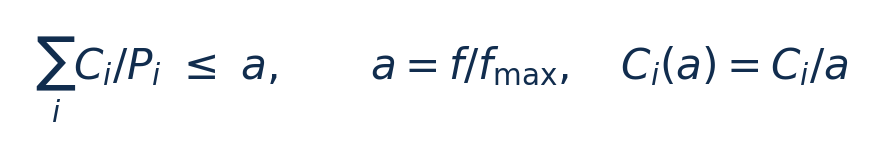

[论文页面](https://doi.org/10.1145/378239.378245) · [本笔记所用 PDF](https://www.andrew.cmu.edu/course/15-821/assets/READINGS/PAPERS/pillai2001.pdf) · [DOI](https://doi.org/10.1145/378239.378245)

整理日期：2026-11-05。**读者原创中文解读；原图归论文作者／出版方。未运行作者实验，不是独立复现。**

## 先把四个角色放对位置

被控负载是要完成的程序和输入，比如压缩一块日志；CPU是执行程序的硬件；控制器根据观测选运行档位；驱动／寄存器把档位落实。程序代码可以完全一样，CPU时钟变慢时每条指令对应的墙钟时间通常变长，访存或I/O等待则未必按同样比例变化。

软件控制并不意味着没有真实硬件。软件中的学习策略可控制真实CPU；也可先控制一个执行时间与能量模型。后者能验证闭环逻辑，但模型输出的J不能当真实电测。E902的RTL能在仿真中改变时钟并反馈计数；电压导致的物理功耗还需相应模型、功耗分析或板级实验。

## 这篇到底解决哪一件事

把“CPU 看起来不忙就降频”改成“在任务截止时间仍可满足的条件下降频”。

仅按平均利用率降频，可能让一个刚释放、期限很近的任务超时。可证伪的问题是：在给定周期任务模型内，是否能降低频率而不破坏可调度性？证据链为调度条件→算法→随机任务集→真实平台。

**把方法想成一条流水线：** 任务声明周期和最坏执行量 → EDF/RM 调度器计算可调度频率 → 任务释放／完成事件更新余量 → 工作点表选择频率和电压 → PowerNow! 执行 → 计时和功率反馈。

| 先回答的问题 | 本文答案 |
| --- | --- |
| 输入 | 每个任务的周期 P_i、最大频率下最坏时间 C_i、释放／完成事件、实际执行周期、可用 OPP。 |
| 输出 | 最低可调度工作点索引，随后映射到时钟与电压；不是改变应用代码的运算结果。 |
| 控制位置 | Linux 2.2.16 扩展模块；任务经 /proc 注册周期和计算上界。 |
| 真实负载边界 | 周期任务在真实 AMD CPU 上执行；仿真部分则生成随机任务集，两种证据分开。 |

## 十个先修关键词

| 级别 | 术语／关键词 | 直觉、严格含义与易混点 |
| --- | --- | --- |
| A | DVFS / DFS | DVFS同时涉及动态电压与频率；只有时钟变化称DFS。电压能否改变取决于实际供电域。 |
| A | Workload | 真正执行应用计算的程序与输入；本文里的控制器是另一个角色。 |
| A | Controller | 根据观测选择动作的软件／硬件，可运行在同一CPU或独立控制核。 |
| A | OPP | Operating Performance Point，经过允许范围验证的电压—频率组合。 |
| A | Power / Energy | 功率W表示此刻消耗快慢；能量J是对时间积分。低功率不必然低能量。 |
| B | Deadline | 作业必须完成的时刻；平均时延、P95与最大时延各有不同用途。 |
| A | WCET | 最坏执行时间：保证范围内最长的执行时间；有限样本最大值不自动等于WCET。 |
| A | Slack | 余量：满足期限后仍可支配的时间。 |
| B | EDF / RM | EDF按最近绝对截止期排序；RM按周期长短给固定优先级。 |
| C | Look-ahead | 前瞻式分析未来需求；其性能取决于模型与可用离散档位。 |

## 用一个小算例建立直觉

教学例：任务利用率分别 0.2 与 0.3，总需求 0.5。有 0.4、0.6、1.0 三档时选 0.6，而不是向下取 0.4。若控制／切换额外占周期 0.12，则需求变为 0.62，必须改选 1.0。

C_i：最大频率下的最坏执行时间，秒；P_i：周期／相对期限，秒；a：无量纲，0<a≤1；f：Hz。前提是执行时间近似与频率成反比，且独立周期任务满足 EDF 模型。

**要防止的误读：** 2001年的电压范围和固定功耗结构不代表现代MCU；原型单台稳定性验证不足以证明工艺温度全覆盖。

## 论文真正验证了什么

| 指标 | 原文报告 | 条件／分母／边界 | 证据位置 |
| --- | --- | --- | --- |
| 原型总系统功率 | 约降低 20%–40% | 5 个任务、各次使用 90% WCET，屏幕背光关闭；不是现代 E902 预期 | §4.3，Fig16，PDF p12 |
| 切换延迟 | 变压约0.4ms；仅变频约41µs | 单台 HP/AMD 原型经验值 | §4.1，p11 |
| 仿真样本 | 数百个不同随机任务集 | 不同利用率、空闲功率、频率集合；不等于数百台板卡 | §3.1，p7–8 |

这些结果来自作者实验。算法reward、模型误差、控制器时延、被控应用速度与应用节能是不同指标，要看具体行的单位和证据。

## 它与你的毕设怎么接起来

你可把每个压缩数据块当作一次作业，周期表示数据到达间隔，期限表示必须压完的时间。先实测不同文件和频点的执行时间，建立保守上界，再让学习策略在安全档位集合内选档。E902 能否动态变压取决于供电域和板级接口；只有时钟分频时，应把第一阶段称为 DFS。

最先可以尝试：**P0：固定频率与静态安全选频**。理由是建立必做基线；最低资源是电脑或E902仿真；相同压缩数据和计时器；通过标准是留出的输入均正确解压；完整周期无违约；报告时间与能量边界。

## 五分钟自测

1. 这篇输出的是下一频率、功率估计，还是通信／控制时序？
2. 是真实负载硬件实验，还是模型／RTL／HIL？哪些部分是真的？
3. 最重要百分比的分母和比较对象是什么？
4. 如果换成单核E902，哪一个输入或硬件旋钮会消失？
5. 算上采样、推理、切频和空闲时间后，节能是否还成立？

答案线索在本页角色表和结果表；进一步读“图文技术精读”的关键原图、公式与三项课题实验，再到“图表索引”回查原PDF。不是先记住论文所有缩写。
