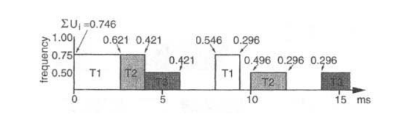
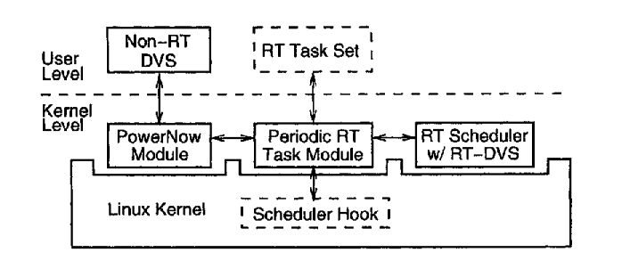
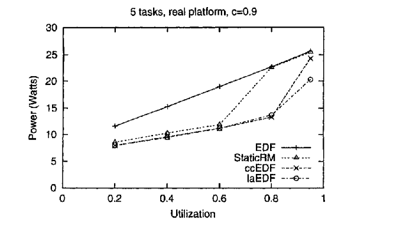

[论文页面](https://doi.org/10.1145/378239.378245) · [本笔记所用 PDF](https://www.andrew.cmu.edu/course/15-821/assets/READINGS/PAPERS/pillai2001.pdf) · [DOI](https://doi.org/10.1145/378239.378245)

整理日期：2026-11-05。**读者原创中文解读；原图归论文作者／出版方。未运行作者实验，不是独立复现。**

**覆盖范围：** 本版本正文中识别到的21项图、表或算法；保留原编号。关键项已裁图并在技术精读相应段落出现，未内嵌的项可点PDF页链接查看，不上传整篇PDF。

**统计总边界：** 仿真跨数百任务集取平均；硬件 OPP 稳定性样本量明确为一台。功率以电流探头和示波器测量，15–30秒区间平均，包含主板固定开销。图中未提供现代意义完整置信区间。模拟默认忽略切换等开销，原型讨论补入时间预算；理论模型与部署保证不能合并陈述。

## Fig1：静态EDF/RM算法

[原文 Fig1，PDF p3](https://www.andrew.cmu.edu/course/15-821/assets/READINGS/PAPERS/pillai2001.pdf#page=3)

1. **本项回答的问题：** 静态EDF/RM算法，用于支撑这条方法或实验链中的具体环节。
2. **组成、坐标和对照：** 先看可调度测试，再看离散频点选择。 结构／流程类没有统一数值坐标；箭头表示数据或控制关系，不表示统计因果。 颜色按原图图例辨认，不能把同色跨图视为同一组。
3. **阅读顺序与统计单位：** 先看设定、单位和图例，再看趋势与作者正文。重复次数及采样独立性参见本篇技术精读统计节；没有为该图定位到的误差线定义／独立重复数，不另行猜测。
4. **直接观察：** 两类调度器约束不同。
5. **作者解释的范围：** 原文以该图／表作为上述观察的结构说明或实验支撑，需连同对应页正文读取；本索引不额外替作者推导因果机制。
6. **独立判断（AI分析）：** 不能把平均利用率阈值当成相同算法。
7. **证据链位置：** 方法／系统实现说明。它支持本文具体条件下的实现或结果，不单独完成跨平台验证。
8. **结论与强度：** 可复述“两类调度器约束不同。”；对图内描述的核查可信度高，对未做独立实验的泛化判断为中或无法判断。不能得出的结论是“不能把平均利用率阈值当成相同算法。”所排除的外推。

## Fig2：静态缩放时间线

[原文 Fig2，PDF p3](https://www.andrew.cmu.edu/course/15-821/assets/READINGS/PAPERS/pillai2001.pdf#page=3)

1. **本项回答的问题：** 静态缩放时间线，用于支撑这条方法或实验链中的具体环节。
2. **组成、坐标和对照：** 横轴时间，纵向分任务，比较EDF与RM。 按原图／表标示的单位与归一化基准阅读；不将不同子图或不同分母的柱高直接相除。 颜色按原图图例辨认，不能把同色跨图视为同一组。
3. **阅读顺序与统计单位：** 先看设定、单位和图例，再看趋势与作者正文。重复次数及采样独立性参见本篇技术精读统计节；没有为该图定位到的误差线定义／独立重复数，不另行猜测。
4. **直接观察：** 不同优先级产生不同可用降频空间。
5. **作者解释的范围：** 原文以该图／表作为上述观察的结构说明或实验支撑，需连同对应页正文读取；本索引不额外替作者推导因果机制。
6. **独立判断（AI分析）：** 该例不能概括所有任务集。
7. **证据链位置：** 性能验证／定量或示例证据，需结合实验条件。它支持本文具体条件下的实现或结果，不单独完成跨平台验证。
8. **结论与强度：** 可复述“不同优先级产生不同可用降频空间。”；对图内描述的核查可信度高，对未做独立实验的泛化判断为中或无法判断。不能得出的结论是“该例不能概括所有任务集。”所排除的外推。

## Fig3：EDF回收余量时间线

[原文 Fig3，PDF p4](https://www.andrew.cmu.edu/course/15-821/assets/READINGS/PAPERS/pillai2001.pdf#page=4)

[打开大图](images/original-fig3.png)

1. **本项回答的问题：** EDF回收余量时间线，用于支撑这条方法或实验链中的具体环节。
2. **组成、坐标和对照：** 沿时间轴看频率与任务释放完成点。 按原图／表标示的单位与归一化基准阅读；不将不同子图或不同分母的柱高直接相除。 颜色按原图图例辨认，不能把同色跨图视为同一组。
3. **阅读顺序与统计单位：** 先看设定、单位和图例，再看趋势与作者正文。重复次数及采样独立性参见本篇技术精读统计节；没有为该图定位到的误差线定义／独立重复数，不另行猜测。
4. **直接观察：** 需求变化触发选频变化。
5. **作者解释的范围：** 原文以该图／表作为上述观察的结构说明或实验支撑，需连同对应页正文读取；本索引不额外替作者推导因果机制。
6. **独立判断（AI分析）：** 只在给定任务模型内解释。
7. **证据链位置：** 性能验证／定量或示例证据，需结合实验条件。它支持本文具体条件下的实现或结果，不单独完成跨平台验证。
8. **结论与强度：** 可复述“需求变化触发选频变化。”；对图内描述的核查可信度高，对未做独立实验的泛化判断为中或无法判断。不能得出的结论是“只在给定任务模型内解释。”所排除的外推。

## Fig4：EDF周期节约算法

[原文 Fig4，PDF p4](https://www.andrew.cmu.edu/course/15-821/assets/READINGS/PAPERS/pillai2001.pdf#page=4)

1. **本项回答的问题：** EDF周期节约算法，用于支撑这条方法或实验链中的具体环节。
2. **组成、坐标和对照：** 释放用最坏量，完成用实际量。 结构／流程类没有统一数值坐标；箭头表示数据或控制关系，不表示统计因果。 颜色按原图图例辨认，不能把同色跨图视为同一组。
3. **阅读顺序与统计单位：** 先看设定、单位和图例，再看趋势与作者正文。重复次数及采样独立性参见本篇技术精读统计节；没有为该图定位到的误差线定义／独立重复数，不另行猜测。
4. **直接观察：** 事件处理顺序是安全性的关键。
5. **作者解释的范围：** 原文以该图／表作为上述观察的结构说明或实验支撑，需连同对应页正文读取；本索引不额外替作者推导因果机制。
6. **独立判断（AI分析）：** 不能只保留降频逻辑而删掉需求恢复。
7. **证据链位置：** 方法／系统实现说明。它支持本文具体条件下的实现或结果，不单独完成跨平台验证。
8. **结论与强度：** 可复述“事件处理顺序是安全性的关键。”；对图内描述的核查可信度高，对未做独立实验的泛化判断为中或无法判断。不能得出的结论是“不能只保留降频逻辑而删掉需求恢复。”所排除的外推。

## Fig5：RM余量推演

[原文 Fig5，PDF p5](https://www.andrew.cmu.edu/course/15-821/assets/READINGS/PAPERS/pillai2001.pdf#page=5)

1. **本项回答的问题：** RM余量推演，用于支撑这条方法或实验链中的具体环节。
2. **组成、坐标和对照：** 按(a)到后续子图看剩余工作。 按原图／表标示的单位与归一化基准阅读；不将不同子图或不同分母的柱高直接相除。 颜色按原图图例辨认，不能把同色跨图视为同一组。
3. **阅读顺序与统计单位：** 先看设定、单位和图例，再看趋势与作者正文。重复次数及采样独立性参见本篇技术精读统计节；没有为该图定位到的误差线定义／独立重复数，不另行猜测。
4. **直接观察：** 固定优先级的余量维护比EDF复杂。
5. **作者解释的范围：** 原文以该图／表作为上述观察的结构说明或实验支撑，需连同对应页正文读取；本索引不额外替作者推导因果机制。
6. **独立判断（AI分析）：** 子图是构造示例。
7. **证据链位置：** 性能验证／定量或示例证据，需结合实验条件。它支持本文具体条件下的实现或结果，不单独完成跨平台验证。
8. **结论与强度：** 可复述“固定优先级的余量维护比EDF复杂。”；对图内描述的核查可信度高，对未做独立实验的泛化判断为中或无法判断。不能得出的结论是“子图是构造示例。”所排除的外推。

## Fig6：RM算法

[原文 Fig6，PDF p5](https://www.andrew.cmu.edu/course/15-821/assets/READINGS/PAPERS/pillai2001.pdf#page=5)

1. **本项回答的问题：** RM算法，用于支撑这条方法或实验链中的具体环节。
2. **组成、坐标和对照：** 对照Fig5追踪变量更新。 结构／流程类没有统一数值坐标；箭头表示数据或控制关系，不表示统计因果。 颜色按原图图例辨认，不能把同色跨图视为同一组。
3. **阅读顺序与统计单位：** 先看设定、单位和图例，再看趋势与作者正文。重复次数及采样独立性参见本篇技术精读统计节；没有为该图定位到的误差线定义／独立重复数，不另行猜测。
4. **直接观察：** 包含RM特有预算。
5. **作者解释的范围：** 原文以该图／表作为上述观察的结构说明或实验支撑，需连同对应页正文读取；本索引不额外替作者推导因果机制。
6. **独立判断（AI分析）：** 不能用EDF伪代码冒充。
7. **证据链位置：** 方法／系统实现说明。它支持本文具体条件下的实现或结果，不单独完成跨平台验证。
8. **结论与强度：** 可复述“包含RM特有预算。”；对图内描述的核查可信度高，对未做独立实验的泛化判断为中或无法判断。不能得出的结论是“不能用EDF伪代码冒充。”所排除的外推。

## Fig7：前瞻EDF示例

[原文 Fig7，PDF p6](https://www.andrew.cmu.edu/course/15-821/assets/READINGS/PAPERS/pillai2001.pdf#page=6)

1. **本项回答的问题：** 前瞻EDF示例，用于支撑这条方法或实验链中的具体环节。
2. **组成、坐标和对照：** 按子图阅读未来截止期前的工作迁移。 按原图／表标示的单位与归一化基准阅读；不将不同子图或不同分母的柱高直接相除。 颜色按原图图例辨认，不能把同色跨图视为同一组。
3. **阅读顺序与统计单位：** 先看设定、单位和图例，再看趋势与作者正文。重复次数及采样独立性参见本篇技术精读统计节；没有为该图定位到的误差线定义／独立重复数，不另行猜测。
4. **直接观察：** 推迟一部分未来工作可给当前降频留空间。
5. **作者解释的范围：** 原文以该图／表作为上述观察的结构说明或实验支撑，需连同对应页正文读取；本索引不额外替作者推导因果机制。
6. **独立判断（AI分析）：** 推迟仍受后续期限限制。
7. **证据链位置：** 性能验证／定量或示例证据，需结合实验条件。它支持本文具体条件下的实现或结果，不单独完成跨平台验证。
8. **结论与强度：** 可复述“推迟一部分未来工作可给当前降频留空间。”；对图内描述的核查可信度高，对未做独立实验的泛化判断为中或无法判断。不能得出的结论是“推迟仍受后续期限限制。”所排除的外推。

## Fig8：前瞻EDF伪代码

[原文 Fig8，PDF p7](https://www.andrew.cmu.edu/course/15-821/assets/READINGS/PAPERS/pillai2001.pdf#page=7)

1. **本项回答的问题：** 前瞻EDF伪代码，用于支撑这条方法或实验链中的具体环节。
2. **组成、坐标和对照：** 从最近到较远期限检查需求。 结构／流程类没有统一数值坐标；箭头表示数据或控制关系，不表示统计因果。 颜色按原图图例辨认，不能把同色跨图视为同一组。
3. **阅读顺序与统计单位：** 先看设定、单位和图例，再看趋势与作者正文。重复次数及采样独立性参见本篇技术精读统计节；没有为该图定位到的误差线定义／独立重复数，不另行猜测。
4. **直接观察：** 算法输出满足未来需求的当前频率。
5. **作者解释的范围：** 原文以该图／表作为上述观察的结构说明或实验支撑，需连同对应页正文读取；本索引不额外替作者推导因果机制。
6. **独立判断（AI分析）：** 不是已经部署的学习预测器。
7. **证据链位置：** 方法／系统实现说明。它支持本文具体条件下的实现或结果，不单独完成跨平台验证。
8. **结论与强度：** 可复述“算法输出满足未来需求的当前频率。”；对图内描述的核查可信度高，对未做独立实验的泛化判断为中或无法判断。不能得出的结论是“不是已经部署的学习预测器。”所排除的外推。

## Fig9：任务数与能量

[原文 Fig9，PDF p9](https://www.andrew.cmu.edu/course/15-821/assets/READINGS/PAPERS/pillai2001.pdf#page=9)

1. **本项回答的问题：** 任务数与能量，用于支撑这条方法或实验链中的具体环节。
2. **组成、坐标和对照：** 横轴利用率，分面5/10/15任务。 按原图／表标示的单位与归一化基准阅读；不将不同子图或不同分母的柱高直接相除。 颜色按原图图例辨认，不能把同色跨图视为同一组。
3. **阅读顺序与统计单位：** 先看设定、单位和图例，再看趋势与作者正文。重复次数及采样独立性参见本篇技术精读统计节；没有为该图定位到的误差线定义／独立重复数，不另行猜测。
4. **直接观察：** 该仿真中利用率比任务数影响更明显。
5. **作者解释的范围：** 原文以该图／表作为上述观察的结构说明或实验支撑，需连同对应页正文读取；本索引不额外替作者推导因果机制。
6. **独立判断（AI分析）：** 不是任务数永远无影响。
7. **证据链位置：** 性能验证／定量或示例证据，需结合实验条件。它支持本文具体条件下的实现或结果，不单独完成跨平台验证。
8. **结论与强度：** 可复述“该仿真中利用率比任务数影响更明显。”；对图内描述的核查可信度高，对未做独立实验的泛化判断为中或无法判断。不能得出的结论是“不是任务数永远无影响。”所排除的外推。

## Fig10：空闲功耗敏感性

[原文 Fig10，PDF p9](https://www.andrew.cmu.edu/course/15-821/assets/READINGS/PAPERS/pillai2001.pdf#page=9)

1. **本项回答的问题：** 空闲功耗敏感性，用于支撑这条方法或实验链中的具体环节。
2. **组成、坐标和对照：** 比较不同idle level与归一化基线。 按原图／表标示的单位与归一化基准阅读；不将不同子图或不同分母的柱高直接相除。 颜色按原图图例辨认，不能把同色跨图视为同一组。
3. **阅读顺序与统计单位：** 先看设定、单位和图例，再看趋势与作者正文。重复次数及采样独立性参见本篇技术精读统计节；没有为该图定位到的误差线定义／独立重复数，不另行猜测。
4. **直接观察：** 空闲越耗电，延长运行与空闲的权衡越重要。
5. **作者解释的范围：** 原文以该图／表作为上述观察的结构说明或实验支撑，需连同对应页正文读取；本索引不额外替作者推导因果机制。
6. **独立判断（AI分析）：** 真实深睡功耗需重测。
7. **证据链位置：** 性能验证／定量或示例证据，需结合实验条件。它支持本文具体条件下的实现或结果，不单独完成跨平台验证。
8. **结论与强度：** 可复述“空闲越耗电，延长运行与空闲的权衡越重要。”；对图内描述的核查可信度高，对未做独立实验的泛化判断为中或无法判断。不能得出的结论是“真实深睡功耗需重测。”所排除的外推。

## Fig11：频率电压档位敏感性

[原文 Fig11，PDF p9](https://www.andrew.cmu.edu/course/15-821/assets/READINGS/PAPERS/pillai2001.pdf#page=9)

1. **本项回答的问题：** 频率电压档位敏感性，用于支撑这条方法或实验链中的具体环节。
2. **组成、坐标和对照：** 三种machine分面内比较同一算法曲线。 按原图／表标示的单位与归一化基准阅读；不将不同子图或不同分母的柱高直接相除。 颜色按原图图例辨认，不能把同色跨图视为同一组。
3. **阅读顺序与统计单位：** 先看设定、单位和图例，再看趋势与作者正文。重复次数及采样独立性参见本篇技术精读统计节；没有为该图定位到的误差线定义／独立重复数，不另行猜测。
4. **直接观察：** 更多档位可能改变策略排名。
5. **作者解释的范围：** 原文以该图／表作为上述观察的结构说明或实验支撑，需连同对应页正文读取；本索引不额外替作者推导因果机制。
6. **独立判断（AI分析）：** 不得假设前瞻策略总最优。
7. **证据链位置：** 性能验证／定量或示例证据，需结合实验条件。它支持本文具体条件下的实现或结果，不单独完成跨平台验证。
8. **结论与强度：** 可复述“更多档位可能改变策略排名。”；对图内描述的核查可信度高，对未做独立实验的泛化判断为中或无法判断。不能得出的结论是“不得假设前瞻策略总最优。”所排除的外推。

## Fig12：实际量占WCET比例

[原文 Fig12，PDF p9](https://www.andrew.cmu.edu/course/15-821/assets/READINGS/PAPERS/pillai2001.pdf#page=9)

1. **本项回答的问题：** 实际量占WCET比例，用于支撑这条方法或实验链中的具体环节。
2. **组成、坐标和对照：** 从低到高执行比例比较。 按原图／表标示的单位与归一化基准阅读；不将不同子图或不同分母的柱高直接相除。 颜色按原图图例辨认，不能把同色跨图视为同一组。
3. **阅读顺序与统计单位：** 先看设定、单位和图例，再看趋势与作者正文。重复次数及采样独立性参见本篇技术精读统计节；没有为该图定位到的误差线定义／独立重复数，不另行猜测。
4. **直接观察：** 提前完成幅度影响动态回收价值。
5. **作者解释的范围：** 原文以该图／表作为上述观察的结构说明或实验支撑，需连同对应页正文读取；本索引不额外替作者推导因果机制。
6. **独立判断（AI分析）：** 比例是仿真条件。
7. **证据链位置：** 性能验证／定量或示例证据，需结合实验条件。它支持本文具体条件下的实现或结果，不单独完成跨平台验证。
8. **结论与强度：** 可复述“提前完成幅度影响动态回收价值。”；对图内描述的核查可信度高，对未做独立实验的泛化判断为中或无法判断。不能得出的结论是“比例是仿真条件。”所排除的外推。

## Fig13：均匀分布的实际需求

[原文 Fig13，PDF p10](https://www.andrew.cmu.edu/course/15-821/assets/READINGS/PAPERS/pillai2001.pdf#page=10)

1. **本项回答的问题：** 均匀分布的实际需求，用于支撑这条方法或实验链中的具体环节。
2. **组成、坐标和对照：** 比较随机需求下的归一化曲线。 按原图／表标示的单位与归一化基准阅读；不将不同子图或不同分母的柱高直接相除。 颜色按原图图例辨认，不能把同色跨图视为同一组。
3. **阅读顺序与统计单位：** 先看设定、单位和图例，再看趋势与作者正文。重复次数及采样独立性参见本篇技术精读统计节；没有为该图定位到的误差线定义／独立重复数，不另行猜测。
4. **直接观察：** 分布与均值共同构成实验条件。
5. **作者解释的范围：** 原文以该图／表作为上述观察的结构说明或实验支撑，需连同对应页正文读取；本索引不额外替作者推导因果机制。
6. **独立判断（AI分析）：** 不能据此断言任意分布都一样。
7. **证据链位置：** 性能验证／定量或示例证据，需结合实验条件。它支持本文具体条件下的实现或结果，不单独完成跨平台验证。
8. **结论与强度：** 可复述“分布与均值共同构成实验条件。”；对图内描述的核查可信度高，对未做独立实验的泛化判断为中或无法判断。不能得出的结论是“不能据此断言任意分布都一样。”所排除的外推。

## Fig14：Linux原型架构

[原文 Fig14，PDF p11](https://www.andrew.cmu.edu/course/15-821/assets/READINGS/PAPERS/pillai2001.pdf#page=11)

[打开大图](images/original-fig14.png)

1. **本项回答的问题：** Linux原型架构，用于支撑这条方法或实验链中的具体环节。
2. **组成、坐标和对照：** 先看任务注册，再看调度模块与PowerNow模块。 结构／流程类没有统一数值坐标；箭头表示数据或控制关系，不表示统计因果。 颜色按原图图例辨认，不能把同色跨图视为同一组。
3. **阅读顺序与统计单位：** 先看设定、单位和图例，再看趋势与作者正文。重复次数及采样独立性参见本篇技术精读统计节；没有为该图定位到的误差线定义／独立重复数，不另行猜测。
4. **直接观察：** 软件选策略，硬件完成工作点切换。
5. **作者解释的范围：** 原文以该图／表作为上述观察的结构说明或实验支撑，需连同对应页正文读取；本索引不额外替作者推导因果机制。
6. **独立判断（AI分析）：** Linux模块结构不能直接搬进E902裸机。
7. **证据链位置：** 方法／系统实现说明。它支持本文具体条件下的实现或结果，不单独完成跨平台验证。
8. **结论与强度：** 可复述“软件选策略，硬件完成工作点切换。”；对图内描述的核查可信度高，对未做独立实验的泛化判断为中或无法判断。不能得出的结论是“Linux模块结构不能直接搬进E902裸机。”所排除的外推。

## Fig15：实测连接

[原文 Fig15，PDF p11](https://www.andrew.cmu.edu/course/15-821/assets/READINGS/PAPERS/pillai2001.pdf#page=11)

1. **本项回答的问题：** 实测连接，用于支撑这条方法或实验链中的具体环节。
2. **组成、坐标和对照：** 沿电源→电流探头→笔记本看边界。 结构／流程类没有统一数值坐标；箭头表示数据或控制关系，不表示统计因果。 颜色按原图图例辨认，不能把同色跨图视为同一组。
3. **阅读顺序与统计单位：** 先看设定、单位和图例，再看趋势与作者正文。重复次数及采样独立性参见本篇技术精读统计节；没有为该图定位到的误差线定义／独立重复数，不另行猜测。
4. **直接观察：** 示波器采样的是整机电源路径。
5. **作者解释的范围：** 原文以该图／表作为上述观察的结构说明或实验支撑，需连同对应页正文读取；本索引不额外替作者推导因果机制。
6. **独立判断（AI分析）：** 不能称为独立CPU电源轨。
7. **证据链位置：** 方法／系统实现说明。它支持本文具体条件下的实现或结果，不单独完成跨平台验证。
8. **结论与强度：** 可复述“示波器采样的是整机电源路径。”；对图内描述的核查可信度高，对未做独立实验的泛化判断为中或无法判断。不能得出的结论是“不能称为独立CPU电源轨。”所排除的外推。

## Fig16：真实平台功率

[原文 Fig16，PDF p12](https://www.andrew.cmu.edu/course/15-821/assets/READINGS/PAPERS/pillai2001.pdf#page=12)

[打开大图](images/original-fig16.png)

1. **本项回答的问题：** 真实平台功率，用于支撑这条方法或实验链中的具体环节。
2. **组成、坐标和对照：** 横轴利用率，纵轴W；比较同负载各策略。 按原图／表标示的单位与归一化基准阅读；不将不同子图或不同分母的柱高直接相除。 颜色按原图图例辨认，不能把同色跨图视为同一组。
3. **阅读顺序与统计单位：** 先看设定、单位和图例，再看趋势与作者正文。重复次数及采样独立性参见本篇技术精读统计节；没有为该图定位到的误差线定义／独立重复数，不另行猜测。
4. **直接观察：** 整机固定功耗存在时仍有节能。
5. **作者解释的范围：** 原文以该图／表作为上述观察的结构说明或实验支撑，需连同对应页正文读取；本索引不额外替作者推导因果机制。
6. **独立判断（AI分析）：** 不是每个应用都有20%–40%。
7. **证据链位置：** 性能验证／定量或示例证据，需结合实验条件。它支持本文具体条件下的实现或结果，不单独完成跨平台验证。
8. **结论与强度：** 可复述“整机固定功耗存在时仍有节能。”；对图内描述的核查可信度高，对未做独立实验的泛化判断为中或无法判断。不能得出的结论是“不是每个应用都有20%–40%。”所排除的外推。

## Fig17：同参数仿真

[原文 Fig17，PDF p12](https://www.andrew.cmu.edu/course/15-821/assets/READINGS/PAPERS/pillai2001.pdf#page=12)

1. **本项回答的问题：** 同参数仿真，用于支撑这条方法或实验链中的具体环节。
2. **组成、坐标和对照：** 与Fig16趋势比较，注意量纲／边界。 按原图／表标示的单位与归一化基准阅读；不将不同子图或不同分母的柱高直接相除。 颜色按原图图例辨认，不能把同色跨图视为同一组。
3. **阅读顺序与统计单位：** 先看设定、单位和图例，再看趋势与作者正文。重复次数及采样独立性参见本篇技术精读统计节；没有为该图定位到的误差线定义／独立重复数，不另行猜测。
4. **直接观察：** 模型与硬件趋势近似。
5. **作者解释的范围：** 原文以该图／表作为上述观察的结构说明或实验支撑，需连同对应页正文读取；本索引不额外替作者推导因果机制。
6. **独立判断（AI分析）：** 仿真只含CPU，不等于整机数值相等。
7. **证据链位置：** 性能验证／定量或示例证据，需结合实验条件。它支持本文具体条件下的实现或结果，不单独完成跨平台验证。
8. **结论与强度：** 可复述“模型与硬件趋势近似。”；对图内描述的核查可信度高，对未做独立实验的泛化判断为中或无法判断。不能得出的结论是“仿真只含CPU，不等于整机数值相等。”所排除的外推。

## Table1：笔记本不同部件的功率

[原文 Table1，PDF p2](https://www.andrew.cmu.edu/course/15-821/assets/READINGS/PAPERS/pillai2001.pdf#page=2)

1. **本项回答的问题：** 笔记本不同部件的功率，用于支撑这条方法或实验链中的具体环节。
2. **组成、坐标和对照：** 逐行看显示、CPU和磁盘状态。 按原图／表标示的单位与归一化基准阅读；不将不同子图或不同分母的柱高直接相除。 颜色按原图图例辨认，不能把同色跨图视为同一组。
3. **阅读顺序与统计单位：** 先看设定、单位和图例，再看趋势与作者正文。重复次数及采样独立性参见本篇技术精读统计节；没有为该图定位到的误差线定义／独立重复数，不另行猜测。
4. **直接观察：** 整机有与CPU调频无关的固定功耗。
5. **作者解释的范围：** 原文以该图／表作为上述观察的结构说明或实验支撑，需连同对应页正文读取；本索引不额外替作者推导因果机制。
6. **独立判断（AI分析）：** 不能用CPU动态功率公式代替整机测量。
7. **证据链位置：** 性能验证／定量或示例证据，需结合实验条件。它支持本文具体条件下的实现或结果，不单独完成跨平台验证。
8. **结论与强度：** 可复述“整机有与CPU调频无关的固定功耗。”；对图内描述的核查可信度高，对未做独立实验的泛化判断为中或无法判断。不能得出的结论是“不能用CPU动态功率公式代替整机测量。”所排除的外推。

## Table2：三任务最坏时间与周期

[原文 Table2，PDF p3](https://www.andrew.cmu.edu/course/15-821/assets/READINGS/PAPERS/pillai2001.pdf#page=3)

[打开大图](images/original-table2.png)

1. **本项回答的问题：** 三任务最坏时间与周期，用于支撑这条方法或实验链中的具体环节。
2. **组成、坐标和对照：** 先读每个C、P，再算C/P。 按原图／表标示的单位与归一化基准阅读；不将不同子图或不同分母的柱高直接相除。 颜色按原图图例辨认，不能把同色跨图视为同一组。
3. **阅读顺序与统计单位：** 先看设定、单位和图例，再看趋势与作者正文。重复次数及采样独立性参见本篇技术精读统计节；没有为该图定位到的误差线定义／独立重复数，不另行猜测。
4. **直接观察：** 例子提供静态选频的输入。
5. **作者解释的范围：** 原文以该图／表作为上述观察的结构说明或实验支撑，需连同对应页正文读取；本索引不额外替作者推导因果机制。
6. **独立判断（AI分析）：** 不是实测压缩负载。
7. **证据链位置：** 性能验证／定量或示例证据，需结合实验条件。它支持本文具体条件下的实现或结果，不单独完成跨平台验证。
8. **结论与强度：** 可复述“例子提供静态选频的输入。”；对图内描述的核查可信度高，对未做独立实验的泛化判断为中或无法判断。不能得出的结论是“不是实测压缩负载。”所排除的外推。

## Table3：实际执行量

[原文 Table3，PDF p4](https://www.andrew.cmu.edu/course/15-821/assets/READINGS/PAPERS/pillai2001.pdf#page=4)

1. **本项回答的问题：** 实际执行量，用于支撑这条方法或实验链中的具体环节。
2. **组成、坐标和对照：** 与Table2最坏值逐任务对照。 按原图／表标示的单位与归一化基准阅读；不将不同子图或不同分母的柱高直接相除。 颜色按原图图例辨认，不能把同色跨图视为同一组。
3. **阅读顺序与统计单位：** 先看设定、单位和图例，再看趋势与作者正文。重复次数及采样独立性参见本篇技术精读统计节；没有为该图定位到的误差线定义／独立重复数，不另行猜测。
4. **直接观察：** 提前完成产生可回收预算。
5. **作者解释的范围：** 原文以该图／表作为上述观察的结构说明或实验支撑，需连同对应页正文读取；本索引不额外替作者推导因果机制。
6. **独立判断（AI分析）：** 运行前不能假定已知实际量。
7. **证据链位置：** 性能验证／定量或示例证据，需结合实验条件。它支持本文具体条件下的实现或结果，不单独完成跨平台验证。
8. **结论与强度：** 可复述“提前完成产生可回收预算。”；对图内描述的核查可信度高，对未做独立实验的泛化判断为中或无法判断。不能得出的结论是“运行前不能假定已知实际量。”所排除的外推。

## Table4：示例能量比较

[原文 Table4，PDF p7](https://www.andrew.cmu.edu/course/15-821/assets/READINGS/PAPERS/pillai2001.pdf#page=7)

1. **本项回答的问题：** 示例能量比较，用于支撑这条方法或实验链中的具体环节。
2. **组成、坐标和对照：** 统一看相对能量和OPP假设。 按原图／表标示的单位与归一化基准阅读；不将不同子图或不同分母的柱高直接相除。 颜色按原图图例辨认，不能把同色跨图视为同一组。
3. **阅读顺序与统计单位：** 先看设定、单位和图例，再看趋势与作者正文。重复次数及采样独立性参见本篇技术精读统计节；没有为该图定位到的误差线定义／独立重复数，不另行猜测。
4. **直接观察：** 不同策略在同一例子有不同代价。
5. **作者解释的范围：** 原文以该图／表作为上述观察的结构说明或实验支撑，需连同对应页正文读取；本索引不额外替作者推导因果机制。
6. **独立判断（AI分析）：** 不能外推为平均实验收益。
7. **证据链位置：** 性能验证／定量或示例证据，需结合实验条件。它支持本文具体条件下的实现或结果，不单独完成跨平台验证。
8. **结论与强度：** 可复述“不同策略在同一例子有不同代价。”；对图内描述的核查可信度高，对未做独立实验的泛化判断为中或无法判断。不能得出的结论是“不能外推为平均实验收益。”所排除的外推。
