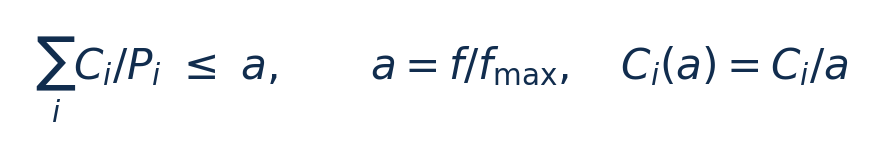
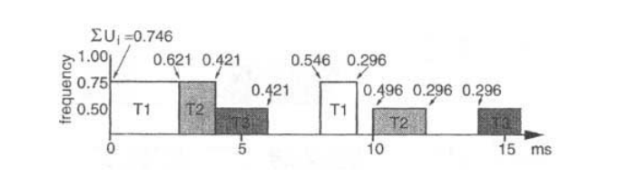
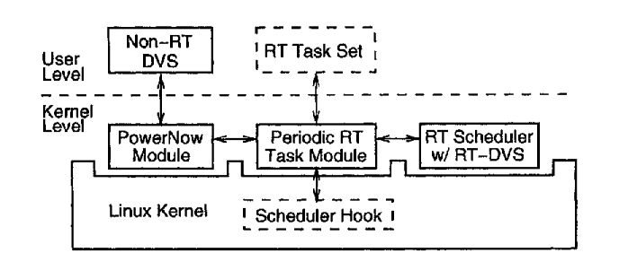
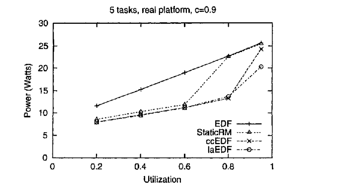

[论文页面](https://doi.org/10.1145/378239.378245) · [本笔记所用 PDF](https://www.andrew.cmu.edu/course/15-821/assets/READINGS/PAPERS/pillai2001.pdf) · [DOI](https://doi.org/10.1145/378239.378245)

整理日期：2026-11-05。**读者原创中文解读；原图归论文作者／出版方。未运行作者实验，不是独立复现。**

**一句话：** 把“CPU 看起来不忙就降频”改成“在任务截止时间仍可满足的条件下降频”。

阅读地图：先看问题与输入输出，再顺着架构图、公式和结果图阅读；最后检查统计边界与E902迁移。完整编号索引另见“图表索引”。下文“读者分析”是推断或建议，不是原文结果。

## 阶段0：材料与版本审计

| 材料 | 当前可用程度 | 影响 |
| --- | --- | --- |
| 摘要、正文、方法、原图注 | 已获取本地完整PDF、文本与逐页渲染 | 可核查结构、实验及关键数字；可见页面优先于异常文本层 |
| 分析版本 | CMU 课程站提供的 ACM 论文扫描版，14 个 PDF 页面；印刷页从 89 开始。 | 引用页码以“PDF第几页”标识 |
| 代码／原始数据 | 原文提供实现结构和算法伪代码；当前材料中尚未定位到可直接下载的配套源码仓库。 | 公开链接不等于已构建或已拿到原始轨迹 |
| 附件、独立原始重复与勘误 | 当前未完成全渠道附件／勘误穷尽检索 | 不能断言没有附件、没有勘误或没有其他版本 |
| 本次工作范围 | 材料阅读、图表裁取、证据整理、教学公式 | 所有新实验均是建议，尚未执行 |

## 阶段1：身份卡与整体概述

| 项目 | 内容 |
| --- | --- |
| 英文题名 | Real-Time Dynamic Voltage Scaling for Low-Power Embedded Operating Systems |
| 中文导读题名 | 实时任务为什么能降频：先证明来得及，再回收执行余量 |
| 作者 | Padmanabhan Pillai, Kang G. Shin |
| 发表／版本 | SOSP 2001，89–102；CMU 课程站提供的 ACM 论文扫描版，14 个 PDF 页面；印刷页从 89 开始。 |
| 类型与领域 | 原始方法／工程系统研究；DVFS、CPU能效、运行时控制 |
| 单位、通讯、资助与利益关系 | 作者来自密歇根大学 Real-Time Computing Laboratory。首页列美国空军科研办公室 AFOSR 资助。该版本未设置现代期刊式的通讯作者／利益冲突声明栏目，不能据此推断作者不存在利益关系。 |
| 核心对象与接口 | 周期任务在真实 AMD CPU 上执行；仿真部分则生成随机任务集，两种证据分开。 |
| 代码与数据 | 原文提供实现结构和算法伪代码；当前材料中尚未定位到可直接下载的配套源码仓库。 |
| 与本课题关系 | 你可把每个压缩数据块当作一次作业，周期表示数据到达间隔，期限表示必须压完的时间。先实测不同文件和频点的执行时间，建立保守上界，再让学习策略在安全档位集合内选档。E902 能否动态变压取决于供电域和板级接口；只有时钟分频时，应把第一阶段称为 DFS。 |

**约200字中文概述（改写）：** 论文研究周期性实时任务的节能调度：先按最坏执行时间选择安全频率，再在任务提前完成时回收余量。作者提出静态、周期节约和前瞻式算法，分别适配 EDF 或 RM，并把策略接入 Linux 调度和处理器调压调频接口。随机任务集仿真检验参数影响，笔记本原型检验实际功耗。价值在于建立截止期与选频之间的可分析关系；保证依赖任务独立、执行时间上界有效等假设，不能直接扩展成任意 Linux 程序的硬实时保证。

**三句话定位：** 问题是仅按平均利用率降频，可能让一个刚释放、期限很近的任务超时。可证伪的问题是：在给定周期任务模型内，是否能降低频率而不破坏可调度性？证据链为调度条件→算法→随机任务集→真实平台。 方法主线为任务声明周期和最坏执行量 → EDF/RM 调度器计算可调度频率 → 任务释放／完成事件更新余量 → 工作点表选择频率和电压 → PowerNow! 执行 → 计时和功率反馈。 主要证据见下方结果表，结论须与测量和版本范围一起使用。

## 阶段2：问题、假设与创新位置

仅按平均利用率降频，可能让一个刚释放、期限很近的任务超时。可证伪的问题是：在给定周期任务模型内，是否能降低频率而不破坏可调度性？证据链为调度条件→算法→随机任务集→真实平台。

**创新判断（读者分析）：** 创新属于调度与执行器的系统整合：用实时可调度性约束选频，再将提前完成释放的周期重新分配。它不是神经网络论文；它适合当你智能控制器的安全基线。 不依据作者自称“首次”断定整个领域绝无前例。

## 阶段3：必要术语与数学

| 级别 | 术语／关键词 | 直觉、严格含义与易混点 |
| --- | --- | --- |
| A | DVFS / DFS | DVFS同时涉及动态电压与频率；只有时钟变化称DFS。电压能否改变取决于实际供电域。 |
| A | Workload | 真正执行应用计算的程序与输入；本文里的控制器是另一个角色。 |
| A | Controller | 根据观测选择动作的软件／硬件，可运行在同一CPU或独立控制核。 |
| A | OPP | Operating Performance Point，经过允许范围验证的电压—频率组合。 |
| A | Power / Energy | 功率W表示此刻消耗快慢；能量J是对时间积分。低功率不必然低能量。 |
| B | Deadline | 作业必须完成的时刻；平均时延、P95与最大时延各有不同用途。 |
| A | WCET | 最坏执行时间：保证范围内最长的执行时间；有限样本最大值不自动等于WCET。 |
| A | Slack | 余量：满足期限后仍可支配的时间。 |
| B | EDF / RM | EDF按最近绝对截止期排序；RM按周期长短给固定优先级。 |
| C | Look-ahead | 前瞻式分析未来需求；其性能取决于模型与可用离散档位。 |

### 公式1：EDF 的选频条件（原文 §2.3 的符号重排）

**符号与前提：** C_i：最大频率下的最坏执行时间，秒；P_i：周期／相对期限，秒；a：无量纲，0<a≤1；f：Hz。前提是执行时间近似与频率成反比，且独立周期任务满足 EDF 模型。

**代入与检查：** 教学例：任务利用率分别 0.2 与 0.3，总需求 0.5。有 0.4、0.6、1.0 三档时选 0.6，而不是向下取 0.4。若控制／切换额外占周期 0.12，则需求变为 0.62，必须改选 1.0。

**来源：** §2.2–2.3，PDF p3–4；例子是读者补充。
### 公式2：整周期能量（读者补充，用于纠正只比较活动功率）

**符号与前提：** E：J；P_idle：W；P 和 T_run：s。这里 P 代表任务周期，不是功率。必须把切换停顿和空闲状态的能量归属统一。

**代入与检查：** 运行能量从 8mJ 降到 6mJ，若控制与切换增加 3mJ，净结果是 9mJ，不能宣称节能。

**来源：** 由 §3–4 的能量边界整理，不是论文编号公式。

## 阶段4–6：架构、关键图与方法拆解

**输入—处理—输出：** 任务声明周期和最坏执行量 → EDF/RM 调度器计算可调度频率 → 任务释放／完成事件更新余量 → 工作点表选择频率和电压 → PowerNow! 执行 → 计时和功率反馈。

| 系统角色 | 具体设置 |
| --- | --- |
| 输入 | 每个任务的周期 P_i、最大频率下最坏时间 C_i、释放／完成事件、实际执行周期、可用 OPP。 |
| 输出 | 最低可调度工作点索引，随后映射到时钟与电压；不是改变应用代码的运算结果。 |
| 控制位置 | Linux 2.2.16 扩展模块；任务经 /proc 注册周期和计算上界。 |
| 真实负载边界 | 周期任务在真实 AMD CPU 上执行；仿真部分则生成随机任务集，两种证据分开。 |

§2.2–2.3（PDF p3–4）：基本模型是单处理器、独立、可抢占的周期任务，期限等于周期。C_i 在最大频率下给定，降频因子 a=f/f_max 时执行时间近似变为 C_i/a。静态 EDF 选择使总利用率不超过 a 的最低离散档位。RM 的判断不同，不能照搬 EDF 的利用率等式。

§2.4（p4–5）：cycle-conserving 策略在任务释放时恢复最坏需求，完成后才用本次实际需求替换；不能提前把上一次的短执行时间当成本次必然上界。EDF 与 RM 各有余量维护方式。§2.5（p6–7）的 look-ahead EDF 尝试推迟未来工作，让当前运行更慢；离散 OPP 不同时，它并不总比 cycle-conserving 更好。

§4（p10–12）：HP N3350、AMD K6-2+，最高 550MHz，实际主板只有 1.4V 和 2.0V 两档。作者以单台机器测试了低电压下稳定频率，不能据此确定其他器件的安全 OPP。电压切换约 0.4ms，纯频率切换约 41µs；这些停顿应算入执行预算。

### Table2：三任务最坏时间与周期

[打开大图](images/original-table2.png) · [原文 Table2，PDF p3](https://www.andrew.cmu.edu/course/15-821/assets/READINGS/PAPERS/pillai2001.pdf#page=3)

**怎样看：** 先读每个C、P，再算C/P。

**直接观察／原文报告：** 例子提供静态选频的输入。

**读者判断：** 不是实测压缩负载。

### Fig3：EDF回收余量时间线

[打开大图](images/original-fig3.png) · [原文 Fig3，PDF p4](https://www.andrew.cmu.edu/course/15-821/assets/READINGS/PAPERS/pillai2001.pdf#page=4)

**怎样看：** 沿时间轴看频率与任务释放完成点。

**直接观察／原文报告：** 需求变化触发选频变化。

**读者判断：** 只在给定任务模型内解释。

### Fig14：Linux原型架构

[打开大图](images/original-fig14.png) · [原文 Fig14，PDF p11](https://www.andrew.cmu.edu/course/15-821/assets/READINGS/PAPERS/pillai2001.pdf#page=11)

**怎样看：** 先看任务注册，再看调度模块与PowerNow模块。

**直接观察／原文报告：** 软件选策略，硬件完成工作点切换。

**读者判断：** Linux模块结构不能直接搬进E902裸机。

| 阅读问题 | 先看材料 | 如何接到下一步 |
| --- | --- | --- |
| 为什么要改现有方案 | 问题背景与动机图 | 确定目标、约束和原有不足 |
| 系统观察什么、控制什么 | 输入输出表＋关键架构图 | 确认数据、模型和执行器真实角色 |
| 方法如何得到动作或估计 | 方法段、公式、算法／模型表 | 明确离线训练与在线流程 |
| 收益是否真实且公平 | 结果图表、统计与测量边界 | 核查基线／目标／分母／开销 |
| 能否用于自己的CPU | 局限、复现计划、三项实验 | 把论文假设变成待验证的工程条件 |

## 阶段7–8：实验、统计及证据链

本节数字均是**原文明确报告或原文数值的标注算例**；没有按图柱高度臆造额外精确值。

| 指标 | 原文报告 | 条件／分母／边界 | 证据位置 |
| --- | --- | --- | --- |
| 原型总系统功率 | 约降低 20%–40% | 5 个任务、各次使用 90% WCET，屏幕背光关闭；不是现代 E902 预期 | §4.3，Fig16，PDF p12 |
| 切换延迟 | 变压约0.4ms；仅变频约41µs | 单台 HP/AMD 原型经验值 | §4.1，p11 |
| 仿真样本 | 数百个不同随机任务集 | 不同利用率、空闲功率、频率集合；不等于数百台板卡 | §3.1，p7–8 |

### Fig16：真实平台功率

[打开大图](images/original-fig16.png) · [原文 Fig16，PDF p12](https://www.andrew.cmu.edu/course/15-821/assets/READINGS/PAPERS/pillai2001.pdf#page=12)

**怎样看：** 横轴利用率，纵轴W；比较同负载各策略。

**直接观察／原文报告：** 整机固定功耗存在时仍有节能。

**读者判断：** 不是每个应用都有20%–40%。

**统计与公平性审查（读者分析）：** 仿真跨数百任务集取平均；硬件 OPP 稳定性样本量明确为一台。功率以电流探头和示波器测量，15–30秒区间平均，包含主板固定开销。图中未提供现代意义完整置信区间。模拟默认忽略切换等开销，原型讨论补入时间预算；理论模型与部署保证不能合并陈述。

工程实验中，设备、程序、输入文件、重复运行、时间窗口是不同统计层级，不能互相替代。本任务不涉及生物样本，细胞／动物／试剂等检查不适用。未注明的P值或置信区间不补造；“差了几个百分点”不自动等于统计显著。

| 主张层级 | 直接证据 | 对照与统计 | 可得结论／替代解释 | 可信度 |
| --- | --- | --- | --- | --- |
| 原文明确报告 | 原型总系统功率：约降低 20%–40% | §4.3，Fig16，PDF p12 | 5 个任务、各次使用 90% WCET，屏幕背光关闭；不是现代 E902 预期；仅在该实验范围内成立 | 图表／文本可核对：高；独立复现：尚无 |
| 作者解释 | 所提架构／模型解释了性能或估计改善 | 关键原图与方法见上文；统计边界见下节 | 效果可能同时来自动作空间、平台特性与采样设置，因果归因需消融 | 中 |
| AI分析／迁移假设 | 用于E902的压缩候选负载 | 本篇未直接验证该芯片与任务组合 | 需三项后续实验；不能复制论文收益数字 | 待验证，当前无法判断 |

## 阶段9–10：贡献与局限分开判断

创新属于调度与执行器的系统整合：用实时可调度性约束选频，再将提前完成释放的周期重新分配。它不是神经网络论文；它适合当你智能控制器的安全基线。

| 来源 | 严重程度 | 局限及其影响 |
| --- | --- | --- |
| 作者讨论 | 重要 | 动态加入任务可能产生暂时违约，需控制首个释放时刻；频点集合会改变算法排名。 |
| 读者分析 | 关键 | 实际 WCET、访存等待、锁阻塞与中断若未计入，理论可调度性不能保护真实程序。 |
| 读者分析 | 重要 | 2001年的电压范围和固定功耗结构不代表现代MCU；原型单台稳定性验证不足以证明工艺温度全覆盖。 |

## 阶段11：最小复现路线与缺口

先用论文 Table2/3 的3任务例重现频率时间线，再随机生成任务集扫利用率与OPP。将切换成本显式加入，不把“忽略成本”与“测得零成本”混同。之后在有权限且支持调频的CPU运行周期任务，测整周期能量；要复现原型百分比还需相同硬件及测量边界。当前未运行作者软件或复现实验。

**代码／数据现状：** 原文提供实现结构和算法伪代码；当前材料中尚未定位到可直接下载的配套源码仓库。

**质量控制顺序：** 先验证程序输出和时间基准，再验证采样／模型，最后比较策略。保存输入文件哈希、平台配置、OPP、随机种子、温度与每次运行原始记录。失败时先回固定安全频点定位错误，再继续优化。复现可行性判断为“可开始部分方法复建，完整数值复现条件未齐”；这与“已完成复现”不同。

## 阶段12：用于你的CPU／E902课题

你可把每个压缩数据块当作一次作业，周期表示数据到达间隔，期限表示必须压完的时间。先实测不同文件和频点的执行时间，建立保守上界，再让学习策略在安全档位集合内选档。E902 能否动态变压取决于供电域和板级接口；只有时钟分频时，应把第一阶段称为 DFS。

| 建议实验／优先级 | 价值 | 最低资源 | 主要风险 | 成功判据（设计目标，非已得结果） |
| --- | --- | --- | --- | --- |
| P0：固定频率与静态安全选频 | 建立必做基线 | 电脑或E902仿真；相同压缩数据和计时器 | 最坏时间估计过小 | 留出的输入均正确解压；完整周期无违约；报告时间与能量边界 |
| P1：完成事件余量回收 | 验证周期节约是否比固定安全档更好 | 作业开始／完成事件、离散频率表 | 短块频繁切换抵消收益 | 同约束下净能量下降；列出每周期切换次数 |
| P1：学习策略加安全过滤 | 连接智能算法与可分析基线 | 小Q表或回归器、保守剩余工作估计 | 误差导致安全集合失效 | 对比无保护学习；分别报告违约率、能量和过滤触发数 |

上述优先级是读者建议：P0先做，P1建立在基线可运行后，P2只在资源允许且前序实验证明有必要时开展。压缩应用仍是候选，尚未替你最终定题或证明已在E902运行。论文公开可读不自动授权任意复制数据；代码、图片和数据须分别核对许可。

## 阶段13：读完后应掌握与继续核查

**五个知识点：** 把“CPU 看起来不忙就降频”改成“在任务截止时间仍可满足的条件下降频”。 你还应能解释输入输出表中的角色、两条公式的单位、首个结果指标的分母，以及局限表里的关键条件。

**五个未决问题：** 独立新输入是否成立？最差时延是否可接受？测量参考是否足够？控制与切换是否抵消收益？E902实际具有哪些接口和可观测量？这些是研究问题，不是对作者遗漏的无证据指控。

**立即做：** 按公式算例手算一次，选一张结果图复述“硬件—负载—基线—指标—边界”。**后续核查：** 补齐代码版本、训练数据和仪表设置。**可复用：** 上文明确标注的模型与接口思路。**谨慎采用：** 所有跨平台百分比。**暂不采用：** 尚未证实存在的电压控制和完整硬实时承诺。
