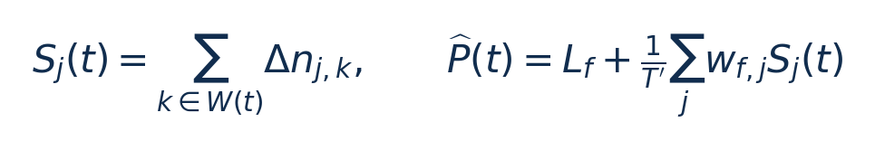

[论文页面](https://doi.org/10.1016/j.sysarc.2025.103504) · [本笔记所用 PDF](https://www.research-collection.ethz.ch/server/api/core/bitstreams/64d80e13-6f49-46a4-bb66-f8b0bc8e60f6/content) · [DOI](https://doi.org/10.1016/j.sysarc.2025.103504)

整理日期：2026-11-05。**读者原创中文解读；原图归论文作者／出版方。未运行作者实验，不是独立复现。**

## 先把四个角色放对位置

被控负载是要完成的程序和输入，比如压缩一块日志；CPU是执行程序的硬件；控制器根据观测选运行档位；驱动／寄存器把档位落实。程序代码可以完全一样，CPU时钟变慢时每条指令对应的墙钟时间通常变长，访存或I/O等待则未必按同样比例变化。

软件控制并不意味着没有真实硬件。软件中的学习策略可控制真实CPU；也可先控制一个执行时间与能量模型。后者能验证闭环逻辑，但模型输出的J不能当真实电测。E902的RTL能在仿真中改变时钟并反馈计数；电压导致的物理功耗还需相应模型、功耗分析或板级实验。

## 这篇到底解决哪一件事

把小型、按频率索引的功率模型放进Linux内核，并设计更及时的计数器采样与移动窗口。

离线小模型即使算得快，计数器何时采、如何汇总、什么时候更新输出仍决定反馈是否及时。问题是能否把整套采样与求值放进OS而保持较低开销，且明确在线误差。

**把方法想成一条流水线：** 离线自动PMC选择和模型拟合 → 内核按切换／tick读取PMC → 移动窗口聚合任务与核心样本 → 按当前频点查权重 → 定点乘加输出功率／能量估计 → 可供调度或未来DVFS策略使用。

| 先回答的问题 | 本文答案 |
| --- | --- |
| 输入 | 频率、各核PMC增量、任务／核身份、观察窗口T′和采样触发时刻。 |
| 输出 | 估计CPU功率／能量与运行统计，非完整频率控制策略。 |
| 实现 | Jetson Linux4.9.253需内核hook补丁；模块基于PMCTrack部分基础重写。 |
| 部署开销 | 10Hz实验监控配置，移动窗口与更新间隔应区分。 |

## 十个先修关键词

| 级别 | 术语／关键词 | 直觉、严格含义与易混点 |
| --- | --- | --- |
| A | DVFS / DFS | DVFS同时涉及动态电压与频率；只有时钟变化称DFS。电压能否改变取决于实际供电域。 |
| A | Workload | 真正执行应用计算的程序与输入；本文里的控制器是另一个角色。 |
| A | Controller | 根据观测选择动作的软件／硬件，可运行在同一CPU或独立控制核。 |
| A | OPP | Operating Performance Point，经过允许范围验证的电压—频率组合。 |
| A | Power / Energy | 功率W表示此刻消耗快慢；能量J是对时间积分。低功率不必然低能量。 |
| B | Deadline | 作业必须完成的时刻；平均时延、P95与最大时延各有不同用途。 |
| A | 功率估计器 | 把计数器转成W，不自行决定频率。 |
| B | 观察窗口 | 用于汇总特征的时段，可比更新间隔长。 |
| B | 定点数 | 用整数及固定缩放因子表示小数，要检查位宽和溢出。 |
| C | 在线APE | 运行中每个估计窗口的相对绝对误差，与整段积分误差不同。 |

## 用一个小算例建立直觉

窗口20ms累积40000次事件，事件率2×10⁶/s；每5ms更新一次窗口不等于用5ms作分母。除错窗口会造成4倍误差。

W(t)为最近采样组成的窗口；S为事件总数；T′为窗口秒数；L_f为常数功率W；w单位J/事件。固定频点公式要随实际状态切换；图示仅为单核简化。

**要防止的误读：** 同设备随机切分偏乐观；E902的32位运算与计数器不足可能抵消模型优势。

## 论文真正验证了什么

| 指标 | 原文报告 | 条件／分母／边界 | 证据位置 |
| --- | --- | --- | --- |
| 离线全部组合 | 功率MAPE8.6%；能量平均误差2.5% | 不能只展示有利子集 | §5.3，p9 |
| 离线GPU>600MHz子集 | 功率MAPE7.5%；能量平均1.3%、最大3.1% | 受限频率范围 | §5.3，p9 |
| 在线能量窗口APE | 平均约9%；P90约20.8%；最大约29% | CPU内核在线实验，Fig4；不同于离线1.3% | §5.4.2，p9–10 |
| 定点相对浮点 | 平均绝对误差约0.17mW，最大约17mW | 数值实现误差，不是相对真实功率的总误差 | §5.4.1，Fig3，p9–10 |
| 监控开销 | 最坏约7ms/s=0.7% | 密集上下文切换；2.3GHz最坏低于0.2% | §5.4.3，p10 |

这些结果来自作者实验。算法reward、模型误差、控制器时延、被控应用速度与应用节能是不同指标，要看具体行的单位和证据。

## 它与你的毕设怎么接起来

把它当你系统的“观测／估计模块”参考最有价值。小型CPU上可以用环形缓冲保存周期、字节进度和活跃时间，用不同频点的整数线性权重估计能量，再由小Q表或回归选档。实际能量传感器与估计都应记录，不能只凭模型预测自证节能。

最先可以尝试：**P0：定点与浮点一致性**。理由是确定模型可部署精度；最低资源是电脑浮点参考＋E902整数实现；通过标准是相同轨迹输出误差、选档差异和最大执行周期均记录。

## 五分钟自测

1. 这篇输出的是下一频率、功率估计，还是通信／控制时序？
2. 是真实负载硬件实验，还是模型／RTL／HIL？哪些部分是真的？
3. 最重要百分比的分母和比较对象是什么？
4. 如果换成单核E902，哪一个输入或硬件旋钮会消失？
5. 算上采样、推理、切频和空闲时间后，节能是否还成立？

答案线索在本页角色表和结果表；进一步读“图文技术精读”的关键原图、公式与三项课题实验，再到“图表索引”回查原PDF。不是先记住论文所有缩写。
