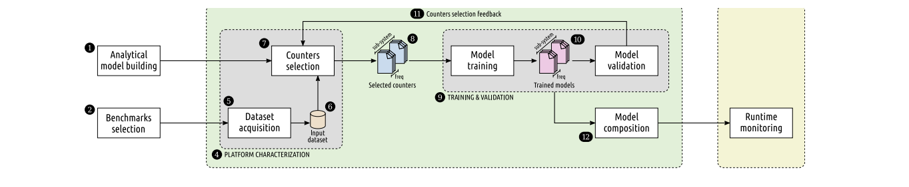
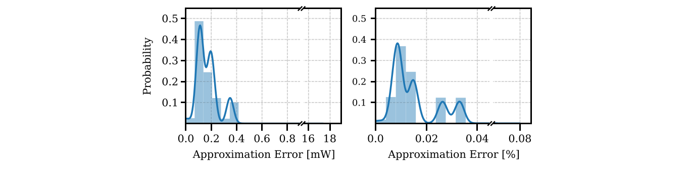
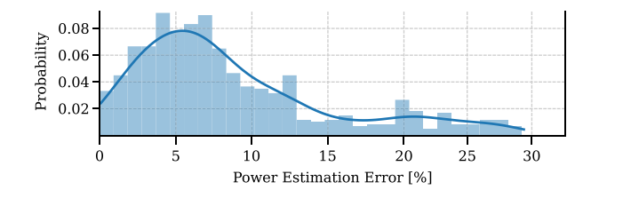
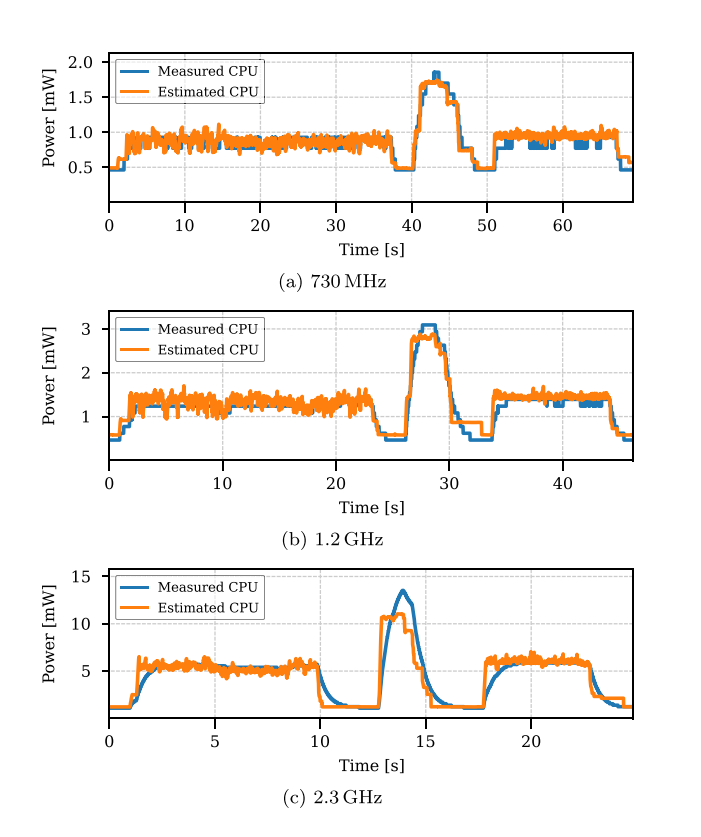

# Runmeter：原图原表阅读索引

[论文页面](https://doi.org/10.1016/j.sysarc.2025.103504) · [本笔记所用 PDF](https://www.research-collection.ethz.ch/server/api/core/bitstreams/64d80e13-6f49-46a4-bb66-f8b0bc8e60f6/content) · [DOI](https://doi.org/10.1016/j.sysarc.2025.103504)

整理日期：2026-11-05。**读者原创中文解读；原图归论文作者／出版方。未运行作者实验，不是独立复现。**

**覆盖范围：** 本版本正文中识别到的6项图、表或算法；保留原编号。关键项已裁图并在技术精读相应段落出现，未内嵌的项可点PDF页链接查看，不上传整篇PDF。

**统计总边界：** 随机样本分割只能评估相似数据分布内误差，不能替代按应用／文件划分的泛化测试。参考仪表200mW分辨率约占该实验功率3%，且有低带宽，在线尖峰偏差原因由作者解释为参考响应迟缓；没有独立高速电测时仍应保留替代解释。Fig4给APE分布而非置信区间。0.7%为时间开销，不是能量开销，更不是收益。 材料术语差异：Fig4横轴写Power Estimation Error，而图注及§5.4.2描述在线能量估计APE；本文9%、20.8%和29%按该正文／图注口径转述，不隐去图轴原标签。

## Fig1：离线到在线总流程

[原文 Fig1，PDF p6](https://www.research-collection.ethz.ch/server/api/core/bitstreams/64d80e13-6f49-46a4-bb66-f8b0bc8e60f6/content#page=6)

[打开大图](images/original-fig1.png)

1. **本项回答的问题：** 离线到在线总流程，用于支撑这条方法或实验链中的具体环节。
2. **组成、坐标和对照：** 左侧建模，右侧在线受控系统与模型。 结构／流程类没有统一数值坐标；箭头表示数据或控制关系，不表示统计因果。 颜色按原图图例辨认，不能把同色跨图视为同一组。
3. **阅读顺序与统计单位：** 先看设定、单位和图例，再看趋势与作者正文。重复次数及采样独立性参见本篇技术精读统计节；没有为该图定位到的误差线定义／独立重复数，不另行猜测。
4. **直接观察：** 包含模型生成与部署。
5. **作者解释的范围：** 原文以该图／表作为上述观察的结构说明或实验支撑，需连同对应页正文读取；本索引不额外替作者推导因果机制。
6. **独立判断（AI分析）：** 箭头不等于论文已验证完整DVFS策略。
7. **证据链位置：** 方法／系统实现说明。它支持本文具体条件下的实现或结果，不单独完成跨平台验证。
8. **结论与强度：** 可复述“包含模型生成与部署。”；对图内描述的核查可信度高，对未做独立实验的泛化判断为中或无法判断。不能得出的结论是“箭头不等于论文已验证完整DVFS策略。”所排除的外推。

## Fig2：离线合成功率

[原文 Fig2，PDF p8](https://www.research-collection.ethz.ch/server/api/core/bitstreams/64d80e13-6f49-46a4-bb66-f8b0bc8e60f6/content#page=8)

1. **本项回答的问题：** 离线合成功率，用于支撑这条方法或实验链中的具体环节。
2. **组成、坐标和对照：** 左总量、右分项，横轴时间。 按原图／表标示的单位与归一化基准阅读；不将不同子图或不同分母的柱高直接相除。 颜色按原图图例辨认，不能把同色跨图视为同一组。
3. **阅读顺序与统计单位：** 先看设定、单位和图例，再看趋势与作者正文。重复次数及采样独立性参见本篇技术精读统计节；没有为该图定位到的误差线定义／独立重复数，不另行猜测。
4. **直接观察：** 模型可分解CPU/GPU。
5. **作者解释的范围：** 原文以该图／表作为上述观察的结构说明或实验支撑，需连同对应页正文读取；本索引不额外替作者推导因果机制。
6. **独立判断（AI分析）：** 该图不是在线能量误差分布。
7. **证据链位置：** 性能验证／定量或示例证据，需结合实验条件。它支持本文具体条件下的实现或结果，不单独完成跨平台验证。
8. **结论与强度：** 可复述“模型可分解CPU/GPU。”；对图内描述的核查可信度高，对未做独立实验的泛化判断为中或无法判断。不能得出的结论是“该图不是在线能量误差分布。”所排除的外推。

## Fig3：定点数值误差

[原文 Fig3，PDF p10](https://www.research-collection.ethz.ch/server/api/core/bitstreams/64d80e13-6f49-46a4-bb66-f8b0bc8e60f6/content#page=10)

[打开大图](images/original-fig3.png)

1. **本项回答的问题：** 定点数值误差，用于支撑这条方法或实验链中的具体环节。
2. **组成、坐标和对照：** 看绝对mW和百分比两个分布。 按原图／表标示的单位与归一化基准阅读；不将不同子图或不同分母的柱高直接相除。 颜色按原图图例辨认，不能把同色跨图视为同一组。
3. **阅读顺序与统计单位：** 先看设定、单位和图例，再看趋势与作者正文。重复次数及采样独立性参见本篇技术精读统计节；没有为该图定位到的误差线定义／独立重复数，不另行猜测。
4. **直接观察：** 定点近似误差很小。
5. **作者解释的范围：** 原文以该图／表作为上述观察的结构说明或实验支撑，需连同对应页正文读取；本索引不额外替作者推导因果机制。
6. **独立判断（AI分析）：** 不能称相对实测总体误差仅0.015%。
7. **证据链位置：** 性能验证／定量或示例证据，需结合实验条件。它支持本文具体条件下的实现或结果，不单独完成跨平台验证。
8. **结论与强度：** 可复述“定点近似误差很小。”；对图内描述的核查可信度高，对未做独立实验的泛化判断为中或无法判断。不能得出的结论是“不能称相对实测总体误差仅0.015%。”所排除的外推。

## Fig4：在线窗口能量APE分布

[原文 Fig4，PDF p10](https://www.research-collection.ethz.ch/server/api/core/bitstreams/64d80e13-6f49-46a4-bb66-f8b0bc8e60f6/content#page=10)

[打开大图](images/original-fig4.png)

1. **本项回答的问题：** 在线窗口能量APE分布，用于支撑这条方法或实验链中的具体环节。
2. **组成、坐标和对照：** 横轴误差百分比、纵向分布，注意尾部。 按原图／表标示的单位与归一化基准阅读；不将不同子图或不同分母的柱高直接相除。 颜色按原图图例辨认，不能把同色跨图视为同一组。
3. **阅读顺序与统计单位：** 先看设定、单位和图例，再看趋势与作者正文。重复次数及采样独立性参见本篇技术精读统计节；没有为该图定位到的误差线定义／独立重复数，不另行猜测。
4. **直接观察：** 均值约9%、P90约20.8%。
5. **作者解释的范围：** 原文以该图／表作为上述观察的结构说明或实验支撑，需连同对应页正文读取；本索引不额外替作者推导因果机制。
6. **独立判断（AI分析）：** 不得套用离线1.3%。
7. **证据链位置：** 性能验证／定量或示例证据，需结合实验条件。它支持本文具体条件下的实现或结果，不单独完成跨平台验证。
8. **结论与强度：** 可复述“均值约9%、P90约20.8%。”；对图内描述的核查可信度高，对未做独立实验的泛化判断为中或无法判断。不能得出的结论是“不得套用离线1.3%。”所排除的外推。

## Fig5：在线功率与INA3221

[原文 Fig5，PDF p10](https://www.research-collection.ethz.ch/server/api/core/bitstreams/64d80e13-6f49-46a4-bb66-f8b0bc8e60f6/content#page=10)

[打开大图](images/original-fig5.png)

1. **本项回答的问题：** 在线功率与INA3221，用于支撑这条方法或实验链中的具体环节。
2. **组成、坐标和对照：** 按频点对比尖锐边缘和慢响应。 按原图／表标示的单位与归一化基准阅读；不将不同子图或不同分母的柱高直接相除。 颜色按原图图例辨认，不能把同色跨图视为同一组。
3. **阅读顺序与统计单位：** 先看设定、单位和图例，再看趋势与作者正文。重复次数及采样独立性参见本篇技术精读统计节；没有为该图定位到的误差线定义／独立重复数，不另行猜测。
4. **直接观察：** 参考传感器有平滑延迟。
5. **作者解释的范围：** 原文以该图／表作为上述观察的结构说明或实验支撑，需连同对应页正文读取；本索引不额外替作者推导因果机制。
6. **独立判断（AI分析）：** 更快变化不自动意味着绝对准确。
7. **证据链位置：** 性能验证／定量或示例证据，需结合实验条件。它支持本文具体条件下的实现或结果，不单独完成跨平台验证。
8. **结论与强度：** 可复述“参考传感器有平滑延迟。”；对图内描述的核查可信度高，对未做独立实验的泛化判断为中或无法判断。不能得出的结论是“更快变化不自动意味着绝对准确。”所排除的外推。

## Table1：已有模型与运行框架比较

[原文 Table1，PDF p4](https://www.research-collection.ethz.ch/server/api/core/bitstreams/64d80e13-6f49-46a4-bb66-f8b0bc8e60f6/content#page=4)

1. **本项回答的问题：** 已有模型与运行框架比较，用于支撑这条方法或实验链中的具体环节。
2. **组成、坐标和对照：** 分开看建模能力与runtime integration。 按原图／表标示的单位与归一化基准阅读；不将不同子图或不同分母的柱高直接相除。 颜色按原图图例辨认，不能把同色跨图视为同一组。
3. **阅读顺序与统计单位：** 先看设定、单位和图例，再看趋势与作者正文。重复次数及采样独立性参见本篇技术精读统计节；没有为该图定位到的误差线定义／独立重复数，不另行猜测。
4. **直接观察：** 在线集成是新增维度。
5. **作者解释的范围：** 原文以该图／表作为上述观察的结构说明或实验支撑，需连同对应页正文读取；本索引不额外替作者推导因果机制。
6. **独立判断（AI分析）：** 跨平台MAPE不是直接排名。
7. **证据链位置：** 性能验证／定量或示例证据，需结合实验条件。它支持本文具体条件下的实现或结果，不单独完成跨平台验证。
8. **结论与强度：** 可复述“在线集成是新增维度。”；对图内描述的核查可信度高，对未做独立实验的泛化判断为中或无法判断。不能得出的结论是“跨平台MAPE不是直接排名。”所排除的外推。
