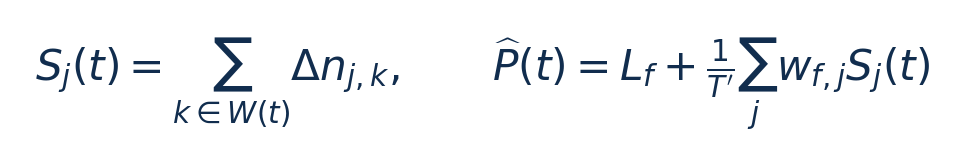
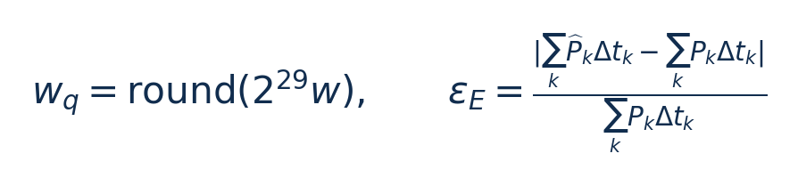
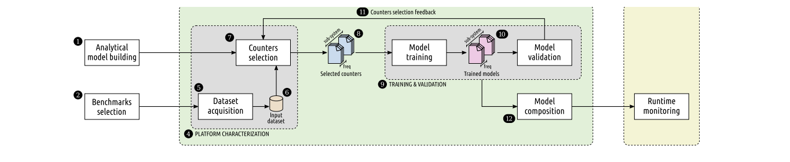
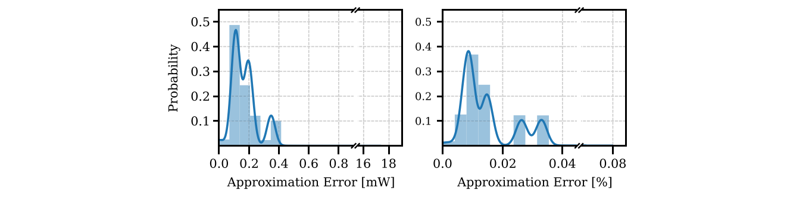
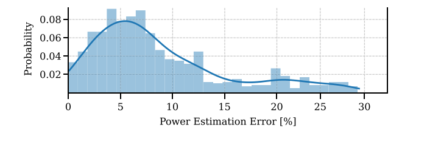
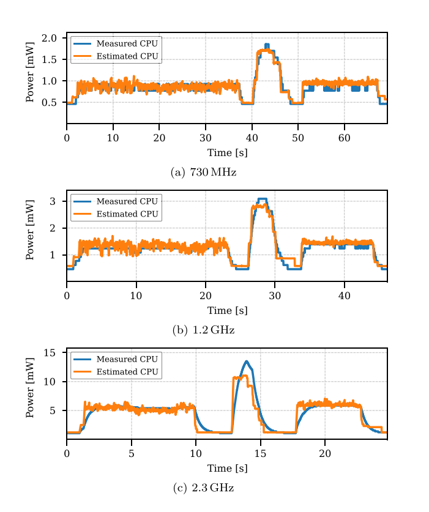

[论文页面](https://doi.org/10.1016/j.sysarc.2025.103504) · [本笔记所用 PDF](https://www.research-collection.ethz.ch/server/api/core/bitstreams/64d80e13-6f49-46a4-bb66-f8b0bc8e60f6/content) · [DOI](https://doi.org/10.1016/j.sysarc.2025.103504)

整理日期：2026-11-05。**读者原创中文解读；原图归论文作者／出版方。未运行作者实验，不是独立复现。**

**一句话：** 把小型、按频率索引的功率模型放进Linux内核，并设计更及时的计数器采样与移动窗口。

阅读地图：先看问题与输入输出，再顺着架构图、公式和结果图阅读；最后检查统计边界与E902迁移。完整编号索引另见“图表索引”。下文“读者分析”是推断或建议，不是原文结果。

## 阶段0：材料与版本审计

| 材料 | 当前可用程度 | 影响 |
| --- | --- | --- |
| 摘要、正文、方法、原图注 | 已获取本地完整PDF、文本与逐页渲染 | 可核查结构、实验及关键数字；可见页面优先于异常文本层 |
| 分析版本 | ETH仓储提供的正式出版版，12个PDF页面，第一页面是仓储封面；正文11页。存在2024及2025预印本，本文页码只针对本正式版。 | 引用页码以“PDF第几页”标识 |
| 代码／原始数据 | [Runmeter工具仓库](https://gitlab.retis.santannapisa.it/ampere/runmeter)；[Jetson内核](https://gitlab.retis.santannapisa.it/ampere/runmeter/kernel-jetson)。链接来自正式版脚注，当前未下载核验全部代码／commit。数据声明为可向作者申请。 | 公开链接不等于已构建或已拿到原始轨迹 |
| 附件、独立原始重复与勘误 | 当前未完成全渠道附件／勘误穷尽检索 | 不能断言没有附件、没有勘误或没有其他版本 |
| 本次工作范围 | 材料阅读、图表裁取、证据整理、教学公式 | 所有新实验均是建议，尚未执行 |

## 阶段1：身份卡与整体概述

| 项目 | 内容 |
| --- | --- |
| 英文题名 | Data-driven power modeling and monitoring via hardware performance counter tracking |
| 中文导读题名 | 从离线功率模型走向内核在线监控：精度、定点数和采样窗口 |
| 作者 | Sergio Mazzola, Gabriele Ara, Thomas Benz, Björn Forsberg, Tommaso Cucinotta, Luca Benini |
| 发表／版本 | Journal of Systems Architecture 167,103504 (2025)；ETH仓储提供的正式出版版，12个PDF页面，第一页面是仓储封面；正文11页。存在2024及2025预印本，本文页码只针对本正式版。 |
| 类型与领域 | 原始方法／工程系统研究；DVFS、CPU能效、运行时控制 |
| 单位、通讯、资助与利益关系 | 作者关联ETH Zürich、Scuola Superiore Sant’Anna及博洛尼亚大学。正式版对应作者含Sergio Mazzola与Tommaso Cucinotta；作者声明无已知竞争性财务利益／相关个人关系。资助包括AMPERE/Fractal（正文末）。数据可向作者申请，不等于已公开原始轨迹。 |
| 核心对象与接口 | 10Hz实验监控配置，移动窗口与更新间隔应区分。 |
| 代码与数据 | [Runmeter工具仓库](https://gitlab.retis.santannapisa.it/ampere/runmeter)；[Jetson内核](https://gitlab.retis.santannapisa.it/ampere/runmeter/kernel-jetson)。链接来自正式版脚注，当前未下载核验全部代码／commit。数据声明为可向作者申请。 |
| 与本课题关系 | 把它当你系统的“观测／估计模块”参考最有价值。小型CPU上可以用环形缓冲保存周期、字节进度和活跃时间，用不同频点的整数线性权重估计能量，再由小Q表或回归选档。实际能量传感器与估计都应记录，不能只凭模型预测自证节能。 |

**约200字中文概述（改写）：** 本文沿用并扩展按子系统和频率建模的方法，用自动筛选的计数器建立低开销线性功率估计，并提出Runmeter内核监控框架。框架在任务切换和调度tick时采样，聚合为可配置窗口统计，以定点数进行在线求值。Xavier实验分别验证离线模型、定点近似、在线估计和监控成本。它的重要增量是将模型变成可用于运行时控制的反馈基础设施；在线窗口误差明显大于离线整体能量误差，论文也未给出完整DVFS governor的净节能结果。

**三句话定位：** 问题是离线小模型即使算得快，计数器何时采、如何汇总、什么时候更新输出仍决定反馈是否及时。问题是能否把整套采样与求值放进OS而保持较低开销，且明确在线误差。 方法主线为离线自动PMC选择和模型拟合 → 内核按切换／tick读取PMC → 移动窗口聚合任务与核心样本 → 按当前频点查权重 → 定点乘加输出功率／能量估计 → 可供调度或未来DVFS策略使用。 主要证据见下方结果表，结论须与测量和版本范围一起使用。

## 阶段2：问题、假设与创新位置

离线小模型即使算得快，计数器何时采、如何汇总、什么时候更新输出仍决定反馈是否及时。问题是能否把整套采样与求值放进OS而保持较低开销，且明确在线误差。

**创新判断（读者分析）：** 相对SAMOS2022，新增内核Runmeter实现、任务切换／tick混合触发、滑动观测窗口、频点切换时事件集合管理，以及定点数和在线验证。离线模型精度不是全部新增贡献，不能重复计作两个独立突破。 不依据作者自称“首次”断定整个领域绝无前例。

## 阶段3：必要术语与数学

| 级别 | 术语／关键词 | 直觉、严格含义与易混点 |
| --- | --- | --- |
| A | DVFS / DFS | DVFS同时涉及动态电压与频率；只有时钟变化称DFS。电压能否改变取决于实际供电域。 |
| A | Workload | 真正执行应用计算的程序与输入；本文里的控制器是另一个角色。 |
| A | Controller | 根据观测选择动作的软件／硬件，可运行在同一CPU或独立控制核。 |
| A | OPP | Operating Performance Point，经过允许范围验证的电压—频率组合。 |
| A | Power / Energy | 功率W表示此刻消耗快慢；能量J是对时间积分。低功率不必然低能量。 |
| B | Deadline | 作业必须完成的时刻；平均时延、P95与最大时延各有不同用途。 |
| A | 功率估计器 | 把计数器转成W，不自行决定频率。 |
| B | 观察窗口 | 用于汇总特征的时段，可比更新间隔长。 |
| B | 定点数 | 用整数及固定缩放因子表示小数，要检查位宽和溢出。 |
| C | 在线APE | 运行中每个估计窗口的相对绝对误差，与整段积分误差不同。 |

### 公式1：移动窗口与固定频点功率（§4整理）

**符号与前提：** W(t)为最近采样组成的窗口；S为事件总数；T′为窗口秒数；L_f为常数功率W；w单位J/事件。固定频点公式要随实际状态切换；图示仅为单核简化。

**代入与检查：** 窗口20ms累积40000次事件，事件率2×10⁶/s；每5ms更新一次窗口不等于用5ms作分母。除错窗口会造成4倍误差。

**来源：** §4.1–4.2，Eq4，PDF p7。
### 公式2：固定点权重与整体能量误差

**符号与前提：** w_q为整数编码；解码为w_q/2^29。ε_E无量纲；分窗口APE与整段能量误差的汇总顺序不同。

**代入与检查：** 一半时间高估、一半低估可相互抵消，使整体能量误差低，但每窗口误差仍大。必须同时报长期积分误差与在线误差分布。

**来源：** §5.3–5.4，PDF p9–10。

## 阶段4–6：架构、关键图与方法拆解

**输入—处理—输出：** 离线自动PMC选择和模型拟合 → 内核按切换／tick读取PMC → 移动窗口聚合任务与核心样本 → 按当前频点查权重 → 定点乘加输出功率／能量估计 → 可供调度或未来DVFS策略使用。

| 系统角色 | 具体设置 |
| --- | --- |
| 输入 | 频率、各核PMC增量、任务／核身份、观察窗口T′和采样触发时刻。 |
| 输出 | 估计CPU功率／能量与运行统计，非完整频率控制策略。 |
| 实现 | Jetson Linux4.9.253需内核hook补丁；模块基于PMCTrack部分基础重写。 |
| 部署开销 | 10Hz实验监控配置，移动窗口与更新间隔应区分。 |

§3（PDF p5–6）：每频点、每子系统拟合少量事件率的非负线性模型，以查表组合覆盖DVFS；这部分与2022前序有明显继承。§4（p6–7）：任务切出必采样，调度tick提供额外触发；对多个近期样本求滑动和，既保留较长窗口的稳定统计，又及时更新。不同频点用相应事件集合，不能把换事件后的计数混入旧模型。

内核避免浮点，采用64位整数、29位小数部分。读者移植到32位E902时必须重新评估64位乘加、溢出、原子读取和执行时间，不能把Linux内核模块当裸机固件。调度tick不唤醒深空闲核是节能考虑，但“未运行期间的周期性硬上界”也不能无条件保证。

§5：Xavier CPU选3档、GPU14档，Rodinia及合成程序每项采3遍；CPU随机70%样本训练、30%验证，存在同轨迹相邻样本进入两集合的风险。在线使用同类验证负载，响应快于INA3221不自动证明瞬态估计是真值。

### Fig1：离线到在线总流程

[打开大图](images/original-fig1.png) · [原文 Fig1，PDF p6](https://www.research-collection.ethz.ch/server/api/core/bitstreams/64d80e13-6f49-46a4-bb66-f8b0bc8e60f6/content#page=6)

**怎样看：** 左侧建模，右侧在线受控系统与模型。

**直接观察／原文报告：** 包含模型生成与部署。

**读者判断：** 箭头不等于论文已验证完整DVFS策略。

| 阅读问题 | 先看材料 | 如何接到下一步 |
| --- | --- | --- |
| 为什么要改现有方案 | 问题背景与动机图 | 确定目标、约束和原有不足 |
| 系统观察什么、控制什么 | 输入输出表＋关键架构图 | 确认数据、模型和执行器真实角色 |
| 方法如何得到动作或估计 | 方法段、公式、算法／模型表 | 明确离线训练与在线流程 |
| 收益是否真实且公平 | 结果图表、统计与测量边界 | 核查基线／目标／分母／开销 |
| 能否用于自己的CPU | 局限、复现计划、三项实验 | 把论文假设变成待验证的工程条件 |

## 阶段7–8：实验、统计及证据链

本节数字均是**原文明确报告或原文数值的标注算例**；没有按图柱高度臆造额外精确值。

| 指标 | 原文报告 | 条件／分母／边界 | 证据位置 |
| --- | --- | --- | --- |
| 离线全部组合 | 功率MAPE8.6%；能量平均误差2.5% | 不能只展示有利子集 | §5.3，p9 |
| 离线GPU>600MHz子集 | 功率MAPE7.5%；能量平均1.3%、最大3.1% | 受限频率范围 | §5.3，p9 |
| 在线能量窗口APE | 平均约9%；P90约20.8%；最大约29% | CPU内核在线实验，Fig4；不同于离线1.3% | §5.4.2，p9–10 |
| 定点相对浮点 | 平均绝对误差约0.17mW，最大约17mW | 数值实现误差，不是相对真实功率的总误差 | §5.4.1，Fig3，p9–10 |
| 监控开销 | 最坏约7ms/s=0.7% | 密集上下文切换；2.3GHz最坏低于0.2% | §5.4.3，p10 |

### Fig3：定点数值误差

[打开大图](images/original-fig3.png) · [原文 Fig3，PDF p10](https://www.research-collection.ethz.ch/server/api/core/bitstreams/64d80e13-6f49-46a4-bb66-f8b0bc8e60f6/content#page=10)

**怎样看：** 看绝对mW和百分比两个分布。

**直接观察／原文报告：** 定点近似误差很小。

**读者判断：** 不能称相对实测总体误差仅0.015%。

### Fig4：在线窗口能量APE分布

[打开大图](images/original-fig4.png) · [原文 Fig4，PDF p10](https://www.research-collection.ethz.ch/server/api/core/bitstreams/64d80e13-6f49-46a4-bb66-f8b0bc8e60f6/content#page=10)

**怎样看：** 横轴误差百分比、纵向分布，注意尾部。

**直接观察／原文报告：** 均值约9%、P90约20.8%。

**读者判断：** 不得套用离线1.3%。

### Fig5：在线功率与INA3221

[打开大图](images/original-fig5.png) · [原文 Fig5，PDF p10](https://www.research-collection.ethz.ch/server/api/core/bitstreams/64d80e13-6f49-46a4-bb66-f8b0bc8e60f6/content#page=10)

**怎样看：** 按频点对比尖锐边缘和慢响应。

**直接观察／原文报告：** 参考传感器有平滑延迟。

**读者判断：** 更快变化不自动意味着绝对准确。

**统计与公平性审查（读者分析）：** 随机样本分割只能评估相似数据分布内误差，不能替代按应用／文件划分的泛化测试。参考仪表200mW分辨率约占该实验功率3%，且有低带宽，在线尖峰偏差原因由作者解释为参考响应迟缓；没有独立高速电测时仍应保留替代解释。Fig4给APE分布而非置信区间。0.7%为时间开销，不是能量开销，更不是收益。 材料术语差异：Fig4横轴写Power Estimation Error，而图注及§5.4.2描述在线能量估计APE；本文9%、20.8%和29%按该正文／图注口径转述，不隐去图轴原标签。

工程实验中，设备、程序、输入文件、重复运行、时间窗口是不同统计层级，不能互相替代。本任务不涉及生物样本，细胞／动物／试剂等检查不适用。未注明的P值或置信区间不补造；“差了几个百分点”不自动等于统计显著。

| 主张层级 | 直接证据 | 对照与统计 | 可得结论／替代解释 | 可信度 |
| --- | --- | --- | --- | --- |
| 原文明确报告 | 离线全部组合：功率MAPE8.6%；能量平均误差2.5% | §5.3，p9 | 不能只展示有利子集；仅在该实验范围内成立 | 图表／文本可核对：高；独立复现：尚无 |
| 作者解释 | 所提架构／模型解释了性能或估计改善 | 关键原图与方法见上文；统计边界见下节 | 效果可能同时来自动作空间、平台特性与采样设置，因果归因需消融 | 中 |
| AI分析／迁移假设 | 用于E902的压缩候选负载 | 本篇未直接验证该芯片与任务组合 | 需三项后续实验；不能复制论文收益数字 | 待验证，当前无法判断 |

## 阶段9–10：贡献与局限分开判断

相对SAMOS2022，新增内核Runmeter实现、任务切换／tick混合触发、滑动观测窗口、频点切换时事件集合管理，以及定点数和在线验证。离线模型精度不是全部新增贡献，不能重复计作两个独立突破。

| 来源 | 严重程度 | 局限及其影响 |
| --- | --- | --- |
| 作者承认 | 关键 | 低GPU频率导致跨域等待时独立模型失准；模拟传感器限制瞬态真实性验证。 |
| 作者方向 | 重要 | 未来把power-aware governor接到Runmeter，跨平台与深空闲情形仍待扩展。 |
| 读者分析 | 重要 | 同设备随机切分偏乐观；E902的32位运算与计数器不足可能抵消模型优势。 |

## 阶段11：最小复现路线与缺口

作者开源Runmeter与对应Jetson kernel：先锁定commit、工具链和内核补丁，再复建事件表、权重和10Hz配置。先检查计数器换组、窗口长度和任务聚合正确，再比较定点与浮点，最后对独立仪表验证在线估计。原始实验数据需要申请，尚未取得；当前未编译模块或复现硬件数值。

**代码／数据现状：** [Runmeter工具仓库](https://gitlab.retis.santannapisa.it/ampere/runmeter)；[Jetson内核](https://gitlab.retis.santannapisa.it/ampere/runmeter/kernel-jetson)。链接来自正式版脚注，当前未下载核验全部代码／commit。数据声明为可向作者申请。

**质量控制顺序：** 先验证程序输出和时间基准，再验证采样／模型，最后比较策略。保存输入文件哈希、平台配置、OPP、随机种子、温度与每次运行原始记录。失败时先回固定安全频点定位错误，再继续优化。复现可行性判断为“可开始部分方法复建，完整数值复现条件未齐”；这与“已完成复现”不同。

## 阶段12：用于你的CPU／E902课题

把它当你系统的“观测／估计模块”参考最有价值。小型CPU上可以用环形缓冲保存周期、字节进度和活跃时间，用不同频点的整数线性权重估计能量，再由小Q表或回归选档。实际能量传感器与估计都应记录，不能只凭模型预测自证节能。

| 建议实验／优先级 | 价值 | 最低资源 | 主要风险 | 成功判据（设计目标，非已得结果） |
| --- | --- | --- | --- | --- |
| P0：定点与浮点一致性 | 确定模型可部署精度 | 电脑浮点参考＋E902整数实现 | 64位溢出或缩放错误 | 相同轨迹输出误差、选档差异和最大执行周期均记录 |
| P1：窗口／更新周期解耦 | 兼顾稳定与响应 | 环形缓冲、两类定时参数 | 窗口过长掩盖突发 | 报告阶段切换响应、能量误差和控制开销 |
| P1：加入真实功耗反馈校准 | 避免模型自证 | 外部测能、不同温度／文件 | 参考仪表本身不准 | 留出整文件和独立重复测试，比较预测与实测净收益 |

上述优先级是读者建议：P0先做，P1建立在基线可运行后，P2只在资源允许且前序实验证明有必要时开展。压缩应用仍是候选，尚未替你最终定题或证明已在E902运行。论文公开可读不自动授权任意复制数据；代码、图片和数据须分别核对许可。

## 阶段13：读完后应掌握与继续核查

**五个知识点：** 把小型、按频率索引的功率模型放进Linux内核，并设计更及时的计数器采样与移动窗口。 你还应能解释输入输出表中的角色、两条公式的单位、首个结果指标的分母，以及局限表里的关键条件。

**五个未决问题：** 独立新输入是否成立？最差时延是否可接受？测量参考是否足够？控制与切换是否抵消收益？E902实际具有哪些接口和可观测量？这些是研究问题，不是对作者遗漏的无证据指控。

**立即做：** 按公式算例手算一次，选一张结果图复述“硬件—负载—基线—指标—边界”。**后续核查：** 补齐代码版本、训练数据和仪表设置。**可复用：** 上文明确标注的模型与接口思路。**谨慎采用：** 所有跨平台百分比。**暂不采用：** 尚未证实存在的电压控制和完整硬实时承诺。
