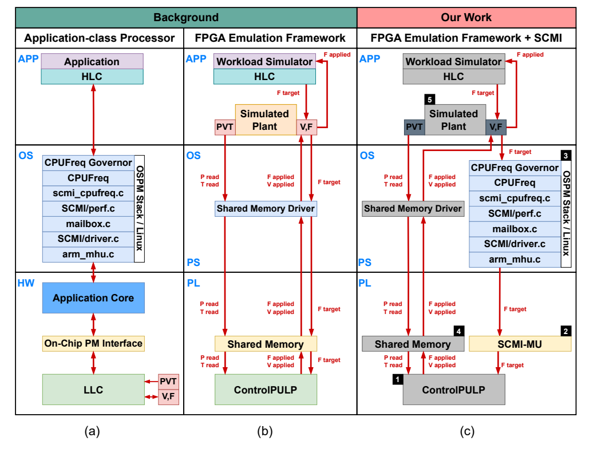
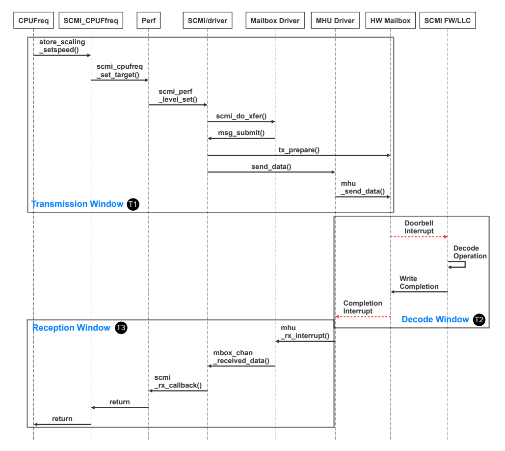
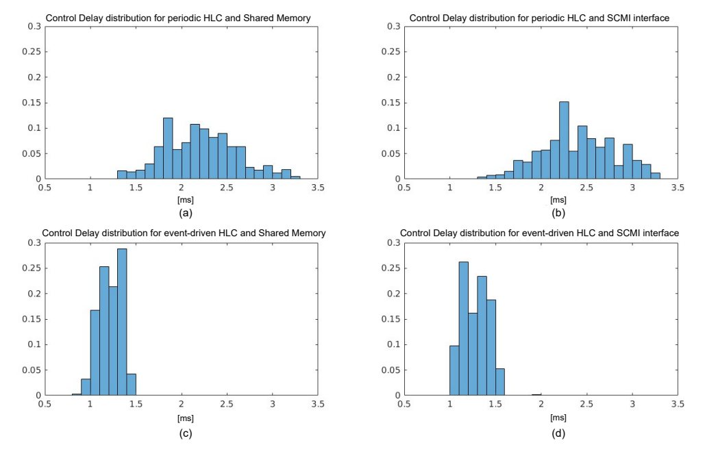
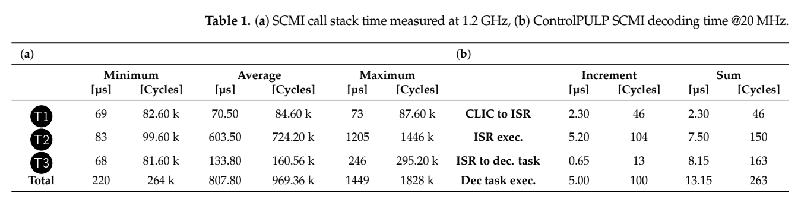
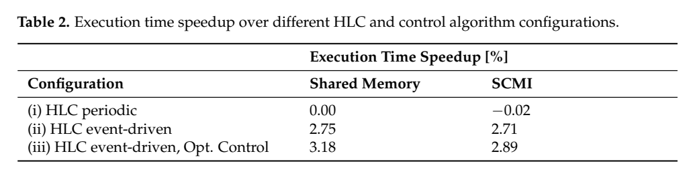

# SCMI端到端时延：原图原表阅读索引

[论文页面](https://www.mdpi.com/1996-1073/17/22/5778) · [本笔记所用 PDF](https://www.research-collection.ethz.ch/server/api/core/bitstreams/5fab7af7-3ebf-4ae4-93bb-9fea8875e6e3/content) · [DOI](https://doi.org/10.3390/en17225778)

整理日期：2026-11-05。**读者原创中文解读；原图归论文作者／出版方。未运行作者实验，不是独立复现。**

**覆盖范围：** 本版本正文中识别到的6项图、表或算法；保留原编号。关键项已裁图并在技术精读相应段落出现，未内嵌的项可点PDF页链接查看，不上传整篇PDF。

**统计总边界：** 通信有分布和最小／平均／最大值，不能只拿70.5µs代表完整链。无拥塞1s发包与密集突发命令是不同工况，未覆盖就不能保证突发响应。模拟阶段模式固定、50%占空比，不能代表全部CPU应用。论文摘要约3%的能效改善，在主结果中应优先引用Table2明确的执行时间指标，不能自行扩成所有真实任务节能3%。

## Fig1：真实部件与HIL映射

[原文 Fig1，PDF p6](https://www.research-collection.ethz.ch/server/api/core/bitstreams/5fab7af7-3ebf-4ae4-93bb-9fea8875e6e3/content#page=6)

[打开大图](images/original-fig1.png)

1. **本项回答的问题：** 真实部件与HIL映射，用于支撑这条方法或实验链中的具体环节。
2. **组成、坐标和对照：** 分清高层Linux、底层固件、模拟CPU。 结构／流程类没有统一数值坐标；箭头表示数据或控制关系，不表示统计因果。 颜色按原图图例辨认，不能把同色跨图视为同一组。
3. **阅读顺序与统计单位：** 先看设定、单位和图例，再看趋势与作者正文。重复次数及采样独立性参见本篇技术精读统计节；没有为该图定位到的误差线定义／独立重复数，不另行猜测。
4. **直接观察：** 接口与plant的真实程度不同。
5. **作者解释的范围：** 原文以该图／表作为上述观察的结构说明或实验支撑，需连同对应页正文读取；本索引不额外替作者推导因果机制。
6. **独立判断（AI分析）：** 不能统称真实CPU节能实测。
7. **证据链位置：** 方法／系统实现说明。它支持本文具体条件下的实现或结果，不单独完成跨平台验证。
8. **结论与强度：** 可复述“接口与plant的真实程度不同。”；对图内描述的核查可信度高，对未做独立实验的泛化判断为中或无法判断。不能得出的结论是“不能统称真实CPU节能实测。”所排除的外推。

## Fig2：SCMI调用时序

[原文 Fig2，PDF p7](https://www.research-collection.ethz.ch/server/api/core/bitstreams/5fab7af7-3ebf-4ae4-93bb-9fea8875e6e3/content#page=7)

[打开大图](images/original-fig2.png)

1. **本项回答的问题：** SCMI调用时序，用于支撑这条方法或实验链中的具体环节。
2. **组成、坐标和对照：** 自上而下读调用，左右区分Linux与固件，定位T1/T2/T3。 按原图／表标示的单位与归一化基准阅读；不将不同子图或不同分母的柱高直接相除。 颜色按原图图例辨认，不能把同色跨图视为同一组。
3. **阅读顺序与统计单位：** 先看设定、单位和图例，再看趋势与作者正文。重复次数及采样独立性参见本篇技术精读统计节；没有为该图定位到的误差线定义／独立重复数，不另行猜测。
4. **直接观察：** 长等待不都在传输硬件。
5. **作者解释的范围：** 原文以该图／表作为上述观察的结构说明或实验支撑，需连同对应页正文读取；本索引不额外替作者推导因果机制。
6. **独立判断（AI分析）：** 无拥塞时序不保证高请求吞吐。
7. **证据链位置：** 性能验证／定量或示例证据，需结合实验条件。它支持本文具体条件下的实现或结果，不单独完成跨平台验证。
8. **结论与强度：** 可复述“长等待不都在传输硬件。”；对图内描述的核查可信度高，对未做独立实验的泛化判断为中或无法判断。不能得出的结论是“无拥塞时序不保证高请求吞吐。”所排除的外推。

## Fig3：三窗口延迟分布

[原文 Fig3，PDF p10](https://www.research-collection.ethz.ch/server/api/core/bitstreams/5fab7af7-3ebf-4ae4-93bb-9fea8875e6e3/content#page=10)

1. **本项回答的问题：** 三窗口延迟分布，用于支撑这条方法或实验链中的具体环节。
2. **组成、坐标和对照：** 按子图看分布宽度和单位。 按原图／表标示的单位与归一化基准阅读；不将不同子图或不同分母的柱高直接相除。 颜色按原图图例辨认，不能把同色跨图视为同一组。
3. **阅读顺序与统计单位：** 先看设定、单位和图例，再看趋势与作者正文。重复次数及采样独立性参见本篇技术精读统计节；没有为该图定位到的误差线定义／独立重复数，不另行猜测。
4. **直接观察：** T2波动大于T1。
5. **作者解释的范围：** 原文以该图／表作为上述观察的结构说明或实验支撑，需连同对应页正文读取；本索引不额外替作者推导因果机制。
6. **独立判断（AI分析）：** 没有分布尾部完整数据不能给硬上界。
7. **证据链位置：** 性能验证／定量或示例证据，需结合实验条件。它支持本文具体条件下的实现或结果，不单独完成跨平台验证。
8. **结论与强度：** 可复述“T2波动大于T1。”；对图内描述的核查可信度高，对未做独立实验的泛化判断为中或无法判断。不能得出的结论是“没有分布尾部完整数据不能给硬上界。”所排除的外推。

## Fig4：控制延迟分布

[原文 Fig4，PDF p12](https://www.research-collection.ethz.ch/server/api/core/bitstreams/5fab7af7-3ebf-4ae4-93bb-9fea8875e6e3/content#page=12)

[打开大图](images/original-fig4.png)

1. **本项回答的问题：** 控制延迟分布，用于支撑这条方法或实验链中的具体环节。
2. **组成、坐标和对照：** 先分周期／事件，再分共享内存／SCMI。 按原图／表标示的单位与归一化基准阅读；不将不同子图或不同分母的柱高直接相除。 颜色按原图图例辨认，不能把同色跨图视为同一组。
3. **阅读顺序与统计单位：** 先看设定、单位和图例，再看趋势与作者正文。重复次数及采样独立性参见本篇技术精读统计节；没有为该图定位到的误差线定义／独立重复数，不另行猜测。
4. **直接观察：** 策略周期影响比邮箱本身更明显。
5. **作者解释的范围：** 原文以该图／表作为上述观察的结构说明或实验支撑，需连同对应页正文读取；本索引不额外替作者推导因果机制。
6. **独立判断（AI分析）：** 114µs是优化降频子情形，不是这些分布统一均值。
7. **证据链位置：** 性能验证／定量或示例证据，需结合实验条件。它支持本文具体条件下的实现或结果，不单独完成跨平台验证。
8. **结论与强度：** 可复述“策略周期影响比邮箱本身更明显。”；对图内描述的核查可信度高，对未做独立实验的泛化判断为中或无法判断。不能得出的结论是“114µs是优化降频子情形，不是这些分布统一均值。”所排除的外推。

## Table1：通信与解码统计

[原文 Table1，PDF p10](https://www.research-collection.ethz.ch/server/api/core/bitstreams/5fab7af7-3ebf-4ae4-93bb-9fea8875e6e3/content#page=10)

[打开大图](images/original-table1.png)

1. **本项回答的问题：** 通信与解码统计，用于支撑这条方法或实验链中的具体环节。
2. **组成、坐标和对照：** 分别看(a)µs与(b)周期及频率。 按原图／表标示的单位与归一化基准阅读；不将不同子图或不同分母的柱高直接相除。 颜色按原图图例辨认，不能把同色跨图视为同一组。
3. **阅读顺序与统计单位：** 先看设定、单位和图例，再看趋势与作者正文。重复次数及采样独立性参见本篇技术精读统计节；没有为该图定位到的误差线定义／独立重复数，不另行猜测。
4. **直接观察：** 发送、返回和解码差异大。
5. **作者解释的范围：** 原文以该图／表作为上述观察的结构说明或实验支撑，需连同对应页正文读取；本索引不额外替作者推导因果机制。
6. **独立判断（AI分析）：** 别把两种时钟域周期直接相加。
7. **证据链位置：** 性能验证／定量或示例证据，需结合实验条件。它支持本文具体条件下的实现或结果，不单独完成跨平台验证。
8. **结论与强度：** 可复述“发送、返回和解码差异大。”；对图内描述的核查可信度高，对未做独立实验的泛化判断为中或无法判断。不能得出的结论是“别把两种时钟域周期直接相加。”所排除的外推。

## Table2：应用性能改善

[原文 Table2，PDF p12](https://www.research-collection.ethz.ch/server/api/core/bitstreams/5fab7af7-3ebf-4ae4-93bb-9fea8875e6e3/content#page=12)

[打开大图](images/original-table2.png)

1. **本项回答的问题：** 应用性能改善，用于支撑这条方法或实验链中的具体环节。
2. **组成、坐标和对照：** 对照相同参考列和三种配置。 按原图／表标示的单位与归一化基准阅读；不将不同子图或不同分母的柱高直接相除。 颜色按原图图例辨认，不能把同色跨图视为同一组。
3. **阅读顺序与统计单位：** 先看设定、单位和图例，再看趋势与作者正文。重复次数及采样独立性参见本篇技术精读统计节；没有为该图定位到的误差线定义／独立重复数，不另行猜测。
4. **直接观察：** SCMI与理想通道差距较小。
5. **作者解释的范围：** 原文以该图／表作为上述观察的结构说明或实验支撑，需连同对应页正文读取；本索引不额外替作者推导因果机制。
6. **独立判断（AI分析）：** 2.89%属于模型应用，不能外推E902。
7. **证据链位置：** 性能验证／定量或示例证据，需结合实验条件。它支持本文具体条件下的实现或结果，不单独完成跨平台验证。
8. **结论与强度：** 可复述“SCMI与理想通道差距较小。”；对图内描述的核查可信度高，对未做独立实验的泛化判断为中或无法判断。不能得出的结论是“2.89%属于模型应用，不能外推E902。”所排除的外推。
