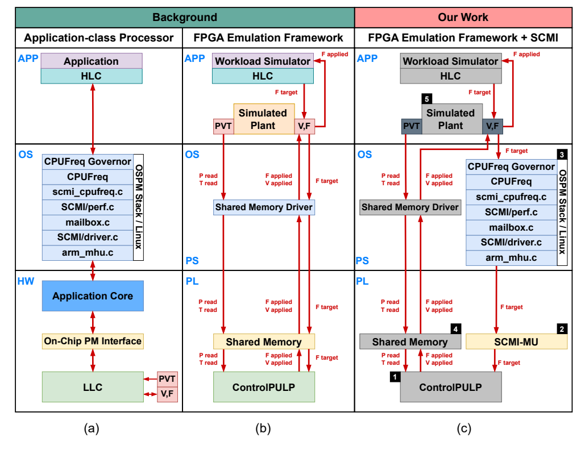
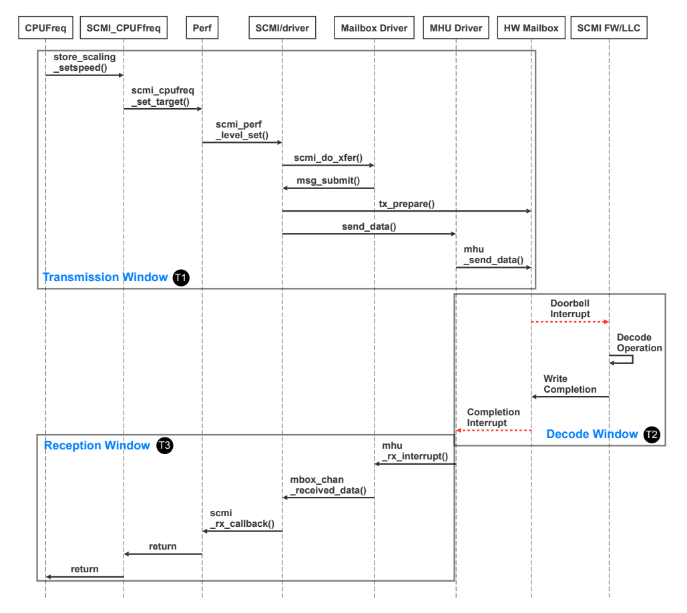
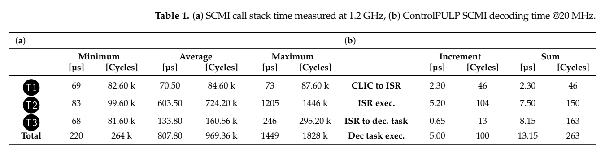
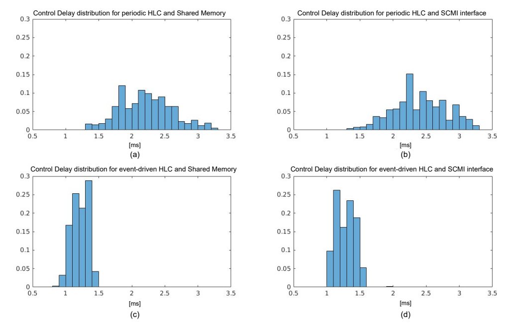
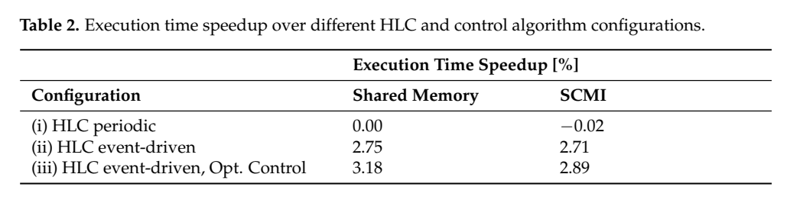

# SCMI端到端时延：图文技术精读

[论文页面](https://www.mdpi.com/1996-1073/17/22/5778) · [本笔记所用 PDF](https://www.research-collection.ethz.ch/server/api/core/bitstreams/5fab7af7-3ebf-4ae4-93bb-9fea8875e6e3/content) · [DOI](https://doi.org/10.3390/en17225778)

整理日期：2026-11-05。**读者原创中文解读；原图归论文作者／出版方。未运行作者实验，不是独立复现。**

**一句话：** 把“写入新频率”拆成Linux发请求、邮箱传输、固件解码、控制任务计算和执行器生效。

阅读地图：先看问题与输入输出，再顺着架构图、公式和结果图阅读；最后检查统计边界与E902迁移。完整编号索引另见“图表索引”。下文“读者分析”是推断或建议，不是原文结果。

## 阶段0：材料与版本审计

| 材料 | 当前可用程度 | 影响 |
| --- | --- | --- |
| 摘要、正文、方法、原图注 | 已获取本地完整PDF、文本与逐页渲染 | 可核查结构、实验及关键数字；可见页面优先于异常文本层 |
| 分析版本 | ETH仓储正式版，含1页封面共16页；本文所有PDF页码比正文印刷页多1。 | 引用页码以“PDF第几页”标识 |
| 代码／原始数据 | 论文依托[ControlPULP平台](https://github.com/pulp-platform/control-pulp)；本篇完整Linux补丁、实验脚本与对应commit当前未全部核验，不假定基础仓库包含所有扩展。 | 公开链接不等于已构建或已拿到原始轨迹 |
| 附件、独立原始重复与勘误 | 当前未完成全渠道附件／勘误穷尽检索 | 不能断言没有附件、没有勘误或没有其他版本 |
| 本次工作范围 | 材料阅读、图表裁取、证据整理、教学公式 | 所有新实验均是建议，尚未执行 |

## 阶段1：身份卡与整体概述

| 项目 | 内容 |
| --- | --- |
| 英文题名 | Performance Characterization of Hardware/Software Communication Interfaces in End-to-End Power Management Solutions of High-Performance Computing Processors |
| 中文导读题名 | 算法算完之后，频率多久才真的变：拆开整条控制链 |
| 作者 | Antonio del Vecchio, Alessandro Ottaviano, Giovanni Bambini, Andrea Acquaviva, Andrea Bartolini |
| 发表／版本 | Energies17(22),5778 (2024)；ETH仓储正式版，含1页封面共16页；本文所有PDF页码比正文印刷页多1。 |
| 类型与领域 | 原始方法／工程系统研究；DVFS、CPU能效、运行时控制 |
| 单位、通讯、资助与利益关系 | 博洛尼亚大学与ETH Zürich合作，通讯作者Antonio del Vecchio、Andrea Bartolini。作者声明无利益冲突；资助包括EUPEX、EPI SGA2、DECICE等（正文末）。 |
| 核心对象与接口 | Linux在A53侧，ControlPULP在FPGA；被控CPU及能量由模型提供。 |
| 代码与数据 | 论文依托[ControlPULP平台](https://github.com/pulp-platform/control-pulp)；本篇完整Linux补丁、实验脚本与对应commit当前未全部核验，不假定基础仓库包含所有扩展。 |
| 与本课题关系 | 你的软控硬模块应记录四个时间戳：算法决定、命令写入、执行器确认、频率实际生效。先做简单目标OPP/busy/ack寄存器即可，不必为单核毕设完整复刻SCMI。智能算法的预测时间要给执行器留余量，超时回退与升降频顺序由底层保证。 |

**约200字中文概述（改写）：** 本文以Linux高层策略与ControlPULP底层控制器为对象，研究SCMI软硬件接口对DVFS的影响。作者在FPGA硬件在环环境中测量请求发送、应答与解码延迟，再比较周期策略、事件驱动策略和底层降频快速通路。结果说明仅优化消息传输远远不够，控制任务调度也能主导响应。优化对降频最明显，升频仍受安全控制和周期限制；实验对象包含模拟CPU和工作负载，不能当真实HPC系统能耗复现。

**三句话定位：** 问题是控制器即使推理只需几微秒，Linux应答、固件任务排队和下一周期应用可能使总延迟达到毫秒。待验证的是哪一段主导，怎样优化才真正改善应用。 方法主线为CPUFreq请求 → Linux SCMI驱动发送 → 共享内存邮箱与doorbell → ControlPULP ISR → FreeRTOS解码任务 → 功率／温度控制任务 → 写频率 → 完成应答回Linux。 主要证据见下方结果表，结论须与测量和版本范围一起使用。

## 阶段2：问题、假设与创新位置

控制器即使推理只需几微秒，Linux应答、固件任务排队和下一周期应用可能使总延迟达到毫秒。待验证的是哪一段主导，怎样优化才真正改善应用。

**创新判断（读者分析）：** 贯通Linux CPUFreq/SCMI与真实固件测量，再将时延放入HIL控制质量实验。贡献在接口和调度的系统刻画，不是提出新的机器学习器；它为智能策略的开销预算提供依据。 不依据作者自称“首次”断定整个领域绝无前例。

## 阶段3：必要术语与数学

| 级别 | 术语／关键词 | 直觉、严格含义与易混点 |
| --- | --- | --- |
| A | DVFS / DFS | DVFS同时涉及动态电压与频率；只有时钟变化称DFS。电压能否改变取决于实际供电域。 |
| A | Workload | 真正执行应用计算的程序与输入；本文里的控制器是另一个角色。 |
| A | Controller | 根据观测选择动作的软件／硬件，可运行在同一CPU或独立控制核。 |
| A | OPP | Operating Performance Point，经过允许范围验证的电压—频率组合。 |
| A | Power / Energy | 功率W表示此刻消耗快慢；能量J是对时间积分。低功率不必然低能量。 |
| B | Deadline | 作业必须完成的时刻；平均时延、P95与最大时延各有不同用途。 |
| A | HLC/LLC | 高层策略与低层约束／执行控制器。 |
| B | SCMI | 标准化管理消息接口，传递性能点请求；不是自动优化算法。 |
| B | Doorbell邮箱 | 写共享内存并发中断通知对方处理消息。 |
| C | CD | 从负载阶段变化到实际频率改变的延迟，包含多层等待。 |

### 公式1：通信延迟与控制延迟不是同一量（定义整理）

**符号与前提：** 全部为秒；T1发送，T2包含平台与Linux等待，T3返回。CD还包括检测、排队、周期与动作应用；T_msg返回完成也不一定是工作负载开始变速的同一时刻。

**代入与检查：** Table1均值70.5+603.5+133.8≈807.8µs。若固件实际解码13.15µs，不能把整个603.5µs都归罪于RISC-V解码慢。

**来源：** §3.2、Table1及§4.2，PDF p8/10–12。
### 公式2：控制改善的正确分母（读者算例）

**符号与前提：** 该式是耗时减少百分比；若用speedup=T_base/T_new−1，定义不同，小差异时才近似相等。论文Table2使用自身speedup口径，应保留表述。

**代入与检查：** 1.35ms降到0.114ms是特定降频路径约91.6%延迟减少；不能据此宣称应用节能91.6%。Table2应用改善只有约2.89%，且为模拟负载。

**来源：** Fig4、Table2与讨论；算例为读者补充。

## 阶段4–6：架构、关键图与方法拆解

**输入—处理—输出：** CPUFreq请求 → Linux SCMI驱动发送 → 共享内存邮箱与doorbell → ControlPULP ISR → FreeRTOS解码任务 → 功率／温度控制任务 → 写频率 → 完成应答回Linux。

| 系统角色 | 具体设置 |
| --- | --- |
| 输入 | perf_level_set消息、目标性能点、plant温度与功率状态。 |
| 输出 | 经底层约束后的频率与SCMI应答；写请求不等于立即生效。 |
| 关键测量 | T1发送、T2解码窗口、T3返回；CD为负载变化至实际频率变化。 |
| 平台 | Linux在A53侧，ControlPULP在FPGA；被控CPU及能量由模型提供。 |

§3（PDF p6–9）：SCMI-MU实现邮箱和中断，Linux使用实际CPUFreq/SCMI驱动。底层ISR只保存和转交，较低优先级解码任务可能等待控制任务。默认PCF每500µs读取新要求，下一周期再应用，形成至少一周期等待。

优化快速通路只在新请求比之前受控频率更低时直接应用，升频仍需检查功率、温度与电压条件。不能把114µs写成所有动作平均延迟。高层采用阶段事件触发可减少周期轮询的等待。

§4：1000次请求的固件解码测量；Linux HLC按1s周期发无拥塞请求做通信刻画。控制质量实验另用500个20ms计算／访存阶段，模拟应用基准10s，比较周期HLC、事件HLC、优化LLC。仿真时间相对控制器放慢25倍，并加入1.7ms人工转发延迟进行时间尺度映射，不能直接等同实机墙钟。

### Fig1：真实部件与HIL映射

[打开大图](images/original-fig1.png) · [原文 Fig1，PDF p6](https://www.research-collection.ethz.ch/server/api/core/bitstreams/5fab7af7-3ebf-4ae4-93bb-9fea8875e6e3/content#page=6)

**怎样看：** 分清高层Linux、底层固件、模拟CPU。

**直接观察／原文报告：** 接口与plant的真实程度不同。

**读者判断：** 不能统称真实CPU节能实测。

### Fig2：SCMI调用时序

[打开大图](images/original-fig2.png) · [原文 Fig2，PDF p7](https://www.research-collection.ethz.ch/server/api/core/bitstreams/5fab7af7-3ebf-4ae4-93bb-9fea8875e6e3/content#page=7)

**怎样看：** 自上而下读调用，左右区分Linux与固件，定位T1/T2/T3。

**直接观察／原文报告：** 长等待不都在传输硬件。

**读者判断：** 无拥塞时序不保证高请求吞吐。

| 阅读问题 | 先看材料 | 如何接到下一步 |
| --- | --- | --- |
| 为什么要改现有方案 | 问题背景与动机图 | 确定目标、约束和原有不足 |
| 系统观察什么、控制什么 | 输入输出表＋关键架构图 | 确认数据、模型和执行器真实角色 |
| 方法如何得到动作或估计 | 方法段、公式、算法／模型表 | 明确离线训练与在线流程 |
| 收益是否真实且公平 | 结果图表、统计与测量边界 | 核查基线／目标／分母／开销 |
| 能否用于自己的CPU | 局限、复现计划、三项实验 | 把论文假设变成待验证的工程条件 |

## 阶段7–8：实验、统计及证据链

本节数字均是**原文明确报告或原文数值的标注算例**；没有按图柱高度臆造额外精确值。

| 指标 | 原文报告 | 条件／分母／边界 | 证据位置 |
| --- | --- | --- | --- |
| Linux发送T1 | 均值70.5µs | HLC1.2GHz；非完整控制延迟 | Table1a，p10 |
| 应答窗口T2 | 均值603.5µs | 含OS与平台，非固件解码本身 | Table1a，p10 |
| LLC解码 | 263周期≈13.15µs @20MHz | 不是2.2GHz实测CPU变频时间 | Table1b、§4.1.2，p10–11 |
| 控制延迟CD | 周期HLC2.20ms；事件HLC1.35ms；优化平均0.77ms | SCMI路径；优化升频1.42ms、降频114µs | §4.2，p11–12 |
| 应用speedup | SCMI优化2.89%；理想共享内存3.18% | 相对周期HLC+理想共享内存基线，模拟应用 | Table2，p12 |

### Table1：通信与解码统计

[打开大图](images/original-table1.png) · [原文 Table1，PDF p10](https://www.research-collection.ethz.ch/server/api/core/bitstreams/5fab7af7-3ebf-4ae4-93bb-9fea8875e6e3/content#page=10)

**怎样看：** 分别看(a)µs与(b)周期及频率。

**直接观察／原文报告：** 发送、返回和解码差异大。

**读者判断：** 别把两种时钟域周期直接相加。

### Fig4：控制延迟分布

[打开大图](images/original-fig4.png) · [原文 Fig4，PDF p12](https://www.research-collection.ethz.ch/server/api/core/bitstreams/5fab7af7-3ebf-4ae4-93bb-9fea8875e6e3/content#page=12)

**怎样看：** 先分周期／事件，再分共享内存／SCMI。

**直接观察／原文报告：** 策略周期影响比邮箱本身更明显。

**读者判断：** 114µs是优化降频子情形，不是这些分布统一均值。

### Table2：应用性能改善

[打开大图](images/original-table2.png) · [原文 Table2，PDF p12](https://www.research-collection.ethz.ch/server/api/core/bitstreams/5fab7af7-3ebf-4ae4-93bb-9fea8875e6e3/content#page=12)

**怎样看：** 对照相同参考列和三种配置。

**直接观察／原文报告：** SCMI与理想通道差距较小。

**读者判断：** 2.89%属于模型应用，不能外推E902。

**统计与公平性审查（读者分析）：** 通信有分布和最小／平均／最大值，不能只拿70.5µs代表完整链。无拥塞1s发包与密集突发命令是不同工况，未覆盖就不能保证突发响应。模拟阶段模式固定、50%占空比，不能代表全部CPU应用。论文摘要约3%的能效改善，在主结果中应优先引用Table2明确的执行时间指标，不能自行扩成所有真实任务节能3%。

工程实验中，设备、程序、输入文件、重复运行、时间窗口是不同统计层级，不能互相替代。本任务不涉及生物样本，细胞／动物／试剂等检查不适用。未注明的P值或置信区间不补造；“差了几个百分点”不自动等于统计显著。

| 主张层级 | 直接证据 | 对照与统计 | 可得结论／替代解释 | 可信度 |
| --- | --- | --- | --- | --- |
| 原文明确报告 | Linux发送T1：均值70.5µs | Table1a，p10 | HLC1.2GHz；非完整控制延迟；仅在该实验范围内成立 | 图表／文本可核对：高；独立复现：尚无 |
| 作者解释 | 所提架构／模型解释了性能或估计改善 | 关键原图与方法见上文；统计边界见下节 | 效果可能同时来自动作空间、平台特性与采样设置，因果归因需消融 | 中 |
| AI分析／迁移假设 | 用于E902的压缩候选负载 | 本篇未直接验证该芯片与任务组合 | 需三项后续实验；不能复制论文收益数字 | 待验证，当前无法判断 |

## 阶段9–10：贡献与局限分开判断

贯通Linux CPUFreq/SCMI与真实固件测量，再将时延放入HIL控制质量实验。贡献在接口和调度的系统刻画，不是提出新的机器学习器；它为智能策略的开销预算提供依据。

| 来源 | 严重程度 | 局限及其影响 |
| --- | --- | --- |
| 作者方向 | 关键 | 当前快速通路主要改善降频，升频延迟未来优化。 |
| 作者实验边界 | 重要 | 被控CPU和工作负载为HIL模型，通信虽真实但能量不是完整实机测量。 |
| 读者分析 | 重要 | 排队、拥塞、周期相位与OS中断尾部可能支配最坏延迟；只报平均无法保证硬期限。 |

## 阶段11：最小复现路线与缺口

先只复建SCMI消息链并复测Table1分段延迟，再接同一plant和周期，最后实现仅降频快通路并按方向分组统计。记录时间缩放和人工延迟，避免把模型时间当墙钟。缺FPGA可先做软件协议／寄存器模型，但只能称软件验证。当前未运行HIL。

**代码／数据现状：** 论文依托[ControlPULP平台](https://github.com/pulp-platform/control-pulp)；本篇完整Linux补丁、实验脚本与对应commit当前未全部核验，不假定基础仓库包含所有扩展。

**质量控制顺序：** 先验证程序输出和时间基准，再验证采样／模型，最后比较策略。保存输入文件哈希、平台配置、OPP、随机种子、温度与每次运行原始记录。失败时先回固定安全频点定位错误，再继续优化。复现可行性判断为“可开始部分方法复建，完整数值复现条件未齐”；这与“已完成复现”不同。

## 阶段12：用于你的CPU／E902课题

你的软控硬模块应记录四个时间戳：算法决定、命令写入、执行器确认、频率实际生效。先做简单目标OPP/busy/ack寄存器即可，不必为单核毕设完整复刻SCMI。智能算法的预测时间要给执行器留余量，超时回退与升降频顺序由底层保证。

| 建议实验／优先级 | 价值 | 最低资源 | 主要风险 | 成功判据（设计目标，非已得结果） |
| --- | --- | --- | --- | --- |
| P0：四时间戳测延迟 | 定位真实瓶颈 | 周期计数器、寄存器trace或逻辑分析 | 时间基准不一致 | 分别给均值/P95/最大值，不混用算法时间与生效时间 |
| P1：轮询与事件驱动 | 降低无效等待 | 完成中断、邮箱或状态寄存器 | 中断过密增加开销 | 同频点和负载下比较尾延迟与净能量 |
| P1：降频快路与升频保护 | 实现安全软控硬链路 | OPP表、busy/ack、锁定／稳定指示 | 过早升频或调压顺序错误 | 随机命令和异常注入不越界，正确性与回退均可观测 |

上述优先级是读者建议：P0先做，P1建立在基线可运行后，P2只在资源允许且前序实验证明有必要时开展。压缩应用仍是候选，尚未替你最终定题或证明已在E902运行。论文公开可读不自动授权任意复制数据；代码、图片和数据须分别核对许可。

## 阶段13：读完后应掌握与继续核查

**五个知识点：** 把“写入新频率”拆成Linux发请求、邮箱传输、固件解码、控制任务计算和执行器生效。 你还应能解释输入输出表中的角色、两条公式的单位、首个结果指标的分母，以及局限表里的关键条件。

**五个未决问题：** 独立新输入是否成立？最差时延是否可接受？测量参考是否足够？控制与切换是否抵消收益？E902实际具有哪些接口和可观测量？这些是研究问题，不是对作者遗漏的无证据指控。

**立即做：** 按公式算例手算一次，选一张结果图复述“硬件—负载—基线—指标—边界”。**后续核查：** 补齐代码版本、训练数据和仪表设置。**可复用：** 上文明确标注的模型与接口思路。**谨慎采用：** 所有跨平台百分比。**暂不采用：** 尚未证实存在的电压控制和完整硬实时承诺。
