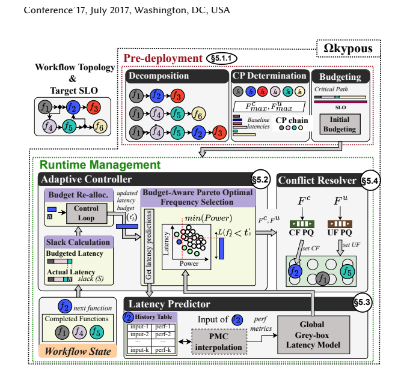
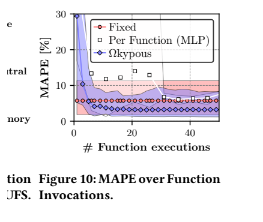
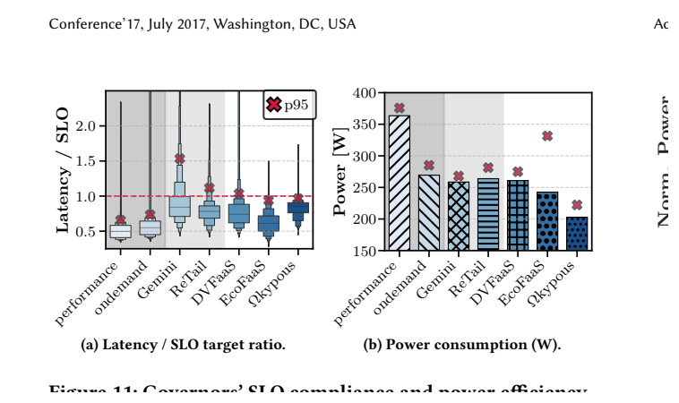

[论文页面](https://doi.org/10.48550/arXiv.2407.18386) · [本笔记所用 PDF](https://arxiv.org/pdf/2407.18386v3) · [标识符](https://doi.org/10.48550/arXiv.2407.18386)

整理日期：2026-11-05。**读者原创中文解读；原图归论文作者／出版方。未运行作者实验，不是独立复现。**

**覆盖范围：** 本版本正文中识别到的18项图、表或算法；保留原编号。关键项已裁图并在技术精读相应段落出现，未内嵌的项可点PDF页链接查看，不上传整篇PDF。

**统计总边界：** Azure trace源、缩放、20分钟窗口聚类和160条工作流是负载设计，不等于160台独立硬件。以p95设SLO与真实hard deadline不同。功率减少与SLO违约要成对给，1.8%并非零违约。论文power-cap图文中40/42.5/45W的loose/strict标签顺序可疑，未核清时不把标签当工程限值复制。

## Fig1：频率对尾延迟和功率

[原文 Fig1，PDF p3](https://arxiv.org/pdf/2407.18386v3#page=3)

1. **本项回答的问题：** 频率对尾延迟和功率，用于支撑这条方法或实验链中的具体环节。
2. **组成、坐标和对照：** 先读图题、图例、坐标/表头与单位，再在同一负载和同一基线内比较。视频/图遍历的计算与访存敏感性不同。 按原图／表标示的单位与归一化基准阅读；不将不同子图或不同分母的柱高直接相除。 颜色按原图图例辨认，不能把同色跨图视为同一组。
3. **阅读顺序与统计单位：** 先看设定、单位和图例，再看趋势与作者正文。重复次数及采样独立性参见本篇技术精读统计节；没有为该图定位到的误差线定义／独立重复数，不另行猜测。
4. **直接观察：** 视频/图遍历的计算与访存敏感性不同。
5. **作者解释的范围：** 原文以该图／表作为上述观察的结构说明或实验支撑，需连同对应页正文读取；本索引不额外替作者推导因果机制。
6. **独立判断（AI分析）：** 本项只支撑原文所列平台和配置；不证明E902可直接复用这些数值。
7. **证据链位置：** 性能验证／定量或示例证据，需结合实验条件。它支持本文具体条件下的实现或结果，不单独完成跨平台验证。
8. **结论与强度：** 可复述“视频/图遍历的计算与访存敏感性不同。”；对图内描述的核查可信度高，对未做独立实验的泛化判断为中或无法判断。不能得出的结论是“本项只支撑原文所列平台和配置；不证明E902可直接复用这些数值。”所排除的外推。

## Fig2：Pareto空间

[原文 Fig2，PDF p3](https://arxiv.org/pdf/2407.18386v3#page=3)

1. **本项回答的问题：** Pareto空间，用于支撑这条方法或实验链中的具体环节。
2. **组成、坐标和对照：** 先读图题、图例、坐标/表头与单位，再在同一负载和同一基线内比较。联合调频扩大可选择的功率—时延点。 按原图／表标示的单位与归一化基准阅读；不将不同子图或不同分母的柱高直接相除。 颜色按原图图例辨认，不能把同色跨图视为同一组。
3. **阅读顺序与统计单位：** 先看设定、单位和图例，再看趋势与作者正文。重复次数及采样独立性参见本篇技术精读统计节；没有为该图定位到的误差线定义／独立重复数，不另行猜测。
4. **直接观察：** 联合调频扩大可选择的功率—时延点。
5. **作者解释的范围：** 原文以该图／表作为上述观察的结构说明或实验支撑，需连同对应页正文读取；本索引不额外替作者推导因果机制。
6. **独立判断（AI分析）：** 本项只支撑原文所列平台和配置；不证明E902可直接复用这些数值。
7. **证据链位置：** 性能验证／定量或示例证据，需结合实验条件。它支持本文具体条件下的实现或结果，不单独完成跨平台验证。
8. **结论与强度：** 可复述“联合调频扩大可选择的功率—时延点。”；对图内描述的核查可信度高，对未做独立实验的泛化判断为中或无法判断。不能得出的结论是“本项只支撑原文所列平台和配置；不证明E902可直接复用这些数值。”所排除的外推。

## Fig3：运行时变异

[原文 Fig3，PDF p4](https://arxiv.org/pdf/2407.18386v3#page=4)

1. **本项回答的问题：** 运行时变异，用于支撑这条方法或实验链中的具体环节。
2. **组成、坐标和对照：** 先读图题、图例、坐标/表头与单位，再在同一负载和同一基线内比较。同函数存在时延变动，模型需反馈。 按原图／表标示的单位与归一化基准阅读；不将不同子图或不同分母的柱高直接相除。 颜色按原图图例辨认，不能把同色跨图视为同一组。
3. **阅读顺序与统计单位：** 先看设定、单位和图例，再看趋势与作者正文。重复次数及采样独立性参见本篇技术精读统计节；没有为该图定位到的误差线定义／独立重复数，不另行猜测。
4. **直接观察：** 同函数存在时延变动，模型需反馈。
5. **作者解释的范围：** 原文以该图／表作为上述观察的结构说明或实验支撑，需连同对应页正文读取；本索引不额外替作者推导因果机制。
6. **独立判断（AI分析）：** 本项只支撑原文所列平台和配置；不证明E902可直接复用这些数值。
7. **证据链位置：** 性能验证／定量或示例证据，需结合实验条件。它支持本文具体条件下的实现或结果，不单独完成跨平台验证。
8. **结论与强度：** 可复述“同函数存在时延变动，模型需反馈。”；对图内描述的核查可信度高，对未做独立实验的泛化判断为中或无法判断。不能得出的结论是“本项只支撑原文所列平台和配置；不证明E902可直接复用这些数值。”所排除的外推。

## Fig4：输入与预测挑战

[原文 Fig4，PDF p4](https://arxiv.org/pdf/2407.18386v3#page=4)

1. **本项回答的问题：** 输入与预测挑战，用于支撑这条方法或实验链中的具体环节。
2. **组成、坐标和对照：** 先读图题、图例、坐标/表头与单位，再在同一负载和同一基线内比较。图规模/视频帧数等输入改变工作量。 按原图／表标示的单位与归一化基准阅读；不将不同子图或不同分母的柱高直接相除。 颜色按原图图例辨认，不能把同色跨图视为同一组。
3. **阅读顺序与统计单位：** 先看设定、单位和图例，再看趋势与作者正文。重复次数及采样独立性参见本篇技术精读统计节；没有为该图定位到的误差线定义／独立重复数，不另行猜测。
4. **直接观察：** 图规模/视频帧数等输入改变工作量。
5. **作者解释的范围：** 原文以该图／表作为上述观察的结构说明或实验支撑，需连同对应页正文读取；本索引不额外替作者推导因果机制。
6. **独立判断（AI分析）：** 本项只支撑原文所列平台和配置；不证明E902可直接复用这些数值。
7. **证据链位置：** 性能验证／定量或示例证据，需结合实验条件。它支持本文具体条件下的实现或结果，不单独完成跨平台验证。
8. **结论与强度：** 可复述“图规模/视频帧数等输入改变工作量。”；对图内描述的核查可信度高，对未做独立实验的泛化判断为中或无法判断。不能得出的结论是“本项只支撑原文所列平台和配置；不证明E902可直接复用这些数值。”所排除的外推。

## Fig5：工作流优化步骤

[原文 Fig5，PDF p5](https://arxiv.org/pdf/2407.18386v3#page=5)

1. **本项回答的问题：** 工作流优化步骤，用于支撑这条方法或实验链中的具体环节。
2. **组成、坐标和对照：** 先读图题、图例、坐标/表头与单位，再在同一负载和同一基线内比较。先预算、再运行时反馈与选档。 按原图／表标示的单位与归一化基准阅读；不将不同子图或不同分母的柱高直接相除。 颜色按原图图例辨认，不能把同色跨图视为同一组。
3. **阅读顺序与统计单位：** 先看设定、单位和图例，再看趋势与作者正文。重复次数及采样独立性参见本篇技术精读统计节；没有为该图定位到的误差线定义／独立重复数，不另行猜测。
4. **直接观察：** 先预算、再运行时反馈与选档。
5. **作者解释的范围：** 原文以该图／表作为上述观察的结构说明或实验支撑，需连同对应页正文读取；本索引不额外替作者推导因果机制。
6. **独立判断（AI分析）：** 本项只支撑原文所列平台和配置；不证明E902可直接复用这些数值。
7. **证据链位置：** 性能验证／定量或示例证据，需结合实验条件。它支持本文具体条件下的实现或结果，不单独完成跨平台验证。
8. **结论与强度：** 可复述“先预算、再运行时反馈与选档。”；对图内描述的核查可信度高，对未做独立实验的泛化判断为中或无法判断。不能得出的结论是“本项只支撑原文所列平台和配置；不证明E902可直接复用这些数值。”所排除的外推。

## Fig6：Ωkypous框图

[原文 Fig6，PDF p6](https://arxiv.org/pdf/2407.18386v3#page=6)

[打开大图](images/original-fig6.png)

1. **本项回答的问题：** Ωkypous框图，用于支撑这条方法或实验链中的具体环节。
2. **组成、坐标和对照：** 先读图题、图例、坐标/表头与单位，再在同一负载和同一基线内比较。预测器、控制器、冲突协调器职责不同。 结构／流程类没有统一数值坐标；箭头表示数据或控制关系，不表示统计因果。 颜色按原图图例辨认，不能把同色跨图视为同一组。
3. **阅读顺序与统计单位：** 先看设定、单位和图例，再看趋势与作者正文。重复次数及采样独立性参见本篇技术精读统计节；没有为该图定位到的误差线定义／独立重复数，不另行猜测。
4. **直接观察：** 预测器、控制器、冲突协调器职责不同。
5. **作者解释的范围：** 原文以该图／表作为上述观察的结构说明或实验支撑，需连同对应页正文读取；本索引不额外替作者推导因果机制。
6. **独立判断（AI分析）：** 本项只支撑原文所列平台和配置；不证明E902可直接复用这些数值。
7. **证据链位置：** 方法／系统实现说明。它支持本文具体条件下的实现或结果，不单独完成跨平台验证。
8. **结论与强度：** 可复述“预测器、控制器、冲突协调器职责不同。”；对图内描述的核查可信度高，对未做独立实验的泛化判断为中或无法判断。不能得出的结论是“本项只支撑原文所列平台和配置；不证明E902可直接复用这些数值。”所排除的外推。

## Fig7：PMC相关性

[原文 Fig7，PDF p7](https://arxiv.org/pdf/2407.18386v3#page=7)

1. **本项回答的问题：** PMC相关性，用于支撑这条方法或实验链中的具体环节。
2. **组成、坐标和对照：** 先读图题、图例、坐标/表头与单位，再在同一负载和同一基线内比较。相关性用于选特征，非直接因果证明。 按原图／表标示的单位与归一化基准阅读；不将不同子图或不同分母的柱高直接相除。 颜色按原图图例辨认，不能把同色跨图视为同一组。
3. **阅读顺序与统计单位：** 先看设定、单位和图例，再看趋势与作者正文。重复次数及采样独立性参见本篇技术精读统计节；没有为该图定位到的误差线定义／独立重复数，不另行猜测。
4. **直接观察：** 相关性用于选特征，非直接因果证明。
5. **作者解释的范围：** 原文以该图／表作为上述观察的结构说明或实验支撑，需连同对应页正文读取；本索引不额外替作者推导因果机制。
6. **独立判断（AI分析）：** 本项只支撑原文所列平台和配置；不证明E902可直接复用这些数值。
7. **证据链位置：** 性能验证／定量或示例证据，需结合实验条件。它支持本文具体条件下的实现或结果，不单独完成跨平台验证。
8. **结论与强度：** 可复述“相关性用于选特征，非直接因果证明。”；对图内描述的核查可信度高，对未做独立实验的泛化判断为中或无法判断。不能得出的结论是“本项只支撑原文所列平台和配置；不证明E902可直接复用这些数值。”所排除的外推。

## Fig8：PMC贡献

[原文 Fig8，PDF p8](https://arxiv.org/pdf/2407.18386v3#page=8)

1. **本项回答的问题：** PMC贡献，用于支撑这条方法或实验链中的具体环节。
2. **组成、坐标和对照：** 先读图题、图例、坐标/表头与单位，再在同一负载和同一基线内比较。Core与Memory分项来自拟合，不能当独立电测比例。 按原图／表标示的单位与归一化基准阅读；不将不同子图或不同分母的柱高直接相除。 颜色按原图图例辨认，不能把同色跨图视为同一组。
3. **阅读顺序与统计单位：** 先看设定、单位和图例，再看趋势与作者正文。重复次数及采样独立性参见本篇技术精读统计节；没有为该图定位到的误差线定义／独立重复数，不另行猜测。
4. **直接观察：** Core与Memory分项来自拟合，不能当独立电测比例。
5. **作者解释的范围：** 原文以该图／表作为上述观察的结构说明或实验支撑，需连同对应页正文读取；本索引不额外替作者推导因果机制。
6. **独立判断（AI分析）：** 本项只支撑原文所列平台和配置；不证明E902可直接复用这些数值。
7. **证据链位置：** 性能验证／定量或示例证据，需结合实验条件。它支持本文具体条件下的实现或结果，不单独完成跨平台验证。
8. **结论与强度：** 可复述“Core与Memory分项来自拟合，不能当独立电测比例。”；对图内描述的核查可信度高，对未做独立实验的泛化判断为中或无法判断。不能得出的结论是“本项只支撑原文所列平台和配置；不证明E902可直接复用这些数值。”所排除的外推。

## Fig9：各域时延贡献

[原文 Fig9，PDF p8](https://arxiv.org/pdf/2407.18386v3#page=8)

1. **本项回答的问题：** 各域时延贡献，用于支撑这条方法或实验链中的具体环节。
2. **组成、坐标和对照：** 先读图题、图例、坐标/表头与单位，再在同一负载和同一基线内比较。选频会改变瓶颈，模型必须反映。 按原图／表标示的单位与归一化基准阅读；不将不同子图或不同分母的柱高直接相除。 颜色按原图图例辨认，不能把同色跨图视为同一组。
3. **阅读顺序与统计单位：** 先看设定、单位和图例，再看趋势与作者正文。重复次数及采样独立性参见本篇技术精读统计节；没有为该图定位到的误差线定义／独立重复数，不另行猜测。
4. **直接观察：** 选频会改变瓶颈，模型必须反映。
5. **作者解释的范围：** 原文以该图／表作为上述观察的结构说明或实验支撑，需连同对应页正文读取；本索引不额外替作者推导因果机制。
6. **独立判断（AI分析）：** 本项只支撑原文所列平台和配置；不证明E902可直接复用这些数值。
7. **证据链位置：** 性能验证／定量或示例证据，需结合实验条件。它支持本文具体条件下的实现或结果，不单独完成跨平台验证。
8. **结论与强度：** 可复述“选频会改变瓶颈，模型必须反映。”；对图内描述的核查可信度高，对未做独立实验的泛化判断为中或无法判断。不能得出的结论是“本项只支撑原文所列平台和配置；不证明E902可直接复用这些数值。”所排除的外推。

## Fig10：少样本MAPE

[原文 Fig10，PDF p8](https://arxiv.org/pdf/2407.18386v3#page=8)

[打开大图](images/original-fig10.png)

1. **本项回答的问题：** 少样本MAPE，用于支撑这条方法或实验链中的具体环节。
2. **组成、坐标和对照：** 先读图题、图例、坐标/表头与单位，再在同一负载和同一基线内比较。看随调用数收敛，不取末值冒充首调用效果。 按原图／表标示的单位与归一化基准阅读；不将不同子图或不同分母的柱高直接相除。 颜色按原图图例辨认，不能把同色跨图视为同一组。
3. **阅读顺序与统计单位：** 先看设定、单位和图例，再看趋势与作者正文。重复次数及采样独立性参见本篇技术精读统计节；没有为该图定位到的误差线定义／独立重复数，不另行猜测。
4. **直接观察：** 看随调用数收敛，不取末值冒充首调用效果。
5. **作者解释的范围：** 原文以该图／表作为上述观察的结构说明或实验支撑，需连同对应页正文读取；本索引不额外替作者推导因果机制。
6. **独立判断（AI分析）：** 本项只支撑原文所列平台和配置；不证明E902可直接复用这些数值。
7. **证据链位置：** 性能验证／定量或示例证据，需结合实验条件。它支持本文具体条件下的实现或结果，不单独完成跨平台验证。
8. **结论与强度：** 可复述“看随调用数收敛，不取末值冒充首调用效果。”；对图内描述的核查可信度高，对未做独立实验的泛化判断为中或无法判断。不能得出的结论是“本项只支撑原文所列平台和配置；不证明E902可直接复用这些数值。”所排除的外推。

## Fig11：160工作流服务质量/功率

[原文 Fig11，PDF p10](https://arxiv.org/pdf/2407.18386v3#page=10)

[打开大图](images/original-fig11.png)

1. **本项回答的问题：** 160工作流服务质量/功率，用于支撑这条方法或实验链中的具体环节。
2. **组成、坐标和对照：** 先读图题、图例、坐标/表头与单位，再在同一负载和同一基线内比较。功率和SLO违约成对比较。 按原图／表标示的单位与归一化基准阅读；不将不同子图或不同分母的柱高直接相除。 颜色按原图图例辨认，不能把同色跨图视为同一组。
3. **阅读顺序与统计单位：** 先看设定、单位和图例，再看趋势与作者正文。重复次数及采样独立性参见本篇技术精读统计节；没有为该图定位到的误差线定义／独立重复数，不另行猜测。
4. **直接观察：** 功率和SLO违约成对比较。
5. **作者解释的范围：** 原文以该图／表作为上述观察的结构说明或实验支撑，需连同对应页正文读取；本索引不额外替作者推导因果机制。
6. **独立判断（AI分析）：** 本项只支撑原文所列平台和配置；不证明E902可直接复用这些数值。
7. **证据链位置：** 性能验证／定量或示例证据，需结合实验条件。它支持本文具体条件下的实现或结果，不单独完成跨平台验证。
8. **结论与强度：** 可复述“功率和SLO违约成对比较。”；对图内描述的核查可信度高，对未做独立实验的泛化判断为中或无法判断。不能得出的结论是“本项只支撑原文所列平台和配置；不证明E902可直接复用这些数值。”所排除的外推。

## Fig12：违约率

[原文 Fig12，PDF p10](https://arxiv.org/pdf/2407.18386v3#page=10)

1. **本项回答的问题：** 违约率，用于支撑这条方法或实验链中的具体环节。
2. **组成、坐标和对照：** 先读图题、图例、坐标/表头与单位，再在同一负载和同一基线内比较。1.8%不是零，低功率基线服务质量不同。 按原图／表标示的单位与归一化基准阅读；不将不同子图或不同分母的柱高直接相除。 颜色按原图图例辨认，不能把同色跨图视为同一组。
3. **阅读顺序与统计单位：** 先看设定、单位和图例，再看趋势与作者正文。重复次数及采样独立性参见本篇技术精读统计节；没有为该图定位到的误差线定义／独立重复数，不另行猜测。
4. **直接观察：** 1.8%不是零，低功率基线服务质量不同。
5. **作者解释的范围：** 原文以该图／表作为上述观察的结构说明或实验支撑，需连同对应页正文读取；本索引不额外替作者推导因果机制。
6. **独立判断（AI分析）：** 本项只支撑原文所列平台和配置；不证明E902可直接复用这些数值。
7. **证据链位置：** 性能验证／定量或示例证据，需结合实验条件。它支持本文具体条件下的实现或结果，不单独完成跨平台验证。
8. **结论与强度：** 可复述“1.8%不是零，低功率基线服务质量不同。”；对图内描述的核查可信度高，对未做独立实验的泛化判断为中或无法判断。不能得出的结论是“本项只支撑原文所列平台和配置；不证明E902可直接复用这些数值。”所排除的外推。

## Fig13：等延迟/功率分布

[原文 Fig13，PDF p10](https://arxiv.org/pdf/2407.18386v3#page=10)

1. **本项回答的问题：** 等延迟/功率分布，用于支撑这条方法或实验链中的具体环节。
2. **组成、坐标和对照：** 先读图题、图例、坐标/表头与单位，再在同一负载和同一基线内比较。明确归一化和SLO设定后看CDF。 按原图／表标示的单位与归一化基准阅读；不将不同子图或不同分母的柱高直接相除。 颜色按原图图例辨认，不能把同色跨图视为同一组。
3. **阅读顺序与统计单位：** 先看设定、单位和图例，再看趋势与作者正文。重复次数及采样独立性参见本篇技术精读统计节；没有为该图定位到的误差线定义／独立重复数，不另行猜测。
4. **直接观察：** 明确归一化和SLO设定后看CDF。
5. **作者解释的范围：** 原文以该图／表作为上述观察的结构说明或实验支撑，需连同对应页正文读取；本索引不额外替作者推导因果机制。
6. **独立判断（AI分析）：** 本项只支撑原文所列平台和配置；不证明E902可直接复用这些数值。
7. **证据链位置：** 性能验证／定量或示例证据，需结合实验条件。它支持本文具体条件下的实现或结果，不单独完成跨平台验证。
8. **结论与强度：** 可复述“明确归一化和SLO设定后看CDF。”；对图内描述的核查可信度高，对未做独立实验的泛化判断为中或无法判断。不能得出的结论是“本项只支撑原文所列平台和配置；不证明E902可直接复用这些数值。”所排除的外推。

## Fig14：功率帽场景

[原文 Fig14，PDF p10](https://arxiv.org/pdf/2407.18386v3#page=10)

1. **本项回答的问题：** 功率帽场景，用于支撑这条方法或实验链中的具体环节。
2. **组成、坐标和对照：** 先读图题、图例、坐标/表头与单位，再在同一负载和同一基线内比较。40/42.5/45W标签先核对，不移植。 按原图／表标示的单位与归一化基准阅读；不将不同子图或不同分母的柱高直接相除。 颜色按原图图例辨认，不能把同色跨图视为同一组。
3. **阅读顺序与统计单位：** 先看设定、单位和图例，再看趋势与作者正文。重复次数及采样独立性参见本篇技术精读统计节；没有为该图定位到的误差线定义／独立重复数，不另行猜测。
4. **直接观察：** 40/42.5/45W标签先核对，不移植。
5. **作者解释的范围：** 原文以该图／表作为上述观察的结构说明或实验支撑，需连同对应页正文读取；本索引不额外替作者推导因果机制。
6. **独立判断（AI分析）：** 本项只支撑原文所列平台和配置；不证明E902可直接复用这些数值。
7. **证据链位置：** 性能验证／定量或示例证据，需结合实验条件。它支持本文具体条件下的实现或结果，不单独完成跨平台验证。
8. **结论与强度：** 可复述“40/42.5/45W标签先核对，不移植。”；对图内描述的核查可信度高，对未做独立实验的泛化判断为中或无法判断。不能得出的结论是“本项只支撑原文所列平台和配置；不证明E902可直接复用这些数值。”所排除的外推。

## Fig15：请求率与频率/尾延迟

[原文 Fig15，PDF p11](https://arxiv.org/pdf/2407.18386v3#page=11)

1. **本项回答的问题：** 请求率与频率/尾延迟，用于支撑这条方法或实验链中的具体环节。
2. **组成、坐标和对照：** 先读图题、图例、坐标/表头与单位，再在同一负载和同一基线内比较。更高请求率通常需更高频率。 按原图／表标示的单位与归一化基准阅读；不将不同子图或不同分母的柱高直接相除。 颜色按原图图例辨认，不能把同色跨图视为同一组。
3. **阅读顺序与统计单位：** 先看设定、单位和图例，再看趋势与作者正文。重复次数及采样独立性参见本篇技术精读统计节；没有为该图定位到的误差线定义／独立重复数，不另行猜测。
4. **直接观察：** 更高请求率通常需更高频率。
5. **作者解释的范围：** 原文以该图／表作为上述观察的结构说明或实验支撑，需连同对应页正文读取；本索引不额外替作者推导因果机制。
6. **独立判断（AI分析）：** 本项只支撑原文所列平台和配置；不证明E902可直接复用这些数值。
7. **证据链位置：** 性能验证／定量或示例证据，需结合实验条件。它支持本文具体条件下的实现或结果，不单独完成跨平台验证。
8. **结论与强度：** 可复述“更高请求率通常需更高频率。”；对图内描述的核查可信度高，对未做独立实验的泛化判断为中或无法判断。不能得出的结论是“本项只支撑原文所列平台和配置；不证明E902可直接复用这些数值。”所排除的外推。

## Fig16：共享频域冲突

[原文 Fig16，PDF p11](https://arxiv.org/pdf/2407.18386v3#page=11)

1. **本项回答的问题：** 共享频域冲突，用于支撑这条方法或实验链中的具体环节。
2. **组成、坐标和对照：** 先读图题、图例、坐标/表头与单位，再在同一负载和同一基线内比较。每线程请求不等于可独立物理执行。 按原图／表标示的单位与归一化基准阅读；不将不同子图或不同分母的柱高直接相除。 颜色按原图图例辨认，不能把同色跨图视为同一组。
3. **阅读顺序与统计单位：** 先看设定、单位和图例，再看趋势与作者正文。重复次数及采样独立性参见本篇技术精读统计节；没有为该图定位到的误差线定义／独立重复数，不另行猜测。
4. **直接观察：** 每线程请求不等于可独立物理执行。
5. **作者解释的范围：** 原文以该图／表作为上述观察的结构说明或实验支撑，需连同对应页正文读取；本索引不额外替作者推导因果机制。
6. **独立判断（AI分析）：** 本项只支撑原文所列平台和配置；不证明E902可直接复用这些数值。
7. **证据链位置：** 性能验证／定量或示例证据，需结合实验条件。它支持本文具体条件下的实现或结果，不单独完成跨平台验证。
8. **结论与强度：** 可复述“每线程请求不等于可独立物理执行。”；对图内描述的核查可信度高，对未做独立实验的泛化判断为中或无法判断。不能得出的结论是“本项只支撑原文所列平台和配置；不证明E902可直接复用这些数值。”所排除的外推。

## Fig17：共存干扰功率

[原文 Fig17，PDF p11](https://arxiv.org/pdf/2407.18386v3#page=11)

1. **本项回答的问题：** 共存干扰功率，用于支撑这条方法或实验链中的具体环节。
2. **组成、坐标和对照：** 先读图题、图例、坐标/表头与单位，再在同一负载和同一基线内比较。管理开销和干扰已纳入此案例。 按原图／表标示的单位与归一化基准阅读；不将不同子图或不同分母的柱高直接相除。 颜色按原图图例辨认，不能把同色跨图视为同一组。
3. **阅读顺序与统计单位：** 先看设定、单位和图例，再看趋势与作者正文。重复次数及采样独立性参见本篇技术精读统计节；没有为该图定位到的误差线定义／独立重复数，不另行猜测。
4. **直接观察：** 管理开销和干扰已纳入此案例。
5. **作者解释的范围：** 原文以该图／表作为上述观察的结构说明或实验支撑，需连同对应页正文读取；本索引不额外替作者推导因果机制。
6. **独立判断（AI分析）：** 本项只支撑原文所列平台和配置；不证明E902可直接复用这些数值。
7. **证据链位置：** 性能验证／定量或示例证据，需结合实验条件。它支持本文具体条件下的实现或结果，不单独完成跨平台验证。
8. **结论与强度：** 可复述“管理开销和干扰已纳入此案例。”；对图内描述的核查可信度高，对未做独立实验的泛化判断为中或无法判断。不能得出的结论是“本项只支撑原文所列平台和配置；不证明E902可直接复用这些数值。”所排除的外推。

## Table1：相关框架对比

[原文 Table1，PDF p2](https://arxiv.org/pdf/2407.18386v3#page=2)

1. **本项回答的问题：** 相关框架对比，用于支撑这条方法或实验链中的具体环节。
2. **组成、坐标和对照：** 先读图题、图例、坐标/表头与单位，再在同一负载和同一基线内比较。区分控制Core、Uncore与工作流余量。 按原图／表标示的单位与归一化基准阅读；不将不同子图或不同分母的柱高直接相除。 颜色按原图图例辨认，不能把同色跨图视为同一组。
3. **阅读顺序与统计单位：** 先看设定、单位和图例，再看趋势与作者正文。重复次数及采样独立性参见本篇技术精读统计节；没有为该图定位到的误差线定义／独立重复数，不另行猜测。
4. **直接观察：** 区分控制Core、Uncore与工作流余量。
5. **作者解释的范围：** 原文以该图／表作为上述观察的结构说明或实验支撑，需连同对应页正文读取；本索引不额外替作者推导因果机制。
6. **独立判断（AI分析）：** 本项只支撑原文所列平台和配置；不证明E902可直接复用这些数值。
7. **证据链位置：** 性能验证／定量或示例证据，需结合实验条件。它支持本文具体条件下的实现或结果，不单独完成跨平台验证。
8. **结论与强度：** 可复述“区分控制Core、Uncore与工作流余量。”；对图内描述的核查可信度高，对未做独立实验的泛化判断为中或无法判断。不能得出的结论是“本项只支撑原文所列平台和配置；不证明E902可直接复用这些数值。”所排除的外推。
