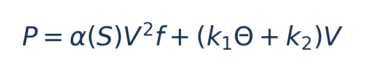
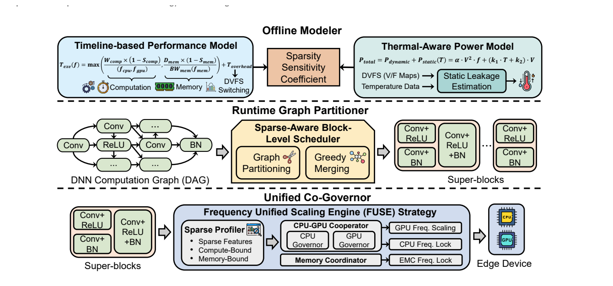
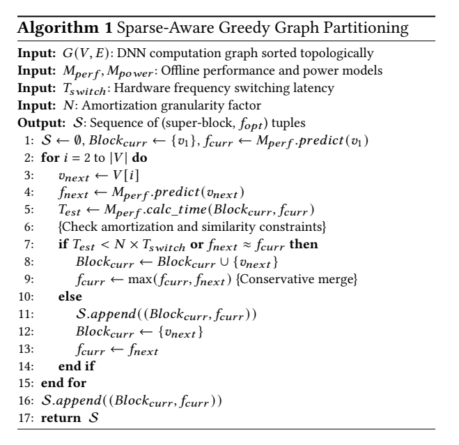
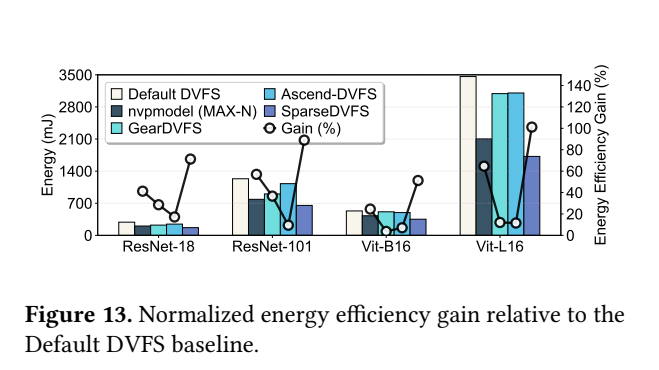
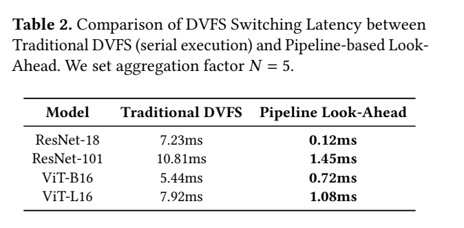

[论文页面](https://arxiv.org/abs/2603.21908v1) · [本笔记所用 PDF](https://arxiv.org/pdf/2603.21908v1) · [标识符](https://doi.org/10.48550/arXiv.2603.21908)

整理日期：2026-11-06。**读者原创中文解读；原图归论文作者／出版方。未运行作者实验，不是独立复现。**

**一句话：** 用稀疏特征和白盒模型估算算子需求，把过短算子合并为super-block，并协同CPU/GPU/EMC提前调频摊销切换成本

阅读地图：先看问题与输入输出，再顺着架构图、公式和结果图阅读；最后检查统计边界与E902迁移。完整编号索引另见“图表索引”。下文“读者分析”是推断或建议，不是原文结果。

## 阶段0：材料与版本审计

| 材料 | 当前可用程度 | 影响 |
| --- | --- | --- |
| 摘要、正文、方法、原图注 | 已获取本地完整PDF、文本与逐页渲染 | 可核查结构、实验及关键数字；可见页面优先于异常文本层 |
| 分析版本 | arXiv2603.21908v1，2026-03-23，14页；页眉仍有xxx et al.占位，按预印本评估。 | 引用页码以“PDF第几页”标识 |
| 代码／原始数据 | 当前材料中尚未定位齐完整控制器源码、实验脚本和原始重复数据；这不表示这些材料不存在。 | 公开链接不等于已构建或已拿到原始轨迹 |
| 附件、独立原始重复与勘误 | 当前未完成全渠道附件／勘误穷尽检索 | 不能断言没有附件、没有勘误或没有其他版本 |
| 本次工作范围 | 材料阅读、图表裁取、证据整理、教学公式 | 所有新实验均是建议，尚未执行 |

## 阶段1：身份卡与整体概述

| 项目 | 内容 |
| --- | --- |
| 英文题名 | SparseDVFS: Sparse-Aware DVFS for Energy-Efficient Edge Inference |
| 中文导读题名 | 用稀疏特征和白盒模型估算算子需求，把过短算子合并为super-block，并协同CPU/GPU/EMC提前调频摊销切换成本 |
| 作者 | Ziyang Zhang, Zheshun Wu, Jie Liu, Luca Mottola |
| 发表／版本 | arXiv预印本2026；arXiv2603.21908v1，2026-03-23，14页；页眉仍有xxx et al.占位，按预印本评估。 |
| 类型与领域 | 原始方法／工程系统研究；DVFS、GPU/CPU能效、CV/LLM应用运行时控制 |
| 单位、通讯、资助与利益关系 | 作者姓名以本版本首页为准；通讯方式、单位及资助可回查首页与末页声明。当前尚未完成资助/利益关系/勘误的跨版本穷尽审计。 |
| 核心对象与接口 | 块执行时间须超过N×Tswitch（默认N=5）；不是越细越好；异步命令需不干扰当前块 |
| 代码与数据 | 当前材料中尚未定位齐完整控制器源码、实验脚本和原始重复数据；这不表示这些材料不存在。 |
| 与本课题关系 | 最适合借鉴的不是78.17%，而是“控制粒度必须大于切换成本”。CPU/E902可将压缩/图像前处理分阶段，合并短阶段，实测请求到生效并加最短驻留；GPU场景再增加CPU提交和EMC协调。 |

**约200字中文概述（改写）：** 本文研究稀疏程度变化的边缘CNN/ViT推理的运行时能效。具体程序包括ResNet18/ResNet101、ViT-B16/ViT-L16，ImageNet2012预训练→ONNX；算子/超级块级执行。作者在Jetson Orin Nano8GB、JetPack6/Linux5.15；PyTorch2.1离线、C++在线、CUDA/TensorRT拦截、sysfs/jetson_clocks；jetson-stats电源轨遥测上采用稀疏感知timeline/roofline延时模型＋温度功耗回归；贪心同频/短算子合并；FUSE统一CPU/GPU/EMC规则＋look-ahead异步命令队列。输入为算子DAG、稀疏度、算量/访存量、温度、离线E/T模型、测得切频延迟Tswitch与聚合因子N，输出为super-block划分＋CPU/GPU/EMC联合频率；提前发下一块动作，CPU race-to-submit避免GPU饥饿。主要结果应与下方基线、性能约束和测量范围一起阅读，不能只摘最高百分比。把能否摊销切换成本显式放入图划分，再联合多个频域执行；这里的智能主要是白盒模型与结构规则，并非深度RL。

**三句话定位：** 问题是为什么局部利用率不能完整反映整个应用的性能与能耗？本篇的研究问题或可检验主张是：用稀疏特征和白盒模型估算算子需求，把过短算子合并为super-block，并协同CPU/GPU/EMC提前调频摊销切换成本。验证链是可观测状态→控制规则或学习模型→执行器→任务正确性/服务质量与能耗对照。 方法主线为算子DAG、稀疏度、算量/访存量、温度、离线E/T模型、测得切频延迟Tswitch与聚合因子N → 稀疏感知timeline/roofline延时模型＋温度功耗回归；贪心同频/短算子合并；FUSE统一CPU/GPU/EMC规则＋look-ahead异步命令队列 → super-block划分＋CPU/GPU/EMC联合频率；提前发下一块动作，CPU race-to-submit避免GPU饥饿 → 执行与反馈。 主要证据见下方结果表，结论须与测量和版本范围一起使用。

## 阶段2：问题、假设与创新位置

为什么局部利用率不能完整反映整个应用的性能与能耗？本篇的研究问题或可检验主张是：用稀疏特征和白盒模型估算算子需求，把过短算子合并为super-block，并协同CPU/GPU/EMC提前调频摊销切换成本。验证链是可观测状态→控制规则或学习模型→执行器→任务正确性/服务质量与能耗对照。

**创新判断（读者分析）：** 把能否摊销切换成本显式放入图划分，再联合多个频域执行；这里的智能主要是白盒模型与结构规则，并非深度RL。 不依据作者自称“首次”断定整个领域绝无前例。

## 阶段3：必要术语与数学

| 级别 | 术语／关键词 | 直觉、严格含义与易混点 |
| --- | --- | --- |
| A | DVFS / DFS | DVFS同时涉及动态电压与频率；只有时钟变化称DFS。电压能否改变取决于实际供电域。 |
| A | Workload | 真正执行应用计算的程序与输入；本文里的控制器是另一个角色。 |
| A | Controller | 根据观测选择动作的软件／硬件，可运行在同一CPU或独立控制核。 |
| A | OPP | Operating Performance Point，经过允许范围验证的电压—频率组合。 |
| A | Power / Energy | 功率W表示此刻消耗快慢；能量J是对时间积分。低功率不必然低能量。 |
| B | Deadline | 作业必须完成的时刻；平均时延、P95与最大时延各有不同用途。 |
| A | 被控程序 | ResNet18/ResNet101、ViT-B16/ViT-L16，ImageNet2012预训练→ONNX；算子/超级块级执行 |
| A | 控制策略 | 稀疏感知timeline/roofline延时模型＋温度功耗回归；贪心同频/短算子合并；FUSE统一CPU/GPU/EMC规则＋look-ahead异步命令队列 |
| B | 控制周期 | 块执行时间须超过N×Tswitch（默认N=5）；不是越细越好；异步命令需不干扰当前块 |
| B | 证据边界 | 实测、硬件仿真、功耗模型是不同证据，见平台与结果表。 |

### 公式1：摊销约束

**符号与前提：** 时间都用s，N无量纲；这是启发式驻留条件，不是节能充分条件。

**代入与检查：** 教学例切换0.2ms、N=5，块应超过1ms；0.1ms算子不宜每个都切。

**来源：** Eq3/Algorithm1，p7
### 公式2：温度功率模型

**符号与前提：** P W，V V，f Hz，Θ温度，系数需对应单位；固定V时静态项随Θ线性。

**代入与检查：** 温度改变后应重新验证误差；不能从此式直接断言超线性温升。

**来源：** Eq2，p6

## 阶段4–6：架构、关键图与方法拆解

**输入—处理—输出：** 算子DAG、稀疏度、算量/访存量、温度、离线E/T模型、测得切频延迟Tswitch与聚合因子N → 稀疏感知timeline/roofline延时模型＋温度功耗回归；贪心同频/短算子合并；FUSE统一CPU/GPU/EMC规则＋look-ahead异步命令队列 → super-block划分＋CPU/GPU/EMC联合频率；提前发下一块动作，CPU race-to-submit避免GPU饥饿 → 执行与反馈。

| 系统角色 | 具体设置 |
| --- | --- |
| 具体控制算法 | 稀疏感知timeline/roofline延时模型＋温度功耗回归；贪心同频/短算子合并；FUSE统一CPU/GPU/EMC规则＋look-ahead异步命令队列 |
| 被控负载类型 | 稀疏程度变化的边缘CNN/ViT推理 |
| 具体被控程序 | ResNet18/ResNet101、ViT-B16/ViT-L16，ImageNet2012预训练→ONNX；算子/超级块级执行 |
| 使用平台与测量 | Jetson Orin Nano8GB、JetPack6/Linux5.15；PyTorch2.1离线、C++在线、CUDA/TensorRT拦截、sysfs/jetson_clocks；jetson-stats电源轨遥测 |
| 输入/状态 | 算子DAG、稀疏度、算量/访存量、温度、离线E/T模型、测得切频延迟Tswitch与聚合因子N |
| 输出/动作 | super-block划分＋CPU/GPU/EMC联合频率；提前发下一块动作，CPU race-to-submit避免GPU饥饿 |
| 周期与运行位置 | 块执行时间须超过N×Tswitch（默认N=5）；不是越细越好；异步命令需不干扰当前块 |

§4–5，PDF p5–8：稀疏使计算量与访存量变化不同，FLOPs线性预测失效；timeline模型取计算与访存瓶颈、加固定开销。功率模型分动态α(S)·V²f与静态(k1T+k2)V。Algorithm1拓扑遍历，若块还太短或下个算子最佳档接近则合并，保守取较高频；满足驻留摊销后才能分界。FUSE在此指frequency unified scaling engine，与另一篇手机LLM的FUSE不是同一系统。CPU先高频提交kernel再下降，稀疏块保高EMC并降GPU，dense块按带宽需求配EMC。look-ahead将下一块切频命令与当前执行重叠。

审查：文中温度式在固定V下对T是线性，却多处称super-linear，应要求额外温度/电压联动解释。所谓32B模型与nn-Meter856MB是作者选择的存储口径，不能当通用推理开销证明。§6.4确实把78.17%定义为相对Default的总能量降低，不应擅自改成另一种效率定义；但此大幅数字与Fig11–13、测量窗口、基线行为需原始轨迹重算，当前只报告作者声称，迁移可信度低。

视觉核查Fig13还有口径冲突：正文定义gain为能量降低比例，但右轴Gain点与左轴能量柱对应的(1−E/Edefault)不一致，部分点约100%，而相应能量柱显然非零。不能仅按正文定义把78.17%当作已自洽验证的节能率；须获取原始J与gain计算代码。这里保留作者数值并明确其内部一致性未通过读者审查。

### Fig7：三阶段架构

[打开大图](images/original-fig7.png) · [原文 Fig7，PDF p5](https://arxiv.org/pdf/2603.21908v1#page=5)

**怎样看：** 先读图题、图例、坐标/表头与单位，再在同一负载和同一基线内比较。离线模型、块划分和执行器分开。

**直接观察／原文报告：** 离线模型、块划分和执行器分开。

**读者判断：** 只支持此图所列的模型、设备、输入与测量口径；离线模型、块划分和执行器分开。 不能由单图推出E902或其他GPU的同幅收益。

### Algorithm1：贪心合并

[打开大图](images/original-algorithm1.png) · [原文 Algorithm1，PDF p7](https://arxiv.org/pdf/2603.21908v1#page=7)

**怎样看：** 先读图题、图例、坐标/表头与单位，再在同一负载和同一基线内比较。保守max频率可牺牲部分能量。

**直接观察／原文报告：** 保守max频率可牺牲部分能量。

**读者判断：** 只支持此图所列的模型、设备、输入与测量口径；保守max频率可牺牲部分能量。 不能由单图推出E902或其他GPU的同幅收益。

| 阅读问题 | 先看材料 | 如何接到下一步 |
| --- | --- | --- |
| 为什么要改现有方案 | 问题背景与动机图 | 确定目标、约束和原有不足 |
| 系统观察什么、控制什么 | 输入输出表＋关键架构图 | 确认数据、模型和执行器真实角色 |
| 方法如何得到动作或估计 | 方法段、公式、算法／模型表 | 明确离线训练与在线流程 |
| 收益是否真实且公平 | 结果图表、统计与测量边界 | 核查基线／目标／分母／开销 |
| 能否用于自己的CPU | 局限、复现计划、三项实验 | 把论文假设变成待验证的工程条件 |

## 阶段7–8：实验、统计及证据链

本节数字均是**原文明确报告或原文数值的标注算例**；没有按图柱高度臆造额外精确值。

| 指标 | 原文报告 | 条件／分母／边界 | 证据位置 |
| --- | --- | --- | --- |
| 作者报告平均总能量降低 | 78.17% | §6.4定义相对Default DVFS；预印本，仅Orin Nano，不是独立复现 | Fig13/§6.4，p9–10 |
| 相对MAX-N时延代价 | 约＋12.8% | MAX-N最低时延；不能把不同基线节能和时延拼成一组 | §6.2/Fig11，p9 |
| 切换摊销例 | ResNet101 10.81→1.45ms | Table2为累计开销；不代表PLL本体锁定时间变快7.5倍 | Table2，p8 |
| 成本收益比 | 14% | cost-gain ratio，低较好；不是节能14% | Fig14，p10 |
| 结果内部一致性 | 未通过读者审查 | Fig13能量柱与右轴gain不能按正文降低率定义对应；须作者原始J与计算脚本 | Fig13与§6.4，p9–10 |

### Fig13：归一化收益

[打开大图](images/original-fig13.png) · [原文 Fig13，PDF p10](https://arxiv.org/pdf/2603.21908v1#page=10)

**怎样看：** 先看左轴mJ能量柱，再在同模型内计算1−新能量/Default能量，并与右轴Gain比较。无需猜柱高精确数值也能看到二者不一致。

**直接观察／原文报告：** 正文78.17%定义为能量降低，但右轴Gain与能量柱的比例并不一致；存在指标口径冲突。

**读者判断：** 不能把内部口径未澄清的78.17%当作可靠性能基准；需原始能量和计算脚本。

### Table2：累计切换开销

[打开大图](images/original-table2.png) · [原文 Table2，PDF p8](https://arxiv.org/pdf/2603.21908v1#page=8)

**怎样看：** 先读图题、图例、坐标/表头与单位，再在同一负载和同一基线内比较。隐藏开销不等于物理切换加速。

**直接观察／原文报告：** 隐藏开销不等于物理切换加速。

**读者判断：** 只支持此图所列的模型、设备、输入与测量口径；隐藏开销不等于物理切换加速。 不能由单图推出E902或其他GPU的同幅收益。

**统计与公平性审查（读者分析）：** 只核查到单Orin Nano平台和作者的功耗轨/时延图；当前正文未定位齐重复次数/误差线与对Default的完整原始能量积分。大能量差尤其要检查idle、预热、thermal throttling、切换与计算窗口是否相同。看起来更低的功率不够证明78.17%的总能量下降。

工程实验中，设备、程序、输入文件、重复运行、时间窗口是不同统计层级，不能互相替代。本任务不涉及生物样本，细胞／动物／试剂等检查不适用。未注明的P值或置信区间不补造；“差了几个百分点”不自动等于统计显著。

| 主张层级 | 直接证据 | 对照与统计 | 可得结论／替代解释 | 可信度 |
| --- | --- | --- | --- | --- |
| 原文明确报告 | 作者报告平均总能量降低：78.17% | Fig13/§6.4，p9–10 | §6.4定义相对Default DVFS；预印本，仅Orin Nano，不是独立复现；仅在该实验范围内成立 | 图表／文本可核对：高；独立复现：尚无 |
| 作者解释 | 所提架构／模型解释了性能或估计改善 | 关键原图与方法见上文；统计边界见下节 | 效果可能同时来自动作空间、平台特性与采样设置，因果归因需消融 | 中 |
| AI分析／迁移假设 | 用于允许的GPU/CV/LLM候选场景及CPU/E902迁移 | 本篇未直接验证该芯片与任务组合 | 需三项后续实验；不能复制论文收益数字 | 待验证，当前无法判断 |

## 阶段9–10：贡献与局限分开判断

把能否摊销切换成本显式放入图划分，再联合多个频域执行；这里的智能主要是白盒模型与结构规则，并非深度RL。

| 来源 | 严重程度 | 局限及其影响 |
| --- | --- | --- |
| 读者分析 | 关键 | 缺原始轨迹与完整重复配置，大幅节能主张外推可信度低，应先独立复核。 |
| 读者分析 | 关键 | 异步提前改频可能影响当前块，必须测实际生效而非只测命令入队。 |
| 读者分析 | 关键 | 稀疏不保证底层kernel真正跳过零元素；模型稀疏度不能直接替代硬件瓶颈实测。 |
| 读者视觉核查 | 关键 | Fig13右轴gain与正文总能量降低定义及柱图对应关系不一致；78.17%仅列为作者报告，不能作为经过审查的实测节能结论。 |

## 阶段11：最小复现路线与缺口

本次未运行作者代码。最小复建顺序：①固定本文平台/模型/输入与质量目标，确认合法可用频档和权限；②逐档运行真实被控程序，验证输出、预热、计时同步与能量测量窗口，至少记录多次独立运行原始数据；③实现本文算法，冻结离线训练/搜索配置，留出新的输入、到达率和温度条件测试；④同动作空间、同质量/SLO比较固定最高档、默认governor、简单规则和本文方案；⑤把离线剖析与在线控制、采样、切频成本单列并计算摊销次数。失败时退回安全固定档，缺失参数列日志，不猜成已知。最适合借鉴的不是78.17%，而是“控制粒度必须大于切换成本”。CPU/E902可将压缩/图像前处理分阶段，合并短阶段，实测请求到生效并加最短驻留；GPU场景再增加CPU提交和EMC协调。

**代码／数据现状：** 当前材料中尚未定位齐完整控制器源码、实验脚本和原始重复数据；这不表示这些材料不存在。

**质量控制顺序：** 先验证程序输出和时间基准，再验证采样／模型，最后比较策略。保存输入文件哈希、平台配置、OPP、随机种子、温度与每次运行原始记录。失败时先回固定安全频点定位错误，再继续优化。复现可行性判断为“可开始部分方法复建，完整数值复现条件未齐”；这与“已完成复现”不同。

## 阶段12：应用选题与CPU／E902课题联系

最适合借鉴的不是78.17%，而是“控制粒度必须大于切换成本”。CPU/E902可将压缩/图像前处理分阶段，合并短阶段，实测请求到生效并加最短驻留；GPU场景再增加CPU提交和EMC协调。

| 建议实验／优先级 | 价值 | 最低资源 | 主要风险 | 成功判据（设计目标，非已得结果） |
| --- | --- | --- | --- | --- |
| P0：测真实切频成本与最小块长 | 先验证应用与执行器，建立同边界基线 | 可控CPU/Jetson，阶段化程序与实际频率日志 | 频率命令不一定获准或真实生效 | 输出正确；保存实际频率、温度、时延与积分能量 |
| P1：逐算子/固定块/自适应聚合三者消融 | 验证状态/阶段感知是否优于固定档与阈值 | 可控CPU/Jetson，阶段化程序与实际频率日志 | 新输入与离线标定分布不同 | 同期限/质量/动作空间下报告净收益及尾部时延 |
| P1：控制成本和迁移消融 | 分开采样、模型、切换与算法贡献 | 执行器时间戳；必要时外部电测或明确功耗模型 | 短任务收益被开销吞掉；E902可观测量不同 | 分别关闭各组件；报告失败输入；CPU迁移重新标定 |

上述优先级是读者建议：P0先做，P1建立在基线可运行后，P2只在资源允许且前序实验证明有必要时开展。本批允许CV/LLM/GPU应用；压缩、CV、SLM均未最终定题，也未证明已在E902运行。论文公开可读不自动授权任意复制数据；代码、图片和数据须分别核对许可。

## 阶段13：读完后应掌握与继续核查

**五个知识点：** 用稀疏特征和白盒模型估算算子需求，把过短算子合并为super-block，并协同CPU/GPU/EMC提前调频摊销切换成本 你还应能解释输入输出表中的角色、两条公式的单位、首个结果指标的分母，以及局限表里的关键条件。

**五个未决问题：** 独立新输入是否成立？最差时延是否可接受？测量参考是否足够？控制与切换是否抵消收益？E902实际具有哪些接口和可观测量？这些是研究问题，不是对作者遗漏的无证据指控。

**立即做：** 按公式算例手算一次，选一张结果图复述“硬件—负载—基线—指标—边界”。**后续核查：** 补齐代码版本、训练数据和仪表设置。**可复用：** 上文明确标注的模型与接口思路。**谨慎采用：** 所有跨平台百分比。**暂不采用：** 尚未证实存在的电压控制和完整硬实时承诺。
