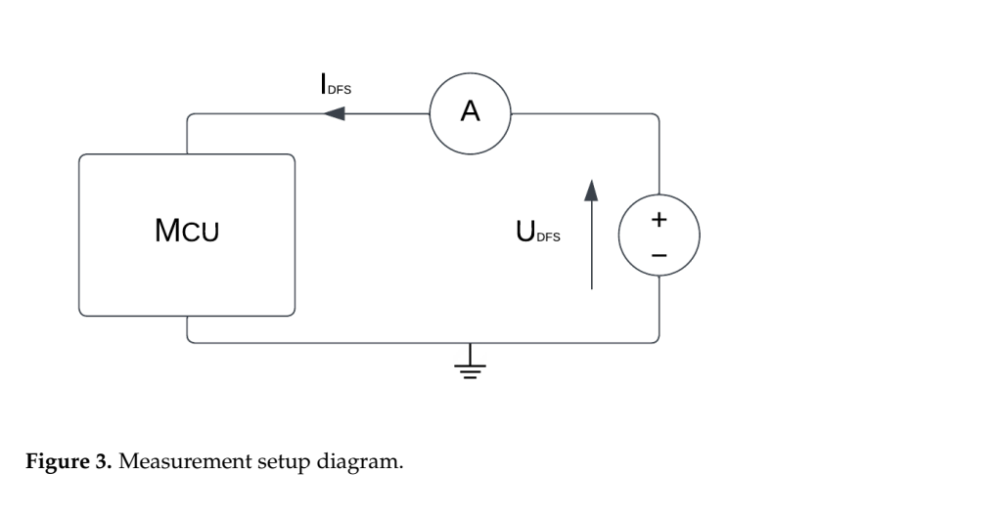
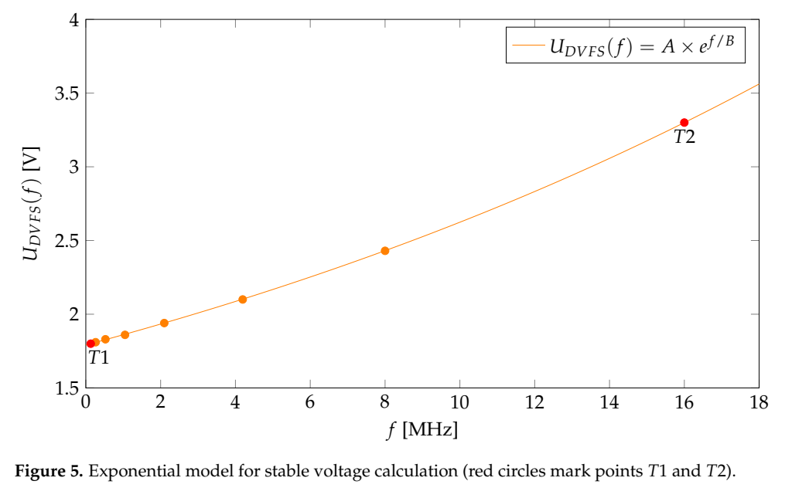
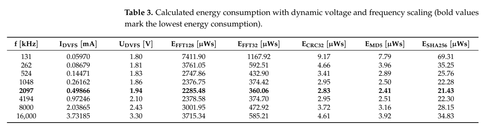
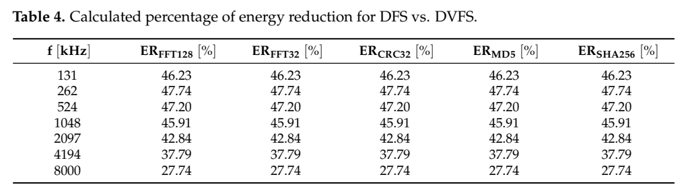

[论文页面](https://doi.org/10.3390/electronics13050826) · [本笔记所用 PDF](https://mdpi-res.com/d_attachment/electronics/electronics-13-00826/article_deploy/electronics-13-00826.pdf) · [标识符](https://doi.org/10.3390/electronics13050826)

整理日期：2026-11-05。**读者原创中文解读；原图归论文作者／出版方。未运行作者实验，不是独立复现。**

**一句话：** 先扫描真实MCU程序的能量—频率曲线，再按任务时限选择三种工作模式

阅读地图：先看问题与输入输出，再顺着架构图、公式和结果图阅读；最后检查统计边界与E902迁移。完整编号索引另见“图表索引”。下文“读者分析”是推断或建议，不是原文结果。

## 阶段0：材料与版本审计

| 材料 | 当前可用程度 | 影响 |
| --- | --- | --- |
| 摘要、正文、方法、原图注 | 已获取本地完整PDF、文本与逐页渲染 | 可核查结构、实验及关键数字；可见页面优先于异常文本层 |
| 分析版本 | MDPI正式版18页，DOI 10.3390/electronics13050826。 | 引用页码以“PDF第几页”标识 |
| 代码／原始数据 | 当前材料中尚未定位齐完整控制器源码、实验脚本和原始重复数据；这不表示这些材料不存在。 | 公开链接不等于已构建或已拿到原始轨迹 |
| 附件、独立原始重复与勘误 | 当前未完成全渠道附件／勘误穷尽检索 | 不能断言没有附件、没有勘误或没有其他版本 |
| 本次工作范围 | 材料阅读、图表裁取、证据整理、教学公式 | 所有新实验均是建议，尚未执行 |

## 阶段1：身份卡与整体概述

| 项目 | 内容 |
| --- | --- |
| 英文题名 | Dynamic Voltage and Frequency Scaling as a Method for Reducing Energy Consumption in Ultra-Low-Power Embedded Systems |
| 中文导读题名 | 先扫描真实MCU程序的能量—频率曲线，再按任务时限选择三种工作模式 |
| 作者 | Josip Zidar, Tomislav Matić, Ivan Aleksi, Željko Hocenski |
| 发表／版本 | Electronics 13(5),826 (2024)；MDPI正式版18页，DOI 10.3390/electronics13050826。 |
| 类型与领域 | 原始方法／工程系统研究；DVFS、CPU能效、运行时控制 |
| 单位、通讯、资助与利益关系 | 作者姓名以本版本首页为准；通讯方式、单位及资助可回查首页与末页声明。当前尚未完成资助/利益关系/勘误的跨版本穷尽审计。 |
| 核心对象与接口 | 任务/事件边界选模式，Algorithm5无限循环；未给统一毫秒采样周期 |
| 代码与数据 | 当前材料中尚未定位齐完整控制器源码、实验脚本和原始重复数据；这不表示这些材料不存在。 |
| 与本课题关系 | 可在E902执行CRC32/SHA256或候选压缩程序，逐档测每块能量与时延；先用任务类别查表，智能模型只在输入复杂度变化使查表不足时加入。 |

**约200字中文概述（改写）：** 本文研究单核MCU计算内核；不同计算量与软/严格时限类别的运行时能效。具体程序包括32点/128点FFT、CRC32、MD5、SHA256（Algorithm1–4）。作者在STM32L0 ARM Cortex-M0+，STM32CubeIDE；Keysight34465A电流测量、GW INSTEK PSB-1400L供电；引用数据表为STM32L010K8，正文未把具体开发板型号写齐上采用离线频点扫描＋两端点指数V–f拟合；Algorithm5按事件/任务类别选择高性能、最低功耗或能量效率模式；没有训练神经网络。输入为应用事件、预先分类的时限需求、测得的I/T和频率表，输出为工作模式/频率，以及指数拟合所得供电目标；完整在线DC–DC切换闭环未展示。主要结果应与下方基线、性能约束和测量范围一起阅读，不能只摘最高百分比。贡献是低成本MCU操作级能量表、经验V–f曲线和按任务要求选模式的工程组织。它适合你建立基线；不是新的强化学习算法。

**三句话定位：** 问题是为什么相同CPU利用率未必对应相同的工作需求？本篇的可检验主张是：先扫描真实MCU程序的能量—频率曲线，再按任务时限选择三种工作模式。验证链是可观测状态→控制规则或学习模型→执行器→任务正确性/服务质量与能耗对照。 方法主线为应用事件、预先分类的时限需求、测得的I/T和频率表 → 离线频点扫描＋两端点指数V–f拟合；Algorithm5按事件/任务类别选择高性能、最低功耗或能量效率模式；没有训练神经网络 → 工作模式/频率，以及指数拟合所得供电目标；完整在线DC–DC切换闭环未展示 → 执行与反馈。 主要证据见下方结果表，结论须与测量和版本范围一起使用。

## 阶段2：问题、假设与创新位置

为什么相同CPU利用率未必对应相同的工作需求？本篇的可检验主张是：先扫描真实MCU程序的能量—频率曲线，再按任务时限选择三种工作模式。验证链是可观测状态→控制规则或学习模型→执行器→任务正确性/服务质量与能耗对照。

**创新判断（读者分析）：** 贡献是低成本MCU操作级能量表、经验V–f曲线和按任务要求选模式的工程组织。它适合你建立基线；不是新的强化学习算法。 不依据作者自称“首次”断定整个领域绝无前例。

## 阶段3：必要术语与数学

| 级别 | 术语／关键词 | 直觉、严格含义与易混点 |
| --- | --- | --- |
| A | DVFS / DFS | DVFS同时涉及动态电压与频率；只有时钟变化称DFS。电压能否改变取决于实际供电域。 |
| A | Workload | 真正执行应用计算的程序与输入；本文里的控制器是另一个角色。 |
| A | Controller | 根据观测选择动作的软件／硬件，可运行在同一CPU或独立控制核。 |
| A | OPP | Operating Performance Point，经过允许范围验证的电压—频率组合。 |
| A | Power / Energy | 功率W表示此刻消耗快慢；能量J是对时间积分。低功率不必然低能量。 |
| B | Deadline | 作业必须完成的时刻；平均时延、P95与最大时延各有不同用途。 |
| A | 被控程序 | 32点/128点FFT、CRC32、MD5、SHA256（Algorithm1–4） |
| A | 控制策略 | 离线频点扫描＋两端点指数V–f拟合；Algorithm5按事件/任务类别选择高性能、最低功耗或能量效率模式；没有训练神经网络 |
| B | 控制周期 | 任务/事件边界选模式，Algorithm5无限循环；未给统一毫秒采样周期 |
| B | 证据边界 | 实测、硬件仿真、功耗模型是不同证据，见平台与结果表。 |

### 公式1：操作级能量

**符号与前提：** V为V，I为A，T为s，E为J；恒定量假设下成立，变动量须积分。

**代入与检查：** 3.3V×1mA×10ms=33µJ；0.5mA若执行30ms则49.5µJ，低电流未必省能。

**来源：** Eq1，p7
### 公式2：作者经验电压曲线

**符号与前提：** f必须用MHz，V输出为V；系数仅属于本文拟合，不是物理安全定律。

**代入与检查：** f=2.097MHz时约1.94V；不能将E902频率直接代入。

**来源：** Eq2，p10–11

## 阶段4–6：架构、关键图与方法拆解

**输入—处理—输出：** 应用事件、预先分类的时限需求、测得的I/T和频率表 → 离线频点扫描＋两端点指数V–f拟合；Algorithm5按事件/任务类别选择高性能、最低功耗或能量效率模式；没有训练神经网络 → 工作模式/频率，以及指数拟合所得供电目标；完整在线DC–DC切换闭环未展示 → 执行与反馈。

| 系统角色 | 具体设置 |
| --- | --- |
| 具体控制算法 | 离线频点扫描＋两端点指数V–f拟合；Algorithm5按事件/任务类别选择高性能、最低功耗或能量效率模式；没有训练神经网络 |
| 被控负载类型 | 单核MCU计算内核；不同计算量与软/严格时限类别 |
| 具体被控程序 | 32点/128点FFT、CRC32、MD5、SHA256（Algorithm1–4） |
| 使用平台与测量 | STM32L0 ARM Cortex-M0+，STM32CubeIDE；Keysight34465A电流测量、GW INSTEK PSB-1400L供电；引用数据表为STM32L010K8，正文未把具体开发板型号写齐 |
| 输入/状态 | 应用事件、预先分类的时限需求、测得的I/T和频率表 |
| 输出/动作 | 工作模式/频率，以及指数拟合所得供电目标；完整在线DC–DC切换闭环未展示 |
| 周期与运行位置 | 任务/事件边界选模式，Algorithm5无限循环；未给统一毫秒采样周期 |

§3.1–3.3（PDF p5–13）先在3.3V下测8档131kHz–16MHz，每项电流、电压、时间取100次平均，计算E=UIt。固定电压下降频会降低电流，但FFT等执行时间拉长，能量未必降低。作者以(0.131MHz,1.8V)与(16MHz,3.3V)拟合U=1.791011·exp(f/26.1804846)，给出Table3的DVFS能量，最小值位于2.097MHz/1.94V。§3.5的Algorithm5是任务类别规则：时间关键任务走高速，无期限轻任务保持省电模式，软期限任务使用能量效率模式。

这是物理MCU上的测量与配置分析，但Table3称“calculated energy”，没有给完整在线调压驱动、稳压器瞬态或每任务实测切换轨迹。不能把静态频点表说成已经部署的学习闭环；指数曲线不是芯片通用的安全电压边界。

### Fig3：电流测量连接

[打开大图](images/original-fig3.png) · [原文 Fig3，PDF p6](https://mdpi-res.com/d_attachment/electronics/electronics-13-00826/article_deploy/electronics-13-00826.pdf#page=6)

**怎样看：** 先读图题、图例、坐标/表头与单位，再在同一负载和同一基线内比较。先分清电流表、供电与MCU，明确测能边界。

**直接观察／原文报告：** 先分清电流表、供电与MCU，明确测能边界。

**读者判断：** 本项只支撑原文所列平台和配置；不证明E902可直接复用这些数值。

### Fig5：两点指数电压拟合

[打开大图](images/original-fig5.png) · [原文 Fig5，PDF p11](https://mdpi-res.com/d_attachment/electronics/electronics-13-00826/article_deploy/electronics-13-00826.pdf#page=11)

**怎样看：** 先读图题、图例、坐标/表头与单位，再在同一负载和同一基线内比较。红点是拟合端点；曲线不是全工作范围可靠性认证。

**直接观察／原文报告：** 红点是拟合端点；曲线不是全工作范围可靠性认证。

**读者判断：** 本项只支撑原文所列平台和配置；不证明E902可直接复用这些数值。

| 阅读问题 | 先看材料 | 如何接到下一步 |
| --- | --- | --- |
| 为什么要改现有方案 | 问题背景与动机图 | 确定目标、约束和原有不足 |
| 系统观察什么、控制什么 | 输入输出表＋关键架构图 | 确认数据、模型和执行器真实角色 |
| 方法如何得到动作或估计 | 方法段、公式、算法／模型表 | 明确离线训练与在线流程 |
| 收益是否真实且公平 | 结果图表、统计与测量边界 | 核查基线／目标／分母／开销 |
| 能否用于自己的CPU | 局限、复现计划、三项实验 | 把论文假设变成待验证的工程条件 |

## 阶段7–8：实验、统计及证据链

本节数字均是**原文明确报告或原文数值的标注算例**；没有按图柱高度臆造额外精确值。

| 指标 | 原文报告 | 条件／分母／边界 | 证据位置 |
| --- | --- | --- | --- |
| 同频点DVFS相对3.3V DFS能量 | 降低27.74%–47.74% | Table4各频率比较；不是相对最优DFS点统一降低47.74% | Table4，PDF p13 |
| 最低计算能量点 | 2.097MHz，约1.94V | 本文8档/5程序与拟合曲线内；不是任意MCU最优点 | Table3/6，p13–14 |
| FFT128示例 | 2285.48µJ | 2.097MHz下Table3；相同程序单位需统一 | Table3，p13 |

### Table3：DVFS计算能量表

[打开大图](images/original-table3.png) · [原文 Table3，PDF p13](https://mdpi-res.com/d_attachment/electronics/electronics-13-00826/article_deploy/electronics-13-00826.pdf#page=13)

**怎样看：** 先读图题、图例、坐标/表头与单位，再在同一负载和同一基线内比较。最低值2.097MHz；表中给的是计算能量。

**直接观察／原文报告：** 最低值2.097MHz；表中给的是计算能量。

**读者判断：** 本项只支撑原文所列平台和配置；不证明E902可直接复用这些数值。

### Table4：同频DFS对DVFS节能率

[打开大图](images/original-table4.png) · [原文 Table4，PDF p13](https://mdpi-res.com/d_attachment/electronics/electronics-13-00826/article_deploy/electronics-13-00826.pdf#page=13)

**怎样看：** 先读图题、图例、坐标/表头与单位，再在同一负载和同一基线内比较。各频率的对照分母是同频DFS，不是全局最优DFS。

**直接观察／原文报告：** 各频率的对照分母是同频DFS，不是全局最优DFS。

**读者判断：** 本项只支撑原文所列平台和配置；不证明E902可直接复用这些数值。

**统计与公平性审查（读者分析）：** Table1为100次测量平均，但没有为每项给原始100次离散度。§3.4把15个不同配置的能量值用于比较不同算法的t/Wilcoxon检验；这与“DVFS相对DFS在独立重复中显著节能”不是同一假设。FFT128与MD5的任务量也不同，不能用算法间P值证明某governor优越。Table4同一频率五程序的百分比相同，读者应要求原始电测和计算流程来区分共用缩放因素与各程序独立行为。

工程实验中，设备、程序、输入文件、重复运行、时间窗口是不同统计层级，不能互相替代。本任务不涉及生物样本，细胞／动物／试剂等检查不适用。未注明的P值或置信区间不补造；“差了几个百分点”不自动等于统计显著。

| 主张层级 | 直接证据 | 对照与统计 | 可得结论／替代解释 | 可信度 |
| --- | --- | --- | --- | --- |
| 原文明确报告 | 同频点DVFS相对3.3V DFS能量：降低27.74%–47.74% | Table4，PDF p13 | Table4各频率比较；不是相对最优DFS点统一降低47.74%；仅在该实验范围内成立 | 图表／文本可核对：高；独立复现：尚无 |
| 作者解释 | 所提架构／模型解释了性能或估计改善 | 关键原图与方法见上文；统计边界见下节 | 效果可能同时来自动作空间、平台特性与采样设置，因果归因需消融 | 中 |
| AI分析／迁移假设 | 用于E902的压缩候选负载 | 本篇未直接验证该芯片与任务组合 | 需三项后续实验；不能复制论文收益数字 | 待验证，当前无法判断 |

## 阶段9–10：贡献与局限分开判断

贡献是低成本MCU操作级能量表、经验V–f曲线和按任务要求选模式的工程组织。它适合你建立基线；不是新的强化学习算法。

| 来源 | 严重程度 | 局限及其影响 |
| --- | --- | --- |
| 读者分析 | 关键 | 仅两端点拟合不足以证明全温度/全芯片批次电压安全，不能复制为E902的OPP。 |
| 读者分析 | 关键 | 频点比较未完整计入动态DC–DC转换效率、切换延时与任务间空闲周期。 |
| 读者分析 | 关键 | 未提供现代Linux governor公平对照；作者明确说明平台与源码差异阻碍直接对比。 |

## 阶段11：最小复现路线与缺口

先重建原文固定安全档、输入文件和测量边界，再实现上述算法。逐档确认正确输出和执行时间，记录控制、监测、调频与空闲成本；冻结模型后用整文件留出的输入测试。原文未定位齐的参数须列入复现日志，不用猜测值伪装完整复现。可在E902执行CRC32/SHA256或候选压缩程序，逐档测每块能量与时延；先用任务类别查表，智能模型只在输入复杂度变化使查表不足时加入。

**代码／数据现状：** 当前材料中尚未定位齐完整控制器源码、实验脚本和原始重复数据；这不表示这些材料不存在。

**质量控制顺序：** 先验证程序输出和时间基准，再验证采样／模型，最后比较策略。保存输入文件哈希、平台配置、OPP、随机种子、温度与每次运行原始记录。失败时先回固定安全频点定位错误，再继续优化。复现可行性判断为“可开始部分方法复建，完整数值复现条件未齐”；这与“已完成复现”不同。

## 阶段12：用于你的CPU／E902课题

可在E902执行CRC32/SHA256或候选压缩程序，逐档测每块能量与时延；先用任务类别查表，智能模型只在输入复杂度变化使查表不足时加入。

| 建议实验／优先级 | 价值 | 最低资源 | 主要风险 | 成功判据（设计目标，非已得结果） |
| --- | --- | --- | --- | --- |
| P0：计算内核E–T扫描 | 建立可解释物理基线 | CRC32/SHA256/压缩块与合法频点、计时器 | 只有DFS时不可假称调压 | 各档正确结果，记录J/块和ms/块 |
| P1：三模式规则 | 验证复杂学习是否必要 | 块大小/期限与模式表 | 任务分类错误会违约 | 同输入对比最大频率/最低可行档/规则 |
| P1：切换全成本 | 检验静态最优能否在线成立 | ack时间戳、外部测能或明确能量模型 | 短块的切换开销可能吃掉收益 | 完整周期净能量改善并报告失败输入 |

上述优先级是读者建议：P0先做，P1建立在基线可运行后，P2只在资源允许且前序实验证明有必要时开展。压缩应用仍是候选，尚未替你最终定题或证明已在E902运行。论文公开可读不自动授权任意复制数据；代码、图片和数据须分别核对许可。

## 阶段13：读完后应掌握与继续核查

**五个知识点：** 先扫描真实MCU程序的能量—频率曲线，再按任务时限选择三种工作模式 你还应能解释输入输出表中的角色、两条公式的单位、首个结果指标的分母，以及局限表里的关键条件。

**五个未决问题：** 独立新输入是否成立？最差时延是否可接受？测量参考是否足够？控制与切换是否抵消收益？E902实际具有哪些接口和可观测量？这些是研究问题，不是对作者遗漏的无证据指控。

**立即做：** 按公式算例手算一次，选一张结果图复述“硬件—负载—基线—指标—边界”。**后续核查：** 补齐代码版本、训练数据和仪表设置。**可复用：** 上文明确标注的模型与接口思路。**谨慎采用：** 所有跨平台百分比。**暂不采用：** 尚未证实存在的电压控制和完整硬实时承诺。
