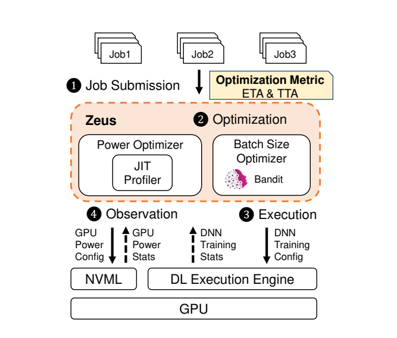
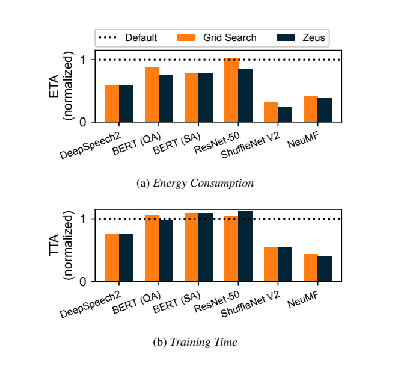
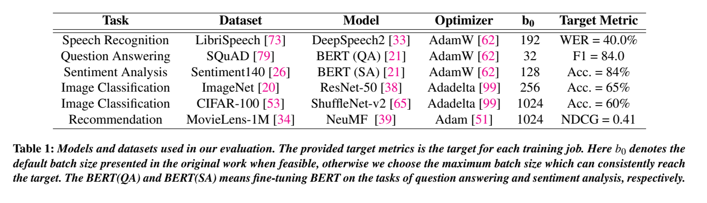

[论文页面](https://www.usenix.org/conference/nsdi23/presentation/you) · [本笔记所用 PDF](https://www.usenix.org/system/files/nsdi23-you.pdf) · [标识符](https://www.usenix.org/conference/nsdi23/presentation/you)

整理日期：2026-11-06。**读者原创中文解读；原图归论文作者／出版方。未运行作者实验，不是独立复现。**

**覆盖范围：** 本版本正文中识别到的28项图、表或算法；保留原编号。关键项已裁图并在技术精读相应段落出现，未内嵌的项可点PDF页链接查看，不上传整篇PDF。

**统计总边界：** 区分4个训练seed、同seed的功率扫描、最后5次任务均值与Alibaba trace回放。大量回放任务不是同等数量独立物理训练重复。不同batch可能改变收敛轨迹；公平比较要固定目标质量和学习率规则，并计入探索失败/早停成本。GPU NVML不含CPU、网络与制冷，结论不是整机碳排放。

## Fig1：单独与联合调节的机会

[原文 Fig1，PDF p3](https://www.usenix.org/system/files/nsdi23-you.pdf#page=3)

1. **本项回答的问题：** 单独与联合调节的机会，用于支撑这条方法或实验链中的具体环节。
2. **组成、坐标和对照：** 先读图题、图例、坐标/表头与单位，再在同一负载和同一基线内比较。各模型对batch与功率帽敏感性不同。 按原图／表标示的单位与归一化基准阅读；不将不同子图或不同分母的柱高直接相除。 颜色按原图图例辨认，不能把同色跨图视为同一组。
3. **阅读顺序与统计单位：** 先看设定、单位和图例，再看趋势与作者正文。重复次数及采样独立性参见本篇技术精读统计节；没有为该图定位到的误差线定义／独立重复数，不另行猜测。
4. **直接观察：** 各模型对batch与功率帽敏感性不同。
5. **作者解释的范围：** 原文以该图／表作为上述观察的结构说明或实验支撑，需连同对应页正文读取；本索引不额外替作者推导因果机制。
6. **独立判断（AI分析）：** 只支持此图所列的模型、设备、输入与测量口径；各模型对batch与功率帽敏感性不同。 不能由单图推出E902或其他GPU的同幅收益。
7. **证据链位置：** 性能验证／定量或示例证据，需结合实验条件。它支持本文具体条件下的实现或结果，不单独完成跨平台验证。
8. **结论与强度：** 可复述“各模型对batch与功率帽敏感性不同。”；对图内描述的核查可信度高，对未做独立实验的泛化判断为中或无法判断。不能得出的结论是“只支持此图所列的模型、设备、输入与测量口径；各模型对batch与功率帽敏感性不同。 不能由单图推出E902或其他GPU的同幅收益。”所排除的外推。

## Fig2：ETA–TTA Pareto前沿

[原文 Fig2，PDF p4](https://www.usenix.org/system/files/nsdi23-you.pdf#page=4)

1. **本项回答的问题：** ETA–TTA Pareto前沿，用于支撑这条方法或实验链中的具体环节。
2. **组成、坐标和对照：** 先读图题、图例、坐标/表头与单位，再在同一负载和同一基线内比较。更省能点可能更慢；每个点是同质量配置。 按原图／表标示的单位与归一化基准阅读；不将不同子图或不同分母的柱高直接相除。 颜色按原图图例辨认，不能把同色跨图视为同一组。
3. **阅读顺序与统计单位：** 先看设定、单位和图例，再看趋势与作者正文。重复次数及采样独立性参见本篇技术精读统计节；没有为该图定位到的误差线定义／独立重复数，不另行猜测。
4. **直接观察：** 更省能点可能更慢；每个点是同质量配置。
5. **作者解释的范围：** 原文以该图／表作为上述观察的结构说明或实验支撑，需连同对应页正文读取；本索引不额外替作者推导因果机制。
6. **独立判断（AI分析）：** 只支持此图所列的模型、设备、输入与测量口径；更省能点可能更慢；每个点是同质量配置。 不能由单图推出E902或其他GPU的同幅收益。
7. **证据链位置：** 性能验证／定量或示例证据，需结合实验条件。它支持本文具体条件下的实现或结果，不单独完成跨平台验证。
8. **结论与强度：** 可复述“更省能点可能更慢；每个点是同质量配置。”；对图内描述的核查可信度高，对未做独立实验的泛化判断为中或无法判断。不能得出的结论是“只支持此图所列的模型、设备、输入与测量口径；更省能点可能更慢；每个点是同质量配置。 不能由单图推出E902或其他GPU的同幅收益。”所排除的外推。

## Fig3：Zeus工作流

[原文 Fig3，PDF p5](https://www.usenix.org/system/files/nsdi23-you.pdf#page=5)

[打开大图](images/original-fig3.png)

1. **本项回答的问题：** Zeus工作流，用于支撑这条方法或实验链中的具体环节。
2. **组成、坐标和对照：** 先读图题、图例、坐标/表头与单位，再在同一负载和同一基线内比较。bandit跨作业，profiler在作业内；输出不是同一时间尺度。 按原图／表标示的单位与归一化基准阅读；不将不同子图或不同分母的柱高直接相除。 颜色按原图图例辨认，不能把同色跨图视为同一组。
3. **阅读顺序与统计单位：** 先看设定、单位和图例，再看趋势与作者正文。重复次数及采样独立性参见本篇技术精读统计节；没有为该图定位到的误差线定义／独立重复数，不另行猜测。
4. **直接观察：** bandit跨作业，profiler在作业内；输出不是同一时间尺度。
5. **作者解释的范围：** 原文以该图／表作为上述观察的结构说明或实验支撑，需连同对应页正文读取；本索引不额外替作者推导因果机制。
6. **独立判断（AI分析）：** 只支持此图所列的模型、设备、输入与测量口径；bandit跨作业，profiler在作业内；输出不是同一时间尺度。 不能由单图推出E902或其他GPU的同幅收益。
7. **证据链位置：** 性能验证／定量或示例证据，需结合实验条件。它支持本文具体条件下的实现或结果，不单独完成跨平台验证。
8. **结论与强度：** 可复述“bandit跨作业，profiler在作业内；输出不是同一时间尺度。”；对图内描述的核查可信度高，对未做独立实验的泛化判断为中或无法判断。不能得出的结论是“只支持此图所列的模型、设备、输入与测量口径；bandit跨作业，profiler在作业内；输出不是同一时间尺度。 不能由单图推出E902或其他GPU的同幅收益。”所排除的外推。

## Fig4：batch探索与利用

[原文 Fig4，PDF p8](https://www.usenix.org/system/files/nsdi23-you.pdf#page=8)

1. **本项回答的问题：** batch探索与利用，用于支撑这条方法或实验链中的具体环节。
2. **组成、坐标和对照：** 先读图题、图例、坐标/表头与单位，再在同一负载和同一基线内比较。初期剪枝与后续TS行为分开读。 按原图／表标示的单位与归一化基准阅读；不将不同子图或不同分母的柱高直接相除。 颜色按原图图例辨认，不能把同色跨图视为同一组。
3. **阅读顺序与统计单位：** 先看设定、单位和图例，再看趋势与作者正文。重复次数及采样独立性参见本篇技术精读统计节；没有为该图定位到的误差线定义／独立重复数，不另行猜测。
4. **直接观察：** 初期剪枝与后续TS行为分开读。
5. **作者解释的范围：** 原文以该图／表作为上述观察的结构说明或实验支撑，需连同对应页正文读取；本索引不额外替作者推导因果机制。
6. **独立判断（AI分析）：** 只支持此图所列的模型、设备、输入与测量口径；初期剪枝与后续TS行为分开读。 不能由单图推出E902或其他GPU的同幅收益。
7. **证据链位置：** 性能验证／定量或示例证据，需结合实验条件。它支持本文具体条件下的实现或结果，不单独完成跨平台验证。
8. **结论与强度：** 可复述“初期剪枝与后续TS行为分开读。”；对图内描述的核查可信度高，对未做独立实验的泛化判断为中或无法判断。不能得出的结论是“只支持此图所列的模型、设备、输入与测量口径；初期剪枝与后续TS行为分开读。 不能由单图推出E902或其他GPU的同幅收益。”所排除的外推。

## Fig5：batch与ETA关系

[原文 Fig5，PDF p8](https://www.usenix.org/system/files/nsdi23-you.pdf#page=8)

1. **本项回答的问题：** batch与ETA关系，用于支撑这条方法或实验链中的具体环节。
2. **组成、坐标和对照：** 先读图题、图例、坐标/表头与单位，再在同一负载和同一基线内比较。局部近凸趋势支持剪枝，不是严格全局凸证明。 按原图／表标示的单位与归一化基准阅读；不将不同子图或不同分母的柱高直接相除。 颜色按原图图例辨认，不能把同色跨图视为同一组。
3. **阅读顺序与统计单位：** 先看设定、单位和图例，再看趋势与作者正文。重复次数及采样独立性参见本篇技术精读统计节；没有为该图定位到的误差线定义／独立重复数，不另行猜测。
4. **直接观察：** 局部近凸趋势支持剪枝，不是严格全局凸证明。
5. **作者解释的范围：** 原文以该图／表作为上述观察的结构说明或实验支撑，需连同对应页正文读取；本索引不额外替作者推导因果机制。
6. **独立判断（AI分析）：** 只支持此图所列的模型、设备、输入与测量口径；局部近凸趋势支持剪枝，不是严格全局凸证明。 不能由单图推出E902或其他GPU的同幅收益。
7. **证据链位置：** 性能验证／定量或示例证据，需结合实验条件。它支持本文具体条件下的实现或结果，不单独完成跨平台验证。
8. **结论与强度：** 可复述“局部近凸趋势支持剪枝，不是严格全局凸证明。”；对图内描述的核查可信度高，对未做独立实验的泛化判断为中或无法判断。不能得出的结论是“只支持此图所列的模型、设备、输入与测量口径；局部近凸趋势支持剪枝，不是严格全局凸证明。 不能由单图推出E902或其他GPU的同幅收益。”所排除的外推。

## Fig6：收敛后能量与时间

[原文 Fig6，PDF p11](https://www.usenix.org/system/files/nsdi23-you.pdf#page=11)

[打开大图](images/original-fig6.png)

1. **本项回答的问题：** 收敛后能量与时间，用于支撑这条方法或实验链中的具体环节。
2. **组成、坐标和对照：** 先读图题、图例、坐标/表头与单位，再在同一负载和同一基线内比较。上下图必须配对，同一Default归一化。 按原图／表标示的单位与归一化基准阅读；不将不同子图或不同分母的柱高直接相除。 颜色按原图图例辨认，不能把同色跨图视为同一组。
3. **阅读顺序与统计单位：** 先看设定、单位和图例，再看趋势与作者正文。重复次数及采样独立性参见本篇技术精读统计节；没有为该图定位到的误差线定义／独立重复数，不另行猜测。
4. **直接观察：** 上下图必须配对，同一Default归一化。
5. **作者解释的范围：** 原文以该图／表作为上述观察的结构说明或实验支撑，需连同对应页正文读取；本索引不额外替作者推导因果机制。
6. **独立判断（AI分析）：** 只支持此图所列的模型、设备、输入与测量口径；上下图必须配对，同一Default归一化。 不能由单图推出E902或其他GPU的同幅收益。
7. **证据链位置：** 性能验证／定量或示例证据，需结合实验条件。它支持本文具体条件下的实现或结果，不单独完成跨平台验证。
8. **结论与强度：** 可复述“上下图必须配对，同一Default归一化。”；对图内描述的核查可信度高，对未做独立实验的泛化判断为中或无法判断。不能得出的结论是“只支持此图所列的模型、设备、输入与测量口径；上下图必须配对，同一Default归一化。 不能由单图推出E902或其他GPU的同幅收益。”所排除的外推。

## Fig7：累计regret

[原文 Fig7，PDF p11](https://www.usenix.org/system/files/nsdi23-you.pdf#page=11)

1. **本项回答的问题：** 累计regret，用于支撑这条方法或实验链中的具体环节。
2. **组成、坐标和对照：** 先读图题、图例、坐标/表头与单位，再在同一负载和同一基线内比较。比较探索成本而非单次最终节能。 按原图／表标示的单位与归一化基准阅读；不将不同子图或不同分母的柱高直接相除。 颜色按原图图例辨认，不能把同色跨图视为同一组。
3. **阅读顺序与统计单位：** 先看设定、单位和图例，再看趋势与作者正文。重复次数及采样独立性参见本篇技术精读统计节；没有为该图定位到的误差线定义／独立重复数，不另行猜测。
4. **直接观察：** 比较探索成本而非单次最终节能。
5. **作者解释的范围：** 原文以该图／表作为上述观察的结构说明或实验支撑，需连同对应页正文读取；本索引不额外替作者推导因果机制。
6. **独立判断（AI分析）：** 只支持此图所列的模型、设备、输入与测量口径；比较探索成本而非单次最终节能。 不能由单图推出E902或其他GPU的同幅收益。
7. **证据链位置：** 性能验证／定量或示例证据，需结合实验条件。它支持本文具体条件下的实现或结果，不单独完成跨平台验证。
8. **结论与强度：** 可复述“比较探索成本而非单次最终节能。”；对图内描述的核查可信度高，对未做独立实验的泛化判断为中或无法判断。不能得出的结论是“只支持此图所列的模型、设备、输入与测量口径；比较探索成本而非单次最终节能。 不能由单图推出E902或其他GPU的同幅收益。”所排除的外推。

## Fig8：二维搜索路径

[原文 Fig8，PDF p11](https://www.usenix.org/system/files/nsdi23-you.pdf#page=11)

1. **本项回答的问题：** 二维搜索路径，用于支撑这条方法或实验链中的具体环节。
2. **组成、坐标和对照：** 先读图题、图例、坐标/表头与单位，再在同一负载和同一基线内比较。深色背景较好；路径深浅表示作业先后。 结构／流程类没有统一数值坐标；箭头表示数据或控制关系，不表示统计因果。 颜色按原图图例辨认，不能把同色跨图视为同一组。
3. **阅读顺序与统计单位：** 先看设定、单位和图例，再看趋势与作者正文。重复次数及采样独立性参见本篇技术精读统计节；没有为该图定位到的误差线定义／独立重复数，不另行猜测。
4. **直接观察：** 深色背景较好；路径深浅表示作业先后。
5. **作者解释的范围：** 原文以该图／表作为上述观察的结构说明或实验支撑，需连同对应页正文读取；本索引不额外替作者推导因果机制。
6. **独立判断（AI分析）：** 只支持此图所列的模型、设备、输入与测量口径；深色背景较好；路径深浅表示作业先后。 不能由单图推出E902或其他GPU的同幅收益。
7. **证据链位置：** 方法／系统实现说明。它支持本文具体条件下的实现或结果，不单独完成跨平台验证。
8. **结论与强度：** 可复述“深色背景较好；路径深浅表示作业先后。”；对图内描述的核查可信度高，对未做独立实验的泛化判断为中或无法判断。不能得出的结论是“只支持此图所列的模型、设备、输入与测量口径；深色背景较好；路径深浅表示作业先后。 不能由单图推出E902或其他GPU的同幅收益。”所排除的外推。

## Fig9：Alibaba回放

[原文 Fig9，PDF p12](https://www.usenix.org/system/files/nsdi23-you.pdf#page=12)

1. **本项回答的问题：** Alibaba回放，用于支撑这条方法或实验链中的具体环节。
2. **组成、坐标和对照：** 先读图题、图例、坐标/表头与单位，再在同一负载和同一基线内比较。大规模任务流为trace-driven simulation。 按原图／表标示的单位与归一化基准阅读；不将不同子图或不同分母的柱高直接相除。 颜色按原图图例辨认，不能把同色跨图视为同一组。
3. **阅读顺序与统计单位：** 先看设定、单位和图例，再看趋势与作者正文。重复次数及采样独立性参见本篇技术精读统计节；没有为该图定位到的误差线定义／独立重复数，不另行猜测。
4. **直接观察：** 大规模任务流为trace-driven simulation。
5. **作者解释的范围：** 原文以该图／表作为上述观察的结构说明或实验支撑，需连同对应页正文读取；本索引不额外替作者推导因果机制。
6. **独立判断（AI分析）：** 只支持此图所列的模型、设备、输入与测量口径；大规模任务流为trace-driven simulation。 不能由单图推出E902或其他GPU的同幅收益。
7. **证据链位置：** 性能验证／定量或示例证据，需结合实验条件。它支持本文具体条件下的实现或结果，不单独完成跨平台验证。
8. **结论与强度：** 可复述“大规模任务流为trace-driven simulation。”；对图内描述的核查可信度高，对未做独立实验的泛化判断为中或无法判断。不能得出的结论是“只支持此图所列的模型、设备、输入与测量口径；大规模任务流为trace-driven simulation。 不能由单图推出E902或其他GPU的同幅收益。”所排除的外推。

## Fig10：数据漂移实验

[原文 Fig10，PDF p12](https://www.usenix.org/system/files/nsdi23-you.pdf#page=12)

1. **本项回答的问题：** 数据漂移实验，用于支撑这条方法或实验链中的具体环节。
2. **组成、坐标和对照：** 先读图题、图例、坐标/表头与单位，再在同一负载和同一基线内比较。单看初期曲线无法推出长期稳定。 按原图／表标示的单位与归一化基准阅读；不将不同子图或不同分母的柱高直接相除。 颜色按原图图例辨认，不能把同色跨图视为同一组。
3. **阅读顺序与统计单位：** 先看设定、单位和图例，再看趋势与作者正文。重复次数及采样独立性参见本篇技术精读统计节；没有为该图定位到的误差线定义／独立重复数，不另行猜测。
4. **直接观察：** 单看初期曲线无法推出长期稳定。
5. **作者解释的范围：** 原文以该图／表作为上述观察的结构说明或实验支撑，需连同对应页正文读取；本索引不额外替作者推导因果机制。
6. **独立判断（AI分析）：** 只支持此图所列的模型、设备、输入与测量口径；单看初期曲线无法推出长期稳定。 不能由单图推出E902或其他GPU的同幅收益。
7. **证据链位置：** 性能验证／定量或示例证据，需结合实验条件。它支持本文具体条件下的实现或结果，不单独完成跨平台验证。
8. **结论与强度：** 可复述“单看初期曲线无法推出长期稳定。”；对图内描述的核查可信度高，对未做独立实验的泛化判断为中或无法判断。不能得出的结论是“只支持此图所列的模型、设备、输入与测量口径；单看初期曲线无法推出长期稳定。 不能由单图推出E902或其他GPU的同幅收益。”所排除的外推。

## Fig11：η偏好参数

[原文 Fig11，PDF p13](https://www.usenix.org/system/files/nsdi23-you.pdf#page=13)

1. **本项回答的问题：** η偏好参数，用于支撑这条方法或实验链中的具体环节。
2. **组成、坐标和对照：** 先读图题、图例、坐标/表头与单位，再在同一负载和同一基线内比较。偏好改变Pareto上的选择。 按原图／表标示的单位与归一化基准阅读；不将不同子图或不同分母的柱高直接相除。 颜色按原图图例辨认，不能把同色跨图视为同一组。
3. **阅读顺序与统计单位：** 先看设定、单位和图例，再看趋势与作者正文。重复次数及采样独立性参见本篇技术精读统计节；没有为该图定位到的误差线定义／独立重复数，不另行猜测。
4. **直接观察：** 偏好改变Pareto上的选择。
5. **作者解释的范围：** 原文以该图／表作为上述观察的结构说明或实验支撑，需连同对应页正文读取；本索引不额外替作者推导因果机制。
6. **独立判断（AI分析）：** 只支持此图所列的模型、设备、输入与测量口径；偏好改变Pareto上的选择。 不能由单图推出E902或其他GPU的同幅收益。
7. **证据链位置：** 性能验证／定量或示例证据，需结合实验条件。它支持本文具体条件下的实现或结果，不单独完成跨平台验证。
8. **结论与强度：** 可复述“偏好改变Pareto上的选择。”；对图内描述的核查可信度高，对未做独立实验的泛化判断为中或无法判断。不能得出的结论是“只支持此图所列的模型、设备、输入与测量口径；偏好改变Pareto上的选择。 不能由单图推出E902或其他GPU的同幅收益。”所排除的外推。

## Fig12：多GPU累计能量

[原文 Fig12，PDF p13](https://www.usenix.org/system/files/nsdi23-you.pdf#page=13)

1. **本项回答的问题：** 多GPU累计能量，用于支撑这条方法或实验链中的具体环节。
2. **组成、坐标和对照：** 先读图题、图例、坐标/表头与单位，再在同一负载和同一基线内比较。多卡同步与单卡最优不同。 按原图／表标示的单位与归一化基准阅读；不将不同子图或不同分母的柱高直接相除。 颜色按原图图例辨认，不能把同色跨图视为同一组。
3. **阅读顺序与统计单位：** 先看设定、单位和图例，再看趋势与作者正文。重复次数及采样独立性参见本篇技术精读统计节；没有为该图定位到的误差线定义／独立重复数，不另行猜测。
4. **直接观察：** 多卡同步与单卡最优不同。
5. **作者解释的范围：** 原文以该图／表作为上述观察的结构说明或实验支撑，需连同对应页正文读取；本索引不额外替作者推导因果机制。
6. **独立判断（AI分析）：** 只支持此图所列的模型、设备、输入与测量口径；多卡同步与单卡最优不同。 不能由单图推出E902或其他GPU的同幅收益。
7. **证据链位置：** 性能验证／定量或示例证据，需结合实验条件。它支持本文具体条件下的实现或结果，不单独完成跨平台验证。
8. **结论与强度：** 可复述“多卡同步与单卡最优不同。”；对图内描述的核查可信度高，对未做独立实验的泛化判断为中或无法判断。不能得出的结论是“只支持此图所列的模型、设备、输入与测量口径；多卡同步与单卡最优不同。 不能由单图推出E902或其他GPU的同幅收益。”所排除的外推。

## Fig13：开销拆分

[原文 Fig13，PDF p13](https://www.usenix.org/system/files/nsdi23-you.pdf#page=13)

1. **本项回答的问题：** 开销拆分，用于支撑这条方法或实验链中的具体环节。
2. **组成、坐标和对照：** 先读图题、图例、坐标/表头与单位，再在同一负载和同一基线内比较。控制成本需要相对完整训练时长看。 按原图／表标示的单位与归一化基准阅读；不将不同子图或不同分母的柱高直接相除。 颜色按原图图例辨认，不能把同色跨图视为同一组。
3. **阅读顺序与统计单位：** 先看设定、单位和图例，再看趋势与作者正文。重复次数及采样独立性参见本篇技术精读统计节；没有为该图定位到的误差线定义／独立重复数，不另行猜测。
4. **直接观察：** 控制成本需要相对完整训练时长看。
5. **作者解释的范围：** 原文以该图／表作为上述观察的结构说明或实验支撑，需连同对应页正文读取；本索引不额外替作者推导因果机制。
6. **独立判断（AI分析）：** 只支持此图所列的模型、设备、输入与测量口径；控制成本需要相对完整训练时长看。 不能由单图推出E902或其他GPU的同幅收益。
7. **证据链位置：** 性能验证／定量或示例证据，需结合实验条件。它支持本文具体条件下的实现或结果，不单独完成跨平台验证。
8. **结论与强度：** 可复述“控制成本需要相对完整训练时长看。”；对图内描述的核查可信度高，对未做独立实验的泛化判断为中或无法判断。不能得出的结论是“只支持此图所列的模型、设备、输入与测量口径；控制成本需要相对完整训练时长看。 不能由单图推出E902或其他GPU的同幅收益。”所排除的外推。

## Fig14：多代GPU比较

[原文 Fig14，PDF p13](https://www.usenix.org/system/files/nsdi23-you.pdf#page=13)

1. **本项回答的问题：** 多代GPU比较，用于支撑这条方法或实验链中的具体环节。
2. **组成、坐标和对照：** 先读图题、图例、坐标/表头与单位，再在同一负载和同一基线内比较。跨代归一化不是绝对J排名。 按原图／表标示的单位与归一化基准阅读；不将不同子图或不同分母的柱高直接相除。 颜色按原图图例辨认，不能把同色跨图视为同一组。
3. **阅读顺序与统计单位：** 先看设定、单位和图例，再看趋势与作者正文。重复次数及采样独立性参见本篇技术精读统计节；没有为该图定位到的误差线定义／独立重复数，不另行猜测。
4. **直接观察：** 跨代归一化不是绝对J排名。
5. **作者解释的范围：** 原文以该图／表作为上述观察的结构说明或实验支撑，需连同对应页正文读取；本索引不额外替作者推导因果机制。
6. **独立判断（AI分析）：** 只支持此图所列的模型、设备、输入与测量口径；跨代归一化不是绝对J排名。 不能由单图推出E902或其他GPU的同幅收益。
7. **证据链位置：** 性能验证／定量或示例证据，需结合实验条件。它支持本文具体条件下的实现或结果，不单独完成跨平台验证。
8. **结论与强度：** 可复述“跨代归一化不是绝对J排名。”；对图内描述的核查可信度高，对未做独立实验的泛化判断为中或无法判断。不能得出的结论是“只支持此图所列的模型、设备、输入与测量口径；跨代归一化不是绝对J排名。 不能由单图推出E902或其他GPU的同幅收益。”所排除的外推。

## Fig15：多代机会扫描

[原文 Fig15，PDF p20](https://www.usenix.org/system/files/nsdi23-you.pdf#page=20)

1. **本项回答的问题：** 多代机会扫描，用于支撑这条方法或实验链中的具体环节。
2. **组成、坐标和对照：** 先读图题、图例、坐标/表头与单位，再在同一负载和同一基线内比较。附录补充硬件迁移证据。 按原图／表标示的单位与归一化基准阅读；不将不同子图或不同分母的柱高直接相除。 颜色按原图图例辨认，不能把同色跨图视为同一组。
3. **阅读顺序与统计单位：** 先看设定、单位和图例，再看趋势与作者正文。重复次数及采样独立性参见本篇技术精读统计节；没有为该图定位到的误差线定义／独立重复数，不另行猜测。
4. **直接观察：** 附录补充硬件迁移证据。
5. **作者解释的范围：** 原文以该图／表作为上述观察的结构说明或实验支撑，需连同对应页正文读取；本索引不额外替作者推导因果机制。
6. **独立判断（AI分析）：** 只支持此图所列的模型、设备、输入与测量口径；附录补充硬件迁移证据。 不能由单图推出E902或其他GPU的同幅收益。
7. **证据链位置：** 性能验证／定量或示例证据，需结合实验条件。它支持本文具体条件下的实现或结果，不单独完成跨平台验证。
8. **结论与强度：** 可复述“附录补充硬件迁移证据。”；对图内描述的核查可信度高，对未做独立实验的泛化判断为中或无法判断。不能得出的结论是“只支持此图所列的模型、设备、输入与测量口径；附录补充硬件迁移证据。 不能由单图推出E902或其他GPU的同幅收益。”所排除的外推。

## Fig16：所有任务Pareto

[原文 Fig16，PDF p20](https://www.usenix.org/system/files/nsdi23-you.pdf#page=20)

1. **本项回答的问题：** 所有任务Pareto，用于支撑这条方法或实验链中的具体环节。
2. **组成、坐标和对照：** 先读图题、图例、坐标/表头与单位，再在同一负载和同一基线内比较。各任务前沿形状不同。 按原图／表标示的单位与归一化基准阅读；不将不同子图或不同分母的柱高直接相除。 颜色按原图图例辨认，不能把同色跨图视为同一组。
3. **阅读顺序与统计单位：** 先看设定、单位和图例，再看趋势与作者正文。重复次数及采样独立性参见本篇技术精读统计节；没有为该图定位到的误差线定义／独立重复数，不另行猜测。
4. **直接观察：** 各任务前沿形状不同。
5. **作者解释的范围：** 原文以该图／表作为上述观察的结构说明或实验支撑，需连同对应页正文读取；本索引不额外替作者推导因果机制。
6. **独立判断（AI分析）：** 只支持此图所列的模型、设备、输入与测量口径；各任务前沿形状不同。 不能由单图推出E902或其他GPU的同幅收益。
7. **证据链位置：** 性能验证／定量或示例证据，需结合实验条件。它支持本文具体条件下的实现或结果，不单独完成跨平台验证。
8. **结论与强度：** 可复述“各任务前沿形状不同。”；对图内描述的核查可信度高，对未做独立实验的泛化判断为中或无法判断。不能得出的结论是“只支持此图所列的模型、设备、输入与测量口径；各任务前沿形状不同。 不能由单图推出E902或其他GPU的同幅收益。”所排除的外推。

## Fig17：batch能量敏感性

[原文 Fig17，PDF p21](https://www.usenix.org/system/files/nsdi23-you.pdf#page=21)

1. **本项回答的问题：** batch能量敏感性，用于支撑这条方法或实验链中的具体环节。
2. **组成、坐标和对照：** 先读图题、图例、坐标/表头与单位，再在同一负载和同一基线内比较。大batch不一定少能量。 按原图／表标示的单位与归一化基准阅读；不将不同子图或不同分母的柱高直接相除。 颜色按原图图例辨认，不能把同色跨图视为同一组。
3. **阅读顺序与统计单位：** 先看设定、单位和图例，再看趋势与作者正文。重复次数及采样独立性参见本篇技术精读统计节；没有为该图定位到的误差线定义／独立重复数，不另行猜测。
4. **直接观察：** 大batch不一定少能量。
5. **作者解释的范围：** 原文以该图／表作为上述观察的结构说明或实验支撑，需连同对应页正文读取；本索引不额外替作者推导因果机制。
6. **独立判断（AI分析）：** 只支持此图所列的模型、设备、输入与测量口径；大batch不一定少能量。 不能由单图推出E902或其他GPU的同幅收益。
7. **证据链位置：** 性能验证／定量或示例证据，需结合实验条件。它支持本文具体条件下的实现或结果，不单独完成跨平台验证。
8. **结论与强度：** 可复述“大batch不一定少能量。”；对图内描述的核查可信度高，对未做独立实验的泛化判断为中或无法判断。不能得出的结论是“只支持此图所列的模型、设备、输入与测量口径；大batch不一定少能量。 不能由单图推出E902或其他GPU的同幅收益。”所排除的外推。

## Fig18：功率帽能量敏感性

[原文 Fig18，PDF p21](https://www.usenix.org/system/files/nsdi23-you.pdf#page=21)

1. **本项回答的问题：** 功率帽能量敏感性，用于支撑这条方法或实验链中的具体环节。
2. **组成、坐标和对照：** 先读图题、图例、坐标/表头与单位，再在同一负载和同一基线内比较。最低功率不必最低ETA。 按原图／表标示的单位与归一化基准阅读；不将不同子图或不同分母的柱高直接相除。 颜色按原图图例辨认，不能把同色跨图视为同一组。
3. **阅读顺序与统计单位：** 先看设定、单位和图例，再看趋势与作者正文。重复次数及采样独立性参见本篇技术精读统计节；没有为该图定位到的误差线定义／独立重复数，不另行猜测。
4. **直接观察：** 最低功率不必最低ETA。
5. **作者解释的范围：** 原文以该图／表作为上述观察的结构说明或实验支撑，需连同对应页正文读取；本索引不额外替作者推导因果机制。
6. **独立判断（AI分析）：** 只支持此图所列的模型、设备、输入与测量口径；最低功率不必最低ETA。 不能由单图推出E902或其他GPU的同幅收益。
7. **证据链位置：** 性能验证／定量或示例证据，需结合实验条件。它支持本文具体条件下的实现或结果，不单独完成跨平台验证。
8. **结论与强度：** 可复述“最低功率不必最低ETA。”；对图内描述的核查可信度高，对未做独立实验的泛化判断为中或无法判断。不能得出的结论是“只支持此图所列的模型、设备、输入与测量口径；最低功率不必最低ETA。 不能由单图推出E902或其他GPU的同幅收益。”所排除的外推。

## Fig19：所有任务累计regret

[原文 Fig19，PDF p21](https://www.usenix.org/system/files/nsdi23-you.pdf#page=21)

1. **本项回答的问题：** 所有任务累计regret，用于支撑这条方法或实验链中的具体环节。
2. **组成、坐标和对照：** 先读图题、图例、坐标/表头与单位，再在同一负载和同一基线内比较。不能只挑优势最大任务。 按原图／表标示的单位与归一化基准阅读；不将不同子图或不同分母的柱高直接相除。 颜色按原图图例辨认，不能把同色跨图视为同一组。
3. **阅读顺序与统计单位：** 先看设定、单位和图例，再看趋势与作者正文。重复次数及采样独立性参见本篇技术精读统计节；没有为该图定位到的误差线定义／独立重复数，不另行猜测。
4. **直接观察：** 不能只挑优势最大任务。
5. **作者解释的范围：** 原文以该图／表作为上述观察的结构说明或实验支撑，需连同对应页正文读取；本索引不额外替作者推导因果机制。
6. **独立判断（AI分析）：** 只支持此图所列的模型、设备、输入与测量口径；不能只挑优势最大任务。 不能由单图推出E902或其他GPU的同幅收益。
7. **证据链位置：** 性能验证／定量或示例证据，需结合实验条件。它支持本文具体条件下的实现或结果，不单独完成跨平台验证。
8. **结论与强度：** 可复述“不能只挑优势最大任务。”；对图内描述的核查可信度高，对未做独立实验的泛化判断为中或无法判断。不能得出的结论是“只支持此图所列的模型、设备、输入与测量口径；不能只挑优势最大任务。 不能由单图推出E902或其他GPU的同幅收益。”所排除的外推。

## Fig20：Zeus全任务路径

[原文 Fig20，PDF p22](https://www.usenix.org/system/files/nsdi23-you.pdf#page=22)

1. **本项回答的问题：** Zeus全任务路径，用于支撑这条方法或实验链中的具体环节。
2. **组成、坐标和对照：** 先读图题、图例、坐标/表头与单位，再在同一负载和同一基线内比较。探索效率是独立指标。 结构／流程类没有统一数值坐标；箭头表示数据或控制关系，不表示统计因果。 颜色按原图图例辨认，不能把同色跨图视为同一组。
3. **阅读顺序与统计单位：** 先看设定、单位和图例，再看趋势与作者正文。重复次数及采样独立性参见本篇技术精读统计节；没有为该图定位到的误差线定义／独立重复数，不另行猜测。
4. **直接观察：** 探索效率是独立指标。
5. **作者解释的范围：** 原文以该图／表作为上述观察的结构说明或实验支撑，需连同对应页正文读取；本索引不额外替作者推导因果机制。
6. **独立判断（AI分析）：** 只支持此图所列的模型、设备、输入与测量口径；探索效率是独立指标。 不能由单图推出E902或其他GPU的同幅收益。
7. **证据链位置：** 方法／系统实现说明。它支持本文具体条件下的实现或结果，不单独完成跨平台验证。
8. **结论与强度：** 可复述“探索效率是独立指标。”；对图内描述的核查可信度高，对未做独立实验的泛化判断为中或无法判断。不能得出的结论是“只支持此图所列的模型、设备、输入与测量口径；探索效率是独立指标。 不能由单图推出E902或其他GPU的同幅收益。”所排除的外推。

## Fig21：GridSearch路径

[原文 Fig21，PDF p22](https://www.usenix.org/system/files/nsdi23-you.pdf#page=22)

1. **本项回答的问题：** GridSearch路径，用于支撑这条方法或实验链中的具体环节。
2. **组成、坐标和对照：** 先读图题、图例、坐标/表头与单位，再在同一负载和同一基线内比较。噪声可使一次搜索误判。 结构／流程类没有统一数值坐标；箭头表示数据或控制关系，不表示统计因果。 颜色按原图图例辨认，不能把同色跨图视为同一组。
3. **阅读顺序与统计单位：** 先看设定、单位和图例，再看趋势与作者正文。重复次数及采样独立性参见本篇技术精读统计节；没有为该图定位到的误差线定义／独立重复数，不另行猜测。
4. **直接观察：** 噪声可使一次搜索误判。
5. **作者解释的范围：** 原文以该图／表作为上述观察的结构说明或实验支撑，需连同对应页正文读取；本索引不额外替作者推导因果机制。
6. **独立判断（AI分析）：** 只支持此图所列的模型、设备、输入与测量口径；噪声可使一次搜索误判。 不能由单图推出E902或其他GPU的同幅收益。
7. **证据链位置：** 方法／系统实现说明。它支持本文具体条件下的实现或结果，不单独完成跨平台验证。
8. **结论与强度：** 可复述“噪声可使一次搜索误判。”；对图内描述的核查可信度高，对未做独立实验的泛化判断为中或无法判断。不能得出的结论是“只支持此图所列的模型、设备、输入与测量口径；噪声可使一次搜索误判。 不能由单图推出E902或其他GPU的同幅收益。”所排除的外推。

## Fig22：η对ETA/TTA影响

[原文 Fig22，PDF p22](https://www.usenix.org/system/files/nsdi23-you.pdf#page=22)

1. **本项回答的问题：** η对ETA/TTA影响，用于支撑这条方法或实验链中的具体环节。
2. **组成、坐标和对照：** 先读图题、图例、坐标/表头与单位，再在同一负载和同一基线内比较。偏好变化会改变比较目标。 按原图／表标示的单位与归一化基准阅读；不将不同子图或不同分母的柱高直接相除。 颜色按原图图例辨认，不能把同色跨图视为同一组。
3. **阅读顺序与统计单位：** 先看设定、单位和图例，再看趋势与作者正文。重复次数及采样独立性参见本篇技术精读统计节；没有为该图定位到的误差线定义／独立重复数，不另行猜测。
4. **直接观察：** 偏好变化会改变比较目标。
5. **作者解释的范围：** 原文以该图／表作为上述观察的结构说明或实验支撑，需连同对应页正文读取；本索引不额外替作者推导因果机制。
6. **独立判断（AI分析）：** 只支持此图所列的模型、设备、输入与测量口径；偏好变化会改变比较目标。 不能由单图推出E902或其他GPU的同幅收益。
7. **证据链位置：** 性能验证／定量或示例证据，需结合实验条件。它支持本文具体条件下的实现或结果，不单独完成跨平台验证。
8. **结论与强度：** 可复述“偏好变化会改变比较目标。”；对图内描述的核查可信度高，对未做独立实验的泛化判断为中或无法判断。不能得出的结论是“只支持此图所列的模型、设备、输入与测量口径；偏好变化会改变比较目标。 不能由单图推出E902或其他GPU的同幅收益。”所排除的外推。

## Fig23：全部GPU结果

[原文 Fig23，PDF p22](https://www.usenix.org/system/files/nsdi23-you.pdf#page=22)

1. **本项回答的问题：** 全部GPU结果，用于支撑这条方法或实验链中的具体环节。
2. **组成、坐标和对照：** 先读图题、图例、坐标/表头与单位，再在同一负载和同一基线内比较。跨代结果仅代表所列设备。 按原图／表标示的单位与归一化基准阅读；不将不同子图或不同分母的柱高直接相除。 颜色按原图图例辨认，不能把同色跨图视为同一组。
3. **阅读顺序与统计单位：** 先看设定、单位和图例，再看趋势与作者正文。重复次数及采样独立性参见本篇技术精读统计节；没有为该图定位到的误差线定义／独立重复数，不另行猜测。
4. **直接观察：** 跨代结果仅代表所列设备。
5. **作者解释的范围：** 原文以该图／表作为上述观察的结构说明或实验支撑，需连同对应页正文读取；本索引不额外替作者推导因果机制。
6. **独立判断（AI分析）：** 只支持此图所列的模型、设备、输入与测量口径；跨代结果仅代表所列设备。 不能由单图推出E902或其他GPU的同幅收益。
7. **证据链位置：** 性能验证／定量或示例证据，需结合实验条件。它支持本文具体条件下的实现或结果，不单独完成跨平台验证。
8. **结论与强度：** 可复述“跨代结果仅代表所列设备。”；对图内描述的核查可信度高，对未做独立实验的泛化判断为中或无法判断。不能得出的结论是“只支持此图所列的模型、设备、输入与测量口径；跨代结果仅代表所列设备。 不能由单图推出E902或其他GPU的同幅收益。”所排除的外推。

## Table1：模型与目标质量

[原文 Table1，PDF p10](https://www.usenix.org/system/files/nsdi23-you.pdf#page=10)

[打开大图](images/original-table1.png)

1. **本项回答的问题：** 模型与目标质量，用于支撑这条方法或实验链中的具体环节。
2. **组成、坐标和对照：** 先读图题、图例、坐标/表头与单位，再在同一负载和同一基线内比较。WER/F1/accuracy/NDCG不可混成同一准确率。 按原图／表标示的单位与归一化基准阅读；不将不同子图或不同分母的柱高直接相除。 颜色按原图图例辨认，不能把同色跨图视为同一组。
3. **阅读顺序与统计单位：** 先看设定、单位和图例，再看趋势与作者正文。重复次数及采样独立性参见本篇技术精读统计节；没有为该图定位到的误差线定义／独立重复数，不另行猜测。
4. **直接观察：** WER/F1/accuracy/NDCG不可混成同一准确率。
5. **作者解释的范围：** 原文以该图／表作为上述观察的结构说明或实验支撑，需连同对应页正文读取；本索引不额外替作者推导因果机制。
6. **独立判断（AI分析）：** 只支持此图所列的模型、设备、输入与测量口径；WER/F1/accuracy/NDCG不可混成同一准确率。 不能由单图推出E902或其他GPU的同幅收益。
7. **证据链位置：** 性能验证／定量或示例证据，需结合实验条件。它支持本文具体条件下的实现或结果，不单独完成跨平台验证。
8. **结论与强度：** 可复述“WER/F1/accuracy/NDCG不可混成同一准确率。”；对图内描述的核查可信度高，对未做独立实验的泛化判断为中或无法判断。不能得出的结论是“只支持此图所列的模型、设备、输入与测量口径；WER/F1/accuracy/NDCG不可混成同一准确率。 不能由单图推出E902或其他GPU的同幅收益。”所排除的外推。

## Table2：测试硬件

[原文 Table2，PDF p10](https://www.usenix.org/system/files/nsdi23-you.pdf#page=10)

1. **本项回答的问题：** 测试硬件，用于支撑这条方法或实验链中的具体环节。
2. **组成、坐标和对照：** 先读图题、图例、坐标/表头与单位，再在同一负载和同一基线内比较。默认V100，其他代际分开。 按原图／表标示的单位与归一化基准阅读；不将不同子图或不同分母的柱高直接相除。 颜色按原图图例辨认，不能把同色跨图视为同一组。
3. **阅读顺序与统计单位：** 先看设定、单位和图例，再看趋势与作者正文。重复次数及采样独立性参见本篇技术精读统计节；没有为该图定位到的误差线定义／独立重复数，不另行猜测。
4. **直接观察：** 默认V100，其他代际分开。
5. **作者解释的范围：** 原文以该图／表作为上述观察的结构说明或实验支撑，需连同对应页正文读取；本索引不额外替作者推导因果机制。
6. **独立判断（AI分析）：** 只支持此图所列的模型、设备、输入与测量口径；默认V100，其他代际分开。 不能由单图推出E902或其他GPU的同幅收益。
7. **证据链位置：** 性能验证／定量或示例证据，需结合实验条件。它支持本文具体条件下的实现或结果，不单独完成跨平台验证。
8. **结论与强度：** 可复述“默认V100，其他代际分开。”；对图内描述的核查可信度高，对未做独立实验的泛化判断为中或无法判断。不能得出的结论是“只支持此图所列的模型、设备、输入与测量口径；默认V100，其他代际分开。 不能由单图推出E902或其他GPU的同幅收益。”所排除的外推。

## Algorithm1：TS选动作

[原文 Algorithm1，PDF p7](https://www.usenix.org/system/files/nsdi23-you.pdf#page=7)

1. **本项回答的问题：** TS选动作，用于支撑这条方法或实验链中的具体环节。
2. **组成、坐标和对照：** 先读图题、图例、坐标/表头与单位，再在同一负载和同一基线内比较。抽样均值，不是直接抽样一次训练能量。 按原图／表标示的单位与归一化基准阅读；不将不同子图或不同分母的柱高直接相除。 颜色按原图图例辨认，不能把同色跨图视为同一组。
3. **阅读顺序与统计单位：** 先看设定、单位和图例，再看趋势与作者正文。重复次数及采样独立性参见本篇技术精读统计节；没有为该图定位到的误差线定义／独立重复数，不另行猜测。
4. **直接观察：** 抽样均值，不是直接抽样一次训练能量。
5. **作者解释的范围：** 原文以该图／表作为上述观察的结构说明或实验支撑，需连同对应页正文读取；本索引不额外替作者推导因果机制。
6. **独立判断（AI分析）：** 只支持此图所列的模型、设备、输入与测量口径；抽样均值，不是直接抽样一次训练能量。 不能由单图推出E902或其他GPU的同幅收益。
7. **证据链位置：** 性能验证／定量或示例证据，需结合实验条件。它支持本文具体条件下的实现或结果，不单独完成跨平台验证。
8. **结论与强度：** 可复述“抽样均值，不是直接抽样一次训练能量。”；对图内描述的核查可信度高，对未做独立实验的泛化判断为中或无法判断。不能得出的结论是“只支持此图所列的模型、设备、输入与测量口径；抽样均值，不是直接抽样一次训练能量。 不能由单图推出E902或其他GPU的同幅收益。”所排除的外推。

## Algorithm2：更新信念

[原文 Algorithm2，PDF p7](https://www.usenix.org/system/files/nsdi23-you.pdf#page=7)

1. **本项回答的问题：** 更新信念，用于支撑这条方法或实验链中的具体环节。
2. **组成、坐标和对照：** 先读图题、图例、坐标/表头与单位，再在同一负载和同一基线内比较。方差来自已观察代价。 按原图／表标示的单位与归一化基准阅读；不将不同子图或不同分母的柱高直接相除。 颜色按原图图例辨认，不能把同色跨图视为同一组。
3. **阅读顺序与统计单位：** 先看设定、单位和图例，再看趋势与作者正文。重复次数及采样独立性参见本篇技术精读统计节；没有为该图定位到的误差线定义／独立重复数，不另行猜测。
4. **直接观察：** 方差来自已观察代价。
5. **作者解释的范围：** 原文以该图／表作为上述观察的结构说明或实验支撑，需连同对应页正文读取；本索引不额外替作者推导因果机制。
6. **独立判断（AI分析）：** 只支持此图所列的模型、设备、输入与测量口径；方差来自已观察代价。 不能由单图推出E902或其他GPU的同幅收益。
7. **证据链位置：** 性能验证／定量或示例证据，需结合实验条件。它支持本文具体条件下的实现或结果，不单独完成跨平台验证。
8. **结论与强度：** 可复述“方差来自已观察代价。”；对图内描述的核查可信度高，对未做独立实验的泛化判断为中或无法判断。不能得出的结论是“只支持此图所列的模型、设备、输入与测量口径；方差来自已观察代价。 不能由单图推出E902或其他GPU的同幅收益。”所排除的外推。

## Algorithm3：剪枝与早停

[原文 Algorithm3，PDF p8](https://www.usenix.org/system/files/nsdi23-you.pdf#page=8)

1. **本项回答的问题：** 剪枝与早停，用于支撑这条方法或实验链中的具体环节。
2. **组成、坐标和对照：** 先读图题、图例、坐标/表头与单位，再在同一负载和同一基线内比较。失败尝试也消耗真实成本。 按原图／表标示的单位与归一化基准阅读；不将不同子图或不同分母的柱高直接相除。 颜色按原图图例辨认，不能把同色跨图视为同一组。
3. **阅读顺序与统计单位：** 先看设定、单位和图例，再看趋势与作者正文。重复次数及采样独立性参见本篇技术精读统计节；没有为该图定位到的误差线定义／独立重复数，不另行猜测。
4. **直接观察：** 失败尝试也消耗真实成本。
5. **作者解释的范围：** 原文以该图／表作为上述观察的结构说明或实验支撑，需连同对应页正文读取；本索引不额外替作者推导因果机制。
6. **独立判断（AI分析）：** 只支持此图所列的模型、设备、输入与测量口径；失败尝试也消耗真实成本。 不能由单图推出E902或其他GPU的同幅收益。
7. **证据链位置：** 性能验证／定量或示例证据，需结合实验条件。它支持本文具体条件下的实现或结果，不单独完成跨平台验证。
8. **结论与强度：** 可复述“失败尝试也消耗真实成本。”；对图内描述的核查可信度高，对未做独立实验的泛化判断为中或无法判断。不能得出的结论是“只支持此图所列的模型、设备、输入与测量口径；失败尝试也消耗真实成本。 不能由单图推出E902或其他GPU的同幅收益。”所排除的外推。
