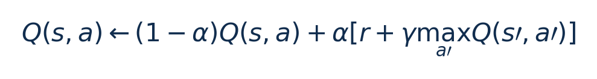
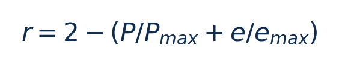
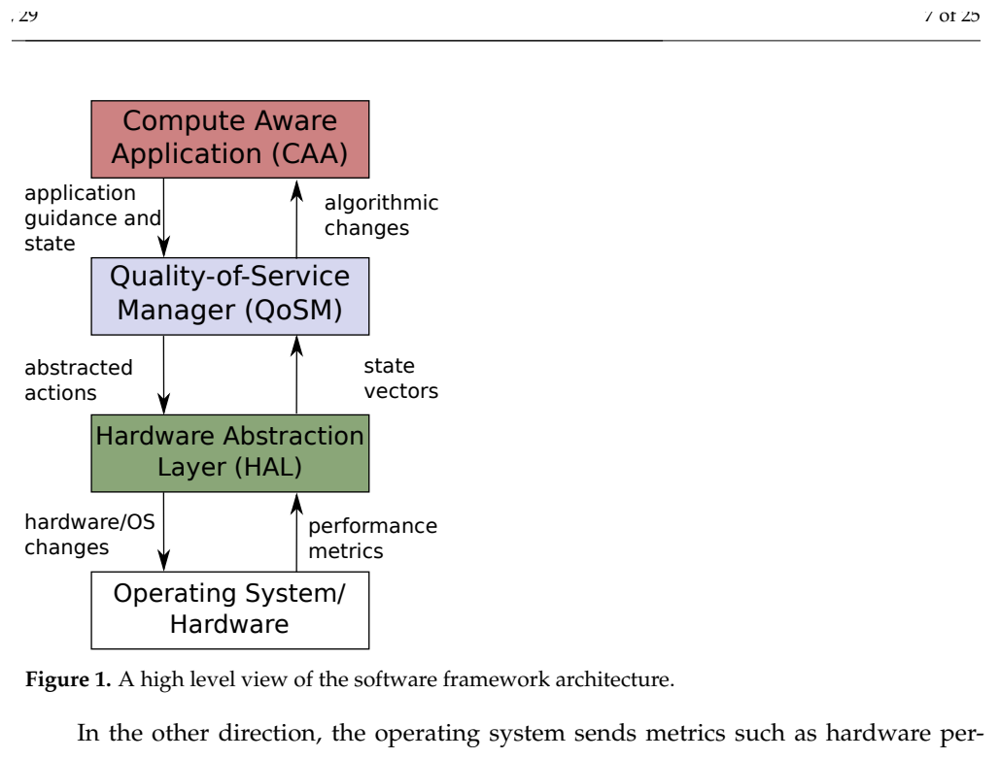
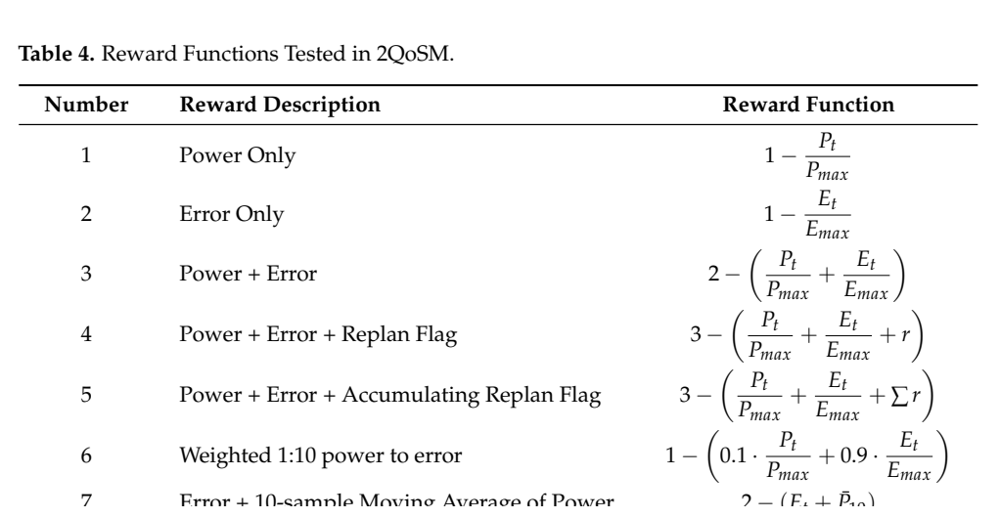
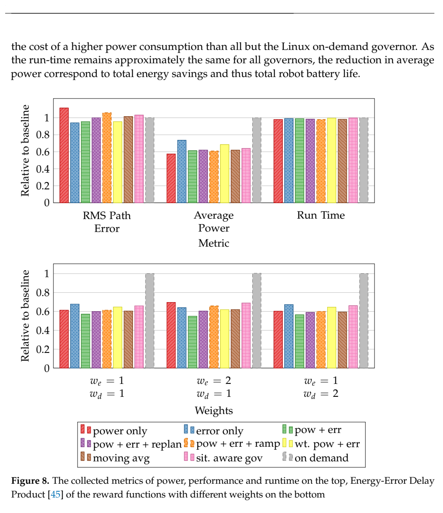

# 2QoSM表格Q：图文技术精读

[论文页面](https://doi.org/10.3390/jlpea12020029) · [本笔记所用 PDF](https://mdpi-res.com/d_attachment/jlpea/jlpea-12-00029/article_deploy/jlpea-12-00029.pdf) · [标识符](https://doi.org/10.3390/jlpea12020029)

整理日期：2026-11-05。**读者原创中文解读；原图归论文作者／出版方。未运行作者实验，不是独立复现。**

**一句话：** 用小Q表控制CPU性能状态，并用七种奖励展示省功率与服务质量的取舍

阅读地图：先看问题与输入输出，再顺着架构图、公式和结果图阅读；最后检查统计边界与E902迁移。完整编号索引另见“图表索引”。下文“读者分析”是推断或建议，不是原文结果。

## 阶段0：材料与版本审计

| 材料 | 当前可用程度 | 影响 |
| --- | --- | --- |
| 摘要、正文、方法、原图注 | 已获取本地完整PDF、文本与逐页渲染 | 可核查结构、实验及关键数字；可见页面优先于异常文本层 |
| 分析版本 | MDPI正式版25页，MCSoC2021论文扩展；关注CPU资源管理，不作为电机课题建议。 | 引用页码以“PDF第几页”标识 |
| 代码／原始数据 | 当前材料中尚未定位齐完整控制器源码、实验脚本和原始重复数据；这不表示这些材料不存在。 | 公开链接不等于已构建或已拿到原始轨迹 |
| 附件、独立原始重复与勘误 | 当前未完成全渠道附件／勘误穷尽检索 | 不能断言没有附件、没有勘误或没有其他版本 |
| 本次工作范围 | 材料阅读、图表裁取、证据整理、教学公式 | 所有新实验均是建议，尚未执行 |

## 阶段1：身份卡与整体概述

| 项目 | 内容 |
| --- | --- |
| 英文题名 | Low-Overhead Reinforcement Learning-Based Power Management Using 2QoSM |
| 中文导读题名 | 用小Q表控制CPU性能状态，并用七种奖励展示省功率与服务质量的取舍 |
| 作者 | Michael Giardino, Daniel Schwyn, Bonnie Ferri, Aldo Ferri |
| 发表／版本 | J. Low Power Electronics and Applications12(2),29 (2022)；MDPI正式版25页，MCSoC2021论文扩展；关注CPU资源管理，不作为电机课题建议。 |
| 类型与领域 | 原始方法／工程系统研究；DVFS、CPU能效、运行时控制 |
| 单位、通讯、资助与利益关系 | 作者姓名以本版本首页为准；通讯方式、单位及资助可回查首页与末页声明。当前尚未完成资助/利益关系/勘误的跨版本穷尽审计。 |
| 核心对象与接口 | 用户态QoSM独立线程，10ms hrtimer周期；各reward先600s训练，每次试验从同训练矩阵起步，试验中仍可更新 |
| 代码与数据 | 当前材料中尚未定位齐完整控制器源码、实验脚本和原始重复数据；这不表示这些材料不存在。 |
| 与本课题关系 | 只借鉴CPU资源管理：用块进度/余量/历史成本作小Q表状态，动作是合法频档；任务正确性不应被当作可交易reward，出错必须失败。无需任何电机知识。 |

**约200字中文概述（改写）：** 本文研究导航/路径规划CPU软件，计算量、访存与重规划需求变化；本文CPU控制不是电机控制算法的运行时能效。具体程序包括Anytime Dynamic A*（ADA*）路径规划、地图与轨迹规划线程；低层PID/里程计由另一Arduino承担，不是用户课题要实现的内容。作者在ODROID-XU4 Exynos5422，4×A15/4×A7、2GB，Ubuntu18.04/Linux4.14.5-92；cluster级DVFS；ArduinoROMEO/ATmega328P独立处理低层动作上采用C/GSL实现表格Q-learning，状态离散化，0.9概率选最大Q/0.1探索；10ms线程更新；七种reward对照，HAL映射至CPU性能状态。输入为路径误差、功率、重规划标志、通信校验错误、地图更新等离散状态；不只CPU利用率，输出为HAL定义的离散CPU性能状态（每状态5个动作Q条目）；具体频率映射需实现确认，线程迁核未作为本实验动作。主要结果应与下方基线、性能约束和测量范围一起阅读，不能只摘最高百分比。用可替换软件抽象把应用性能指标、Q-learning与HAL组合，并系统展示七种reward如何改变策略。学习器本身是经典表格Q，研究价值在状态/奖励/架构取舍。

**三句话定位：** 问题是为什么相同CPU利用率未必对应相同的工作需求？本篇的可检验主张是：用小Q表控制CPU性能状态，并用七种奖励展示省功率与服务质量的取舍。验证链是可观测状态→控制规则或学习模型→执行器→任务正确性/服务质量与能耗对照。 方法主线为路径误差、功率、重规划标志、通信校验错误、地图更新等离散状态；不只CPU利用率 → C/GSL实现表格Q-learning，状态离散化，0.9概率选最大Q/0.1探索；10ms线程更新；七种reward对照，HAL映射至CPU性能状态 → HAL定义的离散CPU性能状态（每状态5个动作Q条目）；具体频率映射需实现确认，线程迁核未作为本实验动作 → 执行与反馈。 主要证据见下方结果表，结论须与测量和版本范围一起使用。

## 阶段2：问题、假设与创新位置

为什么相同CPU利用率未必对应相同的工作需求？本篇的可检验主张是：用小Q表控制CPU性能状态，并用七种奖励展示省功率与服务质量的取舍。验证链是可观测状态→控制规则或学习模型→执行器→任务正确性/服务质量与能耗对照。

**创新判断（读者分析）：** 用可替换软件抽象把应用性能指标、Q-learning与HAL组合，并系统展示七种reward如何改变策略。学习器本身是经典表格Q，研究价值在状态/奖励/架构取舍。 不依据作者自称“首次”断定整个领域绝无前例。

## 阶段3：必要术语与数学

| 级别 | 术语／关键词 | 直觉、严格含义与易混点 |
| --- | --- | --- |
| A | DVFS / DFS | DVFS同时涉及动态电压与频率；只有时钟变化称DFS。电压能否改变取决于实际供电域。 |
| A | Workload | 真正执行应用计算的程序与输入；本文里的控制器是另一个角色。 |
| A | Controller | 根据观测选择动作的软件／硬件，可运行在同一CPU或独立控制核。 |
| A | OPP | Operating Performance Point，经过允许范围验证的电压—频率组合。 |
| A | Power / Energy | 功率W表示此刻消耗快慢；能量J是对时间积分。低功率不必然低能量。 |
| B | Deadline | 作业必须完成的时刻；平均时延、P95与最大时延各有不同用途。 |
| A | 被控程序 | Anytime Dynamic A*（ADA*）路径规划、地图与轨迹规划线程；低层PID/里程计由另一Arduino承担，不是用户课题要实现的内容 |
| A | 控制策略 | C/GSL实现表格Q-learning，状态离散化，0.9概率选最大Q/0.1探索；10ms线程更新；七种reward对照，HAL映射至CPU性能状态 |
| B | 控制周期 | 用户态QoSM独立线程，10ms hrtimer周期；各reward先600s训练，每次试验从同训练矩阵起步，试验中仍可更新 |
| B | 证据边界 | 实测、硬件仿真、功耗模型是不同证据，见平台与结果表。 |

### 公式1：表格Q更新

**符号与前提：** α学习率、γ折扣均无量纲；状态/动作必须离散；不是神经网络反向传播。

**代入与检查：** α=0.1、Q=1、r=0.5、γ=0.9、maxQ′=1时，新Q=1.04。教学例。

**来源：** Eq4，p7
### 公式2：归一化功率/误差奖励

**符号与前提：** P为W，e为任务误差；归一化后无量纲。压缩项目不使用物理路径误差。

**代入与检查：** 当功率比0.5、误差比0.2，r=1.3；必须同时检查绝对期限而非只最大化r。教学例。

**来源：** Table4，p13

## 阶段4–6：架构、关键图与方法拆解

**输入—处理—输出：** 路径误差、功率、重规划标志、通信校验错误、地图更新等离散状态；不只CPU利用率 → C/GSL实现表格Q-learning，状态离散化，0.9概率选最大Q/0.1探索；10ms线程更新；七种reward对照，HAL映射至CPU性能状态 → HAL定义的离散CPU性能状态（每状态5个动作Q条目）；具体频率映射需实现确认，线程迁核未作为本实验动作 → 执行与反馈。

| 系统角色 | 具体设置 |
| --- | --- |
| 具体控制算法 | C/GSL实现表格Q-learning，状态离散化，0.9概率选最大Q/0.1探索；10ms线程更新；七种reward对照，HAL映射至CPU性能状态 |
| 被控负载类型 | 导航/路径规划CPU软件，计算量、访存与重规划需求变化；本文CPU控制不是电机控制算法 |
| 具体被控程序 | Anytime Dynamic A*（ADA*）路径规划、地图与轨迹规划线程；低层PID/里程计由另一Arduino承担，不是用户课题要实现的内容 |
| 使用平台与测量 | ODROID-XU4 Exynos5422，4×A15/4×A7、2GB，Ubuntu18.04/Linux4.14.5-92；cluster级DVFS；ArduinoROMEO/ATmega328P独立处理低层动作 |
| 输入/状态 | 路径误差、功率、重规划标志、通信校验错误、地图更新等离散状态；不只CPU利用率 |
| 输出/动作 | HAL定义的离散CPU性能状态（每状态5个动作Q条目）；具体频率映射需实现确认，线程迁核未作为本实验动作 |
| 周期与运行位置 | 用户态QoSM独立线程，10ms hrtimer周期；各reward先600s训练，每次试验从同训练矩阵起步，试验中仍可更新 |

§4–5（p6–20）：compute-aware application向QoSM报告性能/应用提示，QoSM不知道具体物理含义也可打包状态并执行Q更新，HAL承担平台细节。Q表每项8B，文中1600状态×5动作=64KB；状态离散越细，空间相乘增长。Table2部分“离散级数—累计状态”乘积不完全一致，复现需从实现核对，不能照表盲算。

七种reward分别关注功率、误差、两者相加、重规划标志/累积量、权重和移动平均。功率是动作立即影响的量，误差还受路径/环境影响，容易被功率项压倒。本文机器人场景用于提供丰富CPU需求，不应据此给你安排电机控制；借鉴的是Q表、应用提示与奖励消融。

### Fig1：CAA/QoSM/HAL架构

[打开大图](images/original-fig1.png) · [原文 Fig1，PDF p7](https://mdpi-res.com/d_attachment/jlpea/jlpea-12-00029/article_deploy/jlpea-12-00029.pdf#page=7)

**怎样看：** 先读图题、图例、坐标/表头与单位，再在同一负载和同一基线内比较。应用提示、决策和执行器可替换。

**直接观察／原文报告：** 应用提示、决策和执行器可替换。

**读者判断：** 本项只支撑原文所列平台和配置；不证明E902可直接复用这些数值。

### Table4：七种reward定义

[打开大图](images/original-table4.png) · [原文 Table4，PDF p13](https://mdpi-res.com/d_attachment/jlpea/jlpea-12-00029/article_deploy/jlpea-12-00029.pdf#page=13)

**怎样看：** 先读图题、图例、坐标/表头与单位，再在同一负载和同一基线内比较。逐项比较归一化与权重，不能拼接最优指标。

**直接观察／原文报告：** 逐项比较归一化与权重，不能拼接最优指标。

**读者判断：** 本项只支撑原文所列平台和配置；不证明E902可直接复用这些数值。

| 阅读问题 | 先看材料 | 如何接到下一步 |
| --- | --- | --- |
| 为什么要改现有方案 | 问题背景与动机图 | 确定目标、约束和原有不足 |
| 系统观察什么、控制什么 | 输入输出表＋关键架构图 | 确认数据、模型和执行器真实角色 |
| 方法如何得到动作或估计 | 方法段、公式、算法／模型表 | 明确离线训练与在线流程 |
| 收益是否真实且公平 | 结果图表、统计与测量边界 | 核查基线／目标／分母／开销 |
| 能否用于自己的CPU | 局限、复现计划、三项实验 | 把论文假设变成待验证的工程条件 |

## 阶段7–8：实验、统计及证据链

本节数字均是**原文明确报告或原文数值的标注算例**；没有按图柱高度臆造额外精确值。

| 指标 | 原文报告 | 条件／分母／边界 | 证据位置 |
| --- | --- | --- | --- |
| power-only策略 | 平均功率降低42.6% vs Ondemand | 2.98W；相对situation-aware降低10.2%，但误差更大 | Fig8/§5.4，p15 |
| power＋error策略 | 功率−38.7%、误差−4.6% vs Ondemand | 同一reward可同时转述这两项；不是42.6%与6.1%同时获得 | §5.4，p15 |
| error-only策略 | 误差改善6.1% vs Ondemand | 属于另一策略；不能合并最高功率收益 | §5.4，p15 |
| Q表存储 | 64KB | 1600×5×8B，尚不含程序/栈/其他状态 | §5.2/Table2，p10–11 |

### Fig8：七种reward综合指标

[打开大图](images/original-fig8.png) · [原文 Fig8，PDF p15](https://mdpi-res.com/d_attachment/jlpea/jlpea-12-00029/article_deploy/jlpea-12-00029.pdf#page=15)

**怎样看：** 先读图题、图例、坐标/表头与单位，再在同一负载和同一基线内比较。最佳功率和最佳误差属于不同reward。

**直接观察／原文报告：** 最佳功率和最佳误差属于不同reward。

**读者判断：** 本项只支撑原文所列平台和配置；不证明E902可直接复用这些数值。

**统计与公平性审查（读者分析）：** 600s训练不是600个独立实验。作者每次重置到同一训练后Q表以减少连续学习差异，但运行中仍在线更新。功率、路径误差、完成时间与能量不同，42.6%是W指标；物理误差受环境而非仅CPU动作影响，reward与控制因果联系应谨慎解释。状态表算术不一致和具体动作映射属于复现缺口。

工程实验中，设备、程序、输入文件、重复运行、时间窗口是不同统计层级，不能互相替代。本任务不涉及生物样本，细胞／动物／试剂等检查不适用。未注明的P值或置信区间不补造；“差了几个百分点”不自动等于统计显著。

| 主张层级 | 直接证据 | 对照与统计 | 可得结论／替代解释 | 可信度 |
| --- | --- | --- | --- | --- |
| 原文明确报告 | power-only策略：平均功率降低42.6% vs Ondemand | Fig8/§5.4，p15 | 2.98W；相对situation-aware降低10.2%，但误差更大；仅在该实验范围内成立 | 图表／文本可核对：高；独立复现：尚无 |
| 作者解释 | 所提架构／模型解释了性能或估计改善 | 关键原图与方法见上文；统计边界见下节 | 效果可能同时来自动作空间、平台特性与采样设置，因果归因需消融 | 中 |
| AI分析／迁移假设 | 用于E902的压缩候选负载 | 本篇未直接验证该芯片与任务组合 | 需三项后续实验；不能复制论文收益数字 | 待验证，当前无法判断 |

## 阶段9–10：贡献与局限分开判断

用可替换软件抽象把应用性能指标、Q-learning与HAL组合，并系统展示七种reward如何改变策略。学习器本身是经典表格Q，研究价值在状态/奖励/架构取舍。

| 来源 | 严重程度 | 局限及其影响 |
| --- | --- | --- |
| 读者分析 | 关键 | 不能把机器人误差reward直接移植压缩应用；应以正确性、期限和净能量重定义。 |
| 读者分析 | 关键 | 64KB表可能占E902系统较大RAM，状态压缩是关键。 |
| 读者分析 | 关键 | 在线探索会导致服务质量下降，需要冻结策略/安全回退；不存在训练结束即严格保证。 |

## 阶段11：最小复现路线与缺口

先重建原文固定安全档、输入文件和测量边界，再实现上述算法。逐档确认正确输出和执行时间，记录控制、监测、调频与空闲成本；冻结模型后用整文件留出的输入测试。原文未定位齐的参数须列入复现日志，不用猜测值伪装完整复现。只借鉴CPU资源管理：用块进度/余量/历史成本作小Q表状态，动作是合法频档；任务正确性不应被当作可交易reward，出错必须失败。无需任何电机知识。

**代码／数据现状：** 当前材料中尚未定位齐完整控制器源码、实验脚本和原始重复数据；这不表示这些材料不存在。

**质量控制顺序：** 先验证程序输出和时间基准，再验证采样／模型，最后比较策略。保存输入文件哈希、平台配置、OPP、随机种子、温度与每次运行原始记录。失败时先回固定安全频点定位错误，再继续优化。复现可行性判断为“可开始部分方法复建，完整数值复现条件未齐”；这与“已完成复现”不同。

## 阶段12：用于你的CPU／E902课题

只借鉴CPU资源管理：用块进度/余量/历史成本作小Q表状态，动作是合法频档；任务正确性不应被当作可交易reward，出错必须失败。无需任何电机知识。

| 建议实验／优先级 | 价值 | 最低资源 | 主要风险 | 成功判据（设计目标，非已得结果） |
| --- | --- | --- | --- | --- |
| P0：极小Q表 | 测E902资源可行性 | 例如3×3状态与合法频档 | 状态太粗丢需求 | 报告Q表/代码RAM与推理周期 |
| P1：reward消融 | 防只追求低频而超时 | 同输入和三个reward | 尺度导致一项支配 | 比较净能量、期限违约和正确性 |
| P1：探索与冻结 | 区分训练代价和部署收益 | 固定训练文件/独立测试集 | 在线探索破坏服务 | 测试冻结策略并记录回退次数 |

上述优先级是读者建议：P0先做，P1建立在基线可运行后，P2只在资源允许且前序实验证明有必要时开展。压缩应用仍是候选，尚未替你最终定题或证明已在E902运行。论文公开可读不自动授权任意复制数据；代码、图片和数据须分别核对许可。

## 阶段13：读完后应掌握与继续核查

**五个知识点：** 用小Q表控制CPU性能状态，并用七种奖励展示省功率与服务质量的取舍 你还应能解释输入输出表中的角色、两条公式的单位、首个结果指标的分母，以及局限表里的关键条件。

**五个未决问题：** 独立新输入是否成立？最差时延是否可接受？测量参考是否足够？控制与切换是否抵消收益？E902实际具有哪些接口和可观测量？这些是研究问题，不是对作者遗漏的无证据指控。

**立即做：** 按公式算例手算一次，选一张结果图复述“硬件—负载—基线—指标—边界”。**后续核查：** 补齐代码版本、训练数据和仪表设置。**可复用：** 上文明确标注的模型与接口思路。**谨慎采用：** 所有跨平台百分比。**暂不采用：** 尚未证实存在的电压控制和完整硬实时承诺。
