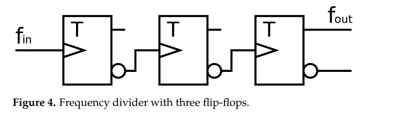
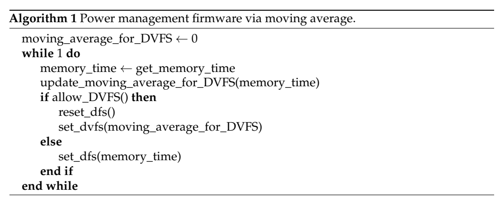
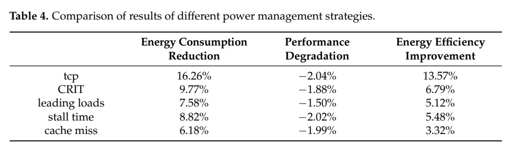

# 数字分频＋DVFS：图文技术精读

[论文页面](https://doi.org/10.3390/electronics12020407) · [本笔记所用 PDF](https://mdpi-res.com/d_attachment/electronics/electronics-12-00407/article_deploy/electronics-12-00407.pdf) · [标识符](https://doi.org/10.3390/electronics12020407)

整理日期：2026-11-05。**读者原创中文解读；原图归论文作者／出版方。未运行作者实验，不是独立复现。**

**一句话：** 用快速数字分频处理短访存阶段，再由较慢的电压频率环处理持续阶段

阅读地图：先看问题与输入输出，再顺着架构图、公式和结果图阅读；最后检查统计边界与E902迁移。完整编号索引另见“图表索引”。下文“读者分析”是推断或建议，不是原文结果。

## 阶段0：材料与版本审计

| 材料 | 当前可用程度 | 影响 |
| --- | --- | --- |
| 摘要、正文、方法、原图注 | 已获取本地完整PDF、文本与逐页渲染 | 可核查结构、实验及关键数字；可见页面优先于异常文本层 |
| 分析版本 | MDPI正式版18页；摘要与Table4平均节能数值冲突，以下保留Table4的16.26%。 | 引用页码以“PDF第几页”标识 |
| 代码／原始数据 | 当前材料中尚未定位齐完整控制器源码、实验脚本和原始重复数据；这不表示这些材料不存在。 | 公开链接不等于已构建或已拿到原始轨迹 |
| 附件、独立原始重复与勘误 | 当前未完成全渠道附件／勘误穷尽检索 | 不能断言没有附件、没有勘误或没有其他版本 |
| 本次工作范围 | 材料阅读、图表裁取、证据整理、教学公式 | 所有新实验均是建议，尚未执行 |

## 阶段1：身份卡与整体概述

| 项目 | 内容 |
| --- | --- |
| 英文题名 | Fine-Grained CPU Power Management Based on Digital Frequency Divider |
| 中文导读题名 | 用快速数字分频处理短访存阶段，再由较慢的电压频率环处理持续阶段 |
| 作者 | Fan Jia, Longbing Zhang |
| 发表／版本 | Electronics12(2),407 (2023)；MDPI正式版18页；摘要与Table4平均节能数值冲突，以下保留Table4的16.26%。 |
| 类型与领域 | 原始方法／工程系统研究；DVFS、CPU能效、运行时控制 |
| 单位、通讯、资助与利益关系 | 作者姓名以本版本首页为准；通讯方式、单位及资助可回查首页与末页声明。当前尚未完成资助/利益关系/勘误的跨版本穷尽审计。 |
| 核心对象与接口 | 快采样512/1024/2048/4096周期；慢DVFS操作间隔>100µs，移动平均25µs；不是Linux毫秒governor |
| 代码与数据 | 当前材料中尚未定位齐完整控制器源码、实验脚本和原始重复数据；这不表示这些材料不存在。 |
| 与本课题关系 | 很适合你“先DFS、再接DVFS”的硬件路线：独立安全分频快环与合法OPP慢环。E902先用实际可观测的总线等待/流水线停顿替代MSHR，再验证时钟域与ack，不照搬乱序核内部逻辑。 |

**约200字中文概述（改写）：** 本文研究乱序CPU上短突发与持续访存密集阶段的运行时能效。具体程序包括SPEC CPU2017 traces，例605.mcf、619.lbm、xalancbmk等；非实际板卡上直接运行SPEC测试。作者在ChampSim修改L2 MSHR与频率时序、McPAT功耗模型；2.5GHz乱序CPU模型，8个DVFS×8个分频配置（64有效频级）；另用Design Compiler估面积上采用改进CRIT访存关键路径计数＋512–4096周期密集采样；25µs移动平均/稳定判定；快DFS分频与≥100µs慢DVFS双层规则。输入为各MSHR miss/refill事件、访存关键路径周期比例cp、当前档位、DVFS冷却时间与稳定状态，输出为快环数字分频比；慢环DVFS档位与分频复位；分频本身不改变电压。主要结果应与下方基线、性能约束和测量范围一起阅读，不能只摘最高百分比。将短窗口访存关键路径估计与双时间尺度DFS/DVFS结合，在电压环响应慢时仍利用快速时钟动作。重点是执行器时间尺度与估计粒度配合，不是复杂学习器。

**三句话定位：** 问题是为什么相同CPU利用率未必对应相同的工作需求？本篇的可检验主张是：用快速数字分频处理短访存阶段，再由较慢的电压频率环处理持续阶段。验证链是可观测状态→控制规则或学习模型→执行器→任务正确性/服务质量与能耗对照。 方法主线为各MSHR miss/refill事件、访存关键路径周期比例cp、当前档位、DVFS冷却时间与稳定状态 → 改进CRIT访存关键路径计数＋512–4096周期密集采样；25µs移动平均/稳定判定；快DFS分频与≥100µs慢DVFS双层规则 → 快环数字分频比；慢环DVFS档位与分频复位；分频本身不改变电压 → 执行与反馈。 主要证据见下方结果表，结论须与测量和版本范围一起使用。

## 阶段2：问题、假设与创新位置

为什么相同CPU利用率未必对应相同的工作需求？本篇的可检验主张是：用快速数字分频处理短访存阶段，再由较慢的电压频率环处理持续阶段。验证链是可观测状态→控制规则或学习模型→执行器→任务正确性/服务质量与能耗对照。

**创新判断（读者分析）：** 将短窗口访存关键路径估计与双时间尺度DFS/DVFS结合，在电压环响应慢时仍利用快速时钟动作。重点是执行器时间尺度与估计粒度配合，不是复杂学习器。 不依据作者自称“首次”断定整个领域绝无前例。

## 阶段3：必要术语与数学

| 级别 | 术语／关键词 | 直觉、严格含义与易混点 |
| --- | --- | --- |
| A | DVFS / DFS | DVFS同时涉及动态电压与频率；只有时钟变化称DFS。电压能否改变取决于实际供电域。 |
| A | Workload | 真正执行应用计算的程序与输入；本文里的控制器是另一个角色。 |
| A | Controller | 根据观测选择动作的软件／硬件，可运行在同一CPU或独立控制核。 |
| A | OPP | Operating Performance Point，经过允许范围验证的电压—频率组合。 |
| A | Power / Energy | 功率W表示此刻消耗快慢；能量J是对时间积分。低功率不必然低能量。 |
| B | Deadline | 作业必须完成的时刻；平均时延、P95与最大时延各有不同用途。 |
| A | 被控程序 | SPEC CPU2017 traces，例605.mcf、619.lbm、xalancbmk等；非实际板卡上直接运行SPEC测试 |
| A | 控制策略 | 改进CRIT访存关键路径计数＋512–4096周期密集采样；25µs移动平均/稳定判定；快DFS分频与≥100µs慢DVFS双层规则 |
| B | 控制周期 | 快采样512/1024/2048/4096周期；慢DVFS操作间隔>100µs，移动平均25µs；不是Linux毫秒governor |
| B | 证据边界 | 实测、硬件仿真、功耗模型是不同证据，见平台与结果表。 |

### 公式1：快慢环动作（教学整理）

**符号与前提：** cp为访存时间比例，无量纲；稳定与allowed包含驻留/电压切换间隔。

**代入与检查：** 访存突发5µs可先DFS，但不说明5µs内完成调压。

**来源：** Algorithm1–2，p7–8
### 公式2：ED²P比较

**符号与前提：** E为J、T为s；ED²P单位J·s²，改善值需使用同基线。

**代入与检查：** E降16%、T增2%，乘积为0.84×1.02²≈0.874，不能把16%直接当ED²P改善。教学例。

**来源：** §4/Table4，p12

## 阶段4–6：架构、关键图与方法拆解

**输入—处理—输出：** 各MSHR miss/refill事件、访存关键路径周期比例cp、当前档位、DVFS冷却时间与稳定状态 → 改进CRIT访存关键路径计数＋512–4096周期密集采样；25µs移动平均/稳定判定；快DFS分频与≥100µs慢DVFS双层规则 → 快环数字分频比；慢环DVFS档位与分频复位；分频本身不改变电压 → 执行与反馈。

| 系统角色 | 具体设置 |
| --- | --- |
| 具体控制算法 | 改进CRIT访存关键路径计数＋512–4096周期密集采样；25µs移动平均/稳定判定；快DFS分频与≥100µs慢DVFS双层规则 |
| 被控负载类型 | 乱序CPU上短突发与持续访存密集阶段 |
| 具体被控程序 | SPEC CPU2017 traces，例605.mcf、619.lbm、xalancbmk等；非实际板卡上直接运行SPEC测试 |
| 使用平台与测量 | ChampSim修改L2 MSHR与频率时序、McPAT功耗模型；2.5GHz乱序CPU模型，8个DVFS×8个分频配置（64有效频级）；另用Design Compiler估面积 |
| 输入/状态 | 各MSHR miss/refill事件、访存关键路径周期比例cp、当前档位、DVFS冷却时间与稳定状态 |
| 输出/动作 | 快环数字分频比；慢环DVFS档位与分频复位；分频本身不改变电压 |
| 周期与运行位置 | 快采样512/1024/2048/4096周期；慢DVFS操作间隔>100µs，移动平均25µs；不是Linux毫秒governor |

§3–4（p6–16）：在时钟树加数字分频，短访存片段先降低频率；电压调节受稳压器时限约束，只有持续且稳定的访存特征才调整OPP。Algorithm1用25µs移动平均和stable_limit抑制突发，Algorithm2比较密集即时采样；二者均在不能做DVFS时仍可DFS。Algorithm3改造CRIT边界计数，跟踪P_global、每MSHR的P_i与P_cp，避免短窗口对未完成miss漏计。按性能损失容限x（本实验10%）推导cp阈值。

实验证据是模拟执行与模型能量；提到Loongson3A5000已有分频并不表示本文在3A5000上电测。摘要16.36%与p12 Table4的16.26%不一致；正文“25ns”与同段反复25µs也不一致，应标注排印疑点。Table3部分延迟行出现明显错位，完整复现需作者配置，而非猜数填回。

### Fig4：数字分频器

[打开大图](images/original-fig4.png) · [原文 Fig4，PDF p6](https://mdpi-res.com/d_attachment/electronics/electronics-12-00407/article_deploy/electronics-12-00407.pdf#page=6)

**怎样看：** 先读图题、图例、坐标/表头与单位，再在同一负载和同一基线内比较。三级触发器可分频，但不改变电压。

**直接观察／原文报告：** 三级触发器可分频，但不改变电压。

**读者判断：** 本项只支撑原文所列平台和配置；不证明E902可直接复用这些数值。

### Algorithm1：移动平均快慢环

[打开大图](images/original-algorithm1.png) · [原文 Algorithm1，PDF p7](https://mdpi-res.com/d_attachment/electronics/electronics-12-00407/article_deploy/electronics-12-00407.pdf#page=7)

**怎样看：** 先读图题、图例、坐标/表头与单位，再在同一负载和同一基线内比较。稳定时慢DVFS，否则快DFS。

**直接观察／原文报告：** 稳定时慢DVFS，否则快DFS。

**读者判断：** 本项只支撑原文所列平台和配置；不证明E902可直接复用这些数值。

| 阅读问题 | 先看材料 | 如何接到下一步 |
| --- | --- | --- |
| 为什么要改现有方案 | 问题背景与动机图 | 确定目标、约束和原有不足 |
| 系统观察什么、控制什么 | 输入输出表＋关键架构图 | 确认数据、模型和执行器真实角色 |
| 方法如何得到动作或估计 | 方法段、公式、算法／模型表 | 明确离线训练与在线流程 |
| 收益是否真实且公平 | 结果图表、统计与测量边界 | 核查基线／目标／分母／开销 |
| 能否用于自己的CPU | 局限、复现计划、三项实验 | 把论文假设变成待验证的工程条件 |

## 阶段7–8：实验、统计及证据链

本节数字均是**原文明确报告或原文数值的标注算例**；没有按图柱高度臆造额外精确值。

| 指标 | 原文报告 | 条件／分母／边界 | 证据位置 |
| --- | --- | --- | --- |
| 模型平均能量降低 | 16.26%（Table4） | 相对无DVFS；摘要写16.36%，版本内不一致 | Table4，p12 |
| 模型平均性能损失 | 2.04% | CRIT1.88%；容限10%是阈值设计设置，非所有应用实证硬上界 | Table4/Fig8，p12–13 |
| ED²P能效改善 | 13.57% | CRIT6.79%；不是额外节能13.57% | Table4，p12 |
| 新增面积 | <0.01% | 作者对计数逻辑综合结果；不等于含PLL/PMIC全控制系统面积 | §3.4，p11 |

### Table4：核心平均结果

[打开大图](images/original-table4.png) · [原文 Table4，PDF p12](https://mdpi-res.com/d_attachment/electronics/electronics-12-00407/article_deploy/electronics-12-00407.pdf#page=12)

**怎样看：** 先读图题、图例、坐标/表头与单位，再在同一负载和同一基线内比较。视觉可见16.26%，与摘要16.36%冲突。

**直接观察／原文报告：** 视觉可见16.26%，与摘要16.36%冲突。

**读者判断：** 本项只支撑原文所列平台和配置；不证明E902可直接复用这些数值。

**统计与公平性审查（读者分析）：** 实验单位为SPEC trace与模拟配置，不是独立芯片电测重复。对照使用相同阈值但不同估计/时间粒度，收益包括更细采样与快分频贡献；须用消融分开。能量/性能/ED²P指标不可混成同一百分比；摘要与表格矛盾已视觉核对。

工程实验中，设备、程序、输入文件、重复运行、时间窗口是不同统计层级，不能互相替代。本任务不涉及生物样本，细胞／动物／试剂等检查不适用。未注明的P值或置信区间不补造；“差了几个百分点”不自动等于统计显著。

| 主张层级 | 直接证据 | 对照与统计 | 可得结论／替代解释 | 可信度 |
| --- | --- | --- | --- | --- |
| 原文明确报告 | 模型平均能量降低：16.26%（Table4） | Table4，p12 | 相对无DVFS；摘要写16.36%，版本内不一致；仅在该实验范围内成立 | 图表／文本可核对：高；独立复现：尚无 |
| 作者解释 | 所提架构／模型解释了性能或估计改善 | 关键原图与方法见上文；统计边界见下节 | 效果可能同时来自动作空间、平台特性与采样设置，因果归因需消融 | 中 |
| AI分析／迁移假设 | 用于E902的压缩候选负载 | 本篇未直接验证该芯片与任务组合 | 需三项后续实验；不能复制论文收益数字 | 待验证，当前无法判断 |

## 阶段9–10：贡献与局限分开判断

将短窗口访存关键路径估计与双时间尺度DFS/DVFS结合，在电压环响应慢时仍利用快速时钟动作。重点是执行器时间尺度与估计粒度配合，不是复杂学习器。

| 来源 | 严重程度 | 局限及其影响 |
| --- | --- | --- |
| 读者分析 | 关键 | E902不是大乱序核，未必有L2 MSHR或同样访存重叠，需要重新定义可观测停顿。 |
| 读者分析 | 关键 | 功耗模型误差、时钟切换毛刺/时序收敛与PMIC实际成本未由此仿真全部验证。 |
| 读者分析 | 关键 | 细采样增加计数与控制开销，不能只采纳最细间隔而忽略执行能力。 |

## 阶段11：最小复现路线与缺口

先重建原文固定安全档、输入文件和测量边界，再实现上述算法。逐档确认正确输出和执行时间，记录控制、监测、调频与空闲成本；冻结模型后用整文件留出的输入测试。原文未定位齐的参数须列入复现日志，不用猜测值伪装完整复现。很适合你“先DFS、再接DVFS”的硬件路线：独立安全分频快环与合法OPP慢环。E902先用实际可观测的总线等待/流水线停顿替代MSHR，再验证时钟域与ack，不照搬乱序核内部逻辑。

**代码／数据现状：** 当前材料中尚未定位齐完整控制器源码、实验脚本和原始重复数据；这不表示这些材料不存在。

**质量控制顺序：** 先验证程序输出和时间基准，再验证采样／模型，最后比较策略。保存输入文件哈希、平台配置、OPP、随机种子、温度与每次运行原始记录。失败时先回固定安全频点定位错误，再继续优化。复现可行性判断为“可开始部分方法复建，完整数值复现条件未齐”；这与“已完成复现”不同。

## 阶段12：用于你的CPU／E902课题

很适合你“先DFS、再接DVFS”的硬件路线：独立安全分频快环与合法OPP慢环。E902先用实际可观测的总线等待/流水线停顿替代MSHR，再验证时钟域与ack，不照搬乱序核内部逻辑。

| 建议实验／优先级 | 价值 | 最低资源 | 主要风险 | 成功判据（设计目标，非已得结果） |
| --- | --- | --- | --- | --- |
| P0：快分频闭环 | 建立可控执行器 | 无毛刺分频/握手、真实压缩程序 | 直接改时钟会破坏总线时序 | 所有档解压正确、测命令至生效 |
| P1：双时间尺度 | 比较快DFS与慢OPP | 保守停顿指标和驻留时间 | 细粒度控制成本过高 | 消融固定/DFS/慢DVFS/双环 |
| P1：能量模型审计 | 防模拟收益冒充实测 | RTL开关活动或外部电测 | 同模型训练评价自证 | 明确模型误差与实测边界 |

上述优先级是读者建议：P0先做，P1建立在基线可运行后，P2只在资源允许且前序实验证明有必要时开展。压缩应用仍是候选，尚未替你最终定题或证明已在E902运行。论文公开可读不自动授权任意复制数据；代码、图片和数据须分别核对许可。

## 阶段13：读完后应掌握与继续核查

**五个知识点：** 用快速数字分频处理短访存阶段，再由较慢的电压频率环处理持续阶段 你还应能解释输入输出表中的角色、两条公式的单位、首个结果指标的分母，以及局限表里的关键条件。

**五个未决问题：** 独立新输入是否成立？最差时延是否可接受？测量参考是否足够？控制与切换是否抵消收益？E902实际具有哪些接口和可观测量？这些是研究问题，不是对作者遗漏的无证据指控。

**立即做：** 按公式算例手算一次，选一张结果图复述“硬件—负载—基线—指标—边界”。**后续核查：** 补齐代码版本、训练数据和仪表设置。**可复用：** 上文明确标注的模型与接口思路。**谨慎采用：** 所有跨平台百分比。**暂不采用：** 尚未证实存在的电压控制和完整硬实时承诺。
