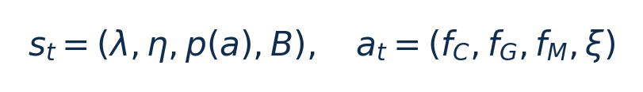

# DVFO：边云协同推理：从零入门

[论文页面](https://arxiv.org/abs/2306.01811v3) · [本笔记所用 PDF](https://arxiv.org/pdf/2306.01811v3) · [标识符](https://doi.org/10.48550/arXiv.2306.01811)

整理日期：2026-11-06。**读者原创中文解读；原图归论文作者／出版方。未运行作者实验，不是独立复现。**

## 先把四个角色放对位置

被控负载是要完成的程序和输入，比如识别一帧图像、生成token或完成一次训练迭代；CPU/GPU是执行程序的硬件；控制器根据观测选运行档位；驱动／寄存器把档位落实。程序代码可以完全一样，CPU时钟变慢时每条指令对应的墙钟时间通常变长，访存或I/O等待则未必按同样比例变化。

软件控制并不意味着没有真实硬件。软件中的学习策略可控制真实CPU；也可先控制一个执行时间与能量模型。后者能验证闭环逻辑，但模型输出的J不能当真实电测。E902的RTL能在仿真中改变时钟并反馈计数；电压导致的物理功耗还需相应模型、功耗分析或板级实验。

## 这篇到底解决哪一件事

用并发DQN联合选择边缘CPU/GPU/内存频率与特征卸载比例，结合注意力和量化降低边缘推理成本

为什么局部利用率不能完整反映整个应用的性能与能耗？本篇的研究问题或可检验主张是：用并发DQN联合选择边缘CPU/GPU/内存频率与特征卸载比例，结合注意力和量化降低边缘推理成本。验证链是可观测状态→控制规则或学习模型→执行器→任务正确性/服务质量与能耗对照。

**把方法想成一条流水线：** η能量/时延权重、融合权重λ、SCAM特征重要性分布、当前带宽B；历史reward/replay用于训练 → 离线训练、在线推理的concurrent DQN：prioritized replay＋ε-greedy；thinking-while-moving减少决策阻塞；SCAM选择特征＋INT8量化＋加权融合 → CPU/GPU/内存频率三元组＋特征分配比例ξ；另由SCAM确定重要特征和加权融合输出 → 执行与反馈。

| 先回答的问题 | 本文答案 |
| --- | --- |
| 具体控制算法 | 离线训练、在线推理的concurrent DQN：prioritized replay＋ε-greedy；thinking-while-moving减少决策阻塞；SCAM选择特征＋INT8量化＋加权融合 |
| 被控负载类型 | 边缘–云协同CV分类推理，网络带宽变化 |
| 具体被控程序 | 主实验EfficientNet-B0与ViT-B16，CIFAR100/ImageNet2012；扩展ResNet18、Inception-v3、MobileNet-v2、MaxViT |
| 使用平台与测量 | Jetson Nano/TX2/Xavier NX（默认NX）；云RTX3080＋Xeon6226R；PyTorch、nvpmodel、jetson-stats边缘设备遥测；云端能量未计入边缘ETI |
| 输入/状态 | η能量/时延权重、融合权重λ、SCAM特征重要性分布、当前带宽B；历史reward/replay用于训练 |
| 输出/动作 | CPU/GPU/内存频率三元组＋特征分配比例ξ；另由SCAM确定重要特征和加权融合输出 |
| 周期与运行位置 | 以推理任务为动作边界；策略推理与正在执行的动作并发，不是CPU利用率固定周期阈值 |

## 十个先修关键词

| 级别 | 术语／关键词 | 直觉、严格含义与易混点 |
| --- | --- | --- |
| A | DVFS / DFS | DVFS同时涉及动态电压与频率；只有时钟变化称DFS。电压能否改变取决于实际供电域。 |
| A | Workload | 真正执行应用计算的程序与输入；本文里的控制器是另一个角色。 |
| A | Controller | 根据观测选择动作的软件／硬件，可运行在同一CPU或独立控制核。 |
| A | OPP | Operating Performance Point，经过允许范围验证的电压—频率组合。 |
| A | Power / Energy | 功率W表示此刻消耗快慢；能量J是对时间积分。低功率不必然低能量。 |
| B | Deadline | 作业必须完成的时刻；平均时延、P95与最大时延各有不同用途。 |
| A | 被控程序 | 主实验EfficientNet-B0与ViT-B16，CIFAR100/ImageNet2012；扩展ResNet18、Inception-v3、MobileNet-v2、MaxViT |
| A | 控制策略 | 离线训练、在线推理的concurrent DQN：prioritized replay＋ε-greedy；thinking-while-moving减少决策阻塞；SCAM选择特征＋INT8量化＋加权融合 |
| B | 控制周期 | 以推理任务为动作边界；策略推理与正在执行的动作并发，不是CPU利用率固定周期阈值 |
| B | 证据边界 | 实测、硬件仿真、功耗模型是不同证据，见平台与结果表。 |

## 用一个小算例建立直觉

教学例B减半会拉长传输；即使本地CPU占用不变，也可能需要减少卸载。

λ/η与ξ无量纲，p(a)为特征重要性分布，B为bit/s，频率单位必须统一MHz。

**要防止的误读：** 正文p12提Table6，但该PDF可见实际表编号到Table4；保留交叉引用缺口，不虚构Table5/6。

## 论文真正验证了什么

| 指标 | 原文报告 | 条件／分母／边界 | 证据位置 |
| --- | --- | --- | --- |
| 主推理能量降低 | 18.4%/31.2%/39.7%/43.4% | 分别相对DRLDO/AppealNet/Cloud-only/Edge-only；NX、5Mbps、两模型×两数据集平均，边缘能量 | §6.3/Fig8，p9 |
| 端到端时延降低 | 28.6%–59.1% | 相对上述不同基线；不是纯DVFS消融收益 | Fig8，p9 |
| 准确率边界 | §6.3称相对Edge-only损失within2%；融合例0.68/0.56个百分点 | 摘要within1%与主实验within2%不能合并；Table4只比较融合实现 | Fig9/Table4，p10/12 |

这些结果来自作者实验。算法reward、模型误差、控制器时延、被控应用速度与应用节能是不同指标，要看具体行的单位和证据。

## 它与你的毕设怎么接起来

若选CV且有Jetson与云GPU，可做联合卸载；若只有CPU，先缩成“本地CPU推理＋离散频率”并保留质量约束。E902不能默认接DQN或跑ViT；可迁移“状态—动作—reward表”和异步控制开销测量。

最先可以尝试：**P0：固定模型本地推理基线**。理由是先验证应用与执行器，建立同边界基线；最低资源是Jetson/可调频Linux CPU，小型分类模型；卸载版本另需云端与带宽控制；通过标准是输出正确；保存实际频率、温度、时延与积分能量。

## 五分钟自测

1. 这篇输出的是下一频率、功率估计，还是通信／控制时序？
2. 是真实负载硬件实验，还是模型／RTL／HIL？哪些部分是真的？
3. 最重要百分比的分母和比较对象是什么？
4. 如果换成单核E902，哪一个输入或硬件旋钮会消失？
5. 算上采样、推理、切频和空闲时间后，节能是否还成立？

答案线索在本页角色表和结果表；进一步读“图文技术精读”的关键原图、公式与三项课题实验，再到“图表索引”回查原PDF。不是先记住论文所有缩写。
