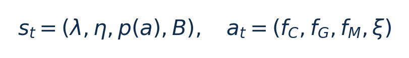
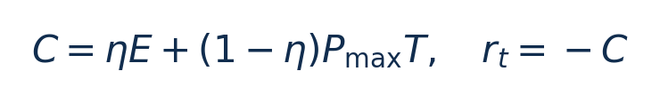
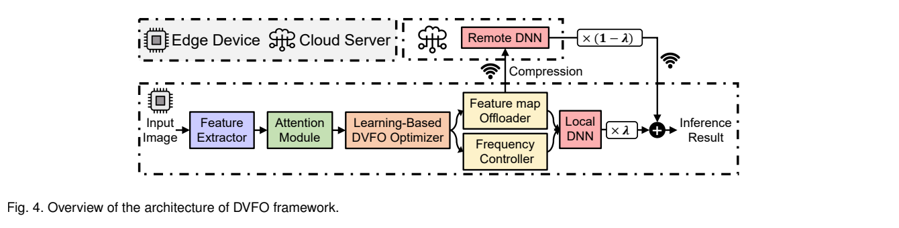
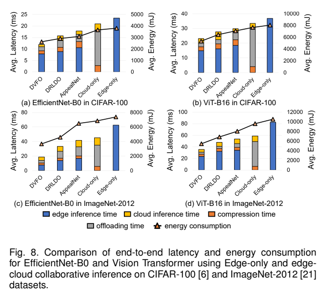
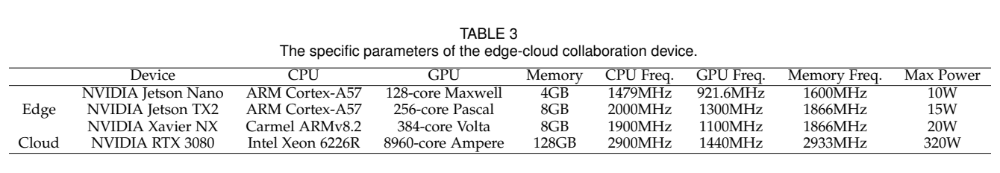

# DVFO：边云协同推理：图文技术精读

[论文页面](https://arxiv.org/abs/2306.01811v3) · [本笔记所用 PDF](https://arxiv.org/pdf/2306.01811v3) · [标识符](https://doi.org/10.48550/arXiv.2306.01811)

整理日期：2026-11-06。**读者原创中文解读；原图归论文作者／出版方。未运行作者实验，不是独立复现。**

**一句话：** 用并发DQN联合选择边缘CPU/GPU/内存频率与特征卸载比例，结合注意力和量化降低边缘推理成本

阅读地图：先看问题与输入输出，再顺着架构图、公式和结果图阅读；最后检查统计边界与E902迁移。完整编号索引另见“图表索引”。下文“读者分析”是推断或建议，不是原文结果。

## 阶段0：材料与版本审计

| 材料 | 当前可用程度 | 影响 |
| --- | --- | --- |
| 摘要、正文、方法、原图注 | 已获取本地完整PDF、文本与逐页渲染 | 可核查结构、实验及关键数字；可见页面优先于异常文本层 |
| 分析版本 | arXiv2306.01811v3，2023-06-23，16页。 | 引用页码以“PDF第几页”标识 |
| 代码／原始数据 | 当前材料中尚未定位齐完整控制器源码、实验脚本和原始重复数据；这不表示这些材料不存在。 | 公开链接不等于已构建或已拿到原始轨迹 |
| 附件、独立原始重复与勘误 | 当前未完成全渠道附件／勘误穷尽检索 | 不能断言没有附件、没有勘误或没有其他版本 |
| 本次工作范围 | 材料阅读、图表裁取、证据整理、教学公式 | 所有新实验均是建议，尚未执行 |

## 阶段1：身份卡与整体概述

| 项目 | 内容 |
| --- | --- |
| 英文题名 | DVFO: Learning-Based DVFS for Energy-Efficient Edge-Cloud Collaborative Inference |
| 中文导读题名 | 用并发DQN联合选择边缘CPU/GPU/内存频率与特征卸载比例，结合注意力和量化降低边缘推理成本 |
| 作者 | Ziyang Zhang, Yang Zhao, Huan Li, Changyao Lin, Jie Liu |
| 发表／版本 | arXiv预印本2023；arXiv2306.01811v3，2023-06-23，16页。 |
| 类型与领域 | 原始方法／工程系统研究；DVFS、GPU/CPU能效、CV/LLM应用运行时控制 |
| 单位、通讯、资助与利益关系 | 作者姓名以本版本首页为准；通讯方式、单位及资助可回查首页与末页声明。当前尚未完成资助/利益关系/勘误的跨版本穷尽审计。 |
| 核心对象与接口 | 以推理任务为动作边界；策略推理与正在执行的动作并发，不是CPU利用率固定周期阈值 |
| 代码与数据 | 当前材料中尚未定位齐完整控制器源码、实验脚本和原始重复数据；这不表示这些材料不存在。 |
| 与本课题关系 | 若选CV且有Jetson与云GPU，可做联合卸载；若只有CPU，先缩成“本地CPU推理＋离散频率”并保留质量约束。E902不能默认接DQN或跑ViT；可迁移“状态—动作—reward表”和异步控制开销测量。 |

**约200字中文概述（改写）：** 本文研究边缘–云协同CV分类推理，网络带宽变化的运行时能效。具体程序包括主实验EfficientNet-B0与ViT-B16，CIFAR100/ImageNet2012；扩展ResNet18、Inception-v3、MobileNet-v2、MaxViT。作者在Jetson Nano/TX2/Xavier NX（默认NX）；云RTX3080＋Xeon6226R；PyTorch、nvpmodel、jetson-stats边缘设备遥测；云端能量未计入边缘ETI上采用离线训练、在线推理的concurrent DQN：prioritized replay＋ε-greedy；thinking-while-moving减少决策阻塞；SCAM选择特征＋INT8量化＋加权融合。输入为η能量/时延权重、融合权重λ、SCAM特征重要性分布、当前带宽B；历史reward/replay用于训练，输出为CPU/GPU/内存频率三元组＋特征分配比例ξ；另由SCAM确定重要特征和加权融合输出。主要结果应与下方基线、性能约束和测量范围一起阅读，不能只摘最高百分比。同时处理应用特征、卸载动作和异构频域，突出决策延迟与任务执行重叠。智能控制器是DQN，CV网络是被控负载，两者角色独立。

**三句话定位：** 问题是为什么局部利用率不能完整反映整个应用的性能与能耗？本篇的研究问题或可检验主张是：用并发DQN联合选择边缘CPU/GPU/内存频率与特征卸载比例，结合注意力和量化降低边缘推理成本。验证链是可观测状态→控制规则或学习模型→执行器→任务正确性/服务质量与能耗对照。 方法主线为η能量/时延权重、融合权重λ、SCAM特征重要性分布、当前带宽B；历史reward/replay用于训练 → 离线训练、在线推理的concurrent DQN：prioritized replay＋ε-greedy；thinking-while-moving减少决策阻塞；SCAM选择特征＋INT8量化＋加权融合 → CPU/GPU/内存频率三元组＋特征分配比例ξ；另由SCAM确定重要特征和加权融合输出 → 执行与反馈。 主要证据见下方结果表，结论须与测量和版本范围一起使用。

## 阶段2：问题、假设与创新位置

为什么局部利用率不能完整反映整个应用的性能与能耗？本篇的研究问题或可检验主张是：用并发DQN联合选择边缘CPU/GPU/内存频率与特征卸载比例，结合注意力和量化降低边缘推理成本。验证链是可观测状态→控制规则或学习模型→执行器→任务正确性/服务质量与能耗对照。

**创新判断（读者分析）：** 同时处理应用特征、卸载动作和异构频域，突出决策延迟与任务执行重叠。智能控制器是DQN，CV网络是被控负载，两者角色独立。 不依据作者自称“首次”断定整个领域绝无前例。

## 阶段3：必要术语与数学

| 级别 | 术语／关键词 | 直觉、严格含义与易混点 |
| --- | --- | --- |
| A | DVFS / DFS | DVFS同时涉及动态电压与频率；只有时钟变化称DFS。电压能否改变取决于实际供电域。 |
| A | Workload | 真正执行应用计算的程序与输入；本文里的控制器是另一个角色。 |
| A | Controller | 根据观测选择动作的软件／硬件，可运行在同一CPU或独立控制核。 |
| A | OPP | Operating Performance Point，经过允许范围验证的电压—频率组合。 |
| A | Power / Energy | 功率W表示此刻消耗快慢；能量J是对时间积分。低功率不必然低能量。 |
| B | Deadline | 作业必须完成的时刻；平均时延、P95与最大时延各有不同用途。 |
| A | 被控程序 | 主实验EfficientNet-B0与ViT-B16，CIFAR100/ImageNet2012；扩展ResNet18、Inception-v3、MobileNet-v2、MaxViT |
| A | 控制策略 | 离线训练、在线推理的concurrent DQN：prioritized replay＋ε-greedy；thinking-while-moving减少决策阻塞；SCAM选择特征＋INT8量化＋加权融合 |
| B | 控制周期 | 以推理任务为动作边界；策略推理与正在执行的动作并发，不是CPU利用率固定周期阈值 |
| B | 证据边界 | 实测、硬件仿真、功耗模型是不同证据，见平台与结果表。 |

### 公式1：状态与动作

**符号与前提：** λ/η与ξ无量纲，p(a)为特征重要性分布，B为bit/s，频率单位必须统一MHz。

**代入与检查：** 教学例B减半会拉长传输；即使本地CPU占用不变，也可能需要减少卸载。

**来源：** §5.1，p6
### 公式2：任务代价与reward（整理）

**符号与前提：** E为边缘J/任务，T为端到端s，Pmax将时间转成能量尺度；云端J不在此E内。

**代入与检查：** 同E而T翻倍，η<1时成本会上升；仅最小化E可能偏向很慢策略。

**来源：** §4.2 Eq4/§5.1 Eq14，p4/6

## 阶段4–6：架构、关键图与方法拆解

**输入—处理—输出：** η能量/时延权重、融合权重λ、SCAM特征重要性分布、当前带宽B；历史reward/replay用于训练 → 离线训练、在线推理的concurrent DQN：prioritized replay＋ε-greedy；thinking-while-moving减少决策阻塞；SCAM选择特征＋INT8量化＋加权融合 → CPU/GPU/内存频率三元组＋特征分配比例ξ；另由SCAM确定重要特征和加权融合输出 → 执行与反馈。

| 系统角色 | 具体设置 |
| --- | --- |
| 具体控制算法 | 离线训练、在线推理的concurrent DQN：prioritized replay＋ε-greedy；thinking-while-moving减少决策阻塞；SCAM选择特征＋INT8量化＋加权融合 |
| 被控负载类型 | 边缘–云协同CV分类推理，网络带宽变化 |
| 具体被控程序 | 主实验EfficientNet-B0与ViT-B16，CIFAR100/ImageNet2012；扩展ResNet18、Inception-v3、MobileNet-v2、MaxViT |
| 使用平台与测量 | Jetson Nano/TX2/Xavier NX（默认NX）；云RTX3080＋Xeon6226R；PyTorch、nvpmodel、jetson-stats边缘设备遥测；云端能量未计入边缘ETI |
| 输入/状态 | η能量/时延权重、融合权重λ、SCAM特征重要性分布、当前带宽B；历史reward/replay用于训练 |
| 输出/动作 | CPU/GPU/内存频率三元组＋特征分配比例ξ；另由SCAM确定重要特征和加权融合输出 |
| 周期与运行位置 | 以推理任务为动作边界；策略推理与正在执行的动作并发，不是CPU利用率固定周期阈值 |

§4–5，PDF p4–8：用端到端TTI与边缘ETI构造加权cost，reward=−cost。状态S={λ,η,特征重要性分布,B}；DQN联合输出频率向量与卸载比例。网络三隐藏层128/64/32、学习率10⁻⁴、buffer10⁶、minibatch256，prioritized replay与target network。thinking-while-moving针对推理期间环境已变化的问题修改Q估计，不是新造应用负载。

SCAM先通道再空间注意力，重要top-k保留边缘，次要特征INT8压缩后卸载，最后边缘加权融合。ξ在文字称offloading proportion，但p6示例写0.3表示30%本地，复现时应回查代码统一约定。§4的串行时延简模和§5的并发实现也须对齐。p8称100频率levels/10⁶组合，p6又说离散10值；这些版本内描述不能默默修成确定动作数。

### Fig4：系统架构

[打开大图](images/original-fig4.png) · [原文 Fig4，PDF p5](https://arxiv.org/pdf/2306.01811v3#page=5)

**怎样看：** 先读图题、图例、坐标/表头与单位，再在同一负载和同一基线内比较。区分边缘、云、压缩与融合。

**直接观察／原文报告：** 区分边缘、云、压缩与融合。

**读者判断：** 只支持此图所列的模型、设备、输入与测量口径；区分边缘、云、压缩与融合。 不能由单图推出E902或其他GPU的同幅收益。

| 阅读问题 | 先看材料 | 如何接到下一步 |
| --- | --- | --- |
| 为什么要改现有方案 | 问题背景与动机图 | 确定目标、约束和原有不足 |
| 系统观察什么、控制什么 | 输入输出表＋关键架构图 | 确认数据、模型和执行器真实角色 |
| 方法如何得到动作或估计 | 方法段、公式、算法／模型表 | 明确离线训练与在线流程 |
| 收益是否真实且公平 | 结果图表、统计与测量边界 | 核查基线／目标／分母／开销 |
| 能否用于自己的CPU | 局限、复现计划、三项实验 | 把论文假设变成待验证的工程条件 |

## 阶段7–8：实验、统计及证据链

本节数字均是**原文明确报告或原文数值的标注算例**；没有按图柱高度臆造额外精确值。

| 指标 | 原文报告 | 条件／分母／边界 | 证据位置 |
| --- | --- | --- | --- |
| 主推理能量降低 | 18.4%/31.2%/39.7%/43.4% | 分别相对DRLDO/AppealNet/Cloud-only/Edge-only；NX、5Mbps、两模型×两数据集平均，边缘能量 | §6.3/Fig8，p9 |
| 端到端时延降低 | 28.6%–59.1% | 相对上述不同基线；不是纯DVFS消融收益 | Fig8，p9 |
| 准确率边界 | §6.3称相对Edge-only损失within2%；融合例0.68/0.56个百分点 | 摘要within1%与主实验within2%不能合并；Table4只比较融合实现 | Fig9/Table4，p10/12 |

### Fig8：时延和边缘能量

[打开大图](images/original-fig8.png) · [原文 Fig8，PDF p9](https://arxiv.org/pdf/2306.01811v3#page=9)

**怎样看：** 先读图题、图例、坐标/表头与单位，再在同一负载和同一基线内比较。彩色堆叠时延与能量折线单位不同。

**直接观察／原文报告：** 彩色堆叠时延与能量折线单位不同。

**读者判断：** 只支持此图所列的模型、设备、输入与测量口径；彩色堆叠时延与能量折线单位不同。 不能由单图推出E902或其他GPU的同幅收益。

### Table3：边云平台

[打开大图](images/original-table3.png) · [原文 Table3，PDF p10](https://arxiv.org/pdf/2306.01811v3#page=10)

**怎样看：** 先读图题、图例、坐标/表头与单位，再在同一负载和同一基线内比较。默认NX；非三板相同频档。

**直接观察／原文报告：** 默认NX；非三板相同频档。

**读者判断：** 只支持此图所列的模型、设备、输入与测量口径；默认NX；非三板相同频档。 不能由单图推出E902或其他GPU的同幅收益。

**统计与公平性审查（读者分析）：** 作者说所有结果在测试集平均，但图像数不是独立设备运行重复。带宽固定5Mbps的主结果与带宽敏感性分开。jetson-stats估边缘整体功耗，云GPU/网络设施能量未包含。改量化、特征分配、网络与调频多组件共同作用，比较必须看相同QAT和模型条件。

工程实验中，设备、程序、输入文件、重复运行、时间窗口是不同统计层级，不能互相替代。本任务不涉及生物样本，细胞／动物／试剂等检查不适用。未注明的P值或置信区间不补造；“差了几个百分点”不自动等于统计显著。

| 主张层级 | 直接证据 | 对照与统计 | 可得结论／替代解释 | 可信度 |
| --- | --- | --- | --- | --- |
| 原文明确报告 | 主推理能量降低：18.4%/31.2%/39.7%/43.4% | §6.3/Fig8，p9 | 分别相对DRLDO/AppealNet/Cloud-only/Edge-only；NX、5Mbps、两模型×两数据集平均，边缘能量；仅在该实验范围内成立 | 图表／文本可核对：高；独立复现：尚无 |
| 作者解释 | 所提架构／模型解释了性能或估计改善 | 关键原图与方法见上文；统计边界见下节 | 效果可能同时来自动作空间、平台特性与采样设置，因果归因需消融 | 中 |
| AI分析／迁移假设 | 用于允许的GPU/CV/LLM候选场景及CPU/E902迁移 | 本篇未直接验证该芯片与任务组合 | 需三项后续实验；不能复制论文收益数字 | 待验证，当前无法判断 |

## 阶段9–10：贡献与局限分开判断

同时处理应用特征、卸载动作和异构频域，突出决策延迟与任务执行重叠。智能控制器是DQN，CV网络是被控负载，两者角色独立。

| 来源 | 严重程度 | 局限及其影响 |
| --- | --- | --- |
| 读者分析 | 关键 | 依赖云端足够算力与带宽，边缘省能不等于全链路省能。 |
| 读者分析 | 关键 | 特征分支/量化可能改变精度；输入难度与带宽移位影响DQN泛化。 |
| 读者分析 | 关键 | 动作离散描述、ξ方向及Table6交叉引用存在核对缺口，不能给出未经代码验证的唯一配置。 |
| 读者核查 | 次要 | 正文p12提Table6，但该PDF可见实际表编号到Table4；保留交叉引用缺口，不虚构Table5/6。 |

## 阶段11：最小复现路线与缺口

本次未运行作者代码。最小复建顺序：①固定本文平台/模型/输入与质量目标，确认合法可用频档和权限；②逐档运行真实被控程序，验证输出、预热、计时同步与能量测量窗口，至少记录多次独立运行原始数据；③实现本文算法，冻结离线训练/搜索配置，留出新的输入、到达率和温度条件测试；④同动作空间、同质量/SLO比较固定最高档、默认governor、简单规则和本文方案；⑤把离线剖析与在线控制、采样、切频成本单列并计算摊销次数。失败时退回安全固定档，缺失参数列日志，不猜成已知。若选CV且有Jetson与云GPU，可做联合卸载；若只有CPU，先缩成“本地CPU推理＋离散频率”并保留质量约束。E902不能默认接DQN或跑ViT；可迁移“状态—动作—reward表”和异步控制开销测量。

**代码／数据现状：** 当前材料中尚未定位齐完整控制器源码、实验脚本和原始重复数据；这不表示这些材料不存在。

**质量控制顺序：** 先验证程序输出和时间基准，再验证采样／模型，最后比较策略。保存输入文件哈希、平台配置、OPP、随机种子、温度与每次运行原始记录。失败时先回固定安全频点定位错误，再继续优化。复现可行性判断为“可开始部分方法复建，完整数值复现条件未齐”；这与“已完成复现”不同。

## 阶段12：应用选题与CPU／E902课题联系

若选CV且有Jetson与云GPU，可做联合卸载；若只有CPU，先缩成“本地CPU推理＋离散频率”并保留质量约束。E902不能默认接DQN或跑ViT；可迁移“状态—动作—reward表”和异步控制开销测量。

| 建议实验／优先级 | 价值 | 最低资源 | 主要风险 | 成功判据（设计目标，非已得结果） |
| --- | --- | --- | --- | --- |
| P0：固定模型本地推理基线 | 先验证应用与执行器，建立同边界基线 | Jetson/可调频Linux CPU，小型分类模型；卸载版本另需云端与带宽控制 | 频率命令不一定获准或真实生效 | 输出正确；保存实际频率、温度、时延与积分能量 |
| P1：只DVFS/只卸载/联合的消融 | 验证状态/阶段感知是否优于固定档与阈值 | Jetson/可调频Linux CPU，小型分类模型；卸载版本另需云端与带宽控制 | 新输入与离线标定分布不同 | 同期限/质量/动作空间下报告净收益及尾部时延 |
| P1：控制成本和迁移消融 | 分开采样、模型、切换与算法贡献 | 执行器时间戳；必要时外部电测或明确功耗模型 | 短任务收益被开销吞掉；E902可观测量不同 | 分别关闭各组件；报告失败输入；CPU迁移重新标定 |

上述优先级是读者建议：P0先做，P1建立在基线可运行后，P2只在资源允许且前序实验证明有必要时开展。本批允许CV/LLM/GPU应用；压缩、CV、SLM均未最终定题，也未证明已在E902运行。论文公开可读不自动授权任意复制数据；代码、图片和数据须分别核对许可。

## 阶段13：读完后应掌握与继续核查

**五个知识点：** 用并发DQN联合选择边缘CPU/GPU/内存频率与特征卸载比例，结合注意力和量化降低边缘推理成本 你还应能解释输入输出表中的角色、两条公式的单位、首个结果指标的分母，以及局限表里的关键条件。

**五个未决问题：** 独立新输入是否成立？最差时延是否可接受？测量参考是否足够？控制与切换是否抵消收益？E902实际具有哪些接口和可观测量？这些是研究问题，不是对作者遗漏的无证据指控。

**立即做：** 按公式算例手算一次，选一张结果图复述“硬件—负载—基线—指标—边界”。**后续核查：** 补齐代码版本、训练数据和仪表设置。**可复用：** 上文明确标注的模型与接口思路。**谨慎采用：** 所有跨平台百分比。**暂不采用：** 尚未证实存在的电压控制和完整硬实时承诺。
