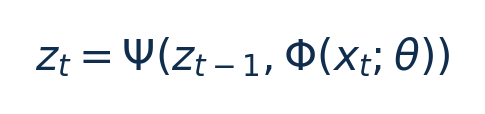

# E4：视频早退出＋DVFS：从零入门

[论文页面](https://ojs.aaai.org/index.php/AAAI/article/view/32104) · [本笔记所用 PDF](https://yangece.github.io/papers/conference/AAAI2025-E4.pdf) · [标识符](https://ojs.aaai.org/index.php/AAAI/article/view/32104)

整理日期：2026-11-06。**读者原创中文解读；原图归论文作者／出版方。未运行作者实验，不是独立复现。**

## 先把四个角色放对位置

被控负载是要完成的程序和输入，比如识别一帧图像、生成token或完成一次训练迭代；CPU/GPU是执行程序的硬件；控制器根据观测选运行档位；驱动／寄存器把档位落实。程序代码可以完全一样，CPU时钟变慢时每条指令对应的墙钟时间通常变长，访存或I/O等待则未必按同样比例变化。

软件控制并不意味着没有真实硬件。软件中的学习策略可控制真实CPU；也可先控制一个执行时间与能量模型。后者能验证闭环逻辑，但模型输出的J不能当真实电测。E902的RTL能在仿真中改变时钟并反馈计数；电压导致的物理功耗还需相应模型、功耗分析或板级实验。

## 这篇到底解决哪一件事

先通过时序注意力确定视频动作识别所需的退出位置，再用坐标下降为退出前各层选CPU/GPU频率

为什么局部利用率不能完整反映整个应用的性能与能耗？本篇的研究问题或可检验主张是：先通过时序注意力确定视频动作识别所需的退出位置，再用坐标下降为退出前各层选CPU/GPU频率。验证链是可观测状态→控制规则或学习模型→执行器→任务正确性/服务质量与能耗对照。

**把方法想成一条流水线：** 历史与当前帧累计特征、注意力权重、gate置信/退出条件、可用CPU/GPU频档、剖析每层配置能量 → 两层LSTM累计特征＋注意力/MLP早退gate；JIT coordinate descent search逐层找CPU-GPU频率；nvpmodel执行，非RL governor → DNN退出位置（改变执行量）＋退出前逐层CPU/GPU频率pair；视频类别 → 执行与反馈。

| 先回答的问题 | 本文答案 |
| --- | --- |
| 具体控制算法 | 两层LSTM累计特征＋注意力/MLP早退gate；JIT coordinate descent search逐层找CPU-GPU频率；nvpmodel执行，非RL governor |
| 被控负载类型 | 边缘视频动作识别，多帧/多出口DNN推理 |
| 具体被控程序 | EfficientNet-B0、MobileNet-v2特征骨干＋5出口；ActivityNet-v1.3、Mini-Kinetics；ImageNet预训练 |
| 使用平台与测量 | Jetson Nano/TX2/Xavier NX/Orin Nano/AGX Orin五设备；Python3.6、nvpmodel；jetson-stats整设备遥测；早退网络另用4×RTX3080离线训练 |
| 输入/状态 | 历史与当前帧累计特征、注意力权重、gate置信/退出条件、可用CPU/GPU频档、剖析每层配置能量 |
| 输出/动作 | DNN退出位置（改变执行量）＋退出前逐层CPU/GPU频率pair；视频类别 |
| 周期与运行位置 | 按视频帧/网络层动作；频率执行毫秒级，JIT搜索开销需单计；不是逐周期硬实时保证 |

## 十个先修关键词

| 级别 | 术语／关键词 | 直觉、严格含义与易混点 |
| --- | --- | --- |
| A | DVFS / DFS | DVFS同时涉及动态电压与频率；只有时钟变化称DFS。电压能否改变取决于实际供电域。 |
| A | Workload | 真正执行应用计算的程序与输入；本文里的控制器是另一个角色。 |
| A | Controller | 根据观测选择动作的软件／硬件，可运行在同一CPU或独立控制核。 |
| A | OPP | Operating Performance Point，经过允许范围验证的电压—频率组合。 |
| A | Power / Energy | 功率W表示此刻消耗快慢；能量J是对时间积分。低功率不必然低能量。 |
| B | Deadline | 作业必须完成的时刻；平均时延、P95与最大时延各有不同用途。 |
| A | 被控程序 | EfficientNet-B0、MobileNet-v2特征骨干＋5出口；ActivityNet-v1.3、Mini-Kinetics；ImageNet预训练 |
| A | 控制策略 | 两层LSTM累计特征＋注意力/MLP早退gate；JIT coordinate descent search逐层找CPU-GPU频率；nvpmodel执行，非RL governor |
| B | 控制周期 | 按视频帧/网络层动作；频率执行毫秒级，JIT搜索开销需单计；不是逐周期硬实时保证 |
| B | 证据边界 | 实测、硬件仿真、功耗模型是不同证据，见平台与结果表。 |

## 用一个小算例建立直觉

同一帧可因之前帧信息不同而在不同出口结束；不能只按图像大小选频。

xt是第t帧，Φ提取特征，Ψ累计历史；z无物理单位，不是CPU利用率。

**要防止的误读：** 论文功率/能量标注、摘要与分组最高加速不同，不能只摘2.8×作为纯DVFS效果。

## 论文真正验证了什么

| 指标 | 原文报告 | 条件／分母／边界 | 证据位置 |
| --- | --- | --- | --- |
| 主要正文结果 | EfficientNet能量−20%–37%、速度1.3–2.2×；MobileNet−18%–30%、1.4–1.9× | 五Jetson/两数据集，与EENet/zTT/Ring比较；摘要最高2.8×不冒充所有主图结果 | §Performance/Fig3，p5–6 |
| 摘要总体 | 平均节能26%，最高速度2.8× | 联合早退和调频；保留正文分组与精度条件 | 摘要，p1 |
| 能量换算示例 | 约217.98mJ→164.01mJ | Table2 Eff-B0无策略6.3ms/34.6W，单DVFS7.1ms/23.1W；乘积教学换算，约−24.8%，不是新实测 | Table2，p7 |

这些结果来自作者实验。算法reward、模型误差、控制器时延、被控应用速度与应用节能是不同指标，要看具体行的单位和证据。

## 它与你的毕设怎么接起来

若选CV应用，建议先CPU小型分类模型固定网络/固定精度做DFS，再加早退作为独立实验变量。E902可尝试小型模型或前处理；Jetson更适合复建完整E4，不能把大平台频率表直接复制到E902。

最先可以尝试：**P0：固定网络与早退质量基线**。理由是先验证应用与执行器，建立同边界基线；最低资源是Linux CPU/Jetson、轻量图像或短视频模型、带标注输入；通过标准是输出正确；保存实际频率、温度、时延与积分能量。

## 五分钟自测

1. 这篇输出的是下一频率、功率估计，还是通信／控制时序？
2. 是真实负载硬件实验，还是模型／RTL／HIL？哪些部分是真的？
3. 最重要百分比的分母和比较对象是什么？
4. 如果换成单核E902，哪一个输入或硬件旋钮会消失？
5. 算上采样、推理、切频和空闲时间后，节能是否还成立？

答案线索在本页角色表和结果表；进一步读“图文技术精读”的关键原图、公式与三项课题实验，再到“图表索引”回查原PDF。不是先记住论文所有缩写。
