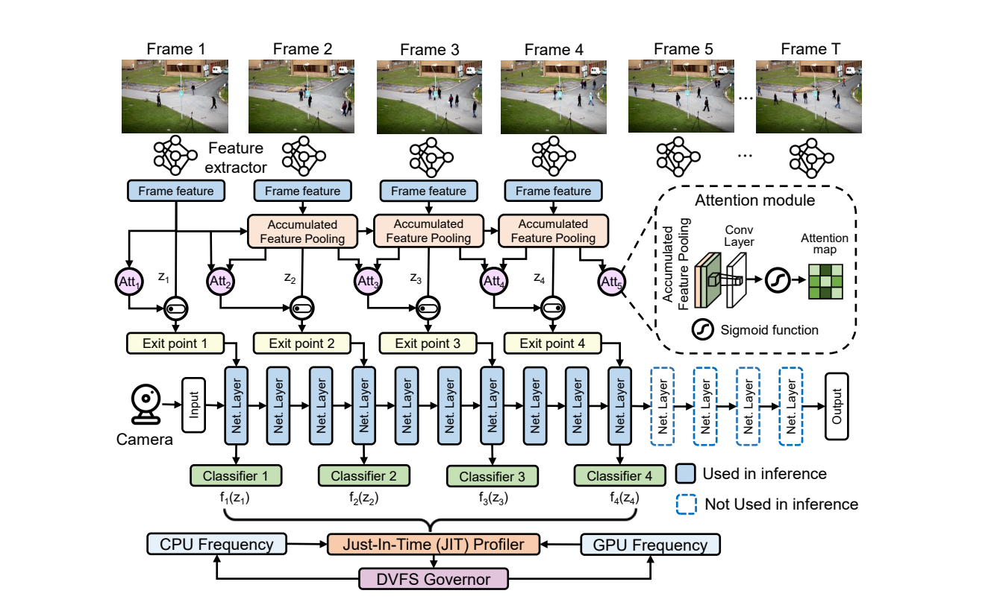
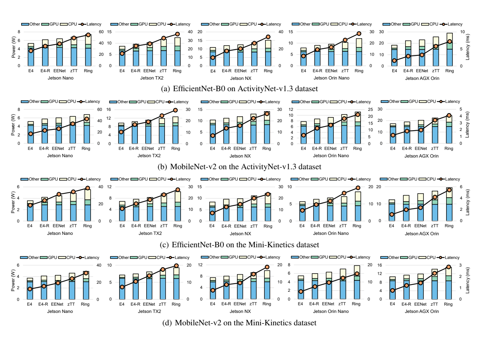
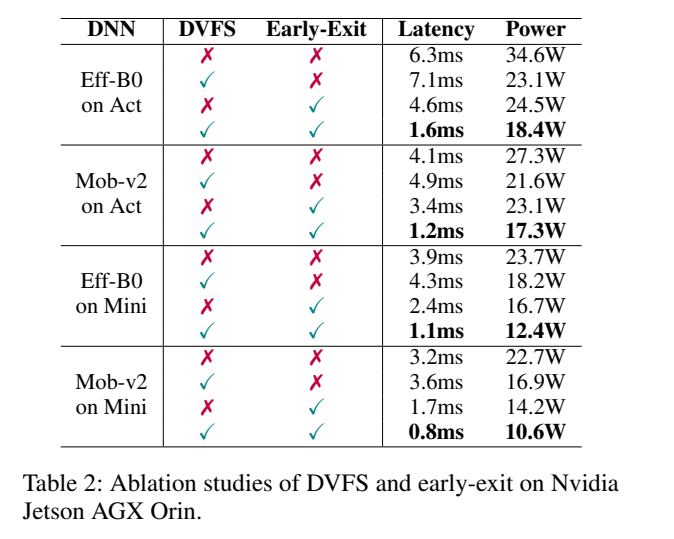

# E4：视频早退出＋DVFS：原图原表阅读索引

[论文页面](https://ojs.aaai.org/index.php/AAAI/article/view/32104) · [本笔记所用 PDF](https://yangece.github.io/papers/conference/AAAI2025-E4.pdf) · [标识符](https://ojs.aaai.org/index.php/AAAI/article/view/32104)

整理日期：2026-11-06。**读者原创中文解读；原图归论文作者／出版方。未运行作者实验，不是独立复现。**

**覆盖范围：** 本版本正文中识别到的8项图、表或算法；保留原编号。关键项已裁图并在技术精读相应段落出现，未内嵌的项可点PDF页链接查看，不上传整篇PDF。

**统计总边界：** Fig3用W轴展示功率，不能直接按柱差称能量降幅；E=P·T需同一任务。Table2消融同时报告DVFS/early-exit，可检查联合贡献。跨模型精度损失和输入帧数互相影响；图像/帧不是运行独立重复。当前材料未定位到每个配置的独立运行数/CI，不能补造显著性。

## Fig1：频率影响热图

[原文 Fig1，PDF p1](https://yangece.github.io/papers/conference/AAAI2025-E4.pdf#page=1)

1. **本项回答的问题：** 频率影响热图，用于支撑这条方法或实验链中的具体环节。
2. **组成、坐标和对照：** 先读图题、图例、坐标/表头与单位，再在同一负载和同一基线内比较。CPU/GPU交互，不只GPU单轴。 按原图／表标示的单位与归一化基准阅读；不将不同子图或不同分母的柱高直接相除。 颜色按原图图例辨认，不能把同色跨图视为同一组。
3. **阅读顺序与统计单位：** 先看设定、单位和图例，再看趋势与作者正文。重复次数及采样独立性参见本篇技术精读统计节；没有为该图定位到的误差线定义／独立重复数，不另行猜测。
4. **直接观察：** CPU/GPU交互，不只GPU单轴。
5. **作者解释的范围：** 原文以该图／表作为上述观察的结构说明或实验支撑，需连同对应页正文读取；本索引不额外替作者推导因果机制。
6. **独立判断（AI分析）：** 只支持此图所列的模型、设备、输入与测量口径；CPU/GPU交互，不只GPU单轴。 不能由单图推出E902或其他GPU的同幅收益。
7. **证据链位置：** 性能验证／定量或示例证据，需结合实验条件。它支持本文具体条件下的实现或结果，不单独完成跨平台验证。
8. **结论与强度：** 可复述“CPU/GPU交互，不只GPU单轴。”；对图内描述的核查可信度高，对未做独立实验的泛化判断为中或无法判断。不能得出的结论是“只支持此图所列的模型、设备、输入与测量口径；CPU/GPU交互，不只GPU单轴。 不能由单图推出E902或其他GPU的同幅收益。”所排除的外推。

## Fig2：E4整体结构

[原文 Fig2，PDF p3](https://yangece.github.io/papers/conference/AAAI2025-E4.pdf#page=3)

[打开大图](images/original-fig2.png)

1. **本项回答的问题：** E4整体结构，用于支撑这条方法或实验链中的具体环节。
2. **组成、坐标和对照：** 先读图题、图例、坐标/表头与单位，再在同一负载和同一基线内比较。先退出策略，再逐层频率。 结构／流程类没有统一数值坐标；箭头表示数据或控制关系，不表示统计因果。 颜色按原图图例辨认，不能把同色跨图视为同一组。
3. **阅读顺序与统计单位：** 先看设定、单位和图例，再看趋势与作者正文。重复次数及采样独立性参见本篇技术精读统计节；没有为该图定位到的误差线定义／独立重复数，不另行猜测。
4. **直接观察：** 先退出策略，再逐层频率。
5. **作者解释的范围：** 原文以该图／表作为上述观察的结构说明或实验支撑，需连同对应页正文读取；本索引不额外替作者推导因果机制。
6. **独立判断（AI分析）：** 只支持此图所列的模型、设备、输入与测量口径；先退出策略，再逐层频率。 不能由单图推出E902或其他GPU的同幅收益。
7. **证据链位置：** 方法／系统实现说明。它支持本文具体条件下的实现或结果，不单独完成跨平台验证。
8. **结论与强度：** 可复述“先退出策略，再逐层频率。”；对图内描述的核查可信度高，对未做独立实验的泛化判断为中或无法判断。不能得出的结论是“只支持此图所列的模型、设备、输入与测量口径；先退出策略，再逐层频率。 不能由单图推出E902或其他GPU的同幅收益。”所排除的外推。

## Fig3：五设备结果

[原文 Fig3，PDF p6](https://yangece.github.io/papers/conference/AAAI2025-E4.pdf#page=6)

[打开大图](images/original-fig3.png)

1. **本项回答的问题：** 五设备结果，用于支撑这条方法或实验链中的具体环节。
2. **组成、坐标和对照：** 先读图题、图例、坐标/表头与单位，再在同一负载和同一基线内比较。柱轴W是功率，折线ms是时延；不可同单位相减。 按原图／表标示的单位与归一化基准阅读；不将不同子图或不同分母的柱高直接相除。 颜色按原图图例辨认，不能把同色跨图视为同一组。
3. **阅读顺序与统计单位：** 先看设定、单位和图例，再看趋势与作者正文。重复次数及采样独立性参见本篇技术精读统计节；没有为该图定位到的误差线定义／独立重复数，不另行猜测。
4. **直接观察：** 柱轴W是功率，折线ms是时延；不可同单位相减。
5. **作者解释的范围：** 原文以该图／表作为上述观察的结构说明或实验支撑，需连同对应页正文读取；本索引不额外替作者推导因果机制。
6. **独立判断（AI分析）：** 只支持此图所列的模型、设备、输入与测量口径；柱轴W是功率，折线ms是时延；不可同单位相减。 不能由单图推出E902或其他GPU的同幅收益。
7. **证据链位置：** 性能验证／定量或示例证据，需结合实验条件。它支持本文具体条件下的实现或结果，不单独完成跨平台验证。
8. **结论与强度：** 可复述“柱轴W是功率，折线ms是时延；不可同单位相减。”；对图内描述的核查可信度高，对未做独立实验的泛化判断为中或无法判断。不能得出的结论是“只支持此图所列的模型、设备、输入与测量口径；柱轴W是功率，折线ms是时延；不可同单位相减。 不能由单图推出E902或其他GPU的同幅收益。”所排除的外推。

## Fig4：帧数与质量

[原文 Fig4，PDF p7](https://yangece.github.io/papers/conference/AAAI2025-E4.pdf#page=7)

1. **本项回答的问题：** 帧数与质量，用于支撑这条方法或实验链中的具体环节。
2. **组成、坐标和对照：** 先读图题、图例、坐标/表头与单位，再在同一负载和同一基线内比较。更多帧不无限提高精度。 按原图／表标示的单位与归一化基准阅读；不将不同子图或不同分母的柱高直接相除。 颜色按原图图例辨认，不能把同色跨图视为同一组。
3. **阅读顺序与统计单位：** 先看设定、单位和图例，再看趋势与作者正文。重复次数及采样独立性参见本篇技术精读统计节；没有为该图定位到的误差线定义／独立重复数，不另行猜测。
4. **直接观察：** 更多帧不无限提高精度。
5. **作者解释的范围：** 原文以该图／表作为上述观察的结构说明或实验支撑，需连同对应页正文读取；本索引不额外替作者推导因果机制。
6. **独立判断（AI分析）：** 只支持此图所列的模型、设备、输入与测量口径；更多帧不无限提高精度。 不能由单图推出E902或其他GPU的同幅收益。
7. **证据链位置：** 性能验证／定量或示例证据，需结合实验条件。它支持本文具体条件下的实现或结果，不单独完成跨平台验证。
8. **结论与强度：** 可复述“更多帧不无限提高精度。”；对图内描述的核查可信度高，对未做独立实验的泛化判断为中或无法判断。不能得出的结论是“只支持此图所列的模型、设备、输入与测量口径；更多帧不无限提高精度。 不能由单图推出E902或其他GPU的同幅收益。”所排除的外推。

## Fig5：内存占用

[原文 Fig5，PDF p7](https://yangece.github.io/papers/conference/AAAI2025-E4.pdf#page=7)

1. **本项回答的问题：** 内存占用，用于支撑这条方法或实验链中的具体环节。
2. **组成、坐标和对照：** 先读图题、图例、坐标/表头与单位，再在同一负载和同一基线内比较。高内存节省不等同GPU节能。 按原图／表标示的单位与归一化基准阅读；不将不同子图或不同分母的柱高直接相除。 颜色按原图图例辨认，不能把同色跨图视为同一组。
3. **阅读顺序与统计单位：** 先看设定、单位和图例，再看趋势与作者正文。重复次数及采样独立性参见本篇技术精读统计节；没有为该图定位到的误差线定义／独立重复数，不另行猜测。
4. **直接观察：** 高内存节省不等同GPU节能。
5. **作者解释的范围：** 原文以该图／表作为上述观察的结构说明或实验支撑，需连同对应页正文读取；本索引不额外替作者推导因果机制。
6. **独立判断（AI分析）：** 只支持此图所列的模型、设备、输入与测量口径；高内存节省不等同GPU节能。 不能由单图推出E902或其他GPU的同幅收益。
7. **证据链位置：** 性能验证／定量或示例证据，需结合实验条件。它支持本文具体条件下的实现或结果，不单独完成跨平台验证。
8. **结论与强度：** 可复述“高内存节省不等同GPU节能。”；对图内描述的核查可信度高，对未做独立实验的泛化判断为中或无法判断。不能得出的结论是“只支持此图所列的模型、设备、输入与测量口径；高内存节省不等同GPU节能。 不能由单图推出E902或其他GPU的同幅收益。”所排除的外推。

## Table1：五板配置

[原文 Table1，PDF p5](https://yangece.github.io/papers/conference/AAAI2025-E4.pdf#page=5)

1. **本项回答的问题：** 五板配置，用于支撑这条方法或实验链中的具体环节。
2. **组成、坐标和对照：** 先读图题、图例、坐标/表头与单位，再在同一负载和同一基线内比较。设备算力和频档不一样。 按原图／表标示的单位与归一化基准阅读；不将不同子图或不同分母的柱高直接相除。 颜色按原图图例辨认，不能把同色跨图视为同一组。
3. **阅读顺序与统计单位：** 先看设定、单位和图例，再看趋势与作者正文。重复次数及采样独立性参见本篇技术精读统计节；没有为该图定位到的误差线定义／独立重复数，不另行猜测。
4. **直接观察：** 设备算力和频档不一样。
5. **作者解释的范围：** 原文以该图／表作为上述观察的结构说明或实验支撑，需连同对应页正文读取；本索引不额外替作者推导因果机制。
6. **独立判断（AI分析）：** 只支持此图所列的模型、设备、输入与测量口径；设备算力和频档不一样。 不能由单图推出E902或其他GPU的同幅收益。
7. **证据链位置：** 性能验证／定量或示例证据，需结合实验条件。它支持本文具体条件下的实现或结果，不单独完成跨平台验证。
8. **结论与强度：** 可复述“设备算力和频档不一样。”；对图内描述的核查可信度高，对未做独立实验的泛化判断为中或无法判断。不能得出的结论是“只支持此图所列的模型、设备、输入与测量口径；设备算力和频档不一样。 不能由单图推出E902或其他GPU的同幅收益。”所排除的外推。

## Table2：DVFS与early-exit消融

[原文 Table2，PDF p7](https://yangece.github.io/papers/conference/AAAI2025-E4.pdf#page=7)

[打开大图](images/original-table2.png)

1. **本项回答的问题：** DVFS与early-exit消融，用于支撑这条方法或实验链中的具体环节。
2. **组成、坐标和对照：** 先读图题、图例、坐标/表头与单位，再在同一负载和同一基线内比较。功率、时延必须配对，分开组件。 按原图／表标示的单位与归一化基准阅读；不将不同子图或不同分母的柱高直接相除。 颜色按原图图例辨认，不能把同色跨图视为同一组。
3. **阅读顺序与统计单位：** 先看设定、单位和图例，再看趋势与作者正文。重复次数及采样独立性参见本篇技术精读统计节；没有为该图定位到的误差线定义／独立重复数，不另行猜测。
4. **直接观察：** 功率、时延必须配对，分开组件。
5. **作者解释的范围：** 原文以该图／表作为上述观察的结构说明或实验支撑，需连同对应页正文读取；本索引不额外替作者推导因果机制。
6. **独立判断（AI分析）：** 只支持此图所列的模型、设备、输入与测量口径；功率、时延必须配对，分开组件。 不能由单图推出E902或其他GPU的同幅收益。
7. **证据链位置：** 性能验证／定量或示例证据，需结合实验条件。它支持本文具体条件下的实现或结果，不单独完成跨平台验证。
8. **结论与强度：** 可复述“功率、时延必须配对，分开组件。”；对图内描述的核查可信度高，对未做独立实验的泛化判断为中或无法判断。不能得出的结论是“只支持此图所列的模型、设备、输入与测量口径；功率、时延必须配对，分开组件。 不能由单图推出E902或其他GPU的同幅收益。”所排除的外推。

## Algorithm1：CDS搜索

[原文 Algorithm1，PDF p4](https://yangece.github.io/papers/conference/AAAI2025-E4.pdf#page=4)

1. **本项回答的问题：** CDS搜索，用于支撑这条方法或实验链中的具体环节。
2. **组成、坐标和对照：** 先读图题、图例、坐标/表头与单位，再在同一负载和同一基线内比较。优化层间坐标，不是强化学习。 按原图／表标示的单位与归一化基准阅读；不将不同子图或不同分母的柱高直接相除。 颜色按原图图例辨认，不能把同色跨图视为同一组。
3. **阅读顺序与统计单位：** 先看设定、单位和图例，再看趋势与作者正文。重复次数及采样独立性参见本篇技术精读统计节；没有为该图定位到的误差线定义／独立重复数，不另行猜测。
4. **直接观察：** 优化层间坐标，不是强化学习。
5. **作者解释的范围：** 原文以该图／表作为上述观察的结构说明或实验支撑，需连同对应页正文读取；本索引不额外替作者推导因果机制。
6. **独立判断（AI分析）：** 只支持此图所列的模型、设备、输入与测量口径；优化层间坐标，不是强化学习。 不能由单图推出E902或其他GPU的同幅收益。
7. **证据链位置：** 性能验证／定量或示例证据，需结合实验条件。它支持本文具体条件下的实现或结果，不单独完成跨平台验证。
8. **结论与强度：** 可复述“优化层间坐标，不是强化学习。”；对图内描述的核查可信度高，对未做独立实验的泛化判断为中或无法判断。不能得出的结论是“只支持此图所列的模型、设备、输入与测量口径；优化层间坐标，不是强化学习。 不能由单图推出E902或其他GPU的同幅收益。”所排除的外推。
