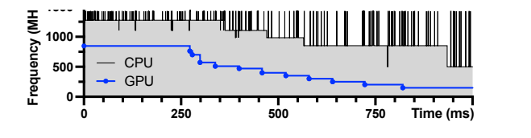
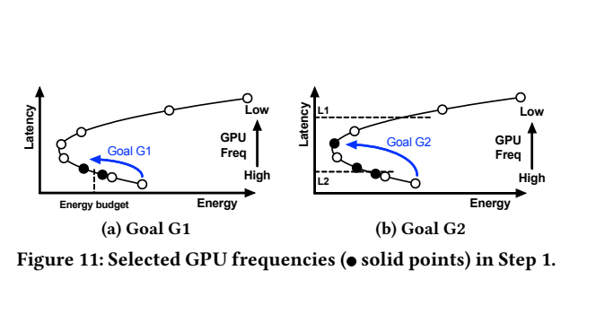
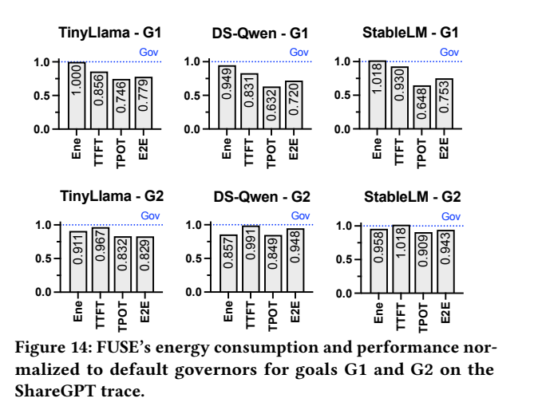
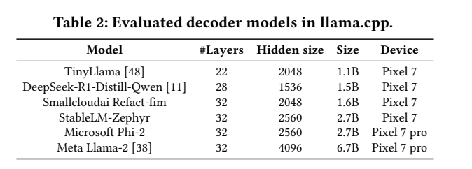

# FUSE：手机LLM协同频率：原图原表阅读索引

[论文页面](https://arxiv.org/abs/2507.02135v1) · [本笔记所用 PDF](https://arxiv.org/pdf/2507.02135v1) · [标识符](https://doi.org/10.48550/arXiv.2507.02135)

整理日期：2026-11-06。**读者原创中文解读；原图归论文作者／出版方。未运行作者实验，不是独立复现。**

**覆盖范围：** 本版本正文中识别到的19项图、表或算法；保留原编号。关键项已裁图并在技术精读相应段落出现，未内嵌的项可点PDF页链接查看，不上传整篇PDF。

**统计总边界：** ShareGPT随机200请求，prompt≤512/output≤256，TTFT不含排队，不能套服务端SLO。Monsoon有高频设备测量，但请求数不同于重复设备样本。文中mAh是电量单位，若未给恒定供电电压，不应直接写等值J；近似iso-energy例也有小幅差异。

## Fig1：GPU利用率目标表

[原文 Fig1，PDF p3](https://arxiv.org/pdf/2507.02135v1#page=3)

1. **本项回答的问题：** GPU利用率目标表，用于支撑这条方法或实验链中的具体环节。
2. **组成、坐标和对照：** 先读图题、图例、坐标/表头与单位，再在同一负载和同一基线内比较。governor根据目标区间调节。 按原图／表标示的单位与归一化基准阅读；不将不同子图或不同分母的柱高直接相除。 颜色按原图图例辨认，不能把同色跨图视为同一组。
3. **阅读顺序与统计单位：** 先看设定、单位和图例，再看趋势与作者正文。重复次数及采样独立性参见本篇技术精读统计节；没有为该图定位到的误差线定义／独立重复数，不另行猜测。
4. **直接观察：** governor根据目标区间调节。
5. **作者解释的范围：** 原文以该图／表作为上述观察的结构说明或实验支撑，需连同对应页正文读取；本索引不额外替作者推导因果机制。
6. **独立判断（AI分析）：** 只支持此图所列的模型、设备、输入与测量口径；governor根据目标区间调节。 不能由单图推出E902或其他GPU的同幅收益。
7. **证据链位置：** 性能验证／定量或示例证据，需结合实验条件。它支持本文具体条件下的实现或结果，不单独完成跨平台验证。
8. **结论与强度：** 可复述“governor根据目标区间调节。”；对图内描述的核查可信度高，对未做独立实验的泛化判断为中或无法判断。不能得出的结论是“只支持此图所列的模型、设备、输入与测量口径；governor根据目标区间调节。 不能由单图推出E902或其他GPU的同幅收益。”所排除的外推。

## Fig2：CPU/GPU推理对比

[原文 Fig2，PDF p5](https://arxiv.org/pdf/2507.02135v1#page=5)

1. **本项回答的问题：** CPU/GPU推理对比，用于支撑这条方法或实验链中的具体环节。
2. **组成、坐标和对照：** 先读图题、图例、坐标/表头与单位，再在同一负载和同一基线内比较。执行设备不同会改变最优策略。 按原图／表标示的单位与归一化基准阅读；不将不同子图或不同分母的柱高直接相除。 颜色按原图图例辨认，不能把同色跨图视为同一组。
3. **阅读顺序与统计单位：** 先看设定、单位和图例，再看趋势与作者正文。重复次数及采样独立性参见本篇技术精读统计节；没有为该图定位到的误差线定义／独立重复数，不另行猜测。
4. **直接观察：** 执行设备不同会改变最优策略。
5. **作者解释的范围：** 原文以该图／表作为上述观察的结构说明或实验支撑，需连同对应页正文读取；本索引不额外替作者推导因果机制。
6. **独立判断（AI分析）：** 只支持此图所列的模型、设备、输入与测量口径；执行设备不同会改变最优策略。 不能由单图推出E902或其他GPU的同幅收益。
7. **证据链位置：** 性能验证／定量或示例证据，需结合实验条件。它支持本文具体条件下的实现或结果，不单独完成跨平台验证。
8. **结论与强度：** 可复述“执行设备不同会改变最优策略。”；对图内描述的核查可信度高，对未做独立实验的泛化判断为中或无法判断。不能得出的结论是“只支持此图所列的模型、设备、输入与测量口径；执行设备不同会改变最优策略。 不能由单图推出E902或其他GPU的同幅收益。”所排除的外推。

## Fig3：E2E分解

[原文 Fig3，PDF p5](https://arxiv.org/pdf/2507.02135v1#page=5)

1. **本项回答的问题：** E2E分解，用于支撑这条方法或实验链中的具体环节。
2. **组成、坐标和对照：** 先读图题、图例、坐标/表头与单位，再在同一负载和同一基线内比较。CPU框架开销即使GPU推理也存在。 按原图／表标示的单位与归一化基准阅读；不将不同子图或不同分母的柱高直接相除。 颜色按原图图例辨认，不能把同色跨图视为同一组。
3. **阅读顺序与统计单位：** 先看设定、单位和图例，再看趋势与作者正文。重复次数及采样独立性参见本篇技术精读统计节；没有为该图定位到的误差线定义／独立重复数，不另行猜测。
4. **直接观察：** CPU框架开销即使GPU推理也存在。
5. **作者解释的范围：** 原文以该图／表作为上述观察的结构说明或实验支撑，需连同对应页正文读取；本索引不额外替作者推导因果机制。
6. **独立判断（AI分析）：** 只支持此图所列的模型、设备、输入与测量口径；CPU框架开销即使GPU推理也存在。 不能由单图推出E902或其他GPU的同幅收益。
7. **证据链位置：** 性能验证／定量或示例证据，需结合实验条件。它支持本文具体条件下的实现或结果，不单独完成跨平台验证。
8. **结论与强度：** 可复述“CPU框架开销即使GPU推理也存在。”；对图内描述的核查可信度高，对未做独立实验的泛化判断为中或无法判断。不能得出的结论是“只支持此图所列的模型、设备、输入与测量口径；CPU框架开销即使GPU推理也存在。 不能由单图推出E902或其他GPU的同幅收益。”所排除的外推。

## Fig4：decode GPU扫描

[原文 Fig4，PDF p6](https://arxiv.org/pdf/2507.02135v1#page=6)

1. **本项回答的问题：** decode GPU扫描，用于支撑这条方法或实验链中的具体环节。
2. **组成、坐标和对照：** 先读图题、图例、坐标/表头与单位，再在同一负载和同一基线内比较。能量/时延Pareto而非越低频越好。 按原图／表标示的单位与归一化基准阅读；不将不同子图或不同分母的柱高直接相除。 颜色按原图图例辨认，不能把同色跨图视为同一组。
3. **阅读顺序与统计单位：** 先看设定、单位和图例，再看趋势与作者正文。重复次数及采样独立性参见本篇技术精读统计节；没有为该图定位到的误差线定义／独立重复数，不另行猜测。
4. **直接观察：** 能量/时延Pareto而非越低频越好。
5. **作者解释的范围：** 原文以该图／表作为上述观察的结构说明或实验支撑，需连同对应页正文读取；本索引不额外替作者推导因果机制。
6. **独立判断（AI分析）：** 只支持此图所列的模型、设备、输入与测量口径；能量/时延Pareto而非越低频越好。 不能由单图推出E902或其他GPU的同幅收益。
7. **证据链位置：** 性能验证／定量或示例证据，需结合实验条件。它支持本文具体条件下的实现或结果，不单独完成跨平台验证。
8. **结论与强度：** 可复述“能量/时延Pareto而非越低频越好。”；对图内描述的核查可信度高，对未做独立实验的泛化判断为中或无法判断。不能得出的结论是“只支持此图所列的模型、设备、输入与测量口径；能量/时延Pareto而非越低频越好。 不能由单图推出E902或其他GPU的同幅收益。”所排除的外推。

## Fig5：prefill GPU扫描

[原文 Fig5，PDF p6](https://arxiv.org/pdf/2507.02135v1#page=6)

1. **本项回答的问题：** prefill GPU扫描，用于支撑这条方法或实验链中的具体环节。
2. **组成、坐标和对照：** 先读图题、图例、坐标/表头与单位，再在同一负载和同一基线内比较。prefill与decode需不同配置。 按原图／表标示的单位与归一化基准阅读；不将不同子图或不同分母的柱高直接相除。 颜色按原图图例辨认，不能把同色跨图视为同一组。
3. **阅读顺序与统计单位：** 先看设定、单位和图例，再看趋势与作者正文。重复次数及采样独立性参见本篇技术精读统计节；没有为该图定位到的误差线定义／独立重复数，不另行猜测。
4. **直接观察：** prefill与decode需不同配置。
5. **作者解释的范围：** 原文以该图／表作为上述观察的结构说明或实验支撑，需连同对应页正文读取；本索引不额外替作者推导因果机制。
6. **独立判断（AI分析）：** 只支持此图所列的模型、设备、输入与测量口径；prefill与decode需不同配置。 不能由单图推出E902或其他GPU的同幅收益。
7. **证据链位置：** 性能验证／定量或示例证据，需结合实验条件。它支持本文具体条件下的实现或结果，不单独完成跨平台验证。
8. **结论与强度：** 可复述“prefill与decode需不同配置。”；对图内描述的核查可信度高，对未做独立实验的泛化判断为中或无法判断。不能得出的结论是“只支持此图所列的模型、设备、输入与测量口径；prefill与decode需不同配置。 不能由单图推出E902或其他GPU的同幅收益。”所排除的外推。

## Fig6：内存扫描

[原文 Fig6，PDF p7](https://arxiv.org/pdf/2507.02135v1#page=7)

1. **本项回答的问题：** 内存扫描，用于支撑这条方法或实验链中的具体环节。
2. **组成、坐标和对照：** 先读图题、图例、坐标/表头与单位，再在同一负载和同一基线内比较。支持保留默认内存governor的条件。 按原图／表标示的单位与归一化基准阅读；不将不同子图或不同分母的柱高直接相除。 颜色按原图图例辨认，不能把同色跨图视为同一组。
3. **阅读顺序与统计单位：** 先看设定、单位和图例，再看趋势与作者正文。重复次数及采样独立性参见本篇技术精读统计节；没有为该图定位到的误差线定义／独立重复数，不另行猜测。
4. **直接观察：** 支持保留默认内存governor的条件。
5. **作者解释的范围：** 原文以该图／表作为上述观察的结构说明或实验支撑，需连同对应页正文读取；本索引不额外替作者推导因果机制。
6. **独立判断（AI分析）：** 只支持此图所列的模型、设备、输入与测量口径；支持保留默认内存governor的条件。 不能由单图推出E902或其他GPU的同幅收益。
7. **证据链位置：** 性能验证／定量或示例证据，需结合实验条件。它支持本文具体条件下的实现或结果，不单独完成跨平台验证。
8. **结论与强度：** 可复述“支持保留默认内存governor的条件。”；对图内描述的核查可信度高，对未做独立实验的泛化判断为中或无法判断。不能得出的结论是“只支持此图所列的模型、设备、输入与测量口径；支持保留默认内存governor的条件。 不能由单图推出E902或其他GPU的同幅收益。”所排除的外推。

## Fig7：CPU与GPU利用率耦合

[原文 Fig7，PDF p7](https://arxiv.org/pdf/2507.02135v1#page=7)

1. **本项回答的问题：** CPU与GPU利用率耦合，用于支撑这条方法或实验链中的具体环节。
2. **组成、坐标和对照：** 先读图题、图例、坐标/表头与单位，再在同一负载和同一基线内比较。降低CPU可让GPU更空闲。 按原图／表标示的单位与归一化基准阅读；不将不同子图或不同分母的柱高直接相除。 颜色按原图图例辨认，不能把同色跨图视为同一组。
3. **阅读顺序与统计单位：** 先看设定、单位和图例，再看趋势与作者正文。重复次数及采样独立性参见本篇技术精读统计节；没有为该图定位到的误差线定义／独立重复数，不另行猜测。
4. **直接观察：** 降低CPU可让GPU更空闲。
5. **作者解释的范围：** 原文以该图／表作为上述观察的结构说明或实验支撑，需连同对应页正文读取；本索引不额外替作者推导因果机制。
6. **独立判断（AI分析）：** 只支持此图所列的模型、设备、输入与测量口径；降低CPU可让GPU更空闲。 不能由单图推出E902或其他GPU的同幅收益。
7. **证据链位置：** 性能验证／定量或示例证据，需结合实验条件。它支持本文具体条件下的实现或结果，不单独完成跨平台验证。
8. **结论与强度：** 可复述“降低CPU可让GPU更空闲。”；对图内描述的核查可信度高，对未做独立实验的泛化判断为中或无法判断。不能得出的结论是“只支持此图所列的模型、设备、输入与测量口径；降低CPU可让GPU更空闲。 不能由单图推出E902或其他GPU的同幅收益。”所排除的外推。

## Fig8：CPU扫描与EAS

[原文 Fig8，PDF p8](https://arxiv.org/pdf/2507.02135v1#page=8)

1. **本项回答的问题：** CPU扫描与EAS，用于支撑这条方法或实验链中的具体环节。
2. **组成、坐标和对照：** 先读图题、图例、坐标/表头与单位，再在同一负载和同一基线内比较。低CPU利用率不等无需提高CPU频率。 按原图／表标示的单位与归一化基准阅读；不将不同子图或不同分母的柱高直接相除。 颜色按原图图例辨认，不能把同色跨图视为同一组。
3. **阅读顺序与统计单位：** 先看设定、单位和图例，再看趋势与作者正文。重复次数及采样独立性参见本篇技术精读统计节；没有为该图定位到的误差线定义／独立重复数，不另行猜测。
4. **直接观察：** 低CPU利用率不等无需提高CPU频率。
5. **作者解释的范围：** 原文以该图／表作为上述观察的结构说明或实验支撑，需连同对应页正文读取；本索引不额外替作者推导因果机制。
6. **独立判断（AI分析）：** 只支持此图所列的模型、设备、输入与测量口径；低CPU利用率不等无需提高CPU频率。 不能由单图推出E902或其他GPU的同幅收益。
7. **证据链位置：** 性能验证／定量或示例证据，需结合实验条件。它支持本文具体条件下的实现或结果，不单独完成跨平台验证。
8. **结论与强度：** 可复述“低CPU利用率不等无需提高CPU频率。”；对图内描述的核查可信度高，对未做独立实验的泛化判断为中或无法判断。不能得出的结论是“只支持此图所列的模型、设备、输入与测量口径；低CPU利用率不等无需提高CPU频率。 不能由单图推出E902或其他GPU的同幅收益。”所排除的外推。

## Fig9：频率CDF

[原文 Fig9，PDF p9](https://arxiv.org/pdf/2507.02135v1#page=9)

1. **本项回答的问题：** 频率CDF，用于支撑这条方法或实验链中的具体环节。
2. **组成、坐标和对照：** 先读图题、图例、坐标/表头与单位，再在同一负载和同一基线内比较。看默认频率驻留分布。 按原图／表标示的单位与归一化基准阅读；不将不同子图或不同分母的柱高直接相除。 颜色按原图图例辨认，不能把同色跨图视为同一组。
3. **阅读顺序与统计单位：** 先看设定、单位和图例，再看趋势与作者正文。重复次数及采样独立性参见本篇技术精读统计节；没有为该图定位到的误差线定义／独立重复数，不另行猜测。
4. **直接观察：** 看默认频率驻留分布。
5. **作者解释的范围：** 原文以该图／表作为上述观察的结构说明或实验支撑，需连同对应页正文读取；本索引不额外替作者推导因果机制。
6. **独立判断（AI分析）：** 只支持此图所列的模型、设备、输入与测量口径；看默认频率驻留分布。 不能由单图推出E902或其他GPU的同幅收益。
7. **证据链位置：** 性能验证／定量或示例证据，需结合实验条件。它支持本文具体条件下的实现或结果，不单独完成跨平台验证。
8. **结论与强度：** 可复述“看默认频率驻留分布。”；对图内描述的核查可信度高，对未做独立实验的泛化判断为中或无法判断。不能得出的结论是“只支持此图所列的模型、设备、输入与测量口径；看默认频率驻留分布。 不能由单图推出E902或其他GPU的同幅收益。”所排除的外推。

## Fig10：耦合频率时序

[原文 Fig10，PDF p9](https://arxiv.org/pdf/2507.02135v1#page=9)

[打开大图](images/original-fig10.png)

1. **本项回答的问题：** 耦合频率时序，用于支撑这条方法或实验链中的具体环节。
2. **组成、坐标和对照：** 先读图题、图例、坐标/表头与单位，再在同一负载和同一基线内比较。需与单独钉住组件对照。 按原图／表标示的单位与归一化基准阅读；不将不同子图或不同分母的柱高直接相除。 颜色按原图图例辨认，不能把同色跨图视为同一组。
3. **阅读顺序与统计单位：** 先看设定、单位和图例，再看趋势与作者正文。重复次数及采样独立性参见本篇技术精读统计节；没有为该图定位到的误差线定义／独立重复数，不另行猜测。
4. **直接观察：** 需与单独钉住组件对照。
5. **作者解释的范围：** 原文以该图／表作为上述观察的结构说明或实验支撑，需连同对应页正文读取；本索引不额外替作者推导因果机制。
6. **独立判断（AI分析）：** 只支持此图所列的模型、设备、输入与测量口径；需与单独钉住组件对照。 不能由单图推出E902或其他GPU的同幅收益。
7. **证据链位置：** 性能验证／定量或示例证据，需结合实验条件。它支持本文具体条件下的实现或结果，不单独完成跨平台验证。
8. **结论与强度：** 可复述“需与单独钉住组件对照。”；对图内描述的核查可信度高，对未做独立实验的泛化判断为中或无法判断。不能得出的结论是“只支持此图所列的模型、设备、输入与测量口径；需与单独钉住组件对照。 不能由单图推出E902或其他GPU的同幅收益。”所排除的外推。

## Fig11：两种目标的候选点

[原文 Fig11，PDF p10](https://arxiv.org/pdf/2507.02135v1#page=10)

[打开大图](images/original-fig11.png)

1. **本项回答的问题：** 两种目标的候选点，用于支撑这条方法或实验链中的具体环节。
2. **组成、坐标和对照：** 先读图题、图例、坐标/表头与单位，再在同一负载和同一基线内比较。G1与G2选择规则不同。 按原图／表标示的单位与归一化基准阅读；不将不同子图或不同分母的柱高直接相除。 颜色按原图图例辨认，不能把同色跨图视为同一组。
3. **阅读顺序与统计单位：** 先看设定、单位和图例，再看趋势与作者正文。重复次数及采样独立性参见本篇技术精读统计节；没有为该图定位到的误差线定义／独立重复数，不另行猜测。
4. **直接观察：** G1与G2选择规则不同。
5. **作者解释的范围：** 原文以该图／表作为上述观察的结构说明或实验支撑，需连同对应页正文读取；本索引不额外替作者推导因果机制。
6. **独立判断（AI分析）：** 只支持此图所列的模型、设备、输入与测量口径；G1与G2选择规则不同。 不能由单图推出E902或其他GPU的同幅收益。
7. **证据链位置：** 性能验证／定量或示例证据，需结合实验条件。它支持本文具体条件下的实现或结果，不单独完成跨平台验证。
8. **结论与强度：** 可复述“G1与G2选择规则不同。”；对图内描述的核查可信度高，对未做独立实验的泛化判断为中或无法判断。不能得出的结论是“只支持此图所列的模型、设备、输入与测量口径；G1与G2选择规则不同。 不能由单图推出E902或其他GPU的同幅收益。”所排除的外推。

## Fig12：G1固定长度结果

[原文 Fig12，PDF p11](https://arxiv.org/pdf/2507.02135v1#page=11)

1. **本项回答的问题：** G1固定长度结果，用于支撑这条方法或实验链中的具体环节。
2. **组成、坐标和对照：** 先读图题、图例、坐标/表头与单位，再在同一负载和同一基线内比较。iso-energy速度改善不是节能。 按原图／表标示的单位与归一化基准阅读；不将不同子图或不同分母的柱高直接相除。 颜色按原图图例辨认，不能把同色跨图视为同一组。
3. **阅读顺序与统计单位：** 先看设定、单位和图例，再看趋势与作者正文。重复次数及采样独立性参见本篇技术精读统计节；没有为该图定位到的误差线定义／独立重复数，不另行猜测。
4. **直接观察：** iso-energy速度改善不是节能。
5. **作者解释的范围：** 原文以该图／表作为上述观察的结构说明或实验支撑，需连同对应页正文读取；本索引不额外替作者推导因果机制。
6. **独立判断（AI分析）：** 只支持此图所列的模型、设备、输入与测量口径；iso-energy速度改善不是节能。 不能由单图推出E902或其他GPU的同幅收益。
7. **证据链位置：** 性能验证／定量或示例证据，需结合实验条件。它支持本文具体条件下的实现或结果，不单独完成跨平台验证。
8. **结论与强度：** 可复述“iso-energy速度改善不是节能。”；对图内描述的核查可信度高，对未做独立实验的泛化判断为中或无法判断。不能得出的结论是“只支持此图所列的模型、设备、输入与测量口径；iso-energy速度改善不是节能。 不能由单图推出E902或其他GPU的同幅收益。”所排除的外推。

## Fig13：G2固定长度结果

[原文 Fig13，PDF p12](https://arxiv.org/pdf/2507.02135v1#page=12)

1. **本项回答的问题：** G2固定长度结果，用于支撑这条方法或实验链中的具体环节。
2. **组成、坐标和对照：** 先读图题、图例、坐标/表头与单位，再在同一负载和同一基线内比较。同阶段时延比较能量。 按原图／表标示的单位与归一化基准阅读；不将不同子图或不同分母的柱高直接相除。 颜色按原图图例辨认，不能把同色跨图视为同一组。
3. **阅读顺序与统计单位：** 先看设定、单位和图例，再看趋势与作者正文。重复次数及采样独立性参见本篇技术精读统计节；没有为该图定位到的误差线定义／独立重复数，不另行猜测。
4. **直接观察：** 同阶段时延比较能量。
5. **作者解释的范围：** 原文以该图／表作为上述观察的结构说明或实验支撑，需连同对应页正文读取；本索引不额外替作者推导因果机制。
6. **独立判断（AI分析）：** 只支持此图所列的模型、设备、输入与测量口径；同阶段时延比较能量。 不能由单图推出E902或其他GPU的同幅收益。
7. **证据链位置：** 性能验证／定量或示例证据，需结合实验条件。它支持本文具体条件下的实现或结果，不单独完成跨平台验证。
8. **结论与强度：** 可复述“同阶段时延比较能量。”；对图内描述的核查可信度高，对未做独立实验的泛化判断为中或无法判断。不能得出的结论是“只支持此图所列的模型、设备、输入与测量口径；同阶段时延比较能量。 不能由单图推出E902或其他GPU的同幅收益。”所排除的外推。

## Fig14：真实ShareGPT回放

[原文 Fig14，PDF p12](https://arxiv.org/pdf/2507.02135v1#page=12)

[打开大图](images/original-fig14.png)

1. **本项回答的问题：** 真实ShareGPT回放，用于支撑这条方法或实验链中的具体环节。
2. **组成、坐标和对照：** 先读图题、图例、坐标/表头与单位，再在同一负载和同一基线内比较。200请求、三模型与两个目标。 按原图／表标示的单位与归一化基准阅读；不将不同子图或不同分母的柱高直接相除。 颜色按原图图例辨认，不能把同色跨图视为同一组。
3. **阅读顺序与统计单位：** 先看设定、单位和图例，再看趋势与作者正文。重复次数及采样独立性参见本篇技术精读统计节；没有为该图定位到的误差线定义／独立重复数，不另行猜测。
4. **直接观察：** 200请求、三模型与两个目标。
5. **作者解释的范围：** 原文以该图／表作为上述观察的结构说明或实验支撑，需连同对应页正文读取；本索引不额外替作者推导因果机制。
6. **独立判断（AI分析）：** 只支持此图所列的模型、设备、输入与测量口径；200请求、三模型与两个目标。 不能由单图推出E902或其他GPU的同幅收益。
7. **证据链位置：** 性能验证／定量或示例证据，需结合实验条件。它支持本文具体条件下的实现或结果，不单独完成跨平台验证。
8. **结论与强度：** 可复述“200请求、三模型与两个目标。”；对图内描述的核查可信度高，对未做独立实验的泛化判断为中或无法判断。不能得出的结论是“只支持此图所列的模型、设备、输入与测量口径；200请求、三模型与两个目标。 不能由单图推出E902或其他GPU的同幅收益。”所排除的外推。

## Fig15：prefill CPU补充

[原文 Fig15，PDF p15](https://arxiv.org/pdf/2507.02135v1#page=15)

1. **本项回答的问题：** prefill CPU补充，用于支撑这条方法或实验链中的具体环节。
2. **组成、坐标和对照：** 先读图题、图例、坐标/表头与单位，再在同一负载和同一基线内比较。正文decode结论的补充证据。 按原图／表标示的单位与归一化基准阅读；不将不同子图或不同分母的柱高直接相除。 颜色按原图图例辨认，不能把同色跨图视为同一组。
3. **阅读顺序与统计单位：** 先看设定、单位和图例，再看趋势与作者正文。重复次数及采样独立性参见本篇技术精读统计节；没有为该图定位到的误差线定义／独立重复数，不另行猜测。
4. **直接观察：** 正文decode结论的补充证据。
5. **作者解释的范围：** 原文以该图／表作为上述观察的结构说明或实验支撑，需连同对应页正文读取；本索引不额外替作者推导因果机制。
6. **独立判断（AI分析）：** 只支持此图所列的模型、设备、输入与测量口径；正文decode结论的补充证据。 不能由单图推出E902或其他GPU的同幅收益。
7. **证据链位置：** 性能验证／定量或示例证据，需结合实验条件。它支持本文具体条件下的实现或结果，不单独完成跨平台验证。
8. **结论与强度：** 可复述“正文decode结论的补充证据。”；对图内描述的核查可信度高，对未做独立实验的泛化判断为中或无法判断。不能得出的结论是“只支持此图所列的模型、设备、输入与测量口径；正文decode结论的补充证据。 不能由单图推出E902或其他GPU的同幅收益。”所排除的外推。

## Fig16：解除CPU锁定

[原文 Fig16，PDF p15](https://arxiv.org/pdf/2507.02135v1#page=15)

1. **本项回答的问题：** 解除CPU锁定，用于支撑这条方法或实验链中的具体环节。
2. **组成、坐标和对照：** 先读图题、图例、坐标/表头与单位，再在同一负载和同一基线内比较。事件触发的频率变化揭示耦合。 按原图／表标示的单位与归一化基准阅读；不将不同子图或不同分母的柱高直接相除。 颜色按原图图例辨认，不能把同色跨图视为同一组。
3. **阅读顺序与统计单位：** 先看设定、单位和图例，再看趋势与作者正文。重复次数及采样独立性参见本篇技术精读统计节；没有为该图定位到的误差线定义／独立重复数，不另行猜测。
4. **直接观察：** 事件触发的频率变化揭示耦合。
5. **作者解释的范围：** 原文以该图／表作为上述观察的结构说明或实验支撑，需连同对应页正文读取；本索引不额外替作者推导因果机制。
6. **独立判断（AI分析）：** 只支持此图所列的模型、设备、输入与测量口径；事件触发的频率变化揭示耦合。 不能由单图推出E902或其他GPU的同幅收益。
7. **证据链位置：** 性能验证／定量或示例证据，需结合实验条件。它支持本文具体条件下的实现或结果，不单独完成跨平台验证。
8. **结论与强度：** 可复述“事件触发的频率变化揭示耦合。”；对图内描述的核查可信度高，对未做独立实验的泛化判断为中或无法判断。不能得出的结论是“只支持此图所列的模型、设备、输入与测量口径；事件触发的频率变化揭示耦合。 不能由单图推出E902或其他GPU的同幅收益。”所排除的外推。

## Fig17：G2频率表

[原文 Fig17，PDF p15](https://arxiv.org/pdf/2507.02135v1#page=15)

1. **本项回答的问题：** G2频率表，用于支撑这条方法或实验链中的具体环节。
2. **组成、坐标和对照：** 先读图题、图例、坐标/表头与单位，再在同一负载和同一基线内比较。离线结果不是在线神经策略。 按原图／表标示的单位与归一化基准阅读；不将不同子图或不同分母的柱高直接相除。 颜色按原图图例辨认，不能把同色跨图视为同一组。
3. **阅读顺序与统计单位：** 先看设定、单位和图例，再看趋势与作者正文。重复次数及采样独立性参见本篇技术精读统计节；没有为该图定位到的误差线定义／独立重复数，不另行猜测。
4. **直接观察：** 离线结果不是在线神经策略。
5. **作者解释的范围：** 原文以该图／表作为上述观察的结构说明或实验支撑，需连同对应页正文读取；本索引不额外替作者推导因果机制。
6. **独立判断（AI分析）：** 只支持此图所列的模型、设备、输入与测量口径；离线结果不是在线神经策略。 不能由单图推出E902或其他GPU的同幅收益。
7. **证据链位置：** 性能验证／定量或示例证据，需结合实验条件。它支持本文具体条件下的实现或结果，不单独完成跨平台验证。
8. **结论与强度：** 可复述“离线结果不是在线神经策略。”；对图内描述的核查可信度高，对未做独立实验的泛化判断为中或无法判断。不能得出的结论是“只支持此图所列的模型、设备、输入与测量口径；离线结果不是在线神经策略。 不能由单图推出E902或其他GPU的同幅收益。”所排除的外推。

## Table1：可用档位

[原文 Table1，PDF p3](https://arxiv.org/pdf/2507.02135v1#page=3)

1. **本项回答的问题：** 可用档位，用于支撑这条方法或实验链中的具体环节。
2. **组成、坐标和对照：** 先读图题、图例、坐标/表头与单位，再在同一负载和同一基线内比较。可锁档范围由设备决定。 按原图／表标示的单位与归一化基准阅读；不将不同子图或不同分母的柱高直接相除。 颜色按原图图例辨认，不能把同色跨图视为同一组。
3. **阅读顺序与统计单位：** 先看设定、单位和图例，再看趋势与作者正文。重复次数及采样独立性参见本篇技术精读统计节；没有为该图定位到的误差线定义／独立重复数，不另行猜测。
4. **直接观察：** 可锁档范围由设备决定。
5. **作者解释的范围：** 原文以该图／表作为上述观察的结构说明或实验支撑，需连同对应页正文读取；本索引不额外替作者推导因果机制。
6. **独立判断（AI分析）：** 只支持此图所列的模型、设备、输入与测量口径；可锁档范围由设备决定。 不能由单图推出E902或其他GPU的同幅收益。
7. **证据链位置：** 性能验证／定量或示例证据，需结合实验条件。它支持本文具体条件下的实现或结果，不单独完成跨平台验证。
8. **结论与强度：** 可复述“可锁档范围由设备决定。”；对图内描述的核查可信度高，对未做独立实验的泛化判断为中或无法判断。不能得出的结论是“只支持此图所列的模型、设备、输入与测量口径；可锁档范围由设备决定。 不能由单图推出E902或其他GPU的同幅收益。”所排除的外推。

## Table2：六模型配置

[原文 Table2，PDF p11](https://arxiv.org/pdf/2507.02135v1#page=11)

[打开大图](images/original-table2.png)

1. **本项回答的问题：** 六模型配置，用于支撑这条方法或实验链中的具体环节。
2. **组成、坐标和对照：** 先读图题、图例、坐标/表头与单位，再在同一负载和同一基线内比较。参数规模不等运行工作量。 按原图／表标示的单位与归一化基准阅读；不将不同子图或不同分母的柱高直接相除。 颜色按原图图例辨认，不能把同色跨图视为同一组。
3. **阅读顺序与统计单位：** 先看设定、单位和图例，再看趋势与作者正文。重复次数及采样独立性参见本篇技术精读统计节；没有为该图定位到的误差线定义／独立重复数，不另行猜测。
4. **直接观察：** 参数规模不等运行工作量。
5. **作者解释的范围：** 原文以该图／表作为上述观察的结构说明或实验支撑，需连同对应页正文读取；本索引不额外替作者推导因果机制。
6. **独立判断（AI分析）：** 只支持此图所列的模型、设备、输入与测量口径；参数规模不等运行工作量。 不能由单图推出E902或其他GPU的同幅收益。
7. **证据链位置：** 性能验证／定量或示例证据，需结合实验条件。它支持本文具体条件下的实现或结果，不单独完成跨平台验证。
8. **结论与强度：** 可复述“参数规模不等运行工作量。”；对图内描述的核查可信度高，对未做独立实验的泛化判断为中或无法判断。不能得出的结论是“只支持此图所列的模型、设备、输入与测量口径；参数规模不等运行工作量。 不能由单图推出E902或其他GPU的同幅收益。”所排除的外推。
