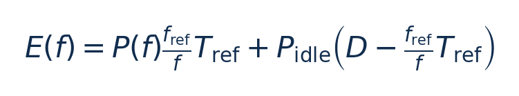

# GreenLLM：SLO双环服务：从零入门

[论文页面](https://arxiv.org/abs/2508.16449v1) · [本笔记所用 PDF](https://arxiv.org/pdf/2508.16449v1) · [标识符](https://doi.org/10.48550/arXiv.2508.16449)

整理日期：2026-11-06。**读者原创中文解读；原图归论文作者／出版方。未运行作者实验，不是独立复现。**

## 先把四个角色放对位置

被控负载是要完成的程序和输入，比如识别一帧图像、生成token或完成一次训练迭代；CPU/GPU是执行程序的硬件；控制器根据观测选运行档位；驱动／寄存器把档位落实。程序代码可以完全一样，CPU时钟变慢时每条指令对应的墙钟时间通常变长，访存或I/O等待则未必按同样比例变化。

软件控制并不意味着没有真实硬件。软件中的学习策略可控制真实CPU；也可先控制一个执行时间与能量模型。后者能验证闭环逻辑，但模型输出的J不能当真实电测。E902的RTL能在仿真中改变时钟并反馈计数；电压导致的物理功耗还需相应模型、功耗分析或板级实验。

## 这篇到底解决哪一件事

prefill按prompt长度分队列并解能量模型，decode用TPS粗档表与token尾延时细环分别调GPU频率

为什么局部利用率不能完整反映整个应用的性能与能耗？本篇的研究问题或可检验主张是：prefill按prompt长度分队列并解能量模型，decode用TPS粗档表与token尾延时细环分别调GPU频率。验证链是可观测状态→控制规则或学习模型→执行器→任务正确性/服务质量与能耗对照。

**把方法想成一条流水线：** prompt长度/队列待处理项、离线aL²+bL+c时延与P(f)功率模型、过去200ms TPS、近期P95 TBT、SLO余量 → prefill长度分队列＋二次延时/三次功率模型约束优化；decode TPS查表粗环＋滞回＋20ms尾延时频率步进细环＋6s表偏置更新 → prefill队列路由与各worker SM频率；decode频带＋15MHz步进频率；不在线改变模型尺寸 → 执行与反馈。

| 先回答的问题 | 本文答案 |
| --- | --- |
| 具体控制算法 | prefill长度分队列＋二次延时/三次功率模型约束优化；decode TPS查表粗环＋滞回＋20ms尾延时频率步进细环＋6s表偏置更新 |
| 被控负载类型 | 多请求服务端LLM推理，prefill/decode解耦、动态到达率 |
| 具体被控程序 | Qwen3-14B dense、Qwen3-30B MoE，BF16；Alibaba ServeGen chat QPS1/3/5/8/10、Azure2024 code/conversation下采样trace |
| 使用平台与测量 | 单DGX-A100节点8×A100-SXM4 40GB/NVLink；Dynamo0.3.1/TensorRT-LLM；NVML SM应用时钟，显存固定；GPU能量，不含全设施 |
| 输入/状态 | prompt长度/队列待处理项、离线aL²+bL+c时延与P(f)功率模型、过去200ms TPS、近期P95 TBT、SLO余量 |
| 输出/动作 | prefill队列路由与各worker SM频率；decode频带＋15MHz步进频率；不在线改变模型尺寸 |
| 周期与运行位置 | decode 200ms估TPS、连续3窗口才换bucket；20ms细环；6s更新粗表。prefill按待处理队列调节 |

## 十个先修关键词

| 级别 | 术语／关键词 | 直觉、严格含义与易混点 |
| --- | --- | --- |
| A | DVFS / DFS | DVFS同时涉及动态电压与频率；只有时钟变化称DFS。电压能否改变取决于实际供电域。 |
| A | Workload | 真正执行应用计算的程序与输入；本文里的控制器是另一个角色。 |
| A | Controller | 根据观测选择动作的软件／硬件，可运行在同一CPU或独立控制核。 |
| A | OPP | Operating Performance Point，经过允许范围验证的电压—频率组合。 |
| A | Power / Energy | 功率W表示此刻消耗快慢；能量J是对时间积分。低功率不必然低能量。 |
| B | Deadline | 作业必须完成的时刻；平均时延、P95与最大时延各有不同用途。 |
| A | 被控程序 | Qwen3-14B dense、Qwen3-30B MoE，BF16；Alibaba ServeGen chat QPS1/3/5/8/10、Azure2024 code/conversation下采样trace |
| A | 控制策略 | prefill长度分队列＋二次延时/三次功率模型约束优化；decode TPS查表粗环＋滞回＋20ms尾延时频率步进细环＋6s表偏置更新 |
| B | 控制周期 | decode 200ms估TPS、连续3窗口才换bucket；20ms细环；6s更新粗表。prefill按待处理队列调节 |
| B | 证据边界 | 实测、硬件仿真、功耗模型是不同证据，见平台与结果表。 |

## 用一个小算例建立直觉

教学例D=1s、busy=0.6s，剩0.4s的idle也耗能；不能只看active功率。

频率同单位，Tref/D为s，功率W，E为J；只在busy≤D可行时用。

**要防止的误读：** SLO不是硬deadline证明；原文表格存在更大通过率代价，需要独立重算和明确违约定义。

## 论文真正验证了什么

| 指标 | 原文报告 | 条件／分母／边界 | 证据位置 |
| --- | --- | --- | --- |
| GPU总能量降低 | Azure Qwen14B最高34.09% | Azure_conv5，相对defaultNV；其他工况约6.78%–34.09%，非所有34% | Table3，p10 |
| Qwen30B例 | Azure_conv8节能22.51%，TBT通过99.8%→93.8% | 通过率下降6.0个百分点；与摘要“additional violations<3.5%”笼统说法不完全一致 | Table4，p10 |
| 路由单独贡献 | 多工况约1%–3%能量变化 | PrefillSplit消融vsdefaultNV；主要节能还来自阶段调频 | Table3–4，p10 |

这些结果来自作者实验。算法reward、模型误差、控制器时延、被控应用速度与应用节能是不同指标，要看具体行的单位和证据。

## 它与你的毕设怎么接起来

适合将“队列长度/阶段＋粗表＋细反馈”迁移到CPU服务应用；E902可用队列积压/剩余期限替代TPS与P95窗口，先简单规则再学习预测。完整LLM服务实验需要GPU内存，E902只适合小负载或作为管理核。

最先可以尝试：**P0：阶段与排队时延分离**。理由是先验证应用与执行器，建立同边界基线；最低资源是单GPU/CPU轻量服务、可控请求到达率、端到端与执行时间日志；通过标准是输出正确；保存实际频率、温度、时延与积分能量。

## 五分钟自测

1. 这篇输出的是下一频率、功率估计，还是通信／控制时序？
2. 是真实负载硬件实验，还是模型／RTL／HIL？哪些部分是真的？
3. 最重要百分比的分母和比较对象是什么？
4. 如果换成单核E902，哪一个输入或硬件旋钮会消失？
5. 算上采样、推理、切频和空闲时间后，节能是否还成立？

答案线索在本页角色表和结果表；进一步读“图文技术精读”的关键原图、公式与三项课题实验，再到“图表索引”回查原PDF。不是先记住论文所有缩写。
