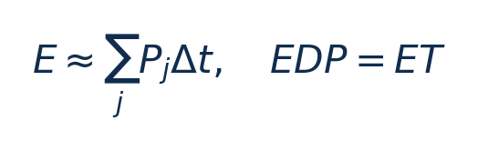

# LLM能量–性能刻画v4：从零入门

[论文页面](https://arxiv.org/abs/2501.08219v4) · [本笔记所用 PDF](https://arxiv.org/pdf/2501.08219v4) · [标识符](https://doi.org/10.48550/arXiv.2501.08219)

整理日期：2026-11-06。**读者原创中文解读；原图归论文作者／出版方。未运行作者实验，不是独立复现。**

## 先把四个角色放对位置

被控负载是要完成的程序和输入，比如识别一帧图像、生成token或完成一次训练迭代；CPU/GPU是执行程序的硬件；控制器根据观测选运行档位；驱动／寄存器把档位落实。程序代码可以完全一样，CPU时钟变慢时每条指令对应的墙钟时间通常变长，访存或I/O等待则未必按同样比例变化。

软件控制并不意味着没有真实硬件。软件中的学习策略可控制真实CPU；也可先控制一个执行时间与能量模型。后者能验证闭环逻辑，但模型输出的J不能当真实电测。E902的RTL能在仿真中改变时钟并反馈计数；电压导致的物理功耗还需相应模型、功耗分析或板级实验。

## 这篇到底解决哪一件事

以控制变量实验刻画模型规模、输入语义、batch与GPU频率的关系，给阶段调频和模型路由提供机会分析而非完整新闭环控制器

为什么局部利用率不能完整反映整个应用的性能与能耗？本篇的研究问题或可检验主张是：以控制变量实验刻画模型规模、输入语义、batch与GPU频率的关系，给阶段调频和模型路由提供机会分析而非完整新闭环控制器。验证链是可观测状态→控制规则或学习模型→执行器→任务正确性/服务质量与能耗对照。

**把方法想成一条流水线：** 受控SM频率、模型规模、batch、prompt语义/长度特征；分类accuracy与生成ROUGE-L；不是在线反馈state → 离线7档SM频率扫描＋语义/质量相关分析＋EDP比较；提出prefill高频/decode低频用例；模型路由联合87%为估算，无训练在线governor → 频率–能量–时间表、EDP最优档、质量/能量机会分析；没有可直接部署的每步闭环动作轨迹 → 执行与反馈。

| 先回答的问题 | 本文答案 |
| --- | --- |
| 具体控制算法 | 离线7档SM频率扫描＋语义/质量相关分析＋EDP比较；提出prefill高频/decode低频用例；模型路由联合87%为估算，无训练在线governor |
| 被控负载类型 | 单GPU离线LLM推理基准，分类与生成两种任务 |
| 具体被控程序 | Llama3.2-1B/3B、Llama3.1-8B、Qwen2.5-14B/32B，FP16；BoolQ/HellaSwag用log-likelihood分类（不生成），TruthfulQA_GEN/NarrativeQA greedy最多100tokens；3817queries |
| 使用平台与测量 | 单RTX PRO6000 Blackwell96GB；NVML/nvidia-smi 10ms功率采样、CUDA同步计时；batch1/4/8，显存默认频率；只计GPU能量 |
| 输入/状态 | 受控SM频率、模型规模、batch、prompt语义/长度特征；分类accuracy与生成ROUGE-L；不是在线反馈state |
| 输出/动作 | 频率–能量–时间表、EDP最优档、质量/能量机会分析；没有可直接部署的每步闭环动作轨迹 |
| 周期与运行位置 | 每配置固定SM频率并重复3次平均；相位切换案例是由刻画提出的策略解释，路由需未来实现与开销验证 |

## 十个先修关键词

| 级别 | 术语／关键词 | 直觉、严格含义与易混点 |
| --- | --- | --- |
| A | DVFS / DFS | DVFS同时涉及动态电压与频率；只有时钟变化称DFS。电压能否改变取决于实际供电域。 |
| A | Workload | 真正执行应用计算的程序与输入；本文里的控制器是另一个角色。 |
| A | Controller | 根据观测选择动作的软件／硬件，可运行在同一CPU或独立控制核。 |
| A | OPP | Operating Performance Point，经过允许范围验证的电压—频率组合。 |
| A | Power / Energy | 功率W表示此刻消耗快慢；能量J是对时间积分。低功率不必然低能量。 |
| B | Deadline | 作业必须完成的时刻；平均时延、P95与最大时延各有不同用途。 |
| A | 被控程序 | Llama3.2-1B/3B、Llama3.1-8B、Qwen2.5-14B/32B，FP16；BoolQ/HellaSwag用log-likelihood分类（不生成），TruthfulQA_GEN/NarrativeQA greedy最多100tokens；3817queries |
| A | 控制策略 | 离线7档SM频率扫描＋语义/质量相关分析＋EDP比较；提出prefill高频/decode低频用例；模型路由联合87%为估算，无训练在线governor |
| B | 控制周期 | 每配置固定SM频率并重复3次平均；相位切换案例是由刻画提出的策略解释，路由需未来实现与开销验证 |
| B | 证据边界 | 实测、硬件仿真、功耗模型是不同证据，见平台与结果表。 |

## 用一个小算例建立直觉

教学例能量0.6倍、时间1.1倍，EDP0.66倍；低功率本身不是能量。

P W、Δt s、E J、T s；采样10ms未必捕获更短瞬态，需窗口校验。

**要防止的误读：** 180MHz极端点和960MHz异常优势必须复核；不能据此要求任意GPU降到180MHz。

## 论文真正验证了什么

| 指标 | 原文报告 | 条件／分母／边界 | 证据位置 |
| --- | --- | --- | --- |
| batch1低频扫描/案例 | 平均GPU能量−41.9%、时延＋2.8% | 180对2842MHz；各模型能量−39.9%–44.0%，时延＋0.3%–5.6%；仅本设备 | TableXI/XVI，p7/9 |
| batch扩大 | batch4/8能量−42.4%/43.6%，时延＋2.1%/1.1% | 同最高频基线；不等任意在线batch服务收益 | TableXI，p7 |
| 联合路由机会 | 约87%估算；3B质量77.0%对32B83.8% | 质量差6.8个百分点；没有部署路由测量；44.5%“easy”是分析分类 | TableXVII/XVIII，p9 |

这些结果来自作者实验。算法reward、模型误差、控制器时延、被控应用速度与应用节能是不同指标，要看具体行的单位和证据。

## 它与你的毕设怎么接起来

适合作为你开题前的实验模板：先固定应用质量和工作量，做E–T曲线/阶段分解，再决定是否有必要学习。CPU/E902也先扫描合法档、计算EDP与错误条；不必一开始选LLM，更不移植Blackwell的频率和百分比。

最先可以尝试：**P0：固定工作量频率扫描**。理由是先验证应用与执行器，建立同边界基线；最低资源是可锁频GPU小SLM或LinuxCPU候选程序，重复运行与温度日志；通过标准是输出正确；保存实际频率、温度、时延与积分能量。

## 五分钟自测

1. 这篇输出的是下一频率、功率估计，还是通信／控制时序？
2. 是真实负载硬件实验，还是模型／RTL／HIL？哪些部分是真的？
3. 最重要百分比的分母和比较对象是什么？
4. 如果换成单核E902，哪一个输入或硬件旋钮会消失？
5. 算上采样、推理、切频和空闲时间后，节能是否还成立？

答案线索在本页角色表和结果表；进一步读“图文技术精读”的关键原图、公式与三项课题实验，再到“图表索引”回查原PDF。不是先记住论文所有缩写。
