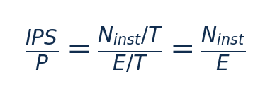
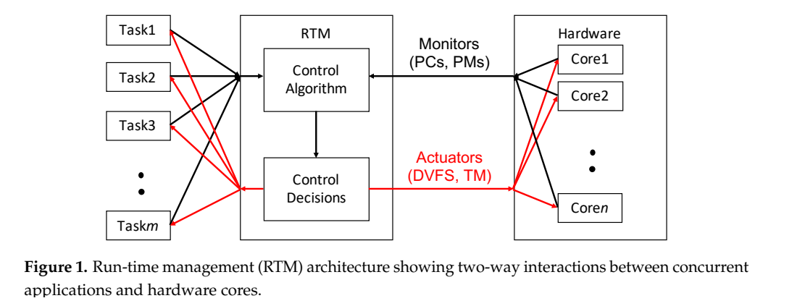
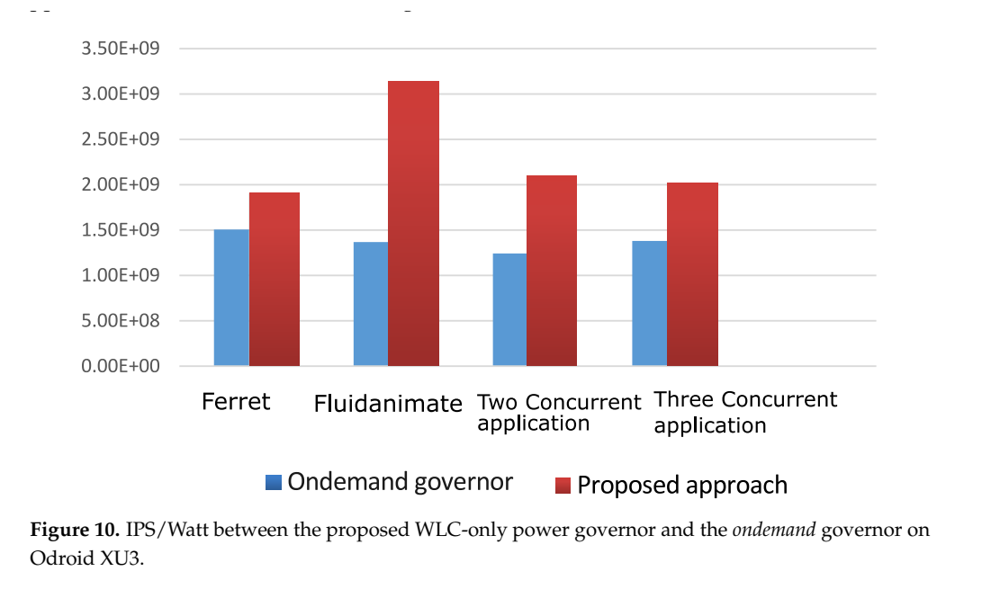
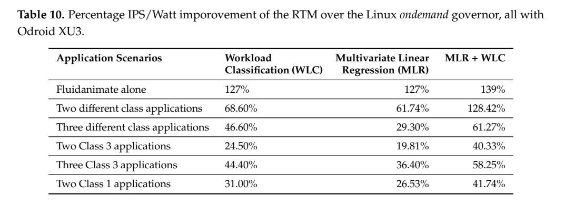

# WLC＋MLR RTM：图文技术精读

[论文页面](https://doi.org/10.3390/jlpea10030025) · [本笔记所用 PDF](https://mdpi-res.com/d_attachment/jlpea/jlpea-10-00025/article_deploy/jlpea-10-00025.pdf) · [标识符](https://doi.org/10.3390/jlpea10030025)

整理日期：2026-11-05。**读者原创中文解读；原图归论文作者／出版方。未运行作者实验，不是独立复现。**

**一句话：** 先按计算/访存特征把任务分成四类，再缩小核分配和频率搜索空间

阅读地图：先看问题与输入输出，再顺着架构图、公式和结果图阅读；最后检查统计边界与E902迁移。完整编号索引另见“图表索引”。下文“读者分析”是推断或建议，不是原文结果。

## 阶段0：材料与版本审计

| 材料 | 当前可用程度 | 影响 |
| --- | --- | --- |
| 摘要、正文、方法、原图注 | 已获取本地完整PDF、文本与逐页渲染 | 可核查结构、实验及关键数字；可见页面优先于异常文本层 |
| 分析版本 | MDPI正式版25页；2018 PATMOS工作的扩展，不能算同一实验重复的新贡献。 | 引用页码以“PDF第几页”标识 |
| 代码／原始数据 | mthreads/PThreads来源 https://github.com/ashurrafiev/PThreads；PARSEC和Likwid是依赖，不代表完整RTM脚本已取得或已运行。 | 公开链接不等于已构建或已拿到原始轨迹 |
| 附件、独立原始重复与勘误 | 当前未完成全渠道附件／勘误穷尽检索 | 不能断言没有附件、没有勘误或没有其他版本 |
| 本次工作范围 | 材料阅读、图表裁取、证据整理、教学公式 | 所有新实验均是建议，尚未执行 |

## 阶段1：身份卡与整体概述

| 项目 | 内容 |
| --- | --- |
| 英文题名 | Low-Complexity Run-time Management of Concurrent Workloads for Energy-Efficient Multi-Core Systems |
| 中文导读题名 | 先按计算/访存特征把任务分成四类，再缩小核分配和频率搜索空间 |
| 作者 | Ali Aalsaud, Fei Xia, Ashur Rafiev, Rishad Shafik, Alexander Romanovsky, Alex Yakovlev |
| 发表／版本 | J. Low Power Electronics and Applications 10(3),25 (2020)；MDPI正式版25页；2018 PATMOS工作的扩展，不能算同一实验重复的新贡献。 |
| 类型与领域 | 原始方法／工程系统研究；DVFS、CPU能效、运行时控制 |
| 单位、通讯、资助与利益关系 | 作者姓名以本版本首页为准；通讯方式、单位及资助可回查首页与末页声明。当前尚未完成资助/利益关系/勘误的跨版本穷尽审计。 |
| 核心对象与接口 | 控制周期500ms；每核监测线程异步采集；200MHz测得WLC循环约10ms，>90%耗于监测 |
| 代码与数据 | mthreads/PThreads来源 https://github.com/ashurrafiev/PThreads；PARSEC和Likwid是依赖，不代表完整RTM脚本已取得或已运行。 |
| 与本课题关系 | 可把四类改成E902可观测的压缩输入/阶段类别，先小表决定频率区间，再用轻量回归预测剩余时间。保留分类与回归分工，删除不存在的big/little分配。 |

**约200字中文概述（改写）：** 本文研究CPU密集、访存密集、混合与低活动并发多线程程序的运行时能效。具体程序包括mthreads整数/64MB随机内存混合合成负载；PARSEC bodytrack、ferret、fluidanimate、canneal、freqmine、streamcluster，单个及多程序组合。作者在ODROID-XU3 Exynos5422，4×A15＋4×A7、Ubuntu14.04与片上电流传感器；Intel Sandybridge Core i7，Ubuntu/Likwid/RAPL并用分流电阻初步交叉验证上采用WLC四类阈值分类＋查表任务映射/cluster DVFS；可选MLR在缩小空间中建模IPC并最大化IPS/W；每500ms重新分类。输入为retired指令、unhalted cycles、内存访问、参考时钟；nnmipc区分计算/内存，urr区分活动程度，输出为各应用核亲和掩码、big/little核数和cluster频率；非单纯CPU频率唯一旋钮。主要结果应与下方基线、性能约束和测量范围一起阅读，不能只摘最高百分比。分类先缩小搜索空间，再可选回归细化；用低成本决策替代在所有并发核/频组合上的昂贵搜索，并验证同一程序随阶段改变类别。

**三句话定位：** 问题是为什么相同CPU利用率未必对应相同的工作需求？本篇的可检验主张是：先按计算/访存特征把任务分成四类，再缩小核分配和频率搜索空间。验证链是可观测状态→控制规则或学习模型→执行器→任务正确性/服务质量与能耗对照。 方法主线为retired指令、unhalted cycles、内存访问、参考时钟；nnmipc区分计算/内存，urr区分活动程度 → WLC四类阈值分类＋查表任务映射/cluster DVFS；可选MLR在缩小空间中建模IPC并最大化IPS/W；每500ms重新分类 → 各应用核亲和掩码、big/little核数和cluster频率；非单纯CPU频率唯一旋钮 → 执行与反馈。 主要证据见下方结果表，结论须与测量和版本范围一起使用。

## 阶段2：问题、假设与创新位置

为什么相同CPU利用率未必对应相同的工作需求？本篇的可检验主张是：先按计算/访存特征把任务分成四类，再缩小核分配和频率搜索空间。验证链是可观测状态→控制规则或学习模型→执行器→任务正确性/服务质量与能耗对照。

**创新判断（读者分析）：** 分类先缩小搜索空间，再可选回归细化；用低成本决策替代在所有并发核/频组合上的昂贵搜索，并验证同一程序随阶段改变类别。 不依据作者自称“首次”断定整个领域绝无前例。

## 阶段3：必要术语与数学

| 级别 | 术语／关键词 | 直觉、严格含义与易混点 |
| --- | --- | --- |
| A | DVFS / DFS | DVFS同时涉及动态电压与频率；只有时钟变化称DFS。电压能否改变取决于实际供电域。 |
| A | Workload | 真正执行应用计算的程序与输入；本文里的控制器是另一个角色。 |
| A | Controller | 根据观测选择动作的软件／硬件，可运行在同一CPU或独立控制核。 |
| A | OPP | Operating Performance Point，经过允许范围验证的电压—频率组合。 |
| A | Power / Energy | 功率W表示此刻消耗快慢；能量J是对时间积分。低功率不必然低能量。 |
| B | Deadline | 作业必须完成的时刻；平均时延、P95与最大时延各有不同用途。 |
| A | 被控程序 | mthreads整数/64MB随机内存混合合成负载；PARSEC bodytrack、ferret、fluidanimate、canneal、freqmine、streamcluster，单个及多程序组合 |
| A | 控制策略 | WLC四类阈值分类＋查表任务映射/cluster DVFS；可选MLR在缩小空间中建模IPC并最大化IPS/W；每500ms重新分类 |
| B | 控制周期 | 控制周期500ms；每核监测线程异步采集；200MHz测得WLC循环约10ms，>90%耗于监测 |
| B | 证据边界 | 实测、硬件仿真、功耗模型是不同证据，见平台与结果表。 |

### 公式1：归一化非访存IPC

**符号与前提：** 计数都必须同窗口，IPCmax为平台理论/参考上限；该指标是代理，非精确CPU工作占比。

**代入与检查：** 阈值0.25/0.35来自XU3标定，不能直接用到E902。

**来源：** Table5–6，p10–11
### 公式2：能效指标

**符号与前提：** 同一窗口功率W、时间s和能量J；IPS/W单位instructions/J。

**代入与检查：** 改善139%即2.39倍instructions/J，不能写成减少139%能量。

**来源：** Table10，p19

## 阶段4–6：架构、关键图与方法拆解

**输入—处理—输出：** retired指令、unhalted cycles、内存访问、参考时钟；nnmipc区分计算/内存，urr区分活动程度 → WLC四类阈值分类＋查表任务映射/cluster DVFS；可选MLR在缩小空间中建模IPC并最大化IPS/W；每500ms重新分类 → 各应用核亲和掩码、big/little核数和cluster频率；非单纯CPU频率唯一旋钮 → 执行与反馈。

| 系统角色 | 具体设置 |
| --- | --- |
| 具体控制算法 | WLC四类阈值分类＋查表任务映射/cluster DVFS；可选MLR在缩小空间中建模IPC并最大化IPS/W；每500ms重新分类 |
| 被控负载类型 | CPU密集、访存密集、混合与低活动并发多线程程序 |
| 具体被控程序 | mthreads整数/64MB随机内存混合合成负载；PARSEC bodytrack、ferret、fluidanimate、canneal、freqmine、streamcluster，单个及多程序组合 |
| 使用平台与测量 | ODROID-XU3 Exynos5422，4×A15＋4×A7、Ubuntu14.04与片上电流传感器；Intel Sandybridge Core i7，Ubuntu/Likwid/RAPL并用分流电阻初步交叉验证 |
| 输入/状态 | retired指令、unhalted cycles、内存访问、参考时钟；nnmipc区分计算/内存，urr区分活动程度 |
| 输出/动作 | 各应用核亲和掩码、big/little核数和cluster频率；非单纯CPU频率唯一旋钮 |
| 周期与运行位置 | 控制周期500ms；每核监测线程异步采集；200MHz测得WLC循环约10ms，>90%耗于监测 |

§5–7（p8–21）：mthreads的M控制整数和随机64MB访问比例，用于建立分类阈值。XU3选nnmipc，0.35以上CPU类、0.25–0.35混合、小于0.25内存类，urr≤0.11识别低活动；其他平台重新标定。分类后按查表偏好分配big/little核和频点，共享资源不足时分摊。MLR可在分类排除大量候选后寻找更高IPS/W配置。

WLC是阈值/规则，不要叫它监督神经网络；MLR是多元线性回归，不是强化学习。总体目标IPS/W等于每焦耳指令吞吐，未直接约束任务截止期；任务迁移和核数改变都可能贡献收益，不能全部归因于DVFS。

### Fig1：RTM与应用/硬件架构

[打开大图](images/original-fig1.png) · [原文 Fig1，PDF p5](https://mdpi-res.com/d_attachment/jlpea/jlpea-10-00025/article_deploy/jlpea-10-00025.pdf#page=5)

**怎样看：** 先读图题、图例、坐标/表头与单位，再在同一负载和同一基线内比较。控制包含映射和DVFS双动作。

**直接观察／原文报告：** 控制包含映射和DVFS双动作。

**读者判断：** 本项只支撑原文所列平台和配置；不证明E902可直接复用这些数值。

| 阅读问题 | 先看材料 | 如何接到下一步 |
| --- | --- | --- |
| 为什么要改现有方案 | 问题背景与动机图 | 确定目标、约束和原有不足 |
| 系统观察什么、控制什么 | 输入输出表＋关键架构图 | 确认数据、模型和执行器真实角色 |
| 方法如何得到动作或估计 | 方法段、公式、算法／模型表 | 明确离线训练与在线流程 |
| 收益是否真实且公平 | 结果图表、统计与测量边界 | 核查基线／目标／分母／开销 |
| 能否用于自己的CPU | 局限、复现计划、三项实验 | 把论文假设变成待验证的工程条件 |

## 阶段7–8：实验、统计及证据链

本节数字均是**原文明确报告或原文数值的标注算例**；没有按图柱高度臆造额外精确值。

| 指标 | 原文报告 | 条件／分母／边界 | 证据位置 |
| --- | --- | --- | --- |
| XU3 WLC-only | IPS/W改善约24%–127% | 相对Ondemand，特定单/多程序场景 | Fig10/Table10，p19 |
| XU3 WLC＋MLR | Fluidanimate139%；两不同类128.42% | 是IPS/W相对改善，不是能量减少139% | Table10，p19 |
| Intel平台WLC＋MLR | IPS/W约20%–40%改善 | 同平台Ondemand，所有核分配给应用 | Fig12，p20 |
| 控制成本 | 10ms/500ms | WLC@200MHz；MLR-only对照约100ms | §7.1.3，p18 |

### Fig10：WLC对Ondemand

[打开大图](images/original-fig10.png) · [原文 Fig10，PDF p19](https://mdpi-res.com/d_attachment/jlpea/jlpea-10-00025/article_deploy/jlpea-10-00025.pdf#page=19)

**怎样看：** 先读图题、图例、坐标/表头与单位，再在同一负载和同一基线内比较。指标是IPS/W，非节能率。

**直接观察／原文报告：** 指标是IPS/W，非节能率。

**读者判断：** 本项只支撑原文所列平台和配置；不证明E902可直接复用这些数值。

### Table10：IPS/W结果汇总

[打开大图](images/original-table10.png) · [原文 Table10，PDF p19](https://mdpi-res.com/d_attachment/jlpea/jlpea-10-00025/article_deploy/jlpea-10-00025.pdf#page=19)

**怎样看：** 先读图题、图例、坐标/表头与单位，再在同一负载和同一基线内比较。Fluidanimate139%是WLC＋MLR的指标改善。

**直接观察／原文报告：** Fluidanimate139%是WLC＋MLR的指标改善。

**读者判断：** 本项只支撑原文所列平台和配置；不证明E902可直接复用这些数值。

**统计与公平性审查（读者分析）：** 结果以不同程序组合和CPU域测量为单位；不要把程序数当独立硬件重复。原文测量/模型选择有交叉验证，但没有统一逐项置信区间，峰值139%不是跨场景平均。IPS/W=2.39倍仅表示该代理指标增幅，非每任务能量可节省139%。500ms分类可能振荡，作者讨论稳定性与配置行为互相影响。

工程实验中，设备、程序、输入文件、重复运行、时间窗口是不同统计层级，不能互相替代。本任务不涉及生物样本，细胞／动物／试剂等检查不适用。未注明的P值或置信区间不补造；“差了几个百分点”不自动等于统计显著。

| 主张层级 | 直接证据 | 对照与统计 | 可得结论／替代解释 | 可信度 |
| --- | --- | --- | --- | --- |
| 原文明确报告 | XU3 WLC-only：IPS/W改善约24%–127% | Fig10/Table10，p19 | 相对Ondemand，特定单/多程序场景；仅在该实验范围内成立 | 图表／文本可核对：高；独立复现：尚无 |
| 作者解释 | 所提架构／模型解释了性能或估计改善 | 关键原图与方法见上文；统计边界见下节 | 效果可能同时来自动作空间、平台特性与采样设置，因果归因需消融 | 中 |
| AI分析／迁移假设 | 用于E902的压缩候选负载 | 本篇未直接验证该芯片与任务组合 | 需三项后续实验；不能复制论文收益数字 | 待验证，当前无法判断 |

## 阶段9–10：贡献与局限分开判断

分类先缩小搜索空间，再可选回归细化；用低成本决策替代在所有并发核/频组合上的昂贵搜索，并验证同一程序随阶段改变类别。

| 来源 | 严重程度 | 局限及其影响 |
| --- | --- | --- |
| 读者分析 | 关键 | E902可能没有所需PMC、异构核或任务迁移资源；必须重做观测特征和动作空间。 |
| 读者分析 | 关键 | 追求IPS/W不自动满足压缩块的绝对期限或公平性。 |
| 读者分析 | 关键 | 分类边界受动作影响可能反复切换，移植要加入驻留/迟滞并测成本。 |

## 阶段11：最小复现路线与缺口

先重建原文固定安全档、输入文件和测量边界，再实现上述算法。逐档确认正确输出和执行时间，记录控制、监测、调频与空闲成本；冻结模型后用整文件留出的输入测试。原文未定位齐的参数须列入复现日志，不用猜测值伪装完整复现。可把四类改成E902可观测的压缩输入/阶段类别，先小表决定频率区间，再用轻量回归预测剩余时间。保留分类与回归分工，删除不存在的big/little分配。

**代码／数据现状：** mthreads/PThreads来源 https://github.com/ashurrafiev/PThreads；PARSEC和Likwid是依赖，不代表完整RTM脚本已取得或已运行。

**质量控制顺序：** 先验证程序输出和时间基准，再验证采样／模型，最后比较策略。保存输入文件哈希、平台配置、OPP、随机种子、温度与每次运行原始记录。失败时先回固定安全频点定位错误，再继续优化。复现可行性判断为“可开始部分方法复建，完整数值复现条件未齐”；这与“已完成复现”不同。

## 阶段12：用于你的CPU／E902课题

可把四类改成E902可观测的压缩输入/阶段类别，先小表决定频率区间，再用轻量回归预测剩余时间。保留分类与回归分工，删除不存在的big/little分配。

| 建议实验／优先级 | 价值 | 最低资源 | 主要风险 | 成功判据（设计目标，非已得结果） |
| --- | --- | --- | --- | --- |
| P0：压缩阶段分类 | 确认阶段变化可观测 | 字节进度/历史周期/等待占比 | 无PMC时类别不可辨 | 用独立文件检验分类稳定性 |
| P1：分类缩空间 | 减少频点穷举成本 | 小树/规则＋回归 | 粗分类排除真正最优档 | 对离线全档oracle比能量/违约 |
| P1：分类迟滞消融 | 限制抖动 | 最短驻留时间和双阈值 | 反应过慢 | 报告切换次数、净能量及尾时延 |

上述优先级是读者建议：P0先做，P1建立在基线可运行后，P2只在资源允许且前序实验证明有必要时开展。压缩应用仍是候选，尚未替你最终定题或证明已在E902运行。论文公开可读不自动授权任意复制数据；代码、图片和数据须分别核对许可。

## 阶段13：读完后应掌握与继续核查

**五个知识点：** 先按计算/访存特征把任务分成四类，再缩小核分配和频率搜索空间 你还应能解释输入输出表中的角色、两条公式的单位、首个结果指标的分母，以及局限表里的关键条件。

**五个未决问题：** 独立新输入是否成立？最差时延是否可接受？测量参考是否足够？控制与切换是否抵消收益？E902实际具有哪些接口和可观测量？这些是研究问题，不是对作者遗漏的无证据指控。

**立即做：** 按公式算例手算一次，选一张结果图复述“硬件—负载—基线—指标—边界”。**后续核查：** 补齐代码版本、训练数据和仪表设置。**可复用：** 上文明确标注的模型与接口思路。**谨慎采用：** 所有跨平台百分比。**暂不采用：** 尚未证实存在的电压控制和完整硬实时承诺。
