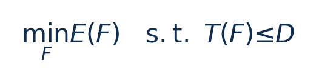

# Perseus：训练流水线频率调度：从零入门

[论文页面](https://arxiv.org/abs/2312.06902v3) · [本笔记所用 PDF](https://arxiv.org/pdf/2312.06902v3) · [标识符](https://doi.org/10.48550/arXiv.2312.06902)

整理日期：2026-11-06。**读者原创中文解读；原图归论文作者／出版方。未运行作者实验，不是独立复现。**

## 先把四个角色放对位置

被控负载是要完成的程序和输入，比如识别一帧图像、生成token或完成一次训练迭代；CPU/GPU是执行程序的硬件；控制器根据观测选运行档位；驱动／寄存器把档位落实。程序代码可以完全一样，CPU时钟变慢时每条指令对应的墙钟时间通常变长，访存或I/O等待则未必按同样比例变化。

软件控制并不意味着没有真实硬件。软件中的学习策略可控制真实CPU；也可先控制一个执行时间与能量模型。后者能验证闭环逻辑，但模型输出的J不能当真实电测。E902的RTL能在仿真中改变时钟并反馈计数；电压导致的物理功耗还需相应模型、功耗分析或板级实验。

## 这篇到底解决哪一件事

将训练计算DAG的关键路径转成最小割问题，给不同前向/反向计算安排GPU频率以回收流水线等待能量

为什么局部利用率不能完整反映整个应用的性能与能耗？本篇的研究问题或可检验主张是：将训练计算DAG的关键路径转成最小割问题，给不同前向/反向计算安排GPU频率以回收流水线等待能量。验证链是可观测状态→控制规则或学习模型→执行器→任务正确性/服务质量与能耗对照。

**把方法想成一条流水线：** 前向/反向计算DAG、各计算频率–时间–能量曲线、阻塞功率、目标iteration time/straggler迭代时间 → 离线/启动剖析E–T曲线→指数连续松弛→关键DAG的s-t最小割/最大流迭代追踪Pareto前沿→离散频率向上取可行档；慢流水线约束下选调度 → 每个前向/反向计算的GPU频率schedule；不改变网络质量目标与global batch → 执行与反馈。

| 先回答的问题 | 本文答案 |
| --- | --- |
| 具体控制算法 | 离线/启动剖析E–T曲线→指数连续松弛→关键DAG的s-t最小割/最大流迭代追踪Pareto前沿→离散频率向上取可行档；慢流水线约束下选调度 |
| 被控负载类型 | GPU流水线并行与数据并行训练，含stage不均衡和straggler |
| 具体被控程序 | GPT3、Bloom、BERT、T5、Wide-ResNet；真实平台约1.3B–6.7B配置，大规模emulation扩到176B |
| 使用平台与测量 | 真实A40-48GB集群与4×A100-80GB节点；NVML锁SM时钟、异步进程执行；大规模GPU数为基于剖析的emulation |
| 输入/状态 | 前向/反向计算DAG、各计算频率–时间–能量曲线、阻塞功率、目标iteration time/straggler迭代时间 |
| 输出/动作 | 每个前向/反向计算的GPU频率schedule；不改变网络质量目标与global batch |
| 周期与运行位置 | 启动时逐频率约5迭代剖析；服务端算前沿，客户端在forward/backward边界异步set_speed；不是逐token反馈 |

## 十个先修关键词

| 级别 | 术语／关键词 | 直觉、严格含义与易混点 |
| --- | --- | --- |
| A | DVFS / DFS | DVFS同时涉及动态电压与频率；只有时钟变化称DFS。电压能否改变取决于实际供电域。 |
| A | Workload | 真正执行应用计算的程序与输入；本文里的控制器是另一个角色。 |
| A | Controller | 根据观测选择动作的软件／硬件，可运行在同一CPU或独立控制核。 |
| A | OPP | Operating Performance Point，经过允许范围验证的电压—频率组合。 |
| A | Power / Energy | 功率W表示此刻消耗快慢；能量J是对时间积分。低功率不必然低能量。 |
| B | Deadline | 作业必须完成的时刻；平均时延、P95与最大时延各有不同用途。 |
| A | 被控程序 | GPT3、Bloom、BERT、T5、Wide-ResNet；真实平台约1.3B–6.7B配置，大规模emulation扩到176B |
| A | 控制策略 | 离线/启动剖析E–T曲线→指数连续松弛→关键DAG的s-t最小割/最大流迭代追踪Pareto前沿→离散频率向上取可行档；慢流水线约束下选调度 |
| B | 控制周期 | 启动时逐频率约5迭代剖析；服务端算前沿，客户端在forward/backward边界异步set_speed；不是逐token反馈 |
| B | 证据边界 | 实测、硬件仿真、功耗模型是不同证据，见平台与结果表。 |

## 用一个小算例建立直觉

教学例两条路径10ms和8ms，第二条可慢2ms；第一条若慢则总迭代变慢。

F为所有计算的频率向量；E为GPU J/迭代，T与D为s。不是每个算子各自满足同一个D。

**要防止的误读：** 单核E902没有多GPU pipeline slack，不能原样移植或套用28.5%。

## 论文真正验证了什么

| 指标 | 原文报告 | 条件／分母／边界 | 证据位置 |
| --- | --- | --- | --- |
| 真实GPU intrinsic能量降低 | 最高28.5% | 8stage A40/T5-3B，对最大频率；同项slowdown0.0%；各模型不全相同 | Table3，p10 |
| A100 GPT3-1.3B例 | 能量−13.2%，时间＋0.1% | 4stage；EnvPipe−8.8%，＋0.1% | Table3a，p10 |
| 大规模结果 | 最高约30% | 是emulation，不是几千张实体卡全部实测 | §6.3/Fig7–8，p11 |

这些结果来自作者实验。算法reward、模型误差、控制器时延、被控应用速度与应用节能是不同指标，要看具体行的单位和证据。

## 它与你的毕设怎么接起来

若选择GPU训练，可以研究小型pipeline的阶段频率调度；E902可迁移“找真正关键路径、给非关键段用余量、离散动作保守取整”，在压缩/预处理/通信流水线重新测E–T。

最先可以尝试：**P0：小DAG阶段E–T测量**。理由是先验证应用与执行器，建立同边界基线；最低资源是2–4GPU或明确标注的DAG仿真；固定模型/输入；通过标准是输出正确；保存实际频率、温度、时延与积分能量。

## 五分钟自测

1. 这篇输出的是下一频率、功率估计，还是通信／控制时序？
2. 是真实负载硬件实验，还是模型／RTL／HIL？哪些部分是真的？
3. 最重要百分比的分母和比较对象是什么？
4. 如果换成单核E902，哪一个输入或硬件旋钮会消失？
5. 算上采样、推理、切频和空闲时间后，节能是否还成立？

答案线索在本页角色表和结果表；进一步读“图文技术精读”的关键原图、公式与三项课题实验，再到“图表索引”回查原PDF。不是先记住论文所有缩写。
