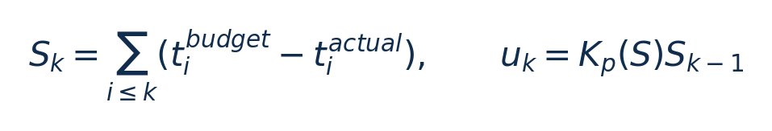

# Ωkypous：从零入门

[论文页面](https://doi.org/10.48550/arXiv.2407.18386) · [本笔记所用 PDF](https://arxiv.org/pdf/2407.18386v3) · [标识符](https://doi.org/10.48550/arXiv.2407.18386)

整理日期：2026-11-05。**读者原创中文解读；原图归论文作者／出版方。未运行作者实验，不是独立复现。**

## 先把四个角色放对位置

被控负载是要完成的程序和输入，比如压缩一块日志；CPU是执行程序的硬件；控制器根据观测选运行档位；驱动／寄存器把档位落实。程序代码可以完全一样，CPU时钟变慢时每条指令对应的墙钟时间通常变长，访存或I/O等待则未必按同样比例变化。

软件控制并不意味着没有真实硬件。软件中的学习策略可控制真实CPU；也可先控制一个执行时间与能量模型。后者能验证闭环逻辑，但模型输出的J不能当真实电测。E902的RTL能在仿真中改变时钟并反馈计数；电压导致的物理功耗还需相应模型、功耗分析或板级实验。

## 这篇到底解决哪一件事

先分配工作流时间预算，再用余量比例反馈与灰盒模型联合选择CPU核心和uncore频率

为什么相同CPU利用率未必对应相同的工作需求？本篇的可检验主张是：先分配工作流时间预算，再用余量比例反馈与灰盒模型联合选择CPU核心和uncore频率。验证链是可观测状态→控制规则或学习模型→执行器→任务正确性/服务质量与能耗对照。

**把方法想成一条流水线：** 工作流拓扑、端到端SLO、历史执行余量、函数输入对应PMC向量、共享频域请求 → 关键路径/比例预算＋自适应比例反馈u=Kp(S)S＋PMC灰盒延迟模型＋二次功率回归；Pareto可行集选最低功率Core/Uncore组合；共享域冲突协调 → 下个函数延迟预算、Core频率与Uncore频率请求；不直接改变应用功能 → 执行与反馈。

| 先回答的问题 | 本文答案 |
| --- | --- |
| 具体控制算法 | 关键路径/比例预算＋自适应比例反馈u=Kp(S)S＋PMC灰盒延迟模型＋二次功率回归；Pareto可行集选最低功率Core/Uncore组合；共享域冲突协调 |
| 被控负载类型 | 具有顺序/分叉/汇合的serverless函数工作流，SLO与调用率变化 |
| 具体被控程序 | SeBS九种函数构成160条工作流；正文点名video-processing、graph-bfs、dynamic-html；Azure调用轨迹驱动（并非直接在Azure上实测） |
| 使用平台与测量 | 两台Intel Xeon E5-2658A服务器，4个10vCPU/16GB VM，各VM分socket；OpenWhisk/Kubernetes/MinIO；acpi-cpufreq与MSR0x620；RAPL20ms采样 |
| 输入/状态 | 工作流拓扑、端到端SLO、历史执行余量、函数输入对应PMC向量、共享频域请求 |
| 输出/动作 | 下个函数延迟预算、Core频率与Uncore频率请求；不直接改变应用功能 |
| 周期与运行位置 | 函数执行前后事件触发；Core系统调用30–70µs，Uncore切换1–3ms；预处理3–15ms、预测2–5ms、远端协调10–20ms |

## 十个先修关键词

| 级别 | 术语／关键词 | 直觉、严格含义与易混点 |
| --- | --- | --- |
| A | DVFS / DFS | DVFS同时涉及动态电压与频率；只有时钟变化称DFS。电压能否改变取决于实际供电域。 |
| A | Workload | 真正执行应用计算的程序与输入；本文里的控制器是另一个角色。 |
| A | Controller | 根据观测选择动作的软件／硬件，可运行在同一CPU或独立控制核。 |
| A | OPP | Operating Performance Point，经过允许范围验证的电压—频率组合。 |
| A | Power / Energy | 功率W表示此刻消耗快慢；能量J是对时间积分。低功率不必然低能量。 |
| B | Deadline | 作业必须完成的时刻；平均时延、P95与最大时延各有不同用途。 |
| A | 被控程序 | SeBS九种函数构成160条工作流；正文点名video-processing、graph-bfs、dynamic-html；Azure调用轨迹驱动（并非直接在Azure上实测） |
| A | 控制策略 | 关键路径/比例预算＋自适应比例反馈u=Kp(S)S＋PMC灰盒延迟模型＋二次功率回归；Pareto可行集选最低功率Core/Uncore组合；共享域冲突协调 |
| B | 控制周期 | 函数执行前后事件触发；Core系统调用30–70µs，Uncore切换1–3ms；预处理3–15ms、预测2–5ms、远端协调10–20ms |
| B | 证据边界 | 实测、硬件仿真、功耗模型是不同证据，见平台与结果表。 |

## 用一个小算例建立直觉

前序比预算早2ms，Kp=0.5，则下个预算可增加1ms；教学例。

时间均s，S正为剩余余量，Kp无量纲且分段自适应；不是包含积分/微分项的PID。

**要防止的误读：** SLO违约非零，模型/干扰与共享域冲突下没有硬实时保证。

## 论文真正验证了什么

| 指标 | 原文报告 | 条件／分母／边界 | 证据位置 |
| --- | --- | --- | --- |
| 相对Performance/Ondemand功率 | 约降低44%/25% | 160条工作流，代价为非零违约；不等于CPU压缩能量收益 | Fig11–12/§6.2.1，p9–10 |
| 相对EcoFaaS功率 | 约降低16.4% | Ωkypous违约1.8%，EcoFaaS1.3%；不是相同违约率下比较 | §6.2.2，p10 |
| 相对DVFaaS功率 | 约降低22% | DVFaaS违约2.8%，各控制器服务质量并非完全相同 | Fig12，p10 |
| 少样本预测 | 5次调用内MAPE<4% | 函数leave-one-out设置；不是所有未知输入误差上界 | Fig10，p8 |

这些结果来自作者实验。算法reward、模型误差、控制器时延、被控应用速度与应用节能是不同指标，要看具体行的单位和证据。

## 它与你的毕设怎么接起来

可把工作流函数换成采集→压缩→发送，用前一阶段余量调下一阶段预算；E902只保留一个合法频率动作。学习灰盒模型的可解释分解，确认开销低于阶段时长，再考虑智能增强。

最先可以尝试：**P0：跨阶段余量**。理由是验证早完成是否可再利用；最低资源是三个软件阶段时间戳；通过标准是对比独立阶段选频和余量传递。

## 五分钟自测

1. 这篇输出的是下一频率、功率估计，还是通信／控制时序？
2. 是真实负载硬件实验，还是模型／RTL／HIL？哪些部分是真的？
3. 最重要百分比的分母和比较对象是什么？
4. 如果换成单核E902，哪一个输入或硬件旋钮会消失？
5. 算上采样、推理、切频和空闲时间后，节能是否还成立？

答案线索在本页角色表和结果表；进一步读“图文技术精读”的关键原图、公式与三项课题实验，再到“图表索引”回查原PDF。不是先记住论文所有缩写。
