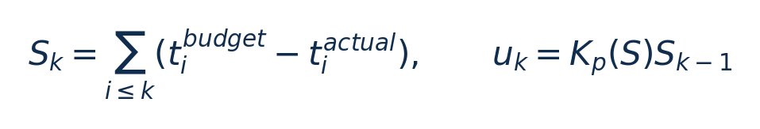
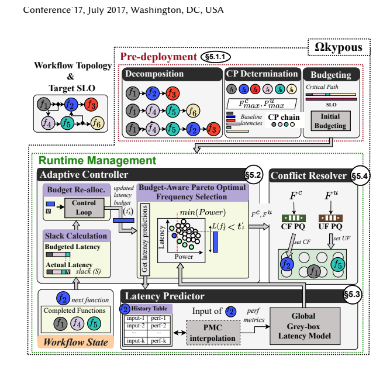
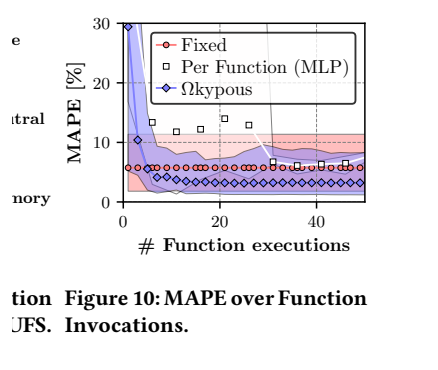
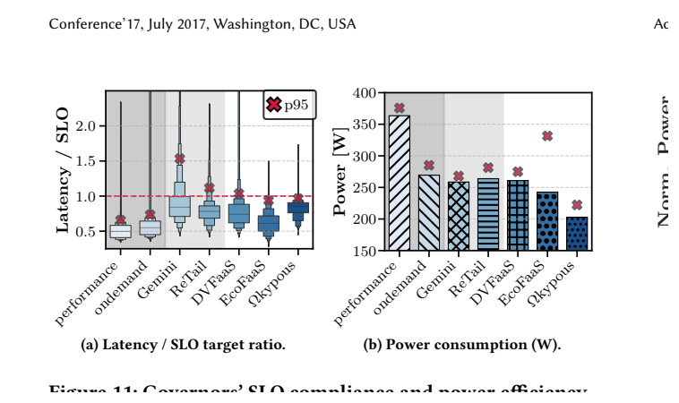

# Ωkypous：图文技术精读

[论文页面](https://doi.org/10.48550/arXiv.2407.18386) · [本笔记所用 PDF](https://arxiv.org/pdf/2407.18386v3) · [标识符](https://doi.org/10.48550/arXiv.2407.18386)

整理日期：2026-11-05。**读者原创中文解读；原图归论文作者／出版方。未运行作者实验，不是独立复现。**

**一句话：** 先分配工作流时间预算，再用余量比例反馈与灰盒模型联合选择CPU核心和uncore频率

阅读地图：先看问题与输入输出，再顺着架构图、公式和结果图阅读；最后检查统计边界与E902迁移。完整编号索引另见“图表索引”。下文“读者分析”是推断或建议，不是原文结果。

## 阶段0：材料与版本审计

| 材料 | 当前可用程度 | 影响 |
| --- | --- | --- |
| 摘要、正文、方法、原图注 | 已获取本地完整PDF、文本与逐页渲染 | 可核查结构、实验及关键数字；可见页面优先于异常文本层 |
| 分析版本 | arXiv2407.18386v3，2025-04-21，13页；页眉Conference17和XXXX DOI为模板，不能当正式会议信息。 | 引用页码以“PDF第几页”标识 |
| 代码／原始数据 | 当前材料中尚未定位齐完整控制器源码、实验脚本和原始重复数据；这不表示这些材料不存在。 | 公开链接不等于已构建或已拿到原始轨迹 |
| 附件、独立原始重复与勘误 | 当前未完成全渠道附件／勘误穷尽检索 | 不能断言没有附件、没有勘误或没有其他版本 |
| 本次工作范围 | 材料阅读、图表裁取、证据整理、教学公式 | 所有新实验均是建议，尚未执行 |

## 阶段1：身份卡与整体概述

| 项目 | 内容 |
| --- | --- |
| 英文题名 | Leveraging Core and Uncore Frequency Scaling for Power-Efficient Serverless Workflows |
| 中文导读题名 | 先分配工作流时间预算，再用余量比例反馈与灰盒模型联合选择CPU核心和uncore频率 |
| 作者 | Achilleas Tzenetopoulos, Dimosthenis Masouros, Sotirios Xydis, Dimitrios Soudris |
| 发表／版本 | arXiv2407.18386，首次2024、v3修订2025；arXiv2407.18386v3，2025-04-21，13页；页眉Conference17和XXXX DOI为模板，不能当正式会议信息。 |
| 类型与领域 | 原始方法／工程系统研究；DVFS、CPU能效、运行时控制 |
| 单位、通讯、资助与利益关系 | 作者姓名以本版本首页为准；通讯方式、单位及资助可回查首页与末页声明。当前尚未完成资助/利益关系/勘误的跨版本穷尽审计。 |
| 核心对象与接口 | 函数执行前后事件触发；Core系统调用30–70µs，Uncore切换1–3ms；预处理3–15ms、预测2–5ms、远端协调10–20ms |
| 代码与数据 | 当前材料中尚未定位齐完整控制器源码、实验脚本和原始重复数据；这不表示这些材料不存在。 |
| 与本课题关系 | 可把工作流函数换成采集→压缩→发送，用前一阶段余量调下一阶段预算；E902只保留一个合法频率动作。学习灰盒模型的可解释分解，确认开销低于阶段时长，再考虑智能增强。 |

**约200字中文概述（改写）：** 本文研究具有顺序/分叉/汇合的serverless函数工作流，SLO与调用率变化的运行时能效。具体程序包括SeBS九种函数构成160条工作流；正文点名video-processing、graph-bfs、dynamic-html；Azure调用轨迹驱动（并非直接在Azure上实测）。作者在两台Intel Xeon E5-2658A服务器，4个10vCPU/16GB VM，各VM分socket；OpenWhisk/Kubernetes/MinIO；acpi-cpufreq与MSR0x620；RAPL20ms采样上采用关键路径/比例预算＋自适应比例反馈u=Kp(S)S＋PMC灰盒延迟模型＋二次功率回归；Pareto可行集选最低功率Core/Uncore组合；共享域冲突协调。输入为工作流拓扑、端到端SLO、历史执行余量、函数输入对应PMC向量、共享频域请求，输出为下个函数延迟预算、Core频率与Uncore频率请求；不直接改变应用功能。主要结果应与下方基线、性能约束和测量范围一起阅读，不能只摘最高百分比。把跨函数时间余量反馈、Core/Uncore联合动作、少样本灰盒预测与共享域协调结合；反馈是自适应比例控制，不是DDQN或标准PID。

**三句话定位：** 问题是为什么相同CPU利用率未必对应相同的工作需求？本篇的可检验主张是：先分配工作流时间预算，再用余量比例反馈与灰盒模型联合选择CPU核心和uncore频率。验证链是可观测状态→控制规则或学习模型→执行器→任务正确性/服务质量与能耗对照。 方法主线为工作流拓扑、端到端SLO、历史执行余量、函数输入对应PMC向量、共享频域请求 → 关键路径/比例预算＋自适应比例反馈u=Kp(S)S＋PMC灰盒延迟模型＋二次功率回归；Pareto可行集选最低功率Core/Uncore组合；共享域冲突协调 → 下个函数延迟预算、Core频率与Uncore频率请求；不直接改变应用功能 → 执行与反馈。 主要证据见下方结果表，结论须与测量和版本范围一起使用。

## 阶段2：问题、假设与创新位置

为什么相同CPU利用率未必对应相同的工作需求？本篇的可检验主张是：先分配工作流时间预算，再用余量比例反馈与灰盒模型联合选择CPU核心和uncore频率。验证链是可观测状态→控制规则或学习模型→执行器→任务正确性/服务质量与能耗对照。

**创新判断（读者分析）：** 把跨函数时间余量反馈、Core/Uncore联合动作、少样本灰盒预测与共享域协调结合；反馈是自适应比例控制，不是DDQN或标准PID。 不依据作者自称“首次”断定整个领域绝无前例。

## 阶段3：必要术语与数学

| 级别 | 术语／关键词 | 直觉、严格含义与易混点 |
| --- | --- | --- |
| A | DVFS / DFS | DVFS同时涉及动态电压与频率；只有时钟变化称DFS。电压能否改变取决于实际供电域。 |
| A | Workload | 真正执行应用计算的程序与输入；本文里的控制器是另一个角色。 |
| A | Controller | 根据观测选择动作的软件／硬件，可运行在同一CPU或独立控制核。 |
| A | OPP | Operating Performance Point，经过允许范围验证的电压—频率组合。 |
| A | Power / Energy | 功率W表示此刻消耗快慢；能量J是对时间积分。低功率不必然低能量。 |
| B | Deadline | 作业必须完成的时刻；平均时延、P95与最大时延各有不同用途。 |
| A | 被控程序 | SeBS九种函数构成160条工作流；正文点名video-processing、graph-bfs、dynamic-html；Azure调用轨迹驱动（并非直接在Azure上实测） |
| A | 控制策略 | 关键路径/比例预算＋自适应比例反馈u=Kp(S)S＋PMC灰盒延迟模型＋二次功率回归；Pareto可行集选最低功率Core/Uncore组合；共享域冲突协调 |
| B | 控制周期 | 函数执行前后事件触发；Core系统调用30–70µs，Uncore切换1–3ms；预处理3–15ms、预测2–5ms、远端协调10–20ms |
| B | 证据边界 | 实测、硬件仿真、功耗模型是不同证据，见平台与结果表。 |

### 公式1：比例余量反馈

**符号与前提：** 时间均s，S正为剩余余量，Kp无量纲且分段自适应；不是包含积分/微分项的PID。

**代入与检查：** 前序比预算早2ms，Kp=0.5，则下个预算可增加1ms；教学例。

**来源：** §5.1–5.2，p5–6
### 公式2：可行频点优化

**符号与前提：** W为域工作周期，F为Hz，L为s，P为W；预测可行不等于实际必然满足。

**代入与检查：** 若E902没有独立uncore，只保留Fc并重新建模，不能保留假旋钮。

**来源：** Eq3/§5.2，p6–7

## 阶段4–6：架构、关键图与方法拆解

**输入—处理—输出：** 工作流拓扑、端到端SLO、历史执行余量、函数输入对应PMC向量、共享频域请求 → 关键路径/比例预算＋自适应比例反馈u=Kp(S)S＋PMC灰盒延迟模型＋二次功率回归；Pareto可行集选最低功率Core/Uncore组合；共享域冲突协调 → 下个函数延迟预算、Core频率与Uncore频率请求；不直接改变应用功能 → 执行与反馈。

| 系统角色 | 具体设置 |
| --- | --- |
| 具体控制算法 | 关键路径/比例预算＋自适应比例反馈u=Kp(S)S＋PMC灰盒延迟模型＋二次功率回归；Pareto可行集选最低功率Core/Uncore组合；共享域冲突协调 |
| 被控负载类型 | 具有顺序/分叉/汇合的serverless函数工作流，SLO与调用率变化 |
| 具体被控程序 | SeBS九种函数构成160条工作流；正文点名video-processing、graph-bfs、dynamic-html；Azure调用轨迹驱动（并非直接在Azure上实测） |
| 使用平台与测量 | 两台Intel Xeon E5-2658A服务器，4个10vCPU/16GB VM，各VM分socket；OpenWhisk/Kubernetes/MinIO；acpi-cpufreq与MSR0x620；RAPL20ms采样 |
| 输入/状态 | 工作流拓扑、端到端SLO、历史执行余量、函数输入对应PMC向量、共享频域请求 |
| 输出/动作 | 下个函数延迟预算、Core频率与Uncore频率请求；不直接改变应用功能 |
| 周期与运行位置 | 函数执行前后事件触发；Core系统调用30–70µs，Uncore切换1–3ms；预处理3–15ms、预测2–5ms、远端协调10–20ms |

§5–6（p5–11）：部署前按关键路径及函数估时分配SLO，运行时用前序实际时间与预算之差S修正下一函数预算。负余量时Kp取较大值快速恢复，正余量小时保守、较大时更积极省功率。灰盒延迟=Core/Uncore/DRAM工作量各除对应频率，各工作量由PMC线性组合估计；新输入用已知执行点插值得到PMC表示，再增量更新。功率用二次回归。选择满足预算的Pareto组合，而非只按瞬时利用率。共享域Conflict Resolver用多函数需求解决频率冲突。

§6.1在实体Xeon上运行函数，以缩放后的Azure trace产生调用，不应写成作者取得Azure实际电测。SLO本身由Ondemand下逐函数p95组合定义，不是用户任意严格期限。对Gemini/ReTail控制策略对照提供oracle延迟，读者须保留此公平性设定。

### Fig6：Ωkypous框图

[打开大图](images/original-fig6.png) · [原文 Fig6，PDF p6](https://arxiv.org/pdf/2407.18386v3#page=6)

**怎样看：** 先读图题、图例、坐标/表头与单位，再在同一负载和同一基线内比较。预测器、控制器、冲突协调器职责不同。

**直接观察／原文报告：** 预测器、控制器、冲突协调器职责不同。

**读者判断：** 本项只支撑原文所列平台和配置；不证明E902可直接复用这些数值。

### Fig10：少样本MAPE

[打开大图](images/original-fig10.png) · [原文 Fig10，PDF p8](https://arxiv.org/pdf/2407.18386v3#page=8)

**怎样看：** 先读图题、图例、坐标/表头与单位，再在同一负载和同一基线内比较。看随调用数收敛，不取末值冒充首调用效果。

**直接观察／原文报告：** 看随调用数收敛，不取末值冒充首调用效果。

**读者判断：** 本项只支撑原文所列平台和配置；不证明E902可直接复用这些数值。

| 阅读问题 | 先看材料 | 如何接到下一步 |
| --- | --- | --- |
| 为什么要改现有方案 | 问题背景与动机图 | 确定目标、约束和原有不足 |
| 系统观察什么、控制什么 | 输入输出表＋关键架构图 | 确认数据、模型和执行器真实角色 |
| 方法如何得到动作或估计 | 方法段、公式、算法／模型表 | 明确离线训练与在线流程 |
| 收益是否真实且公平 | 结果图表、统计与测量边界 | 核查基线／目标／分母／开销 |
| 能否用于自己的CPU | 局限、复现计划、三项实验 | 把论文假设变成待验证的工程条件 |

## 阶段7–8：实验、统计及证据链

本节数字均是**原文明确报告或原文数值的标注算例**；没有按图柱高度臆造额外精确值。

| 指标 | 原文报告 | 条件／分母／边界 | 证据位置 |
| --- | --- | --- | --- |
| 相对Performance/Ondemand功率 | 约降低44%/25% | 160条工作流，代价为非零违约；不等于CPU压缩能量收益 | Fig11–12/§6.2.1，p9–10 |
| 相对EcoFaaS功率 | 约降低16.4% | Ωkypous违约1.8%，EcoFaaS1.3%；不是相同违约率下比较 | §6.2.2，p10 |
| 相对DVFaaS功率 | 约降低22% | DVFaaS违约2.8%，各控制器服务质量并非完全相同 | Fig12，p10 |
| 少样本预测 | 5次调用内MAPE<4% | 函数leave-one-out设置；不是所有未知输入误差上界 | Fig10，p8 |

### Fig11：160工作流服务质量/功率

[打开大图](images/original-fig11.png) · [原文 Fig11，PDF p10](https://arxiv.org/pdf/2407.18386v3#page=10)

**怎样看：** 先读图题、图例、坐标/表头与单位，再在同一负载和同一基线内比较。功率和SLO违约成对比较。

**直接观察／原文报告：** 功率和SLO违约成对比较。

**读者判断：** 本项只支撑原文所列平台和配置；不证明E902可直接复用这些数值。

**统计与公平性审查（读者分析）：** Azure trace源、缩放、20分钟窗口聚类和160条工作流是负载设计，不等于160台独立硬件。以p95设SLO与真实hard deadline不同。功率减少与SLO违约要成对给，1.8%并非零违约。论文power-cap图文中40/42.5/45W的loose/strict标签顺序可疑，未核清时不把标签当工程限值复制。

工程实验中，设备、程序、输入文件、重复运行、时间窗口是不同统计层级，不能互相替代。本任务不涉及生物样本，细胞／动物／试剂等检查不适用。未注明的P值或置信区间不补造；“差了几个百分点”不自动等于统计显著。

| 主张层级 | 直接证据 | 对照与统计 | 可得结论／替代解释 | 可信度 |
| --- | --- | --- | --- | --- |
| 原文明确报告 | 相对Performance/Ondemand功率：约降低44%/25% | Fig11–12/§6.2.1，p9–10 | 160条工作流，代价为非零违约；不等于CPU压缩能量收益；仅在该实验范围内成立 | 图表／文本可核对：高；独立复现：尚无 |
| 作者解释 | 所提架构／模型解释了性能或估计改善 | 关键原图与方法见上文；统计边界见下节 | 效果可能同时来自动作空间、平台特性与采样设置，因果归因需消融 | 中 |
| AI分析／迁移假设 | 用于E902的压缩候选负载 | 本篇未直接验证该芯片与任务组合 | 需三项后续实验；不能复制论文收益数字 | 待验证，当前无法判断 |

## 阶段9–10：贡献与局限分开判断

把跨函数时间余量反馈、Core/Uncore联合动作、少样本灰盒预测与共享域协调结合；反馈是自适应比例控制，不是DDQN或标准PID。

| 来源 | 严重程度 | 局限及其影响 |
| --- | --- | --- |
| 读者分析 | 关键 | Core/Uncore独立旋钮与PMC是服务器特性，单核E902不存在时不能照搬。 |
| 读者分析 | 关键 | 端到端管理开销为毫秒量级，不适合直接用于几十微秒小块。 |
| 读者分析 | 关键 | SLO违约非零，模型/干扰与共享域冲突下没有硬实时保证。 |

## 阶段11：最小复现路线与缺口

先重建原文固定安全档、输入文件和测量边界，再实现上述算法。逐档确认正确输出和执行时间，记录控制、监测、调频与空闲成本；冻结模型后用整文件留出的输入测试。原文未定位齐的参数须列入复现日志，不用猜测值伪装完整复现。可把工作流函数换成采集→压缩→发送，用前一阶段余量调下一阶段预算；E902只保留一个合法频率动作。学习灰盒模型的可解释分解，确认开销低于阶段时长，再考虑智能增强。

**代码／数据现状：** 当前材料中尚未定位齐完整控制器源码、实验脚本和原始重复数据；这不表示这些材料不存在。

**质量控制顺序：** 先验证程序输出和时间基准，再验证采样／模型，最后比较策略。保存输入文件哈希、平台配置、OPP、随机种子、温度与每次运行原始记录。失败时先回固定安全频点定位错误，再继续优化。复现可行性判断为“可开始部分方法复建，完整数值复现条件未齐”；这与“已完成复现”不同。

## 阶段12：用于你的CPU／E902课题

可把工作流函数换成采集→压缩→发送，用前一阶段余量调下一阶段预算；E902只保留一个合法频率动作。学习灰盒模型的可解释分解，确认开销低于阶段时长，再考虑智能增强。

| 建议实验／优先级 | 价值 | 最低资源 | 主要风险 | 成功判据（设计目标，非已得结果） |
| --- | --- | --- | --- | --- |
| P0：跨阶段余量 | 验证早完成是否可再利用 | 三个软件阶段时间戳 | 总时间不等于各阶段期限 | 对比独立阶段选频和余量传递 |
| P1：小回归剩余时间 | 替换大PMC模型 | 字节数/历史cycles-byte | 训练输入覆盖不足 | 整文件留出报告MAPE及最大低估 |
| P1：请求到生效预算 | 纳入真实执行器 | 采样/推理/寄存器/ack时间戳 | 只报推理掩盖切频延迟 | 完整路径P95与最坏值可重复 |

上述优先级是读者建议：P0先做，P1建立在基线可运行后，P2只在资源允许且前序实验证明有必要时开展。压缩应用仍是候选，尚未替你最终定题或证明已在E902运行。论文公开可读不自动授权任意复制数据；代码、图片和数据须分别核对许可。

## 阶段13：读完后应掌握与继续核查

**五个知识点：** 先分配工作流时间预算，再用余量比例反馈与灰盒模型联合选择CPU核心和uncore频率 你还应能解释输入输出表中的角色、两条公式的单位、首个结果指标的分母，以及局限表里的关键条件。

**五个未决问题：** 独立新输入是否成立？最差时延是否可接受？测量参考是否足够？控制与切换是否抵消收益？E902实际具有哪些接口和可观测量？这些是研究问题，不是对作者遗漏的无证据指控。

**立即做：** 按公式算例手算一次，选一张结果图复述“硬件—负载—基线—指标—边界”。**后续核查：** 补齐代码版本、训练数据和仪表设置。**可复用：** 上文明确标注的模型与接口思路。**谨慎采用：** 所有跨平台百分比。**暂不采用：** 尚未证实存在的电压控制和完整硬实时承诺。
