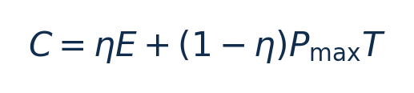
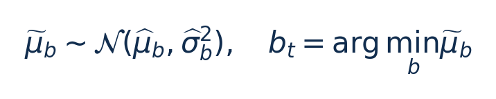
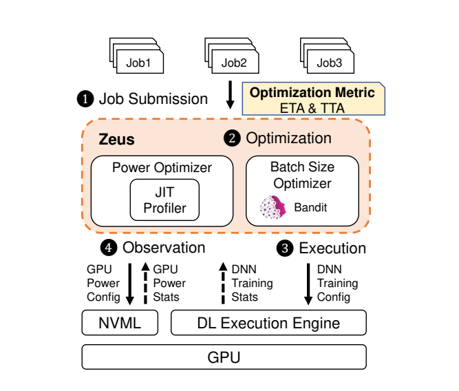
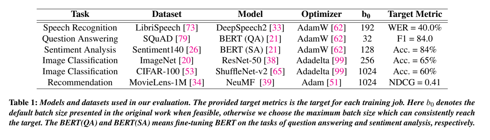
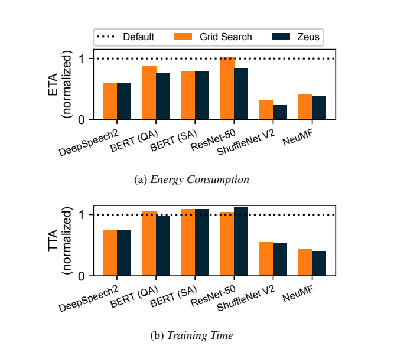

# Zeus：训练能量优化：图文技术精读

[论文页面](https://www.usenix.org/conference/nsdi23/presentation/you) · [本笔记所用 PDF](https://www.usenix.org/system/files/nsdi23-you.pdf) · [标识符](https://www.usenix.org/conference/nsdi23/presentation/you)

整理日期：2026-11-06。**读者原创中文解读；原图归论文作者／出版方。未运行作者实验，不是独立复现。**

**一句话：** 把反复训练任务的batch size视为老虎机动作，用在线功率剖析寻找功率上限，优化达到目标精度的总能量与总时间

阅读地图：先看问题与输入输出，再顺着架构图、公式和结果图阅读；最后检查统计边界与E902迁移。完整编号索引另见“图表索引”。下文“读者分析”是推断或建议，不是原文结果。

## 阶段0：材料与版本审计

| 材料 | 当前可用程度 | 影响 |
| --- | --- | --- |
| 摘要、正文、方法、原图注 | 已获取本地完整PDF、文本与逐页渲染 | 可核查结构、实验及关键数字；可见页面优先于异常文本层 |
| 分析版本 | USENIX正式PDF22页，含封面；PDF p2对应印刷p119。 | 引用页码以“PDF第几页”标识 |
| 代码／原始数据 | 原文给出 https://github.com/SymbioticLab/Zeus；本次未构建运行代码或核对全部历史实验commit。 | 公开链接不等于已构建或已拿到原始轨迹 |
| 附件、独立原始重复与勘误 | 当前未完成全渠道附件／勘误穷尽检索 | 不能断言没有附件、没有勘误或没有其他版本 |
| 本次工作范围 | 材料阅读、图表裁取、证据整理、教学公式 | 所有新实验均是建议，尚未执行 |

## 阶段1：身份卡与整体概述

| 项目 | 内容 |
| --- | --- |
| 英文题名 | Zeus: Understanding and Optimizing GPU Energy Consumption of DNN Training |
| 中文导读题名 | 把反复训练任务的batch size视为老虎机动作，用在线功率剖析寻找功率上限，优化达到目标精度的总能量与总时间 |
| 作者 | Jie You, Jae-Won Chung, Mosharaf Chowdhury |
| 发表／版本 | USENIX NSDI 2023，119–139；USENIX正式PDF22页，含封面；PDF p2对应印刷p119。 |
| 类型与领域 | 原始方法／工程系统研究；DVFS、GPU/CPU能效、CV/LLM应用运行时控制 |
| 单位、通讯、资助与利益关系 | 作者姓名以本版本首页为准；通讯方式、单位及资助可回查首页与末页声明。当前尚未完成资助/利益关系/勘误的跨版本穷尽审计。 |
| 核心对象与接口 | batch在训练任务再次提交时选择；power cap在迭代边界切换采样，每个帽约5秒；无统一20ms频率环 |
| 代码与数据 | 原文给出 https://github.com/SymbioticLab/Zeus；本次未构建运行代码或核对全部历史实验commit。 |
| 与本课题关系 | 若你选择GPU训练，这是完整应用方向；先小模型重复训练即可。CPU/E902可借鉴“重复作业＋低维离散动作＋探索预算”，动作换为合法OPP、保持任务输出一致；E902不直接照搬大模型batch和GPU功率帽。 |

**约200字中文概述（改写）：** 本文研究反复提交、需要达到目标质量的GPU DNN训练/微调的运行时能效。具体程序包括DeepSpeech2/LibriSpeech；BERT/SQuAD与Sentiment140；ResNet50/ImageNet；ShuffleNet-v2/CIFAR100；NeuMF/MovieLens1M。作者在默认V100 PCIe32GB；另A40、RTX6000、P100；PyTorch ZeusDataLoader＋NVML GPU遥测与功率帽。多数优化评估由真实训练/功率轨迹回放；漂移另有端到端训练上采用高斯Thompson Sampling多臂老虎机选batch size；两轮剪枝/代价早停；固定batch时JIT剖析选GPU功率上限；近期窗口适应漂移。输入为用户权重η、目标accuracy/F1/WER/NDCG、候选batch、每次达到目标的epochs/时间/能量、各功率帽吞吐与功率，输出为下次训练的batch size b；本次GPU功率上限p；超代价时中止并换batch。不是直接写任意电压。主要结果应与下方基线、性能约束和测量范围一起阅读，不能只摘最高百分比。将time/energy-to-accuracy、随机收敛与反复训练的探索成本统一起来；智能模块是低维概率老虎机，不是CNN控制器。

**三句话定位：** 问题是为什么局部利用率不能完整反映整个应用的性能与能耗？本篇的研究问题或可检验主张是：把反复训练任务的batch size视为老虎机动作，用在线功率剖析寻找功率上限，优化达到目标精度的总能量与总时间。验证链是可观测状态→控制规则或学习模型→执行器→任务正确性/服务质量与能耗对照。 方法主线为用户权重η、目标accuracy/F1/WER/NDCG、候选batch、每次达到目标的epochs/时间/能量、各功率帽吞吐与功率 → 高斯Thompson Sampling多臂老虎机选batch size；两轮剪枝/代价早停；固定batch时JIT剖析选GPU功率上限；近期窗口适应漂移 → 下次训练的batch size b；本次GPU功率上限p；超代价时中止并换batch。不是直接写任意电压 → 执行与反馈。 主要证据见下方结果表，结论须与测量和版本范围一起使用。

## 阶段2：问题、假设与创新位置

为什么局部利用率不能完整反映整个应用的性能与能耗？本篇的研究问题或可检验主张是：把反复训练任务的batch size视为老虎机动作，用在线功率剖析寻找功率上限，优化达到目标精度的总能量与总时间。验证链是可观测状态→控制规则或学习模型→执行器→任务正确性/服务质量与能耗对照。

**创新判断（读者分析）：** 将time/energy-to-accuracy、随机收敛与反复训练的探索成本统一起来；智能模块是低维概率老虎机，不是CNN控制器。 不依据作者自称“首次”断定整个领域绝无前例。

## 阶段3：必要术语与数学

| 级别 | 术语／关键词 | 直觉、严格含义与易混点 |
| --- | --- | --- |
| A | DVFS / DFS | DVFS同时涉及动态电压与频率；只有时钟变化称DFS。电压能否改变取决于实际供电域。 |
| A | Workload | 真正执行应用计算的程序与输入；本文里的控制器是另一个角色。 |
| A | Controller | 根据观测选择动作的软件／硬件，可运行在同一CPU或独立控制核。 |
| A | OPP | Operating Performance Point，经过允许范围验证的电压—频率组合。 |
| A | Power / Energy | 功率W表示此刻消耗快慢；能量J是对时间积分。低功率不必然低能量。 |
| B | Deadline | 作业必须完成的时刻；平均时延、P95与最大时延各有不同用途。 |
| A | 被控程序 | DeepSpeech2/LibriSpeech；BERT/SQuAD与Sentiment140；ResNet50/ImageNet；ShuffleNet-v2/CIFAR100；NeuMF/MovieLens1M |
| A | 控制策略 | 高斯Thompson Sampling多臂老虎机选batch size；两轮剪枝/代价早停；固定batch时JIT剖析选GPU功率上限；近期窗口适应漂移 |
| B | 控制周期 | batch在训练任务再次提交时选择；power cap在迭代边界切换采样，每个帽约5秒；无统一20ms频率环 |
| B | 证据边界 | 实测、硬件仿真、功耗模型是不同证据，见平台与结果表。 |

### 公式1：能量—时间代价

**符号与前提：** E为J，Pmax为W，T为s，η∈[0,1]；两项同为J。T是达到目标质量的时间。

**代入与检查：** 教学例：E=800J、T=10s、Pmax=100W、η=0.5，C=900J；不是800J节能率。

**来源：** Eq2–3，PDF p5
### 公式2：Thompson动作选择（教学整理）

**符号与前提：** b为batch动作，μ是总代价均值信念，σ是均值不确定性；方差不等于节能。

**代入与检查：** 某档均值较好但不确定性大，抽样仍会探索；不保证每次选择都最优。

**来源：** Algorithm1–3，p7–8

## 阶段4–6：架构、关键图与方法拆解

**输入—处理—输出：** 用户权重η、目标accuracy/F1/WER/NDCG、候选batch、每次达到目标的epochs/时间/能量、各功率帽吞吐与功率 → 高斯Thompson Sampling多臂老虎机选batch size；两轮剪枝/代价早停；固定batch时JIT剖析选GPU功率上限；近期窗口适应漂移 → 下次训练的batch size b；本次GPU功率上限p；超代价时中止并换batch。不是直接写任意电压 → 执行与反馈。

| 系统角色 | 具体设置 |
| --- | --- |
| 具体控制算法 | 高斯Thompson Sampling多臂老虎机选batch size；两轮剪枝/代价早停；固定batch时JIT剖析选GPU功率上限；近期窗口适应漂移 |
| 被控负载类型 | 反复提交、需要达到目标质量的GPU DNN训练/微调 |
| 具体被控程序 | DeepSpeech2/LibriSpeech；BERT/SQuAD与Sentiment140；ResNet50/ImageNet；ShuffleNet-v2/CIFAR100；NeuMF/MovieLens1M |
| 使用平台与测量 | 默认V100 PCIe32GB；另A40、RTX6000、P100；PyTorch ZeusDataLoader＋NVML GPU遥测与功率帽。多数优化评估由真实训练/功率轨迹回放；漂移另有端到端训练 |
| 输入/状态 | 用户权重η、目标accuracy/F1/WER/NDCG、候选batch、每次达到目标的epochs/时间/能量、各功率帽吞吐与功率 |
| 输出/动作 | 下次训练的batch size b；本次GPU功率上限p；超代价时中止并换batch。不是直接写任意电压 |
| 周期与运行位置 | batch在训练任务再次提交时选择；power cap在迭代边界切换采样，每个帽约5秒；无统一20ms频率环 |

§3–5，PDF p5–9：目标C=η·ETA+(1−η)·Pmax·TTA，η=0.5默认；ETA/TTA是达到固定目标质量的J与秒，不是每epoch能耗。利用同batch下达到目标的epoch数不随功率帽变化的假设，先选最优p，再用老虎机选b，降低二维探索成本。Gaussian TS从各batch平均代价的信念抽样、选最小值，再用实测/回放代价更新；首次两轮剪枝，每batch至少两次以估方差；累计代价超过β·历史最小代价时停止（默认β=2）。近期样本窗口处理非平稳数据。

§6.1明确多数实验并非连续几百次完整重训：每个model/batch收集4个训练随机种子轨迹，再结合功率/吞吐轨迹回放；数据漂移实验另端到端运行。power limit由NVML执行，硬件内部可能调频调压，但控制器动作叫功率上限。训练目标和学习率缩放必须共同固定，不能把改变收敛所需epochs的收益都算成硬件DVFS贡献。

### Fig3：Zeus工作流

[打开大图](images/original-fig3.png) · [原文 Fig3，PDF p5](https://www.usenix.org/system/files/nsdi23-you.pdf#page=5)

**怎样看：** 先读图题、图例、坐标/表头与单位，再在同一负载和同一基线内比较。bandit跨作业，profiler在作业内；输出不是同一时间尺度。

**直接观察／原文报告：** bandit跨作业，profiler在作业内；输出不是同一时间尺度。

**读者判断：** 只支持此图所列的模型、设备、输入与测量口径；bandit跨作业，profiler在作业内；输出不是同一时间尺度。 不能由单图推出E902或其他GPU的同幅收益。

### Table1：模型与目标质量

[打开大图](images/original-table1.png) · [原文 Table1，PDF p10](https://www.usenix.org/system/files/nsdi23-you.pdf#page=10)

**怎样看：** 先读图题、图例、坐标/表头与单位，再在同一负载和同一基线内比较。WER/F1/accuracy/NDCG不可混成同一准确率。

**直接观察／原文报告：** WER/F1/accuracy/NDCG不可混成同一准确率。

**读者判断：** 只支持此图所列的模型、设备、输入与测量口径；WER/F1/accuracy/NDCG不可混成同一准确率。 不能由单图推出E902或其他GPU的同幅收益。

| 阅读问题 | 先看材料 | 如何接到下一步 |
| --- | --- | --- |
| 为什么要改现有方案 | 问题背景与动机图 | 确定目标、约束和原有不足 |
| 系统观察什么、控制什么 | 输入输出表＋关键架构图 | 确认数据、模型和执行器真实角色 |
| 方法如何得到动作或估计 | 方法段、公式、算法／模型表 | 明确离线训练与在线流程 |
| 收益是否真实且公平 | 结果图表、统计与测量边界 | 核查基线／目标／分母／开销 |
| 能否用于自己的CPU | 局限、复现计划、三项实验 | 把论文假设变成待验证的工程条件 |

## 阶段7–8：实验、统计及证据链

本节数字均是**原文明确报告或原文数值的标注算例**；没有按图柱高度臆造额外精确值。

| 指标 | 原文报告 | 条件／分母／边界 | 证据位置 |
| --- | --- | --- | --- |
| 达到目标的GPU能量降低 | 15.3%–75.8% | 相对默认batch＋最大功率帽；Fig6取最后5次recurrences；主要是轨迹回放结果 | §6.1–6.2/Fig6，p10–11 |
| 训练时间代价 | 最多缩短60.1%，部分增加12.8% | 不同负载的能量—时间折中；不是所有负载同时提速 | §6.2，p11 |
| 探索代价 | Grid Search最坏累计regret为Zeus的72倍 | 相同recurrence任务设置；regret单位J，不是节能72倍 | Fig7–8，p11 |

### Fig6：收敛后能量与时间

[打开大图](images/original-fig6.png) · [原文 Fig6，PDF p11](https://www.usenix.org/system/files/nsdi23-you.pdf#page=11)

**怎样看：** 先读图题、图例、坐标/表头与单位，再在同一负载和同一基线内比较。上下图必须配对，同一Default归一化。

**直接观察／原文报告：** 上下图必须配对，同一Default归一化。

**读者判断：** 只支持此图所列的模型、设备、输入与测量口径；上下图必须配对，同一Default归一化。 不能由单图推出E902或其他GPU的同幅收益。

**统计与公平性审查（读者分析）：** 区分4个训练seed、同seed的功率扫描、最后5次任务均值与Alibaba trace回放。大量回放任务不是同等数量独立物理训练重复。不同batch可能改变收敛轨迹；公平比较要固定目标质量和学习率规则，并计入探索失败/早停成本。GPU NVML不含CPU、网络与制冷，结论不是整机碳排放。

工程实验中，设备、程序、输入文件、重复运行、时间窗口是不同统计层级，不能互相替代。本任务不涉及生物样本，细胞／动物／试剂等检查不适用。未注明的P值或置信区间不补造；“差了几个百分点”不自动等于统计显著。

| 主张层级 | 直接证据 | 对照与统计 | 可得结论／替代解释 | 可信度 |
| --- | --- | --- | --- | --- |
| 原文明确报告 | 达到目标的GPU能量降低：15.3%–75.8% | §6.1–6.2/Fig6，p10–11 | 相对默认batch＋最大功率帽；Fig6取最后5次recurrences；主要是轨迹回放结果；仅在该实验范围内成立 | 图表／文本可核对：高；独立复现：尚无 |
| 作者解释 | 所提架构／模型解释了性能或估计改善 | 关键原图与方法见上文；统计边界见下节 | 效果可能同时来自动作空间、平台特性与采样设置，因果归因需消融 | 中 |
| AI分析／迁移假设 | 用于允许的GPU/CV/LLM候选场景及CPU/E902迁移 | 本篇未直接验证该芯片与任务组合 | 需三项后续实验；不能复制论文收益数字 | 待验证，当前无法判断 |

## 阶段9–10：贡献与局限分开判断

将time/energy-to-accuracy、随机收敛与反复训练的探索成本统一起来；智能模块是低维概率老虎机，不是CNN控制器。

| 来源 | 严重程度 | 局限及其影响 |
| --- | --- | --- |
| 读者分析 | 关键 | batch最优假设依赖复用的任务分布；一次性训练未必摊销探索成本。 |
| 读者分析 | 关键 | 功率帽和batch同时变动，必须做仅功率帽、仅batch、联合三组消融。 |
| 读者分析 | 关键 | 不能把轨迹回放的统计规模当作同规模物理端到端重训，也不能把GPU能量当全系统能量。 |

## 阶段11：最小复现路线与缺口

本次未运行作者代码。最小复建顺序：①固定本文平台/模型/输入与质量目标，确认合法可用频档和权限；②逐档运行真实被控程序，验证输出、预热、计时同步与能量测量窗口，至少记录多次独立运行原始数据；③实现本文算法，冻结离线训练/搜索配置，留出新的输入、到达率和温度条件测试；④同动作空间、同质量/SLO比较固定最高档、默认governor、简单规则和本文方案；⑤把离线剖析与在线控制、采样、切频成本单列并计算摊销次数。失败时退回安全固定档，缺失参数列日志，不猜成已知。若你选择GPU训练，这是完整应用方向；先小模型重复训练即可。CPU/E902可借鉴“重复作业＋低维离散动作＋探索预算”，动作换为合法OPP、保持任务输出一致；E902不直接照搬大模型batch和GPU功率帽。

**代码／数据现状：** 原文给出 https://github.com/SymbioticLab/Zeus；本次未构建运行代码或核对全部历史实验commit。

**质量控制顺序：** 先验证程序输出和时间基准，再验证采样／模型，最后比较策略。保存输入文件哈希、平台配置、OPP、随机种子、温度与每次运行原始记录。失败时先回固定安全频点定位错误，再继续优化。复现可行性判断为“可开始部分方法复建，完整数值复现条件未齐”；这与“已完成复现”不同。

## 阶段12：应用选题与CPU／E902课题联系

若你选择GPU训练，这是完整应用方向；先小模型重复训练即可。CPU/E902可借鉴“重复作业＋低维离散动作＋探索预算”，动作换为合法OPP、保持任务输出一致；E902不直接照搬大模型batch和GPU功率帽。

| 建议实验／优先级 | 价值 | 最低资源 | 主要风险 | 成功判据（设计目标，非已得结果） |
| --- | --- | --- | --- | --- |
| P0：小模型达到目标质量的E–T表 | 先验证应用与执行器，建立同边界基线 | 可控制功率帽的NVIDIA GPU、PyTorch小CNN/CIFAR子集、固定seed与精度目标 | 频率命令不一定获准或真实生效 | 输出正确；保存实际频率、温度、时延与积分能量 |
| P1：功率帽与batch的2×2消融 | 验证状态/阶段感知是否优于固定档与阈值 | 可控制功率帽的NVIDIA GPU、PyTorch小CNN/CIFAR子集、固定seed与精度目标 | 新输入与离线标定分布不同 | 同期限/质量/动作空间下报告净收益及尾部时延 |
| P1：控制成本和迁移消融 | 分开采样、模型、切换与算法贡献 | 执行器时间戳；必要时外部电测或明确功耗模型 | 短任务收益被开销吞掉；E902可观测量不同 | 分别关闭各组件；报告失败输入；CPU迁移重新标定 |

上述优先级是读者建议：P0先做，P1建立在基线可运行后，P2只在资源允许且前序实验证明有必要时开展。本批允许CV/LLM/GPU应用；压缩、CV、SLM均未最终定题，也未证明已在E902运行。论文公开可读不自动授权任意复制数据；代码、图片和数据须分别核对许可。

## 阶段13：读完后应掌握与继续核查

**五个知识点：** 把反复训练任务的batch size视为老虎机动作，用在线功率剖析寻找功率上限，优化达到目标精度的总能量与总时间 你还应能解释输入输出表中的角色、两条公式的单位、首个结果指标的分母，以及局限表里的关键条件。

**五个未决问题：** 独立新输入是否成立？最差时延是否可接受？测量参考是否足够？控制与切换是否抵消收益？E902实际具有哪些接口和可观测量？这些是研究问题，不是对作者遗漏的无证据指控。

**立即做：** 按公式算例手算一次，选一张结果图复述“硬件—负载—基线—指标—边界”。**后续核查：** 补齐代码版本、训练数据和仪表设置。**可复用：** 上文明确标注的模型与接口思路。**谨慎采用：** 所有跨平台百分比。**暂不采用：** 尚未证实存在的电压控制和完整硬实时承诺。
